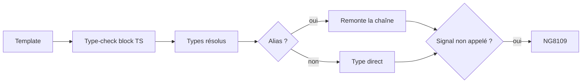
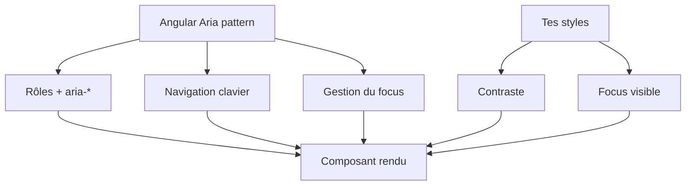

# Angular — Détail du samedi 6 septembre 2026

## 1. Angular 22.1.5 — le diagnostic étendu détecte les alias de signaux non invoqués

**Source :** Angular — https://github.com/angular/angular/releases/tag/v22.1.5
**Date :** 3 septembre 2026

### Contexte

Un signal Angular est une fonction à zéro argument. Écrire `{{ count }}` dans un template n'affiche pas la valeur : ça affiche la représentation textuelle de la fonction elle-même. Le résultat visible est souvent `function () { … }` ou une chaîne vide, jamais le nombre attendu. Ce piège est si fréquent qu'Angular en a fait un diagnostic étendu dédié, `NG8109` / `interpolatedSignalNotInvoked`, documenté sur https://angular.dev/extended-diagnostics/NG8109.

Le problème, c'est que ce diagnostic reposait sur une analyse volontairement étroite. Il reconnaissait un signal quand l'interpolation référençait **directement** un membre de la classe typé `Signal<T>`. Dès que la valeur transitait par un intermédiaire — une variable de template, un alias déclaré, une propriété qui réexpose un signal — le compilateur perdait la trace et se taisait. Le bug passait alors la compilation, la CI, la revue, et n'apparaissait qu'à l'écran. Le correctif livré le 3 septembre dans `22.1.5` et `22.2.0-next.5` s'intitule exactement `check uninvoked signal aliases in extended diagnostic`.

### Comment ça marche

Il faut comprendre où se place ce contrôle dans la chaîne de compilation. Angular ne lit pas ton template avec une regex. Il le traduit en un **type-check block** : un fichier TypeScript synthétique où chaque expression du template devient une expression TypeScript typée, avec les mêmes règles d'inférence que ton code. C'est ce fichier que `tsc` vérifie.

Les diagnostics étendus s'exécutent *après* cette traduction, sur l'arbre typé. Chaque règle reçoit le nœud d'expression et son type résolu. La règle `interpolatedSignalNotInvoked` cherchait un nœud dont le type est assignable à `Signal<unknown>` et qui n'est pas suivi d'un appel. La faiblesse tenait à la résolution du nœud : elle s'arrêtait au premier niveau. Un alias introduit un nœud supplémentaire entre la référence et la déclaration d'origine, et l'analyse ne le traversait pas.

Le correctif fait remonter la chaîne d'alias jusqu'à la déclaration réelle avant de tester le type. La conséquence pratique est directe : du code qui compilait hier peut échouer aujourd'hui, et c'est le comportement voulu.



Un rappel qui coûte cher quand on l'oublie : **aucun diagnostic étendu ne s'émet sans `strictTemplates`**. Si ton `tsconfig.json` ne l'active pas, la règle existe mais reste muette, alias ou pas.

### En pratique — exemple de code

```ts
// Avant 22.1.5 — le @let masque le signal, aucun diagnostic n'est émis
@Component({
  selector: 'app-cart',
  template: `
    @let total = cartTotal;        // alias vers le signal, pas vers sa valeur
    <p>Total : {{ total }}</p>     <!-- affiche la fonction, pas 42 -->
  `,
})
export class CartComponent {
  readonly cartTotal = signal(42);
}

// Après 22.1.5 — NG8109 remonte l'alias et signale l'oubli à la compilation
@Component({
  selector: 'app-cart',
  template: `
    @let total = cartTotal();      // on invoque le signal à l'aliasing
    <p>Total : {{ total }}</p>     <!-- affiche bien 42 -->
  `,
})
export class CartComponent {
  readonly cartTotal = signal(42);
}
```

```json
// tsconfig.json — sans strictTemplates, le diagnostic ne se déclenche jamais
{
  "angularCompilerOptions": {
    "strictTemplates": true,
    "extendedDiagnostics": {
      "checks": { "interpolatedSignalNotInvoked": "error" }
    }
  }
}
```

### Pourquoi ça compte pour toi

Tu vas monter en `22.1.5` et voir des builds rouges sur des templates stables. Ne suppose pas une régression du compilateur : chacune de ces erreurs correspond à une valeur qui ne s'affichait pas. Passe le check en `error` plutôt qu'en `warning`, et vérifie que `strictTemplates` est bien actif — sinon tu paies le coût de l'upgrade sans en toucher le bénéfice.

### Points de vigilance

Le patch est dans la ligne stable `22.1.x` comme dans la `next`. Si tu es figé sur `22.1.4`, tu n'as pas le contrôle. Traite l'upgrade comme un audit ponctuel : corrige les appels manquants avant de mélanger ce diff à une feature.

---

## 2. Angular Aria — restyler un pattern accessible sans perdre l'accessibilité

**Source :** Angular Blog — https://blog.angular.dev/customizing-angular-aria-tabs-quickly-with-google-antigravity-cli-39ff8e0271a4
**Date :** 2 septembre 2026

### Contexte

Angular Aria est présenté par l'équipe comme « un ensemble de patterns UI entièrement accessibles et personnalisables ». C'est une promesse ambitieuse, parce que les deux qualités s'opposent souvent : les bibliothèques accessibles imposent leur design system, et les bibliothèques customisables laissent l'accessibilité au développeur.

Le billet du 2 septembre teste la promesse sur un cas volontairement hostile. Il part de l'exemple d'onglets de la documentation et le repeint en **néomorphisme** — un style connu pour ses contrastes faibles, ombres douces et fonds quasi identiques au texte. Résultat mesuré : le score Lighthouse accessibilité passe de 100 à 95, avec un seul critère en échec, le ratio de contraste texte/fond. Toute la mécanique clavier et sémantique, elle, survit intacte.

### Comment ça marche

Angular Aria applique le modèle **headless**. Le pattern ne fournit pas de CSS. Il fournit le comportement : rôles ARIA (`tablist`, `tab`, `tabpanel`), attributs d'état (`aria-selected`, `aria-controls`), navigation clavier (flèches, `Home`, `End`), et gestion du focus — notamment le mode « selection follows focus », où déplacer le focus change l'onglet actif.

La bonne façon de se le représenter est de séparer deux couches. Le pattern possède la **structure** et le **contrat d'interaction** ; tu possèdes la **présentation**. Ce qui explique exactement le résultat de l'expérience : re-styler ne touche pas la couche que le pattern garantit, mais le contraste ne vit que dans ta couche. Aucune bibliothèque ne peut te le garantir, puisqu'elle ne connaît pas tes couleurs.



Deux points restent donc entièrement à ta charge : le **contraste** (4,5:1 pour du texte normal en WCAG AA) et la **visibilité du focus**. Le second est le plus insidieux : un `outline: none` posé pour « nettoyer » le design supprime le seul retour visuel de la navigation clavier que le pattern a soigneusement câblée.

### En pratique — exemple de code

```html
<!-- Le pattern porte la sémantique ; tes classes ne portent que le style -->
<div ngTabList class="tabs">
  <button ngTab value="movie" class="tab">Film</button>
  <button ngTab value="series" class="tab">Série</button>
</div>
<div ngTabPanel value="movie" class="panel">Panel 1</div>
```

```css
/* Néomorphisme naïf : joli, et sous le seuil WCAG AA */
.tab { background: #e0e5ec; color: #a3adb8; } /* ratio ≈ 1,9:1 → échec */

/* Corrigé : même style, texte assombri jusqu'au seuil */
.tab { background: #e0e5ec; color: #2b3138; } /* ratio ≈ 11:1 → AA + AAA */

/* Ne supprime jamais l'indicateur de focus : remplace-le */
.tab:focus-visible { outline: 3px solid #1a4fd6; outline-offset: 2px; }
```

### Pourquoi ça compte pour toi

Si tu construis un design system par-dessus Angular Aria, arrête de traiter l'accessibilité comme une étape de recette. Le pattern couvre la sémantique et le clavier ; le contraste et le focus visible restent dans ton CSS. Ajoute un check de contraste automatisé dans ta CI et fais échouer le build — un audit Lighthouse manuel après coup arrive toujours trop tard pour un design déjà validé.

### Limites

Le score Lighthouse ne prouve rien à lui seul : il n'audite que ce qu'il sait mesurer automatiquement. Un 100 ne garantit ni un ordre de tabulation cohérent, ni des libellés compréhensibles au lecteur d'écran.
