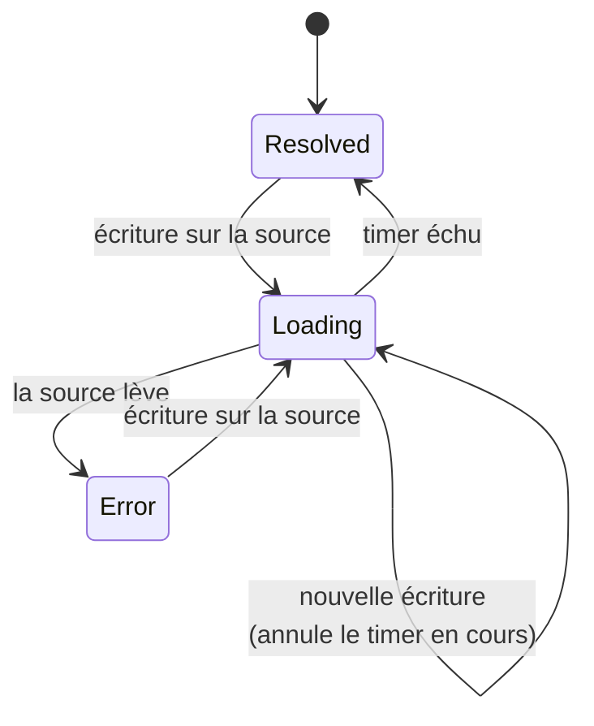
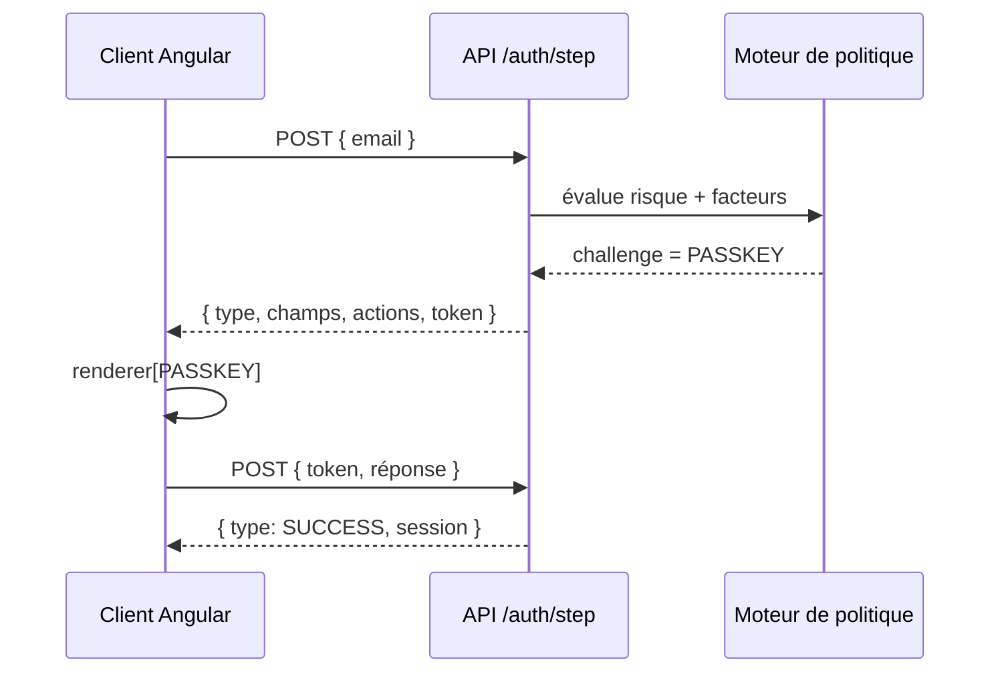

# Angular — Détail du lundi 7 septembre 2026

## 1. Angular 22.2.0-next.5 — `debounced()` et l'annulation des timers périmés

**Source :** Angular (GitHub Releases) — https://github.com/angular/angular/releases/tag/v22.2.0-next.5
**Date :** 3 septembre 2026

### Contexte

Angular 22 a introduit `debounced()`, une primitive de debounce native aux signaux. Jusque-là, temporiser une valeur réactive imposait un détour : soit RxJS (`debounceTime` + `switchMap` + `toSignal`), soit un `setTimeout` manuel enfermé dans un `effect`. Les deux fonctionnent, mais aucun ne reste dans le monde des signaux : tu sors de la réactivité, tu y rentres, et tu perds la composabilité en route.

Le correctif du 3 septembre, livré simultanément dans `22.2.0-next.5` et le patch `22.1.5`, ferme une fuite dans cette primitive : les timers de debounce périmés n'étaient pas annulés. Concrètement, chaque changement rapide de la source empilait un `setTimeout` qui survivait à la valeur qui l'avait déclenché. Sur un champ de recherche tapé vite, tu accumulais des timers orphelins jusqu'à ce que le dernier gagne — et sur un composant détruit avant l'échéance, le timer restait pendant.

### Comment ça marche

`debounced()` prend une fonction de lecture de signal et un délai, et renvoie non pas un signal mais une **`Resource`**. Ce choix est le cœur du design, et il mérite qu'on s'y arrête.

Un signal ne sait exprimer qu'une chose : sa valeur courante. Or un debounce a trois états distincts. La valeur est stabilisée. La valeur est en attente parce que la source vient de bouger. La source a levé une erreur. Un `Signal<string>` ne peut représenter que le premier cas ; il faudrait un second signal `isPending` maintenu à la main à côté, et les deux pourraient désynchroniser.

La `Resource` porte les trois nativement. Étape par étape, le mécanisme est le suivant :

1. Un `effect` interne lit la source. Toute écriture sur la source réveille cet effect.
2. À chaque réveil, l'implémentation **annule** le timer en cours — c'est précisément ce que le correctif garantit — puis en arme un nouveau à `wait` millisecondes.
3. Tant que le timer court, `status()` vaut `'loading'` et `isLoading()` vaut `true`. `value()` conserve la dernière valeur stabilisée.
4. Quand le timer arrive à échéance sans avoir été annulé, la valeur est publiée, `status()` repasse à `'resolved'`.
5. À la destruction du contexte d'injection, le timer en vol est nettoyé.



L'annulation est le point critique. Sans elle, la transition `Loading --> Loading` arme un timer supplémentaire au lieu de remplacer le précédent : chaque frappe crée un `setTimeout` qui vivra jusqu'au bout. Le résultat visible restait correct — la dernière écriture gagne — mais le coût était réel : handles de timers accumulés, callbacks exécutés pour rien, et fuite mémoire sur un composant détruit entre-temps.

### En pratique — exemple de code

```ts
// Avant — RxJS : trois opérateurs, un pont vers les signaux, un abonnement à gérer
readonly results = toSignal(
  this.searchControl.valueChanges.pipe(
    debounceTime(500),
    distinctUntilChanged(),
    switchMap(q => this.http.get<Result[]>(`/api/search?q=${q}`)),
  ),
  { initialValue: [] },
);

// Après — Angular 22 : debounced() renvoie une Resource, l'état d'attente est lisible
import { signal, debounced, resource } from '@angular/core';

readonly query = signal('');
readonly debouncedQuery = debounced(() => this.query(), 500);

readonly results = resource({
  // params ne se réévalue qu'après 500 ms de silence sur query()
  params: () => this.debouncedQuery.value(),
  loader: ({ params, abortSignal }) =>
    fetch(`/api/search?q=${params}`, { signal: abortSignal }).then(r => r.json()),
});
```

Dans le template, `debouncedQuery.isLoading()` te donne gratuitement l'indicateur « je suis en train d'attendre que tu arrêtes de taper », distinct de `results.isLoading()` qui signale la requête réseau. Deux spinners différents, deux sémantiques différentes — c'est ce que le retour `Resource` rend possible.

### Pourquoi ça compte pour toi

Si tu as des composants de recherche encore en RxJS, tu peux les migrer sans changer ton backend : `debounced()` supprime le pont observable/signal et rend l'état d'attente explicite. Mets à jour vers `22.1.5` au minimum — la fuite de timers touche toutes les versions 22 antérieures et se voit surtout sur les formulaires longs. Vérifie aussi tes `effect` maison qui font du `setTimeout` : le même bug s'y trouve probablement.

### Points de vigilance

`debounced()` temporise la **valeur**, pas la requête. Si ton API est lente, tu peux toujours avoir des réponses hors séquence : garde un `abortSignal` dans le loader de ta `resource`, comme dans l'exemple.

---

## 2. Airbnb — l'authentification pilotée par le serveur, et ses chiffres

**Source :** InfoQ — https://www.infoq.com/news/2026/09/airbnb-server-driven-login/
**Date :** 4 septembre 2026

### Contexte

Une page de connexion moderne n'est plus un formulaire. C'est un arbre de décision : selon le pays, l'appareil, l'historique de risque et la présence d'une passkey, il faut demander un mot de passe, un OTP SMS, un lien magique, une passkey, ou enchaîner deux facteurs. Quand cet arbre vit côté client, il est dupliqué sur chaque plateforme — web, iOS, Android — et chaque évolution de politique demande trois implémentations plus un cycle de review sur les stores mobiles.

Airbnb a retourné le problème avec un système baptisé **Flexible Authentication** : le serveur décide, le client rend. Les chiffres publiés cette semaine : **60 % de code lié à l'authentification supprimé**, **100 Ko retirés du bundle web**, **+2,6 % d'authentifications réussies**, **-27 % de comptes créés en double**, **-11 % de coûts OTP**.

### Comment ça marche

Le principe est celui du *server-driven UI*, restreint à un domaine où il est particulièrement rentable. Le client ne connaît plus les *flux*, seulement les *briques*.

Le serveur maintient un moteur de politique. À chaque étape, il évalue le contexte — identifiant fourni, signaux de risque, facteurs disponibles pour ce compte — et renvoie une description déclarative du prochain challenge : son type, ses champs, ses libellés, ses actions possibles. Le client possède un registre de renderers, un par type de challenge, et se contente de choisir le bon.



Trois conséquences suivent mécaniquement. D'abord, changer de politique — activer les passkeys sur un marché, durcir un seuil de risque — devient un déploiement serveur, sans release mobile. Ensuite, le bundle client maigrit : les 100 Ko économisés sont l'arbre de décision et les branches mortes qui l'accompagnaient. Enfin, la baisse de 27 % de comptes dupliqués s'explique par la centralisation : c'est le serveur, qui voit tous les identifiants, qui détecte qu'une adresse correspond à un compte existant — un client isolé ne pouvait pas.

Le prix à payer est un aller-retour réseau par étape. Airbnb l'assume : le gain de conversion (+2,6 %) dépasse le coût de latence, parce que le serveur choisit désormais *le bon* challenge du premier coup au lieu d'imposer un parcours générique.

### En pratique — exemple de code

```ts
// Le client ne connaît que des types de challenge, jamais l'enchaînement.
type Challenge =
  | { type: 'PASSWORD'; token: string; fields: Field[] }
  | { type: 'OTP'; token: string; destination: string }
  | { type: 'PASSKEY'; token: string; options: PublicKeyCredentialRequestOptions }
  | { type: 'SUCCESS'; session: string };

@Injectable({ providedIn: 'root' })
export class AuthFlowService {
  private readonly http = inject(HttpClient);
  readonly step = signal<Challenge | null>(null);

  // Une seule méthode : on POST une réponse, le serveur renvoie l'étape suivante.
  async submit(payload: unknown): Promise<void> {
    const token = this.step()?.type !== 'SUCCESS' ? this.step()?.token : undefined;
    const next = await firstValueFrom(
      this.http.post<Challenge>('/auth/step', { token, payload }),
    );
    this.step.set(next); // le template switche sur next.type via @switch
  }
}
```

Le template devient un `@switch` sur `step().type`, avec un composant par branche. Ajouter un facteur revient à ajouter un cas — aucun code d'orchestration à toucher.

### Pourquoi ça compte pour toi

Sur une stack Angular + .NET, tu as déjà la moitié du dispositif : ASP.NET Core Identity sait décrire les facteurs disponibles pour un utilisateur. Ce qui manque en général, c'est de renvoyer cette décision au client au lieu de la recoder en TypeScript. Le pattern se teste sans big bang : commence par la réinitialisation de mot de passe, le flux le plus tordu et le moins critique. Tu mesureras vite si le tour réseau supplémentaire passe.

### Limites

Le server-driven UI déplace le couplage plutôt qu'il ne le supprime : ton client doit connaître tous les types de challenge que le serveur peut émettre. Versionne ce contrat, et prévois un rendu de repli pour un type inconnu — sinon un déploiement serveur casse les vieux clients mobiles.
