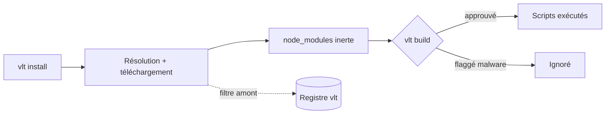

# Angular — Détail du mardi 8 septembre 2026

## 1. vlt 1.0 — `install` et `build` séparés, et un graphe de dépendances interrogeable

**Source :** InfoQ — https://www.infoq.com/news/2026/09/vlt-npm-replacement/
**Date :** 7 septembre 2026

### Contexte

Depuis un an, la chaîne d'approvisionnement JavaScript encaisse attaque sur attaque. Le ver Shai-Hulud, revenu en août, republiait des paquets compromis en réutilisant les jetons de publication trouvés sur les machines infectées. Le vecteur est presque toujours le même : les scripts de cycle de vie. Quand tu tapes `npm install`, npm télécharge, décompresse, puis exécute `preinstall`, `install` et `postinstall` de chaque paquet — dans le même souffle, avec tes droits et tes variables d'environnement.

L'écosystème a réagi en ordre dispersé. npm v12 désactive les scripts d'installation par défaut. pnpm met en quarantaine les versions trop fraîches via un âge minimum de publication. Bun bloque aussi les `postinstall`. vlt, publié en 1.0 le 7 septembre par Darcy Clarke et l'équipe qui a créé npm à l'origine, prend le problème par un autre bout : il découpe l'installation en deux commandes distinctes et déplace une partie du filtrage vers le registre lui-même.

### Comment ça marche

Le modèle tient en trois briques qui s'empilent.

**Première brique : la séparation install/build.** `vlt install` résout le graphe, télécharge les tarballs et les décompresse dans `node_modules`. Point. Aucun script n'est lancé. `vlt build` est une deuxième passe explicite qui exécute les scripts, mais uniquement pour les paquets que tu as approuvés, et en sautant par défaut tout ce que le registre a marqué comme malveillant. La conséquence pratique : entre les deux commandes, tu as une fenêtre où le code est sur disque mais inerte. Tu peux l'auditer, le diffuser en CI, ou refuser de builder.

**Deuxième brique : `vlt query`.** vlt matérialise le graphe de dépendances comme un arbre de type DOM et te laisse le sélectionner avec une syntaxe façon CSS. Plus de 60 sélecteurs existent ; environ la moitié sont orientés sécurité et s'appuient sur une intégration Socket qui annote chaque nœud (scripts d'installation, code obfusqué, télémétrie réseau, mainteneur récent). Un sélecteur `:host(local)` élargit la requête à tous les projets présents sur la machine — utile pour répondre à « est-ce que cette version compromise traîne quelque part chez moi ? ».

**Troisième brique : le registre.** vlt héberge son propre registre et des miroirs d'écosystème qui refusent de servir les paquets connus comme malveillants. L'équipe revendique plus de 275 000 versions signalées, dont un quart resterait installable depuis npm d'après les relecteurs. C'est un déplacement du point de contrôle : au lieu de compter sur le client de chaque développeur, le filtre est en amont, partagé.



### En pratique — exemple de code

Voici la bascule sur un projet Angular existant, puis deux requêtes d'audit.

```bash
# Avant — npm : une seule commande, les scripts partent avec
npm ci

# Après — vlt : téléchargement d'abord, exécution ensuite et seulement si tu valides
npm install -g vlt
vlt install                 # rien ne s'exécute, node_modules est inerte
vlt build                   # lance les scripts approuvés, saute les paquets flaggés

# Auditer : tous les paquets qui déclarent un script d'installation
vlt query ':script(install), :script(postinstall)'

# Sécurité : les dépendances signalées, rendues en diagramme
vlt query ':malware, :obfuscated' --view=mermaid

# Machine entière : cette version compromise traîne-t-elle ailleurs ?
vlt query ':host(local) #chalk@5.6.1'
```

La migration reste courte : la configuration passe de `.npmrc` à `vlt.json`, le lockfile devient `vlt-lock.json`, et l'API de registre étant compatible npm, tes pipelines CI, registres privés et outils existants continuent de fonctionner sans réécriture.

### Pourquoi ça compte pour toi

Sur un monorepo Angular, `npm ci` en CI exécute des dizaines de scripts tiers à chaque build, souvent dans un runner qui porte tes secrets de déploiement. Séparer `install` de `build` te donne un point d'arrêt auditable exactement là où tu n'en avais aucun. Et `vlt query` répond en une commande à la question que tu poses aujourd'hui à coups de `grep` dans `package-lock.json`. Teste-le sur une branche avant de toucher à ta CI.

### Points de vigilance

Sur la vitesse brute d'installation, pnpm et Bun restent devant : vlt annonce son registre jusqu'à 38 % plus rapide que npm, pas un record absolu. Le registre hébergé introduit aussi une dépendance de plus dans ta chaîne — évalue-la comme tel. Enfin, `vlt build` n'a de valeur que si quelqu'un regarde vraiment entre les deux étapes ; approuver tout par réflexe te ramène au comportement de npm.
