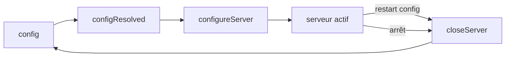

# Angular — Détail du samedi 12 septembre 2026

## 1. Vite 8.3.0 — `closeServer`, option `tsconfig` top-level et la sortie d'esbuild

**Source :** GitHub — https://github.com/vitejs/vite/releases/tag/v8.3.0
**Date :** 10 septembre 2026

### Contexte

Vite a longtemps eu deux moteurs sous le capot. En développement, un serveur ESM natif qui transforme les modules à la demande. En production, un bundler — Rollup pour le graphe de modules, **esbuild** pour la transformation TypeScript et la minification. Cette double dépendance était le prix d'un compromis : esbuild est écrit en Go et très rapide, mais son analyse reste syntaxique.

Depuis le rachat de la chaîne d'outils par VoidZero, la trajectoire est claire. Rollup est remplacé par **Rolldown**, écrit en Rust, et esbuild par **oxc**, la boîte à outils JavaScript du même projet. La 8.3.0 franchit une étape symbolique : le commit `f40efef` (PR #23381) **supprime l'`esbuildPlugin`** du dépôt, parce que plus aucun chemin de code ne l'appelle.

Le reste du mineur est plus prosaïque, mais il touche directement ceux qui écrivent des plugins. Deux hooks manquaient depuis toujours : un plugin pouvait démarrer un watcher, un worker ou un process enfant, sans point d'accroche propre pour le fermer.

### Comment ça marche

Le cycle de vie d'un plugin Vite est une suite de hooks appelés dans un ordre garanti. Jusqu'ici, côté serveur, tu disposais de `configureServer` et `configurePreviewServer` pour la montée en charge, mais de rien à la descente. Le seul recours était d'écouter `httpServer.on('close')` à la main, ou de brancher un `process.on('SIGTERM')` — approche fragile, puisqu'un restart de config ne tue pas le process.

Les hooks `closeServer` et `closePreviewServer` (PR #23110) comblent ce trou. Ils sont appelés quand l'instance de serveur est détruite, y compris lors d'un **redémarrage à chaud** provoqué par un changement de `vite.config.ts`. C'est exactement le moment où tu veux fermer une connexion à une base, arrêter un mock server ou vider un cache mémoire.



Le second changement structurant est l'option **top-level `tsconfig`** (PR #23310). Avant, si ton projet avait plusieurs `tsconfig` — un pour l'app, un pour les tests, un pour le SSR — tu devais soit renommer des fichiers, soit passer par un plugin comme `vite-tsconfig-paths` pour rediriger la résolution. L'option devient une clé de configuration de premier niveau.

Deux correctifs méritent ton attention. Le premier (PR #23437, issue #17467) change la façon dont Vite décide si un module est une dépendance : seuls les **segments de chemin `node_modules` entiers** comptent désormais. Si ton monorepo contient un dossier nommé `my_node_modules_helper`, son classement change — et avec lui l'optimisation de dépendances. Le second (PR #23219) corrige les positions de code frame en présence de fins de ligne **CRLF**, ce qui concerne tous les projets Windows où les messages d'erreur pointaient à côté.

### En pratique — exemple de code

```ts
// vite.config.ts — Vite 8.3.0
import { defineConfig, type Plugin } from 'vite'

function mockApiPlugin(): Plugin {
  let server: { close(): Promise<void> } | undefined

  return {
    name: 'mock-api',
    // Avant : on démarrait ici, sans jamais fermer proprement.
    async configureServer() {
      server = await startMockApi({ port: 4010 })
    },
    // Après (8.3.0) : appelé aussi au restart de config, pas seulement à l'arrêt.
    async closeServer() {
      await server?.close()
      server = undefined
    },
  }
}

export default defineConfig({
  // Nouveau en 8.3.0 : plus besoin de plugin pour cibler un tsconfig alternatif.
  tsconfig: './tsconfig.app.json',
  plugins: [mockApiPlugin()],
  server: {
    // server.watch accepte désormais les options de watch Rolldown.
    watch: { followSymlinks: false },
  },
})
```

### Pourquoi ça compte pour toi

Le dev-server du CLI Angular est bâti sur Vite. Tu subis donc cette 8.3 indirectement, sans changer de ligne. Si tu maintiens un plugin Vite maison dans ton monorepo, remplace tes `httpServer.on('close')` par `closeServer` : c'est le seul hook appelé au restart de config. Et vérifie tes chemins : le fix `node_modules` peut reclasser un module que tu croyais externe.

### Points de vigilance

Les notes du tag `v8.3.0` ne listent que le delta depuis `v8.3.0-beta.1`. Le contenu réel du mineur est cumulé depuis `v8.3.0-beta.0` (2 septembre). Si tu lis uniquement la page du tag stable, tu rates l'essentiel — dont les deux hooks et l'option `tsconfig`.

---

## 2. Angular CLI 22.1.8 et 22.2.0-next.7 — `splitting` déprécié, cache SQLite durci

**Source :** GitHub — https://github.com/angular/angular-cli/releases/tag/v22.2.0-next.7
**Date :** 10 septembre 2026

### Contexte

Le dépôt `angular/angular-cli` est distinct de `angular/angular` et numérote ses patches indépendamment. C'est une source de confusion récurrente : le framework s'est arrêté au 9 septembre, mais le CLI a publié **quatre releases le 10** — 22.1.8 (stable), 22.2.0-next.7, plus les backports 21.2.24 et 20.3.37.

Le fil rouge de cette salve n'est pas une feature, c'est le **cache disque**. Depuis que `@angular/build` persiste ses résultats intermédiaires dans un magasin SQLite, ce magasin est devenu un point chaud : il est lu à chaque rebuild incrémental, écrit en concurrence par plusieurs workers, et partagé entre les runs de CI. Trois symptômes remontaient du terrain — corruptions après un `kill -9`, répertoire parent absent dans les conteneurs, et contention sur les read-locks.

En parallèle, une option introduite huit jours plus tôt est déjà dépréciée. C'est inhabituel, et ça mérite d'être compris.

### Comment ça marche

L'option `splitting` du builder `unit-test` existait pour contourner un bug précis. Vitest exécute tes tests dans un environnement DOM simulé par **JSDOM**. Quand le bundler découpait le code en plusieurs chunks, les exports d'un module partagé pouvaient être **encore non initialisés** au moment où un initialiseur de champ de classe les lisait. Concrètement : une classe de test qui faisait `private svc = inject(MonService)` dans un champ, avec `MonService` venant d'un chunk partagé, recevait `undefined`.

Le contournement consistait à désactiver le code splitting : un seul chunk, donc plus de problème d'ordre d'initialisation — au prix du temps de build. **Vitest 5 a corrigé la cause racine en amont**, donc le contournement devient du bruit dans ta configuration. L'équipe le déprécie plutôt que de le supprimer, pour laisser une fenêtre de migration.

Le lot de perf, lui, attaque la latence du watch sur trois fronts. Le commit `d11a663e77` **vérifie les métadonnées de cache avant de lire le fichier**, ce qui élimine les read-locks SQLite : on ne prend plus un verrou pour découvrir qu'on n'avait rien à lire. Le commit `482f6d8aab` **découple le type-checking diagnostique du démarrage du build** — tu obtiens un bundle servi plus tôt, les diagnostics arrivent ensuite. Et `0ba4d8e29c` réduit la latence de debounce du watcher.

Un changement passe facilement inaperçu : `d396324b4e` fait passer **`preloadInitial` à `false` par défaut quand le service worker est activé**. Le HTML généré change, parce que précharger les chunks initiaux entre en conflit avec la stratégie de cache du service worker.

### En pratique — exemple de code

```jsonc
// angular.json — builder unit-test
{
  "targets": {
    "test": {
      "builder": "@angular/build:unit-test",
      "options": {
        "runner": "vitest",
        // Avant : contournement du bug JSDOM sur les champs de classe.
        // "splitting": false,

        // Après (22.2.0-next.7 + Vitest 5) : à retirer, l'option est dépréciée.
        "tsConfig": "tsconfig.spec.json"
      }
    }
  }
}
```

```bash
# Vérifier la version réellement installée — le CLI et le framework divergent.
npx ng version

# En cas de cache SQLite suspect (avant 22.1.8, la corruption n'était pas récupérée).
rm -rf .angular/cache && npx ng build --configuration development
```

### Pourquoi ça compte pour toi

Si tu as ajouté `splitting: false` début septembre, retire-le dès que tu es sur Vitest 5 — sinon tu paies un build mono-chunk pour rien. Passe sur 22.1.8 si ta CI a déjà connu un cache `.angular` corrompu : la récupération est désormais automatique. Et si tu sers un service worker, relis ton HTML généré : le défaut de `preloadInitial` a changé.

### Limites

Ces releases ne contiennent aucune nouveauté de framework. Les vraies features — `ErrorBoundary` programmatique, blocs `@boundary` dans le language service, ressources du router exposées en API publique — datent du 9 septembre et sortent de la fenêtre de 48 h couverte ici.
