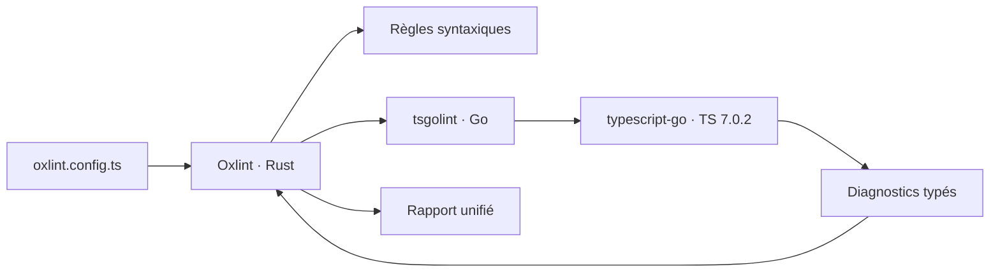

# Angular — Détail du dimanche 13 septembre 2026

## 1. tsgolint v7 stable — le lint type-aware branché sur typescript-go

**Source :** InfoQ — https://www.infoq.com/news/2026/09/tsgolint-oxlint-typescript/
**Date :** 11 septembre 2026

### Contexte

Un linter JavaScript traite deux familles de règles très différentes. La première ne regarde que la syntaxe : un AST suffit pour détecter une variable inutilisée ou un `==` suspect. La seconde a besoin de savoir ce qu'une expression *est* : une `Promise` est-elle attendue quelque part, ce `any` vient-il d'une lib mal typée, ce `switch` couvre-t-il bien tous les cas de l'union. Cette seconde famille, dite **type-aware**, exige un vrai modèle des types du programme. C'est le tier le plus utile et, de loin, le plus cher.

Historiquement, seul `typescript-eslint` savait le faire, en instanciant le compilateur TypeScript — écrit en TypeScript — depuis Node.js. Sur un gros monorepo, la note se compte en minutes. Depuis deux ans, l'écosystème réécrit sa chaîne d'outils en langages natifs : Rust chez VoidZero (le projet **oxc**, dont Oxlint fait partie), Go chez Microsoft avec **typescript-go**, le portage officiel du compilateur qui devient TypeScript 7. `tsgolint` est la pièce qui relie les deux mondes. Elle vient de passer stable en **v7**.

### Comment ça marche

Le point clé, c'est le refus de réimplémenter un type checker. Biome, le concurrent direct, synthétise ses propres types sans le compilateur ; une analyse chiffre sa règle `noFloatingPromises` à environ **75 %** des cas attrapés par typescript-eslint. tsgolint fait l'inverse : il embarque `typescript-go` et construit de vrais programmes TypeScript. Il hérite donc mécaniquement de chaque optimisation future de l'équipe TypeScript, et garde une surface de règles identique à typescript-eslint.

Le pipeline se décompose en trois étages. Oxlint, en Rust, lit la configuration, découvre les fichiers, applique les règles syntaxiques — la partie bon marché. Il transmet ensuite le travail type-aware au binaire Go. Celui-ci monte le programme TypeScript, résout les types, exécute les 59 règles supportées sur 61, puis renvoie des diagnostics structurés qu'Oxlint fusionne avec les siens.



Le versionnage traduit cette dépendance : le saut direct du `0.x` expérimental au **v7** est délibéré, parce que tsgolint est désormais versionné contre le compilateur qu'il embarque. `v7.0.2000` correspond à **TypeScript 7.0.2**. Les benchmarks de l'équipe, sur `microsoft/vscode`, `microsoft/typescript`, `typeorm` et `vuejs/core`, mesurés sur un Apple M4 Pro, donnent **12 à 18×** le débit d'ESLint avec typescript-eslint.

Deux drapeaux méritent d'être retenus. `--type-check` remonte les erreurs du compilateur à côté des diagnostics de lint, depuis le *même* programme TypeScript — un seul parcours de types pour les deux besoins. Et `--debug` expose des timings par règle, ce qui permet d'identifier la règle qui plombe un run avant de la désactiver à l'aveugle.

### En pratique — exemple de code

```bash
# Avant — ESLint + typescript-eslint : un process Node monte le compilateur TS
npx eslint "src/**/*.ts" --max-warnings 0

# Après — Oxlint orchestre, tsgolint fait l'analyse de types en Go
pnpm add -D oxlint oxlint-tsgolint@7
pnpm oxlint --type-aware                       # lint type-aware seul
pnpm oxlint --type-aware --type-check          # + erreurs du compilateur, même programme
pnpm oxlint --type-aware --debug               # timings par règle

# Traduire une config ESLint existante plutôt que la réécrire
npx @oxlint/migrate --type-aware
```

```json
// .oxlintrc.json — épingler la config plutôt que d'empiler les flags en CI
{
  "plugins": ["typescript"],
  "typeAware": true,
  "rules": {
    "typescript/no-floating-promises": "error",
    "typescript/await-thenable": "error"
  }
}
```

### Pourquoi ça compte pour toi

Le lint type-aware est le seul qui attrape les `Promise` oubliées — la classe de bug qui te coûte le plus cher côté front. Si ta CI passe des minutes sur ESLint, le gain est réel. Mais vérifie d'abord la contrainte bloquante : **TypeScript 7.0 minimum**. Tant que ton projet Angular reste sur une version antérieure, la migration attend. Commence par mesurer avec `--debug`, pas par basculer la CI.

### Points de vigilance

- `baseUrl` et certaines options tsconfig héritées ne sont **pas supportées**. Un projet qui utilise encore des fonctionnalités retirées en TypeScript 6 doit migrer avant.
- La correctness est encore en rodage : un rapport documente un **autofix qui supprimait une assertion de type** que `tsc` exigeait. N'active pas `--fix` en CI sans relire les diffs.
- L'équipe typescript-eslint qualifie son propre fork de tsgolint d'expérience « pas en développement actif ». Le pari ici est celui d'oxc, pas celui de l'amont historique.
