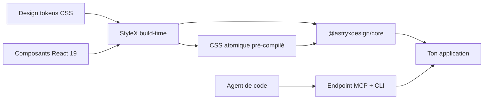

# Angular — Détail du lundi 14 septembre 2026

## 1. Astryx (Meta) — le design system React 19 conçu pour être piloté par des agents

**Source :** InfoQ — https://www.infoq.com/news/2026/09/meta-astryx-design-system/
**Date :** 13 septembre 2026

### Contexte

Un design system d'entreprise vieillit toujours de la même façon. On publie une bibliothèque de composants React, chaque équipe la surcharge à sa sauce, et au bout de trois ans plus personne ne sait quelle règle CSS gagne. Meta a vécu ce cycle en interne pendant huit ans sur un système qui alimente aujourd'hui plus de 13 000 applications. Le 13 septembre, l'entreprise en publie la bêta open source sous le nom **Astryx**, en licence MIT, avec React 19 comme plancher.

La nouveauté ne tient pas au catalogue — plus de 150 composants accessibles, des thèmes, un mode sombre, des templates. Elle tient à l'hypothèse de départ : une part croissante du code qui consomme le design system n'est plus écrite par un humain. Astryx a donc été structuré pour être lisible et opérable par un agent, plutôt que rétrofitté après coup. Concrètement, cela se traduit par une CLI dédiée et un endpoint MCP livrés dans le même paquet que les composants.

### Comment ça marche

Le principe structurant est la **séparation entre comportement et apparence**. Un composant Astryx embarque sa logique d'interaction et sa conformité d'accessibilité ; il ne décide de rien sur le plan visuel. L'apparence est entièrement déportée dans une couche centralisée de design tokens — palettes de couleurs, hiérarchie typographique, rayons de bordure. Changer de marque revient à changer les tokens, pas les composants.

Sous le capot, les styles sont écrits avec **StyleX**, le compilateur CSS-in-JS de Meta. Il travaille au build, pas au runtime. Chaque déclaration devient une classe atomique déterministe : une propriété, une valeur, une classe, réutilisée partout. Deux conséquences pratiques. D'abord, aucune collision possible, puisque la classe est dérivée de la déclaration elle-même. Ensuite, la feuille de style plafonne au lieu de croître linéairement avec le nombre de composants.

Le point malin de la distribution : `@astryxdesign/core` publie le **CSS déjà compilé** à côté des composants React typés. Tu n'as donc aucun plugin de build à installer pour consommer Astryx. StyleX est une dépendance de l'auteur, pas de l'utilisateur.

Restent deux portes de sortie pour la personnalisation. La prop `xstyle` accepte des styles StyleX typés, vérifiés à la compilation. Et les composants conservent le support natif de `className`, ce qui laisse cohabiter Tailwind, CSS Modules ou une feuille classique. Quand ni les tokens ni la composition ne suffisent — état privé inaccessible, structure DOM à réécrire — la CLI expose `swizzle`, qui éjecte le code source complet du composant dans ton dépôt. Tu gagnes le contrôle total et tu hérites de la dette de maintenance.



### En pratique — exemple de code

Les deux chemins de personnalisation, côte à côte. Le premier est typé et vérifié au build ; le second ne demande aucune configuration de compilateur.

```jsx
// Chemin 1 — StyleX : styles typés, résolus à la compilation
import * as stylex from '@stylexjs/stylex';

const overrides = stylex.create({
  card: { maxWidth: 400, marginBlock: 16 },
  saveButton: { alignSelf: 'flex-end' },
});

<Card xstyle={overrides.card} />
<Button label="Save" xstyle={overrides.saveButton} />

// Chemin 2 — className natif : interop Tailwind / CSS Modules,
// aucun plugin de build requis, le CSS d'Astryx est déjà compilé
<Card className="shadow-lg hover:shadow-xl transition-shadow">
  ...
</Card>
<Button label="Save" className="my-app-save-btn" />
```

### Pourquoi ça compte pour toi

Astryx est React : tu ne l'intégreras pas dans ton front Angular. Ce que tu peux copier, c'est le modèle. Sépare comportement et apparence, centralise les tokens, et surtout expose ta bibliothèque interne aux agents via MCP plutôt que via un Storybook qu'ils ne liront jamais. C'est ce qui fait la différence entre un assistant qui invente des classes et un assistant qui réutilise tes composants.

### Points de vigilance

La bêta est jeune et la gouvernance d'un projet sponsorisé par un éditeur reste une question ouverte — plusieurs développeurs l'ont soulevée dès l'annonce. Les portages communautaires vers Svelte 5 et Flutter reprennent l'architecture de tokens et les spécifications de composants, pas le code : ils vivront ou mourront indépendamment. Enfin, `swizzle` est irréversible en pratique : chaque composant éjecté sort du périmètre des mises à jour amont.
