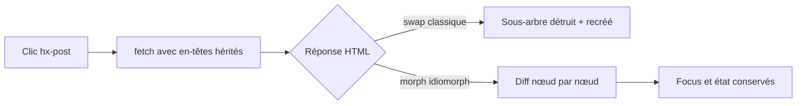
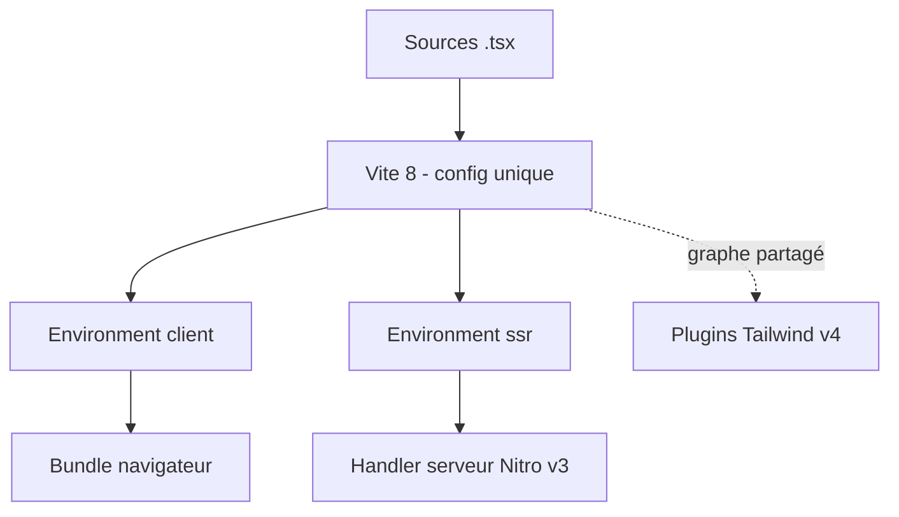

# Angular — Détail du samedi 19 septembre 2026

## 1. htmx 4.0 — transport `fetch()`, morphing swaps et héritage d'attributs explicite

**Source :** InfoQ — https://www.infoq.com/news/2026/09/htmx-4-released/
**Date :** 18 septembre 2026

### Contexte

htmx est la bibliothèque phare du mouvement hypermedia : tu ajoutes de l'AJAX, des transitions CSS, des WebSockets et du SSE directement dans tes balises HTML, via des attributs. Pas de bundler, pas de state management côté client, pas de JSON. C'est le compagnon naturel d'un backend qui rend déjà du HTML — Symfony avec Twig, ASP.NET Core avec Razor, Django, Rails.

La version 2.0 datait de 2024. Carson Gross avait publiquement promis qu'il n'y aurait jamais de htmx 3. Il y a eu un htmx 4, après huit mois de travail, en sautant la 3 entièrement. Son commentaire à InfoWorld tient en un mot : « Oops ». Le déclencheur technique est le transport : htmx reposait encore sur `XMLHttpRequest`, une API qui ne sait pas streamer proprement une réponse.

### Comment ça marche

Le cœur de la version 4 est le passage à `fetch()`. Ce n'est pas cosmétique : `fetch()` expose un `ReadableStream` sur le corps de la réponse, ce qui permet à htmx de traiter le HTML au fil de l'eau au lieu d'attendre la fin du transfert. Le script reste pourtant autour de 14 Ko. Pour tes attributs `hx-get` et `hx-post`, rien ne change en apparence.

Ce transport débloque deux fonctionnalités. La première est le **morphing swap** natif, alimenté par `idiomorph`. Jusqu'ici, un swap htmx remplaçait le sous-arbre DOM cible : le navigateur détruisait les nœuds existants et en recréait de neufs. Conséquence classique, le focus d'un input disparaissait en plein remplissage de formulaire, le scroll interne d'une liste sautait, une vidéo en cours redémarrait. Le morphing compare l'ancien et le nouvel arbre et n'applique que les différences, nœud par nœud. L'état vivant du DOM survit.

La seconde est **`hx-partial`**. Avant, mettre à jour plusieurs zones depuis une seule réponse imposait les out-of-band swaps : tu collais des `hx-swap-oob` sur des fragments baladeurs dans la réponse. C'était fonctionnel mais illisible. `hx-partial` te donne une balise dédiée qui déclare explicitement ses cibles.

Le changement qui va te mordre est ailleurs. **L'héritage d'attributs devient explicite.** En htmx 2, un attribut posé sur un parent descendait automatiquement à tous ses enfants. En htmx 4, il faut le marquer avec le suffixe `:inherited`. Le piège est décrit dans le write-up DEV Community relayé par InfoQ : si tu passes un token CSRF à tes enfants via `hx-headers` sur un conteneur, il cesse de descendre. Rien ne casse visuellement côté client. Le serveur, lui, commence à répondre 403 sur toutes les requêtes mutantes.

Les noms d'événements sont aussi normalisés sur un motif `htmx:phase:action` : `htmx:afterRequest` devient `htmx:after:request`. Et l'historique n'écrit plus de snapshot DOM dans `localStorage` — il refait une requête, ce qui règle les incompatibilités avec les scripts tiers.



### En pratique — exemple de code

L'héritage est le point de migration numéro un. Regarde ce que devient une confirmation partagée et un en-tête CSRF.

```html
<!-- Avant — htmx 2 : les attributs du parent descendent implicitement -->
<div hx-confirm="Es-tu sûr ?"
     hx-headers='{"X-CSRF-Token": "abc123"}'>
  <button hx-delete="/item/1">Supprimer</button>
</div>

<!-- Après — htmx 4 : sans :inherited, le bouton n'hérite de rien.
     Le hx-confirm ne s'affiche plus ET le token CSRF n'est plus envoyé
     -> le serveur répond 403 sans que le front signale quoi que ce soit. -->
<div hx-confirm:inherited="Es-tu sûr ?"
     hx-headers:inherited='{"X-CSRF-Token": "abc123"}'>
  <button hx-delete="/item/1">Supprimer</button>
</div>
```

L'équipe fournit un vérificateur en ligne de commande qui signale les héritages perdus, les attributs renommés et les anciens événements. Lance-le sur tes templates avant toute autre chose.

```bash
# Scanne tes templates serveur : héritages implicites, hx-disable -> hx-ignore,
# htmx:afterRequest -> htmx:after:request, etc.
npx htmx.org@4.0.0 upgrade-check -- ./templates

# htmx 4 est publié sous le tag npm "next", pas "latest".
# Un lien CDN non versionné ne te fera donc PAS basculer tout seul.
npm install htmx.org@next
```

### Pourquoi ça compte pour toi

Si tu sers du HTML depuis Symfony ou ASP.NET Core, htmx 4 te donne enfin du streaming et des swaps qui ne détruisent pas l'état de tes formulaires. Mais ne migre pas sans passer `upgrade-check` : un CSRF qui cesse d'être hérité produit des 403 que tu chercheras côté serveur pendant des heures. La 2.x reste supportée indéfiniment — tu as le temps.

### Points de vigilance

Un timeout de requête de 60 secondes apparaît par défaut. Vérifie tes endpoints d'export ou de génération de rapport avant migration. Plusieurs attributs sont renommés, dont `hx-disable` qui devient `hx-ignore`.

---

## 2. SolidStart 2.0 — Vinxi remplacé par l'Environment API de Vite 8, puis mise en maintenance

**Source :** InfoQ — https://www.infoq.com/news/2026/09/solid-start-v2/
**Date :** 19 septembre 2026

### Contexte

SolidStart est le méta-framework officiel de SolidJS, la bibliothèque réactive fine-grained de Ryan Carniato qui compile les composants en mises à jour DOM directes, sans virtual DOM. SolidStart lui ajoute le SSR, le streaming, les server functions et le routage par système de fichiers. C'est l'équivalent de Next.js pour React, ou d'Angular SSR pour Angular.

Le problème historique de SolidStart v1 était le build. Un framework full-stack a besoin de **deux builds distincts** : un pour le bundle client, un pour le code serveur. Vite 5 n'avait pas de façon propre de décrire ça. L'équipe Solid avait donc construit Vinxi, une couche par-dessus Vite qui orchestrait plusieurs configurations Vite en parallèle. Une dépendance de plus, un point de friction de plus avec chaque plugin de l'écosystème.

### Comment ça marche

Vite 8 apporte l'**Environment API**, et c'est le concept à comprendre. Un « environment » Vite est une cible de build nommée, avec sa propre condition de résolution de modules, sa propre transformation et son propre runtime. Au lieu d'un build client et d'un build serveur pilotés par deux instances Vite qui s'ignorent, tu déclares `client`, `ssr`, et éventuellement un environment `edge`, dans **une seule configuration**.

L'intérêt pratique est la cohérence du graphe de modules. Quand un plugin comme Tailwind CSS v4 scanne tes sources, il voit maintenant le même graphe que le serveur de développement. Quand une fonction serveur est extraite d'un composant, Vite sait dans quel environment la placer sans que Vinxi ait à réécrire les chemins. SolidStart 2 se branche directement là-dessus, sur la chaîne Rolldown de Vite 8, et gagne l'intégration directe avec les plugins de déploiement Nitro v3, Cloudflare et Netlify.

Le bénéfice le plus visible est la fin du FOUC. En v1, les styles d'un composant chargé en lazy n'étaient pas rendus côté serveur : la page arrivait, s'affichait brute, puis se stylait. La v2 émet les balises de préchargement pendant le streaming SSR, donc le style arrive avec le HTML.

Quelques jours après la stable, SolidStart est passé en maintenance. Solid 2.0 RC intègre les server functions dans le core, la couche de service dans un « start mode », et le routage fichier dans un paquet router-neutral. Carniato l'explique sans détour : un méta-framework existe pour combler les trous de son framework ; ces trous sont bouchés, il ne restait qu'un wrapper autour de choses qui n'avaient plus besoin d'être wrappées. Plutôt que de sortir une 3.0 creuse, ils la retirent.



### En pratique — exemple de code

Le point de migration principal est le déplacement de la configuration. Tout ce qui vivait dans `app.config.ts` remonte dans `vite.config.ts`.

```ts
// Avant — SolidStart v1 : configuration propriétaire pilotée par Vinxi
import { defineConfig } from "@solidjs/start/config";

export default defineConfig({
  server: { preset: "cloudflare-module" },
  vite: { plugins: [] },          // Vite était imbriqué DANS la config Start
});
```

```ts
// Après — SolidStart v2 : Vite est la racine, Start n'est qu'un plugin
import { defineConfig } from "vite";
import solid from "@solidjs/start/vite";
import tailwindcss from "@tailwindcss/vite";

export default defineConfig({
  plugins: [
    solid({ server: { preset: "cloudflare-module" } }),
    tailwindcss(),               // voit désormais le même graphe de modules
  ],
  // Les environments client/ssr sont dérivés par le plugin Start.
  // Tu peux les surcharger ici si besoin via `environments: { ... }`.
});
```

```bash
# Scaffolder un projet v2 directement (Node.js 24 requis)
npm create solid --start --v2
```

### Pourquoi ça compte pour toi

Tu ne fais pas de Solid, mais l'Environment API de Vite 8 est ce sur quoi ta chaîne Angular va converger : le CLI Angular s'appuie déjà sur Vite pour le dev server. Comprendre la notion d'environment t'évitera de bricoler quand un plugin Tailwind ou un preset de déploiement se comportera différemment en SSR. Retiens aussi la leçon d'architecture : un wrapper qui n'a plus rien à wrapper doit être retiré, pas versionné.

### Limites

La v2 exige Node.js 24 et Vite 8. Le guide de migration couvre aussi les imports de paquets, les types d'environnement, les runtimes serveur et les middlewares — ce n'est pas un simple bump de version.
