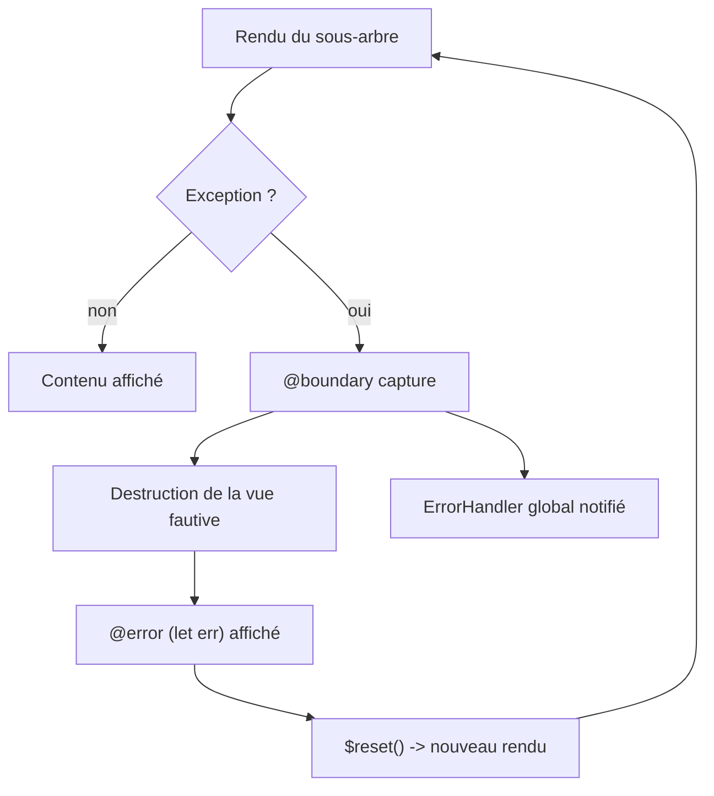

# Angular — Détail du dimanche 20 septembre 2026

## 1. Angular 22.2 — `@boundary` / `@error`, les error boundaries au niveau du template

**Source :** angular/angular PR #70560 (docs: add error boundaries entries) — https://github.com/angular/angular/pull/70560
**Date :** fusionnée le 10 septembre 2026, cible 22.2 (RC le 16 septembre 2026)

### Contexte

Jusqu'ici, une erreur levée pendant le rendu ou la détection de changement d'Angular remontait jusqu'à l'`ErrorHandler` racine de l'application. Tu pouvais la logger, l'envoyer à Sentry, afficher un toast — mais tu ne pouvais pas la **contenir**. Le sous-arbre fautif était détruit, et selon l'endroit où l'exception surgissait, c'est toute la page qui se retrouvait dans un état incohérent ou blanche. Le contournement classique consistait à écrire un composant `ErrorBoundaryComponent` maison, avec un `ngOnError` simulé, du `try/catch` autour des getters de template, ou une couche de `resource()` avec un état d'erreur explicite. Trois solutions, aucune propre.

Le problème est le plus aigu là où un composant périphérique cohabite avec un flux critique : un widget promotionnel dans un tunnel de commande, un bloc de recommandations sur une page produit, une intégration tierce dans un dashboard. Ces composants ne devraient jamais pouvoir faire tomber le paiement. React a répondu à ça avec les error boundaries de classe depuis 2017 ; Angular arrive avec une réponse plus intégrée, parce qu'elle vit dans le compilateur de template et non dans un composant utilisateur.

### Comment ça marche

Le bloc `@boundary` est une **structure de contrôle du template**, au même titre que `@if`, `@for` ou `@defer`. Le compilateur de template génère, pour le contenu du bloc, une vue intégrée dont l'exécution est enveloppée d'un gestionnaire. Pas de composant supplémentaire dans l'arbre d'injection, pas de directive : l'instrumentation est produite à la compilation.

Le déroulé pas à pas, quand une erreur survient :

1. Angular exécute la création ou la mise à jour de la vue contenue dans `@boundary`.
2. Une exception est levée — dans un constructeur de composant, un `computed()` évalué depuis le template, un pipe, un hook de cycle de vie du sous-arbre.
3. L'exception ne se propage pas à la vue parente. La frontière la capture, détruit la vue fautive, puis instancie la vue du bloc `@error`.
4. L'erreur est exposée dans le bloc `@error` via `let err`, et une primitive `$reset` permet de rejouer le contenu protégé.
5. L'erreur est également signalée à l'`ErrorHandler` de l'application, pour que ta télémétrie continue de la voir.

Le point important : la portée est celle du **bloc**, pas du composant. Deux `@boundary` frères sont indépendants ; un `@boundary` imbriqué capture avant son parent, comme un `try/catch` imbriqué. Et parce que ça vit dans le template, la frontière fonctionne aussi pour les composants créés par `@defer`, `@for` ou un `NgComponentOutlet`.



Pour les vues créées impérativement, la même sémantique passe par une option de `createComponent`. C'est cohérent : une vue montée à la main n'a pas de template parent pour l'envelopper, donc la frontière se déclare dans les options.

### En pratique — exemple de code

```html
<!-- Avant — le widget promo plante, tout le tunnel de commande part avec lui -->
<app-checkout-summary [cart]="cart()" />
<app-promotional-widget [userId]="userId()" />
<app-payment-form (submit)="pay($event)" />
```

```html
<!-- Après — Angular 22.2 : la frontière isole le widget tiers -->
<app-checkout-summary [cart]="cart()" />

@boundary {
  <app-promotional-widget [userId]="userId()" />
}
@error (let err) {
  <!-- Repli silencieux : l'utilisateur ne voit pas l'incident, la télémétrie si -->
  <app-default-promo-widget />
  <button type="button" (click)="$reset()">Réessayer</button>
}

<app-payment-form (submit)="pay($event)" />
```

```ts
// Vues créées impérativement : même contrat, via les options de createComponent
const ref = viewContainerRef.createComponent(Dynamic, {
  onError: (error: unknown) => {
    // Retourne le contenu de repli, ou laisse remonter en relançant
    this.telemetry.capture(error);
    this.showFallback.set(true);
  },
});
```

### Pourquoi ça compte pour toi

Tu peux enfin borner le rayon d'explosion d'un composant que tu ne contrôles pas — SDK tiers, widget marketing, micro-frontend. Côté backend, le parallèle est direct : c'est un bulkhead, pas un `catch` global. Repère dès maintenant, dans tes pages critiques, les sous-arbres non essentiels et prépare-leur un repli. Attention : la fonctionnalité est en developer preview sur 22.2, et Prettier ne sait pas encore formater ces blocs.

### Points de vigilance

- La primitive de relance s'appelle bien `$reset` et non `$retry` — le renommage a eu lieu pendant la revue du compilateur, beaucoup d'articles tiers citent encore l'ancien nom.
- Une frontière ne capture pas ce qui se passe **hors** du cycle de rendu : une promesse rejetée dans un `setTimeout` ou une souscription RxJS non gérée continue de remonter à l'`ErrorHandler`.
- Un ticket ouvert signale que les frontières disparaissent après un rafraîchissement HMR ; à surveiller en développement.
