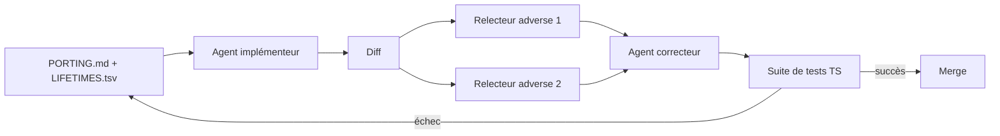

# Angular — Détail du lundi 21 septembre 2026

## 1. Bun 1.4 — 535 k lignes de Zig réécrites en Rust par un pipeline d'agents

**Source :** InfoQ — https://www.infoq.com/news/2026/09/bun-AI-rewrite-zig-rust-4-months/
**Date :** 20 septembre 2026

### Contexte

Bun est le runtime JavaScript/TypeScript qui sert aussi de bundler, de runner de tests et de gestionnaire de paquets. Il était écrit en Zig, un langage système sans ramasse-miettes et sans vérificateur d'emprunts. Jarred Sumner, son créateur, décrit la conséquence sans détour : une large part des bugs sont des `use-after-free`, des doubles libérations et des oublis de libération dans les chemins d'erreur.

En Rust sûr, ces trois familles deviennent des erreurs de compilation. Le problème est le coût du changement. Réécrire 535 496 lignes à la main aurait gelé les correctifs de sécurité et les nouvelles fonctionnalités pendant un an. Sumner a donc tenté autre chose : laisser un modèle faire le portage, et valider contre la suite de tests existante. Cette suite est écrite en TypeScript, donc indépendante du langage d'implémentation du runtime. C'est le point de bascule de toute l'opération.

### Comment ça marche

Le portage n'est pas un prompt géant. C'est un harnais à rôles séparés, orchestré sur une cinquantaine de workflows.

Deux artefacts pilotent tout. `PORTING.md` décrit la correspondance entre patterns et types Zig et leurs équivalents Rust. `LIFETIMES.tsv` liste la durée de vie de chaque champ de chaque struct du dépôt. Sans ce second fichier, l'agent invente des durées de vie et le compilateur refuse tout.

Ensuite vient la boucle. Un agent implémenteur traduit un fichier Zig. Deux agents relecteurs adverses tournent en fenêtres de contexte isolées, avec accès aux seuls diffs. Leur unique mission est de trouver des bugs et des divergences de comportement. Un agent correcteur traite ce qu'ils remontent. La règle est explicite : l'implémenteur ne relit pas, le relecteur n'implémente pas.

Le point méthodologique le plus intéressant : à chaque erreur, Sumner corrigeait le processus, pas l'artefact. On ne patche pas le code généré à la main, on améliore le prompt ou le guide de portage, puis on relance.

L'exécution a été distribuée sur quatre shards de workspace de seize agents chacun, soit 64 instances en parallèle. Au pic, le système produisait environ 1 300 lignes par minute et 695 commits par heure. Faire passer la suite complète a coûté 5,9 milliards de tokens d'entrée non mis en cache et 690 millions de tokens de sortie, soit environ 165 000 $ au tarif API.



### En pratique — exemple de code

Le cœur du gain tient dans une seule idée : remplacer la libération explicite par la libération portée par le type.

```zig
// Avant — Zig : la libération est une discipline, pas une garantie.
// Un `return` ajouté plus tard dans un chemin d'erreur fuit silencieusement.
fn readAll(alloc: std.mem.Allocator, path: []const u8) ![]u8 {
    const buf = try alloc.alloc(u8, 4096);
    errdefer alloc.free(buf);          // oublié une fois => fuite
    const n = try readInto(path, buf);
    return buf[0..n];
}
```

```rust
// Après — Rust : `Vec<u8>` possède sa mémoire, `Drop` la rend au retour.
// Tout chemin de sortie, y compris le `?`, libère. Rien à discipliner.
fn read_all(path: &str) -> std::io::Result<Vec<u8>> {
    let mut buf = vec![0u8; 4096];
    let n = read_into(path, &mut buf)?; // early return => Drop s'exécute
    buf.truncate(n);
    Ok(buf)
}
```

Les effets sont mesurés. Deux mille appels consécutifs à `Bun.build()` en processus plafonnent à 609 Mo en Rust, contre plus de 6,7 Go auparavant. Le débit HTTP gagne 2 à 5 %, et 128 bugs anciens de la 1.3.14 disparaissent.

### Pourquoi ça compte pour toi

Si ta CI lance `bun test` ou `bun install`, tu exécutes déjà ce code. Vérifie ton pin de version avant de supposer la stabilité. Plus largement, le patron est transposable à tes migrations .NET ou Angular : séparer l'implémenteur du relecteur, figer un guide de portage, corriger le processus plutôt que l'artefact. La suite de tests devient le contrat, donc sa couverture devient ton vrai plafond de qualité.

### Points de vigilance

Le portage mécanique a introduit 19 régressions sémantiques nées de similarités syntaxiques entre Zig et Rust. Onze passes de revue de sécurité et du fuzzing continu sur chaque parser ont produit quinze correctifs supplémentaires. Andrew Kelley, créateur de Zig, conteste frontalement l'argument : si la suite de tests suffisait, pourquoi tant de bugs subsistaient-ils dans le code Zig ? Un million de lignes fusionnées sans relecture humaine complète fait de Bun un canari pour toute l'industrie.
