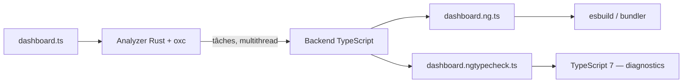

# Angular — Détail du vendredi 25 septembre 2026

## 1. Angular Preprocessor (ngp) — le compilateur Angular réécrit en Rust sur oxc

**Source :** Angular Blog — https://blog.angular.dev/an-update-on-angulars-typescript-7-powered-compiler-9619a35e2b0a
**Date :** 25 septembre 2026

### Contexte

Depuis 2015, le compilateur ahead-of-time d'Angular est bâti **au-dessus des API du compilateur TypeScript**. Concrètement, `ngc` instancie un `ts.Program`, lit l'AST TypeScript, et injecte ses propres transformations via l'API `ts.Transformer`. C'est l'intégration la plus profonde entre un framework web et TypeScript dans tout l'écosystème. Elle a très bien vieilli — tant que TypeScript restait écrit en TypeScript.

TypeScript 7, le port natif en Go, casse ce contrat. Deux raisons se cumulent. D'abord le coût de franchir la frontière JavaScript ↔ Go à chaque appel d'API. Ensuite, et c'est rédhibitoire, l'API `ts.Transformer` **n'existe pas** entre langages : elle suppose que ton code de transformation tourne dans le même runtime que le compilateur. Angular ne peut donc pas simplement « pointer vers TS 7 » et récupérer la vitesse.

L'équipe a tranché début 2026 : découpler la compilation Angular des API du compilateur TypeScript, et écrire un outil dédié qui prend ton code source et en sort du TypeScript transformé, prêt à être avalé par n'importe quel pipeline de build. C'est le chemin qu'ont déjà pris plusieurs frameworks — et beaucoup d'entre eux utilisent la même brique : **oxc**, la toolchain Rust de Void Zero, le moteur derrière Vite.

### Comment ça marche

L'outil s'appelle **ngp** (Angular Preprocessor), par opposition à `ngc`. Il a exactement deux missions.

**Mission 1 — compiler les décorateurs.** Pour chaque fichier d'entrée, disons `dashboard.ts`, ngp produit un `dashboard.ng.ts` : ton code, mais avec `@Component`, `@Pipe`, `@Directive` remplacés par leur forme compilée. C'est ce fichier qui part vers esbuild ou vers TypeScript, et c'est ce code qui s'exécute dans le navigateur.

**Mission 2 — permettre le type-checking des templates.** ngp produit aussi un `dashboard.ngtypecheck.ts` : une traduction en TypeScript pur des expressions et des types contenus dans ton template. TypeScript type-check ce fichier et remonte les diagnostics. Des source maps sont générées pour les deux sorties, donc les erreurs pointent vers ton fichier d'origine. Ces deux fichiers restent **en mémoire** en temps normal : rien n'est écrit sur disque.

L'architecture interne est hybride, et c'est le point à retenir.

- Le **frontend** — appelé l'*analyzer* — est une bibliothèque Rust. Via oxc, il parse ton code, repère les classes décorées, cartographie les relations entre NgModules et leurs composants/directives, extrait les métadonnées des libs au format Angular Package Format, et produit une liste de tâches de compilation. Rust et oxc gèrent bien le multithreading : l'analyzer lit tes sources **en parallèle** et streame les unités de travail vers le backend.
- Le **backend** est resté en TypeScript. Il exécute les tâches en appelant le compilateur de templates existant d'Angular — un composant sophistiqué que réécrire prendrait trop de temps aujourd'hui.

La colle entre les deux est **napi-rs**, qui empaquette une lib Rust soit en plugin natif Node, soit en bundle WebAssembly. ngp charge le binaire natif si un build existe pour ton OS et ton architecture, sinon il retombe sur le WASM. Ce fallback n'est pas un lot de consolation : il permet de compiler de l'Angular **dans un navigateur**, ce dont les IDE en ligne ont besoin.



### En pratique — exemple de code

Ce que ngp change n'est pas ton code source, mais **ce qui en sort**. Voici la forme des deux artefacts produits à partir d'un même composant.

```ts
// Avant — dashboard.ts, ton source : ngc lisait ce fichier via ts.Program
//         et injectait sa transformation dans le pipeline TypeScript.
@Component({
  selector: 'app-dashboard',
  template: `<h1>{{ user().name }}</h1>`,
})
export class Dashboard {
  readonly user = input.required<User>();
}
```

```ts
// Après — deux sorties ngp, générées en mémoire, avec source maps.

// (1) dashboard.ng.ts : c'est CE code qui part au bundler et tourne dans le navigateur.
export class Dashboard {
  readonly user = input.required<User>();
  static ɵcmp = /* définition de composant compilée : instructions de rendu */;
}

// (2) dashboard.ngtypecheck.ts : jamais exécuté, seulement type-checké par TS 7.
//     Les expressions du template deviennent du TypeScript ordinaire.
function _tcb_Dashboard(this: Dashboard) {
  const _t1 = this.user();      // erreur ici => remappée sur le template d'origine
  _t1.name;
}
```

Rien à changer dans ton `angular.json` aujourd'hui : l'intégration au build system de la CLI est encore au stade prototype.

### Pourquoi ça compte pour toi

Ton build Angular va gagner un étage natif, et ça se verra surtout sur les gros projets. Mais ne planifie pas ta migration sur un chiffre : l'équipe refuse explicitement d'annoncer un gain tant que le build CLI complet n'est pas mesuré bout en bout. Surveille plutôt deux choses : la version expérimentale attendue d'ici fin 2026, et la liste de breaking changes de type-checking qu'ils s'engagent à documenter. Si ta CI casse sur des erreurs de types inédites, ce sera là.

### Pour aller plus loin | Points de vigilance

- **Pourquoi Rust et pas Go ?** Microsoft a choisi Go parce que porter une base de code d'un langage à GC vers un autre est plus simple. Angular n'avait pas cette contrainte et voulait surtout une toolchain JS/TS mature en natif : parser, AST, binder sémantique, transformateur. Seul oxc cochait toutes les cases. À noter, les API de TypeScript 7 sont privées par design dans la version initiale, et il n'existe pas de parser TypeScript public en Go.
- **Les API d'interop TS 7.1** seront quand même utilisées, mais uniquement pour le type-checking et les diagnostics — pas pour tout le pipeline, jugé trop coûteux à traverser.
- **oxc-angular-compiler**, le projet Void Zero existant, couvre la mission 1 mais ni le type-checking de templates ni les optimisations cross-fichiers nécessaires aux apps non-standalone. Angular s'y intéresse pour, à terme, pousser plus de travail côté Rust.
- Le langage service Angular sera lui aussi porté sur ngp : un prototype fonctionne déjà.
