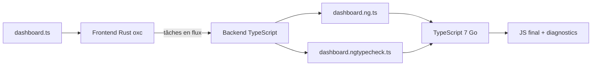

# Angular — Détail du dimanche 4 octobre 2026

## 1. ngp — le préprocesseur Rust qui remplace le compilateur Angular pour TypeScript 7

**Source :** Angular Blog — https://blog.angular.dev/an-update-on-angulars-typescript-7-powered-compiler-9619a35e2b0a
**Date :** 25 septembre 2026

### Contexte

TypeScript 7 est la réécriture native du compilateur en Go, annoncée pour diviser par dix les temps de build. Problème : Angular ne se contente pas d'appeler `tsc`. Son compilateur (`ngtsc`) s'insère dans le pipeline de TypeScript via l'API `ts.Transformer`, en JavaScript, pour réécrire les décorateurs `@Component` en code exécutable.

Un binaire Go ne peut pas appeler du code de transformation JavaScript en cours de compilation. L'API sur laquelle repose tout l'écosystème Angular disparaît donc de fait. L'équipe a écarté le portage complet du compilateur et choisi de découpler la compilation Angular des API de TypeScript.

### Comment ça marche

`ngp` (Angular Preprocessor) devient une étape distincte, exécutée avant TypeScript. Il lit tes fichiers, produit du TypeScript « pur », et TypeScript 7 compile ensuite ce résultat sans rien savoir d'Angular.

Le pipeline est hybride. Le frontend est écrit en Rust avec la bibliothèque `oxc` pour le parsing et la manipulation d'AST. Il traite les fichiers en parallèle, repère les classes décorées Angular, relie les `NgModule`, et extrait les dépendances de chaque composant. Il envoie ensuite des tâches de compilation au backend.

Le backend reste en TypeScript. Il réutilise le compilateur de templates existant, génère le code final et écrit les fichiers avec leurs source maps. Garder ce code évite de réécrire des années de logique de templates.

Le lien entre les deux passe par `napi-rs`, qui emballe l'analyseur Rust en module natif pour Node.js ou en WebAssembly pour le navigateur. Pour chaque `dashboard.ts`, `ngp` émet deux fichiers : `dashboard.ng.ts`, le code de production avec décorateurs compilés, et `dashboard.ngtypecheck.ts`, qui traduit les expressions de template pour que TypeScript signale les erreurs de typage. Les source maps des deux fichiers renvoient vers ton fichier d'origine.



### En pratique — exemple de code

L'équipe indique que l'intégration reste largement transparente dans la CLI. Voici une illustration de la transformation (schématique, pas la sortie réelle de `ngp`) :

```typescript
// Entrée : dashboard.ts (ce que tu écris)
@Component({
  selector: 'app-dashboard',
  template: `<h1>{{ title() }}</h1>`,
})
export class Dashboard {
  title = signal('Ventes');
}

// Sortie schématique : dashboard.ng.ts
// Le décorateur est remplacé par des définitions statiques
// que le runtime Angular sait lire, sans transformer TypeScript.
export class Dashboard {
  title = signal('Ventes');
  static ɵcmp = /* définition de composant compilée */ null as any;
}

// Sortie schématique : dashboard.ngtypecheck.ts
// L'expression de template devient du TypeScript vérifiable :
// function _tcb(ctx: Dashboard) { ctx.title(); }
```

### Pourquoi ça compte pour toi

Si tu as des applications Angular, ton temps de build dépend désormais de ce chantier, pas seulement de TypeScript 7. Prévois une migration expérimentale côté CLI avant la fin de l'année. Lis les breaking changes de type-checking : l'équipe admet « quelques cas limites » où les diagnostics diffèrent. Rien n'est à migrer aujourd'hui.

### Limites

L'équipe dit qu'il est « trop tôt » pour affirmer que le gain de dix fois de TypeScript 7 se retrouve sur un build Angular complet. Elle teste `ngp` sur le corpus d'applications de Google avant de publier des benchmarks. Traite toute promesse de vitesse comme non démontrée.
