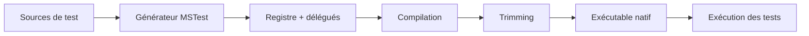

# CSharp — Détail du samedi 6 septembre 2026

## 1. MSTest 4.4 — publier et exécuter tes tests en Native AOT

**Source :** .NET Blog — https://devblogs.microsoft.com/dotnet/mstest-source-generation/
**Date :** 3 septembre 2026

### Contexte

Si tu publies une application en Native AOT, une suite de tests verte te ment partiellement. Native AOT compile en avance de phase, supprime le code non utilisé au trimming, et exige des alternatives à la génération de code au runtime comme à la réflexion non restreinte. Ton binaire publié peut donc se comporter autrement que le code exercé par le processus de test managé.

Le cas d'école tient en trois lignes. Un test sérialise un `record Receipt(decimal Total)` avec `JsonSerializer.Serialize` et vérifie la sortie. En managé, `System.Text.Json` retrouve le type par réflexion, le test passe. En publication trimmée ou AOT, la sérialisation par réflexion est **désactivée par défaut** et le même chemin lève `InvalidOperationException: Reflection-based serialization has been disabled for this application`. Le test n'a rien détecté parce qu'il ne tournait pas sous le modèle de déploiement livré.

MSTest avait tenté une première préversion Native AOT en avril 2024, avec un moteur expérimental à la couverture limitée. La version 4.4 déplace la génération de source dans la chaîne d'outils MSTest ouverte et l'aligne sur la plateforme de test.

### Comment ça marche

Le nœud du problème est un ordre d'opérations. Le trimming supprime ce qu'il ne voit pas référencé statiquement. Or la découverte de tests classique est intégralement dynamique : `Assembly.GetTypes()`, filtrage par attribut, construction et invocation par réflexion. Rien de tout cela n'est visible au trimmer, qui supprime donc tes classes de test — ou laisse les métadonnées disparaître.

La génération de source inverse la chronologie. Pendant la compilation, donc **avant** le trimming, le générateur émet quatre choses : un registre des classes de test de l'assembly, les données d'attributs des membres supportés, des délégués qui construisent les classes et invoquent les méthodes, et les références qui préservent ces types au trimming. Le trimmer voit alors un graphe statique complet.



Le point important n'est pas le code généré, c'est que le build **enregistre** quels tests existent et comment les lancer. Ton modèle de programmation ne bouge pas d'un pouce.

Deux responsabilités restent distinctes, et le billet insiste dessus. Le générateur MSTest rend le test découvrable et exécutable après trimming. C'est au **code applicatif** de fournir ses propres métadonnées générées — un `JsonSerializerContext` pour la sérialisation, par exemple. MSTest ne masque pas le problème applicatif : il le fait remonter avant la mise en production.

Enfin, `ReflectionFree` — le mode par défaut — ne signifie pas zéro réflexion. Certaines opérations conservent des replis réflectifs. Le mode `Rooting` préserve les membres découverts mais exécute par réflexion : c'est un outil d'investigation de compatibilité, pas la cible.

### En pratique — exemple de code

```xml
<!-- Avant — projet de tests managé classique -->
<Project Sdk="MSTest.Sdk/4.3.0">
  <PropertyGroup>
    <TargetFramework>net10.0</TargetFramework>
  </PropertyGroup>
</Project>

<!-- Après — génération de source + exécutable natif, deux lignes changent -->
<Project Sdk="MSTest.Sdk/4.4.0">
  <PropertyGroup>
    <TargetFramework>net10.0</TargetFramework>
    <PublishAot>true</PublishAot>
  </PropertyGroup>
</Project>
```

```bash
# Publie avec le MÊME RID que ton application, puis lance le binaire natif
dotnet publish ./MyProject.Tests/MyProject.Tests.csproj \
  -c Release -r linux-x64 -o ./artifacts/native-tests
./artifacts/native-tests/MyProject.Tests   # .exe sur Windows
```

```csharp
// Le correctif est côté APPLICATION, pas côté test :
// on fournit les métadonnées JSON générées que le mode AOT exige.
[JsonSerializable(typeof(Receipt))]
internal partial class AppJsonContext : JsonSerializerContext { }

var json = JsonSerializer.Serialize(new Receipt(42), AppJsonContext.Default.Receipt);
```

### Pourquoi ça compte pour toi

Si tu livres du .NET trimmé ou AOT, ta CI valide aujourd'hui un artefact que tu ne déploies pas. Ajoute une seule voie native, sur un projet qui touche sérialisation, injection de dépendances ou binding de configuration — pas sur des tests arithmétiques. Et fais de la **parité du nombre de tests** un gate : un registre incomplet passe au vert en silence.

### Points de vigilance

Les formes de test non supportées sont explicites : classe qui hérite seulement de `[TestClass]` (l'analyseur `MSTEST0069` le signale), type inaccessible, `file`-local, statique ou générique ouvert, méthode générique ou à paramètres `ref`/`out`/`in`, et `[AssemblyFixtureProvider]`. Traite ces diagnostics comme des barrières de migration, jamais comme des avertissements à supprimer. Certaines extensions et certains rapporteurs de CI ne sont pas disponibles sur le chemin AOT ; TRX et la couverture de code, eux, restent supportés.
