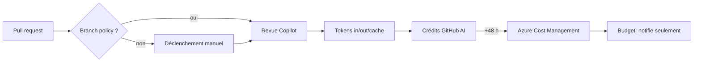
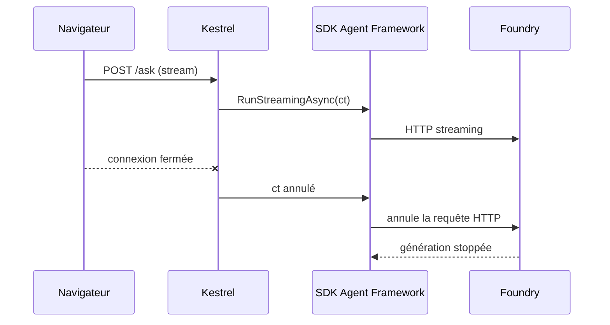

# CSharp — Détail du lundi 7 septembre 2026

## 1. Copilot code review sur Azure Repos — la facturation à l'usage, avec 48 h d'aveuglement

**Source :** InfoQ — https://www.infoq.com/news/2026/09/copilot-code-review-azure-repos/
**Date :** 4 septembre 2026

### Contexte

Microsoft pousse depuis des années ses clients Azure Repos vers GitHub, en réservant les fonctionnalités agentiques à ce dernier. Le 4 septembre, l'entreprise a changé de pied et ouvert GitHub Copilot code review à tous les clients Azure DevOps, en supprimant l'inscription qui la restreignait depuis juin. Le billet d'annonce dit explicitement pourquoi : beaucoup de clients ne sont pas prêts à migrer, la complexité dépendant de la taille, des personnalisations, des contraintes de conformité et du secteur.

C'est la même logique que le serveur MCP distant Azure DevOps passé en GA le mois dernier : amener l'outillage agentique là où sont les dépôts, plutôt que d'attendre que les dépôts bougent. Pour une équipe .NET installée sur Azure DevOps depuis dix ans, c'est une bonne nouvelle. À condition de comprendre le modèle de coût avant d'activer la revue automatique sur tous les dépôts.

### Comment ça marche

La revue s'exécute sur l'infrastructure Azure Pipelines, dans le pool d'agents par défaut de l'organisation — ou dans un Managed DevOps Pool, qui doit tourner sur la dernière image Ubuntu Server. Les images Windows ne sont pas supportées, et les agents auto-hébergés non plus.

Le cycle de facturation est le point à comprendre pas à pas :

1. Une pull request déclenche une revue, manuellement ou via une **branch policy**.
2. La revue consomme des tokens d'entrée, de sortie et de cache. Le volume dépend du *review effort* choisi, de la taille de la PR, des instructions personnalisées et du modèle.
3. Ces tokens sont convertis en **crédits GitHub AI**, à raison d'un crédit par cent.
4. La charge apparaît dans Azure Cost Management sous le produit *GitHub Copilot for AzDO*, **48 heures après** la fin de la revue.
5. Un budget dépassé déclenche un e-mail dans l'heure suivant la prochaine évaluation. Il **n'arrête rien**.



Combine les points 4 et 5 : une policy de revue automatique posée un vendredi sur un projet actif tourne tout le week-end avant que le premier euro n'apparaisse quelque part. La documentation est explicite — les budgets notifient, ils n'arrêtent ni les revues ni les ressources.

Deux garde-fous existent quand même. Les plafonds de concurrence — cinq revues simultanées par organisation, deux par utilisateur, une par PR — mettent naturellement en file d'attente une organisation qui active la revue partout. Et les charges portent désormais des tags de projet Azure DevOps, donc tu peux filtrer et grouper l'analyse de coût par projet au lieu de subir un total d'organisation.

Côté valeur, la revue reste **consultative par construction** : Copilot laisse toujours un review de type *Comment*, jamais *Approve* ni *Request changes*. Elle ne satisfait donc aucune policy de reviewer obligatoire et ne bloque pas de merge. Elle ne re-review pas après de nouveaux commits sans demande explicite, et ne lit pas les réponses à ses propres commentaires.

### En pratique — exemple de code

```bash
# Activer la revue sur UN dépôt d'abord, comme Microsoft le recommande.
# 1) Poser un budget avec alerte à 50 % et 90 % — il notifie, il ne coupe pas.
az consumption budget create \
  --budget-name copilot-review-guard \
  --amount 200 --time-grain Monthly \
  --category Cost --resource-group rg-devops

# 2) Filtrer le coût réel par projet grâce aux tags (données à J-2).
az costmanagement query \
  --type ActualCost --timeframe MonthToDate \
  --scope "/subscriptions/$SUB" \
  --dataset-grouping name="Project" type="TagKey"
```

```yaml
# Branch policy : commence en revue MANUELLE, mesure une semaine,
# puis seulement bascule automatic: true si le coût observé tient.
policy:
  copilotCodeReview:
    enabled: true
    automatic: false        # <- le levier qui coûte cher
    reviewEffort: standard  # low | standard | high
    paths: ['src/**/*.cs']  # cible le code qui vaut une revue
```

### Pourquoi ça compte pour toi

Si ton équipe vit sur Azure DevOps, tu gagnes une revue automatisée sans migrer tes dépôts. Mais traite l'activation comme un changement d'infra, pas comme une case à cocher : active sur un ou deux dépôts, compare les niveaux d'effort, et attends deux relevés de coût avant d'étendre. Le budget ne te protégera pas, seule ta discipline le fera. Et n'espère pas remplacer un reviewer humain : Copilot ne peut pas approuver.

### Points de vigilance

Les prérequis excluent du monde : dépôts ≤ 10 Go, PR de 100 fichiers modifiés maximum, sans conflit de merge, et TFVC non supporté. Le déploiement est progressif par région, comptez deux à trois semaines. La documentation porte encore une bannière *limited preview* : pas de SLA.

---

## 2. Microsoft Agent Framework .NET 1.20.0 — l'annulation qui traverse le workflow hébergé

**Source :** Microsoft Agent Framework (GitHub Releases) — https://github.com/microsoft/agent-framework/releases
**Date :** septembre 2026

### Contexte

Agent Framework est la brique .NET de Microsoft pour orchestrer des agents : tu décris un workflow, il l'exécute soit en local dans ton process, soit hébergé côté Foundry. La 1.20.0 apporte des améliorations sur la recherche web, la gestion des logprobs et la fiabilité Foundry / Cosmos DB, plus un correctif qui mérite un développement : **l'annulation est désormais honorée pour les réponses de workflow hébergées par Foundry**.

Le bug est de ceux qu'on ne voit pas en développement et qui coûtent cher en production. Ton contrôleur ASP.NET Core reçoit un `CancellationToken`, le client ferme l'onglet, le token est annulé, ta méthode rend la main — et le workflow continue de tourner côté Foundry, consommant des tokens facturés pour une réponse que plus personne n'attend.

### Comment ça marche

En .NET, l'annulation est **coopérative**. Un `CancellationToken` ne tue rien : il signale une intention. Chaque maillon de la chaîne doit choisir de la respecter, et la chaîne casse au premier maillon qui l'ignore.

Le trajet complet, étape par étape :

1. Kestrel crée un token lié à la connexion HTTP et l'injecte dans l'action de ton contrôleur via `HttpContext.RequestAborted`.
2. Tu le passes à la méthode d'exécution du workflow.
3. Le SDK doit le relayer au `HttpClient` qui parle à l'endpoint Foundry.
4. Sur une réponse **streamée**, le SDK doit aussi le vérifier entre chaque chunk de l'énumération asynchrone.
5. L'annulation de la requête HTTP sous-jacente est ce qui signale à Foundry d'arrêter la génération.



C'est l'étape 4 qui manquait. Sur une réponse hébergée streamée, l'énumération continuait de tirer des chunks même token annulé, et la dernière flèche du diagramme n'était jamais émise. Le symptôme classique : ton API répond vite en cas de timeout — donc les métriques applicatives sont belles — mais la facture ne baisse pas.

La leçon générale dépasse ce SDK. Chaque fois que tu franchis une frontière de process avec une opération longue, pose-toi la question : mon annulation traverse-t-elle ? Un `Task.WhenAny` avec un `Task.Delay` te rend la main sans rien annuler du tout — c'est un faux timeout.

### En pratique — exemple de code

```csharp
// Avant — le timeout rend la main au client, mais rien n'est annulé côté Foundry.
[HttpPost("ask")]
public async Task<IActionResult> Ask(AskRequest req)
{
    var run = _workflow.RunAsync(req.Prompt);          // pas de token
    var done = await Task.WhenAny(run, Task.Delay(30_000));
    return done == run ? Ok(await run) : StatusCode(504); // le workflow continue !
}

// Après — le token de la requête HTTP traverse jusqu'au stream Foundry.
[HttpPost("ask")]
public async Task Ask(AskRequest req, CancellationToken ct)
{
    // Lie l'abandon client à un plafond métier : le premier qui tombe annule l'autre.
    using var cts = CancellationTokenSource.CreateLinkedTokenSource(ct);
    cts.CancelAfter(TimeSpan.FromSeconds(30));

    Response.ContentType = "text/event-stream";
    // WithCancellation vérifie le token entre CHAQUE chunk, pas seulement au démarrage.
    await foreach (var chunk in _workflow.RunStreamingAsync(req.Prompt, cts.Token)
                                          .WithCancellation(cts.Token))
    {
        await Response.WriteAsync($"data: {chunk.Text}\n\n", cts.Token);
        await Response.Body.FlushAsync(cts.Token);
    }
}
```

Le `CreateLinkedTokenSource` est le pattern à retenir : il combine l'abandon client et ton propre plafond, et propage l'annulation au premier des deux qui se déclenche.

### Pourquoi ça compte pour toi

Si tu exposes des endpoints qui appellent un LLM, audite ta chaîne d'annulation aujourd'hui : ouvre un stream, ferme le client, et regarde ta consommation de tokens. Un `CancellationToken` accepté en paramètre mais jamais transmis est un piège fréquent — les analyseurs Roslyn ne le détectent pas. Monte en 1.20.0 si tu utilises les workflows hébergés Foundry, et ajoute un test d'intégration qui annule à mi-course.

### Pour aller plus loin

Le même audit vaut pour EF Core (`ToListAsync(ct)`), `HttpClient` et les consumers de messages. Le token doit descendre jusqu'à l'appel I/O réel, sinon il ne sert qu'à décorer la signature.
