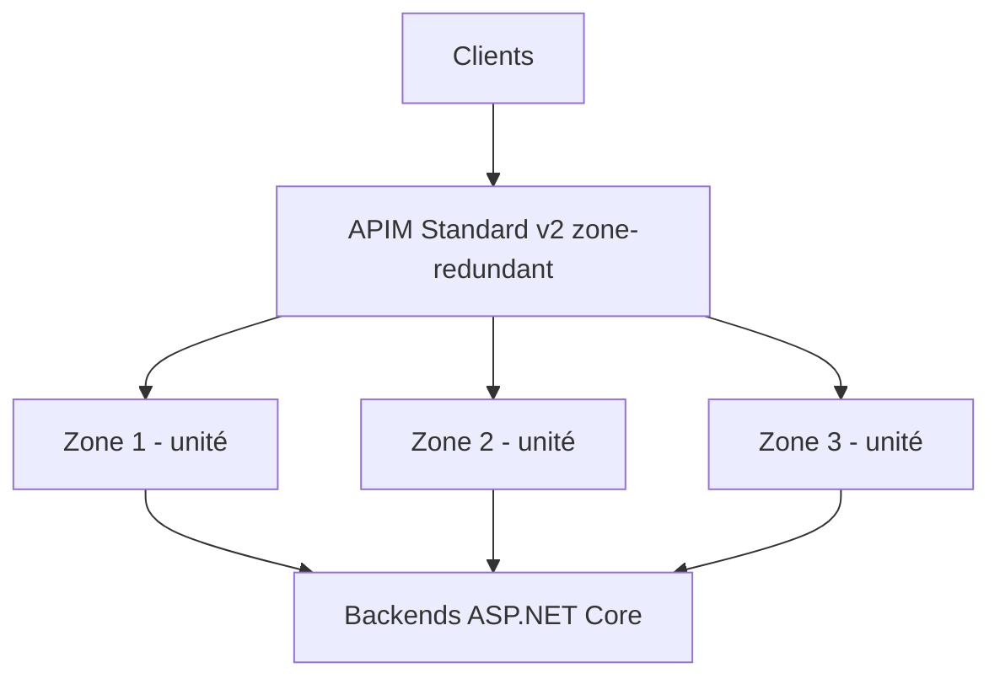

# CSharp — Détail du mardi 8 septembre 2026

## 1. Azure API Management Standard v2 — la redondance de zone, et la décision qu'elle t'impose à la création

**Source :** InfoQ — https://www.infoq.com/news/2026/09/apim-standard-v2-zone-redundancy/
**Date :** 7 septembre 2026

### Contexte

Quand tu places API Management devant tes API ASP.NET Core, tu déplaces un point de défaillance : la passerelle devient le chemin critique de tout ton trafic entrant. Si elle tombe, peu importe que tes App Services soient répartis sur trois zones — les clients ne les atteignent plus.

Jusqu'ici, la redondance de zone sur les paliers v2 était réservée à Premium v2, arrivée en décembre. Microsoft vient de l'activer sur **Standard v2**. L'écart tarifaire est important : Standard v2 démarre à **700 $ par mois**, Premium v2 à **2 801 $**. Ce qui reste différent, c'est le SLA — **99,95 %** contre **99,99 %** — et une contrainte qui ne se rattrape pas : la redondance de zone n'est configurable qu'**à la création de l'instance**.

### Comment ça marche

Une région Azure zonale expose trois zones de disponibilité : trois ensembles de datacenters physiquement séparés, avec alimentation, refroidissement et réseau indépendants, reliés par de la fibre à faible latence.

Sans redondance de zone, les unités de calcul de ta passerelle vivent dans une seule zone. Une panne d'alimentation ou de réseau sur ce site coupe la passerelle entière. Avec la redondance activée, Azure répartit les unités de la passerelle sur plusieurs zones et route le trafic vers celles qui répondent. Une zone tombe, les autres absorbent — au prix d'une capacité réduite le temps que la plateforme réagisse.

Deux conséquences à intégrer dans ton dimensionnement.

**Le SLA n'est pas un objectif de disponibilité, c'est un plafond contractuel.** 99,95 % autorise environ 22 minutes d'indisponibilité par mois ; 99,99 % en autorise 4. Si ton SLO applicatif est plus strict que le SLA de ta passerelle, ton SLO est faux : tu ne peux pas être plus disponible que ton maillon le plus faible.

**Le nombre d'unités doit survivre à la perte d'une zone.** Sur trois zones, une instance à trois unités tombe à deux quand une zone disparaît. Si ton pic de trafic exige trois unités, tu passes en dégradé pendant l'incident. Dimensionne pour `N + 1`, pas pour `N`.



### En pratique — exemple de code

La propriété se pose au déploiement de la ressource. Voici l'avant et l'après en Bicep.

```bicep
// Avant — Standard v2 mono-zone : rien à changer plus tard, mais rien à récupérer non plus
resource apim 'Microsoft.ApiManagement/service@2024-05-01' = {
  name: 'apim-prod'
  location: 'westeurope'
  sku: { name: 'StandardV2', capacity: 3 }
  properties: { publisherEmail: 'ops@example.com', publisherName: 'Example' }
}

// Après — Standard v2 réparti sur trois zones, décidé À LA CRÉATION
resource apim 'Microsoft.ApiManagement/service@2024-05-01' = {
  name: 'apim-prod'
  location: 'westeurope'
  sku: { name: 'StandardV2', capacity: 3 }   // 3 unités = 1 par zone, N+1 si pic à 2
  zones: ['1', '2', '3']                     // non modifiable après déploiement
  properties: { publisherEmail: 'ops@example.com', publisherName: 'Example' }
}
```

Vérifie l'état réel d'une instance déjà déployée avant de planifier quoi que ce soit :

```bash
# Retourne les zones effectives ; une sortie vide ou null = instance mono-zone
az apim show -g rg-prod -n apim-prod --query "{sku:sku.name, zones:zones}" -o json
```

### Pourquoi ça compte pour toi

Si ta passerelle Azure est mono-zone, tu ne peux pas la corriger en place : il faut créer une nouvelle instance, migrer APIs, produits, politiques et abonnements, puis basculer le DNS. Autrement dit, c'est un chantier à planifier, pas une case à cocher. Lance dès maintenant l'audit `az apim show` sur tes environnements et compare le SLA de la passerelle aux SLO que tu as promis. Le prix de Standard v2 rend l'arbitrage bien moins douloureux qu'avant.

### Limites

La redondance de zone protège d'une panne de zone, pas d'une panne régionale ni d'une erreur de configuration propagée à toutes les unités. Pour survivre à la perte d'une région entière, il te faut une seconde instance dans une autre région et un routage global devant — Front Door ou Traffic Manager. Et le SLA reste celui de la passerelle : tes backends, ta base PostgreSQL et tes dépendances tierces ont chacun le leur, qui se multiplient.
