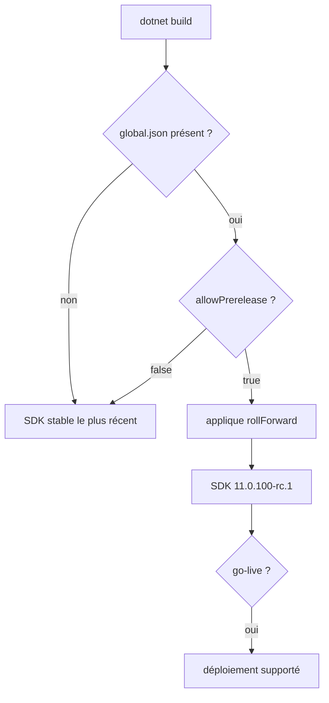
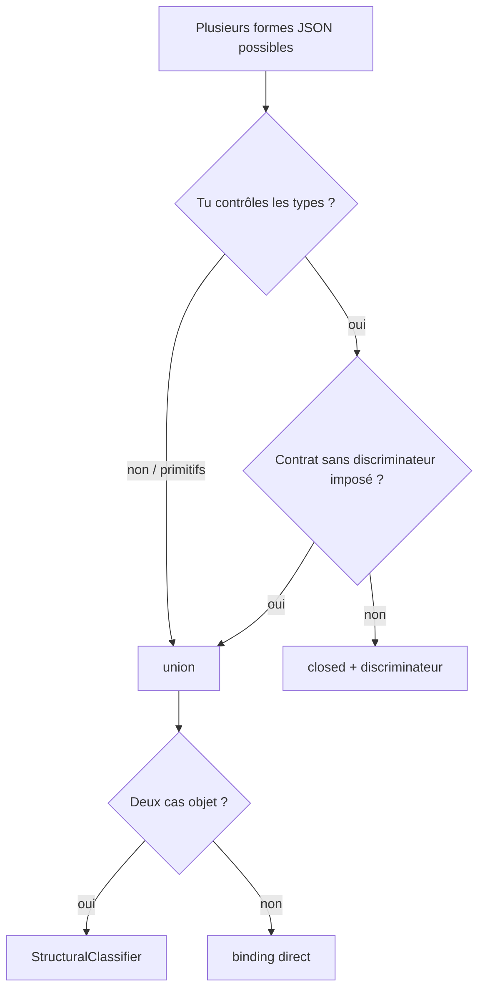

# CSharp — Détail du samedi 12 septembre 2026

## 1. .NET 11 Release Candidate 1 — la licence go-live, et ce que ça t'autorise

**Source :** .NET Blog — https://devblogs.microsoft.com/dotnet/dotnet-11-rc-1/
**Date :** 8 septembre 2026

### Contexte

Le cycle de release de .NET est rigide et prévisible : previews de février à août, release candidates en septembre et octobre, GA en novembre. Ce qui distingue une RC d'une preview n'est pas la quantité de code, c'est le **contrat de support**.

La RC1 de .NET 11 arrive avec une **licence go-live**. Traduction concrète : Microsoft s'engage à supporter cette build en production, alors que la version finale n'est pas sortie. Les previews, elles, portent un avertissement explicite d'usage non-production. C'est la différence entre « tu peux tester » et « tu peux déployer et ouvrir un ticket ».

Cette RC1 ferme aussi la porte aux previews de langage. **C# 15 stabilise les types union** — la feature quitte le régime expérimental et devient une garantie de compatibilité. Même chose pour les raffinements du modèle `unsafe`, sujet qu'on avait traité fin août quand il était encore mouvant.

### Comment ça marche

Le mécanisme de sélection de version est ce qui te permet d'exploiter une RC sans casser tes autres projets. Le SDK .NET résout la version à utiliser dans cet ordre : un fichier `global.json` remontant depuis le répertoire courant, puis la politique de roll-forward par défaut, puis le SDK le plus récent installé.

Par défaut, le SDK **n'utilise pas** une version preview ou RC si une version stable satisfait la demande. Il faut l'autoriser explicitement avec `"allowPrerelease": true`. C'est le garde-fou qui évite qu'une installation de RC1 sur ta machine ne change silencieusement le comportement de tous tes builds.

Le `rollForward` détermine la marge de manœuvre. `latestPatch` reste sur la même bande de feature, `latestFeature` accepte une bande supérieure, `disable` exige une correspondance exacte. Pour un test de RC, la combinaison utile est une version explicite plus `allowPrerelease`.



Côté contenu, quatre changements valent une lecture attentive pour du backend. La **validation d'options asynchrone** permet enfin de valider une configuration qui doit interroger une ressource externe au démarrage — jusqu'ici tu devais bloquer un thread ou tricher avec un `HostedService`. La **publication de conteneurs reproductible** signifie qu'un même commit produit le même digest d'image, ce qui rend vérifiables les attestations de provenance. Le SDK **saute désormais les uploads redondants** vers le registre. Et côté NuGet, les mises à jour de paquets vulnérables **fonctionnent avec `TreatWarningsAsErrors`** : tu n'es plus obligé de désactiver temporairement la règle pour pouvoir corriger la vulnérabilité qu'elle signale.

### En pratique — exemple de code

```jsonc
// global.json — épingler la RC1 sur un projet, sans toucher aux autres
{
  "sdk": {
    "version": "11.0.100-rc.1",
    // Obligatoire : sans ça, le SDK ignore les préversions même installées.
    "allowPrerelease": true,
    // latestPatch : reste sur la bande 11.0.1xx, prend les correctifs.
    "rollForward": "latestPatch"
  }
}
```

```bash
# Vérifier ce que le SDK résout réellement dans ce dossier
dotnet --version

# Lister tous les SDK installés : la RC1 doit apparaître à côté des stables
dotnet --list-sdks

# Publier une image conteneur reproductible (nouveau défaut côté SDK)
dotnet publish -c Release /t:PublishContainer
```

### Pourquoi ça compte pour toi

La licence go-live change ta fenêtre de décision. Tu peux basculer un service non critique sur .NET 11 maintenant, avec support, et récupérer deux mois d'avance sur la migration. Épingle la RC via `global.json` plutôt que globalement : tu isoles le risque. Et si ta CI utilise `TreatWarningsAsErrors`, le correctif NuGet te débloque un scénario qui obligeait jusqu'ici à un contournement.

### Points de vigilance

RC1 signifie « API figée », pas « zéro bug ». La liste des breaking changes de .NET 11 est un document à part, publié sur Microsoft Learn, et elle continuera de bouger jusqu'à la GA de novembre. Sur Windows, la RC1 n'est supportée que par Visual Studio 2026 **Insiders** — pas par la version stable de VS.

---

## 2. C# 15 — unions et hiérarchies `closed` face à System.Text.Json dans ASP.NET Core

**Source :** .NET Blog — https://devblogs.microsoft.com/dotnet/unions-and-closed-hierarchies-in-aspnetcore/
**Date :** 10 septembre 2026

### Contexte

On avait couvert les types union comme feature de langage : un ensemble fermé de cas, sans héritage, avec exhaustivité vérifiée par le compilateur. Restait la question qui décide de leur utilité réelle en backend web : **comment ça se sérialise ?**

Le problème concret vient des contrats d'API qui autorisent plusieurs types JSON pour une même valeur. L'exemple canonique est le `maxUnavailable` de Kubernetes : un nombre absolu comme `2`, ou un pourcentage comme `"25%"`. Avant C# 15, tu modélisais ça avec `object` — qui accepte tout — ou avec un wrapper maison portant sa propre API de construction et de matching. Une classe de base ne fonctionne pas, puisqu'on ne peut pas faire dériver `int` et `string` d'un ancêtre commun.

C# 15 apporte deux outils distincts, et la confusion entre eux est la première source d'erreur.

### Comment ça marche

Une **union** est un type nommé représentant une valeur issue d'une liste fixe de types-cas. Les cas peuvent être des primitifs, des classes, des interfaces, des types nullables. Chaque cas se convertit implicitement vers l'union, sans cast.

Une **hiérarchie `closed`** est autre chose : c'est toujours de l'héritage, mais le modificateur `closed` empêche les autres assemblies de dériver du type de base. Le compilateur peut donc traiter la liste des dérivés connus comme complète.

La différence décisive est côté JSON. STJ sérialise une union en **dépaquetant le cas actif** : pas d'enveloppe, pas de champ `$type`, aucun discriminateur. `new UnionIntString(42)` produit `42`. C'est parfait pour préserver un contrat existant sans discriminateur. Mais en lecture, si deux cas produisent le même type JSON, STJ ne peut pas choisir.

Le classificateur structurel intégré, `JsonUnionTypeStructuralClassifier`, résout ce cas en distinguant les objets par leurs **noms de propriété**. Le coût est explicite : il doit scanner l'objet JSON avant la désérialisation, donc le travail est proportionnel à la taille du payload. Et sa décision dépend des formes des cas — renommer une propriété peut reclasser des payloads existants.

Pour une hiérarchie `closed` que tu contrôles, le choix recommandé est inverse : garder un discriminateur, et laisser STJ **inférer** les dérivés au lieu de les enregistrer avec `[JsonDerivedType]`.



Le périmètre de support est une contrainte dure à connaître avant de concevoir. Le support des unions dans ASP.NET Core **vient entièrement de STJ**. Elles fonctionnent donc là où ASP.NET Core utilise STJ : corps de requête et de réponse JSON, `JsonHubProtocol` de SignalR, interop JavaScript et état persisté de Blazor. Elles ne fonctionnent **pas** pour les query strings, les route values, les en-têtes ni les champs de formulaire.

### En pratique — exemple de code

```csharp
// Avant — contrat "int ou pourcentage" modélisé avec object : rien n'est vérifié.
app.MapGet("/max-unavailable/{name}", object (string name)
    => Deployments.GetMaxUnavailable(name)); // int ou string, le compilateur ne sait pas

// Après — C# 15 / .NET 11 : le contrat est dans la signature.
public union IntOrString(int, string);

app.MapGet("/deployments/{name}/max-unavailable",
    IntOrString (string name) => Deployments.GetMaxUnavailable(name));

// Conversion implicite, sans cast.
IntOrString absolute = 2;
IntOrString percentage = "25%";

// switch exhaustif : pas d'arm `_ =>`, le compilateur connaît tous les cas.
static string Describe(IntOrString value) => value switch
{
    int count => $"{count} pods",
    string pct => pct,
};
```

```csharp
// Deux cas objet -> ambigu en lecture. Le classificateur structurel tranche
// sur les noms de propriété (coût : un scan du payload avant désérialisation).
[JsonUnion(TypeClassifier = typeof(JsonUnionTypeStructuralClassifier))]
public union UnionPet(Cat, Dog);

// Hiérarchie closed : STJ infère les dérivés, plus besoin de [JsonDerivedType].
[JsonPolymorphic(InferClosedTypePolymorphism = true)]
public closed record class PaymentEvent(string PaymentId);

public sealed record class PaymentAuthorized(string PaymentId, decimal Amount)
    : PaymentEvent(PaymentId);

// Produit / accepte : {"$type":"PaymentAuthorized","paymentId":"p-123","amount":42.5}
app.MapPost("/payment-event", (PaymentEvent paymentEvent) => paymentEvent);
```

### Pourquoi ça compte pour toi

Tu peux supprimer tes wrappers maison « soit A soit B » et tes `object` dans les DTO. Le contrat remonte dans la signature, et le compilateur te signale par `CS8509` tout `switch` devenu incomplet. Deux réflexes : pour un contrat neuf que tu maîtrises, préfère `closed` + discriminateur ; ne compte pas sur les unions pour un paramètre de query string ou de formulaire.

### Limites

Le format sans discriminateur est un arbitrage, pas un avantage net. En écriture il est trivial ; en lecture, deux cas peuvent être indistinguables. Le cas `IntOrString` en corps de requête l'illustre : les réglages JSON web autorisent la lecture d'un nombre depuis une chaîne, donc `"25%"` et `"25"` deviennent ambigus et exigent un classificateur custom.
