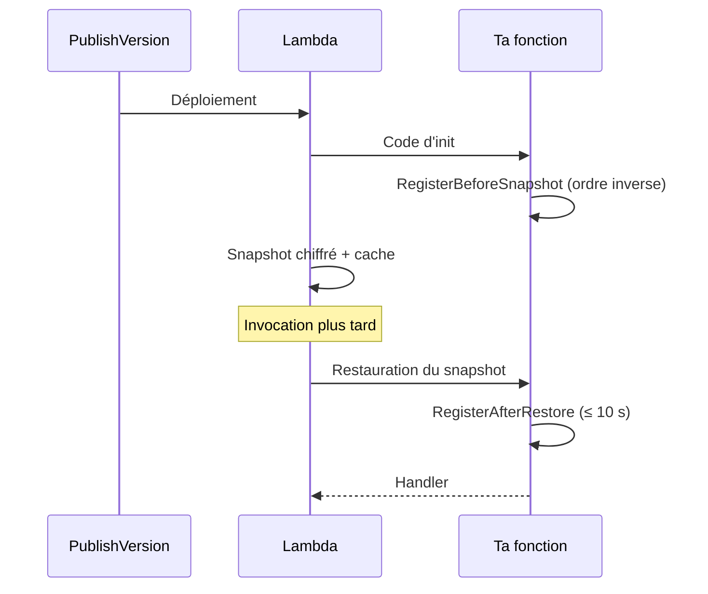
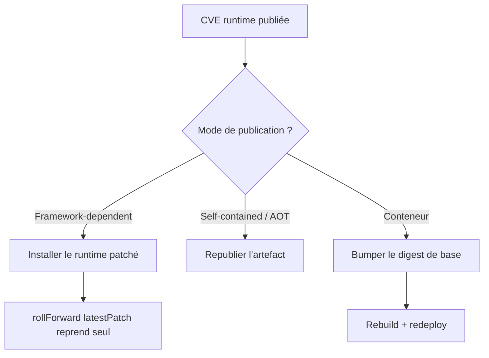

# CSharp — Détail du dimanche 13 septembre 2026

## 1. Lambda SnapStart sur images de conteneur — et les hooks .NET que ça t'oblige à écrire

**Source :** InfoQ — https://www.infoq.com/news/2026/09/lambda-snapstart-container-image/
**Date :** 12 septembre 2026

### Contexte

Une fonction Lambda se package de deux façons. En archive zip, plafonnée à **250 Mo** décompressés — et les layers comptent dans le même budget, ce qui surprend encore beaucoup d'équipes. En image de conteneur, plafonnée à **10 Go**. Jusqu'ici, choisir le conteneur revenait à renoncer à SnapStart et à accepter plusieurs secondes de démarrage, le temps que Lambda télécharge les couches et initialise le runtime.

Le compromis était douloureux. Un thread Reddit cité par InfoQ montre une équipe qui, pour faire tenir pandas et numpy sous les 250 Mo, retirait espaces, commentaires et docstrings de ses propres paquets installés — pour récupérer environ 5 Mo. AWS vient de supprimer ce choix : SnapStart couvre désormais les images de conteneur.

### Comment ça marche

SnapStart ne fait pas de magie sur le temps de démarrage : il le **déplace**. Au moment où tu publies une version, Lambda exécute le code d'initialisation, prend un **instantané chiffré de l'environnement d'exécution déjà initialisé**, et le met en cache. À l'invocation, il reprend depuis cet instantané au lieu de tout refaire.

La conséquence est la partie que les équipes oublient : **tout ce qui vit dans ton état d'init est gelé dans le snapshot**, puis restauré à l'identique dans *chaque* environnement d'exécution. Les connexions PostgreSQL ouvertes pendant l'init sont figées, et cassées au réveil. Les jetons obtenus au démarrage ont vieilli. Et surtout, une graine de générateur pseudo-aléatoire capturée dans l'instantané produit **la même séquence** dans tous les environnements restaurés — un problème de sécurité, pas de performance.

D'où les *runtime hooks*. En .NET, tu enregistres `RegisterBeforeSnapshot()` et `RegisterAfterRestore()` dans le constructeur de ta classe de handler. Les hooks « before » s'exécutent dans l'**ordre inverse** d'enregistrement et comptent dans la limite de temps du code d'initialisation ; les hooks « after » s'exécutent dans l'ordre d'enregistrement et doivent tenir en **10 secondes**.



Côté packaging, le support n'est pas uniforme. Les images de base AWS avec **.NET 8 ou plus** (comme Java 11+ et Python 3.12+) se comportent exactement comme un zip. Toute autre image — Node.js, Ruby, base custom — doit ajouter `LABEL com.amazonaws.lambda.feature.snapstart="Allow"` dans son Dockerfile ou implémenter les hooks de runtime custom. Sans l'un des deux, la publication de version **échoue pendant l'initialisation**.

### En pratique — exemple de code

```csharp
// Handler .NET avec hooks SnapStart : on ferme ce qui ne survit pas au gel,
// on rouvre et on re-sème l'aléa au réveil.
public class Function
{
    private NpgsqlDataSource? _db;

    public Function()
    {
        Amazon.Lambda.Core.SnapshotRestore.RegisterBeforeSnapshot(BeforeSnapshotAsync);
        Amazon.Lambda.Core.SnapshotRestore.RegisterAfterRestore(AfterRestoreAsync);
        _db = NpgsqlDataSource.Create(Environment.GetEnvironmentVariable("PG_DSN")!);
    }

    private async ValueTask BeforeSnapshotAsync()      // compte dans la limite d'init
    {
        if (_db is not null) await _db.DisposeAsync(); // pas de socket figée dans l'image
        _db = null;
    }

    private ValueTask AfterRestoreAsync()              // ≤ 10 s
    {
        _db = NpgsqlDataSource.Create(Environment.GetEnvironmentVariable("PG_DSN")!);
        RandomNumberGenerator.Fill(stackalloc byte[32]); // réamorce l'entropie du process
        return ValueTask.CompletedTask;
    }
}
```

```dockerfile
# Base non-AWS : sans ce label (ou sans hooks custom), PublishVersion échoue.
FROM mcr.microsoft.com/dotnet/runtime:9.0
LABEL com.amazonaws.lambda.feature.snapstart="Allow"
```

### Pourquoi ça compte pour toi

Si tu déploies du .NET sur Lambda en image de conteneur, tu récupères un démarrage sub-seconde sans rien rearchitecturer. Mais tu hérites de deux dettes. Tes pools de connexions et ton aléa doivent passer par les hooks, sinon tu propages un état gelé. Et le **patch de l'image de base t'incombe** : AWS ne met à jour que le runtime des fonctions zip.

### Limites

- Stockage éphémère au-delà de **512 Mo** : incompatible avec SnapStart. Serverless Framework 4.42.0 rejette la combinaison avant déploiement.
- Disponible dans toutes les régions commerciales **sauf** Asie-Pacifique Nouvelle-Zélande et Taipei.
- La **tarification SnapStart est documentée à part** du tarif Lambda standard.

---

## 2. Servicing .NET de septembre 2026 — huit CVE, et le runtime que ton audit NuGet ne voit pas

**Source :** .NET Blog — https://devblogs.microsoft.com/dotnet/dotnet-and-dotnet-framework-september-2026-servicing-updates/
**Date :** 8 septembre 2026

### Contexte

Le 8 septembre, Microsoft a publié **.NET 10.0.12, 9.0.20 et 8.0.31**. Huit CVE corrigées : `CVE-2026-69805`, `69439`, `71328`, `69522`, `69304`, `58649`, `66822`, `69806`. Sept touchent les trois versions de .NET encore supportées. La huitième, **`CVE-2026-69522`**, déborde sur **.NET Framework 4.6.2, 4.7, 4.7.1, 4.7.2, 4.8 et 4.8.1** — si tu maintiens encore du legacy Framework, il est dans le périmètre.

Ce type de release passe souvent sous le radar parce qu'elle n'apporte pas de fonctionnalité. C'est précisément pour ça qu'elle mérite une routine, pas une lecture.

### Comment ça marche

Le point pédagogique est là : **ton application dépend de deux chaînes d'approvisionnement distinctes**, et un seul outil d'audit ne couvre que l'une des deux.

La première, ce sont tes paquets NuGet. `dotnet list package --vulnerable --include-transitive` les compare aux avis publiés et te sort une liste. C'est l'outil que tout le monde connaît.

La seconde, c'est le runtime .NET lui-même. Et **il n'apparaît pas dans cet audit**. La façon dont il se patche dépend entièrement de ton mode de publication :

- **Framework-dependent** : tu installes le runtime patché sur la machine ou tu reconstruis l'image. Le *roll-forward* par défaut, `latestPatch`, fait que ton binaire prend automatiquement le 8.0.31 dès qu'il est présent — tu n'as rien à recompiler.
- **Self-contained ou Native AOT** : le runtime est **embarqué dans ton artefact**. Aucun patch système ne l'atteindra jamais. Tu dois republier, point.
- **Conteneur** : si ton `FROM` est épinglé sur un digest — bonne pratique par ailleurs — le patch n'arrive pas tout seul. Il faut bumper le digest et rebâtir.



### En pratique — exemple de code

```bash
# 1. Ce que tu exécutes réellement — l'audit NuGet ne répond PAS à cette question
dotnet --list-runtimes | grep -E 'Microsoft\.(NETCore|AspNetCore)\.App (8|9|10)\.'

# 2. L'autre chaîne : les paquets, transitifs inclus
dotnet list package --vulnerable --include-transitive

# 3. Vérifier que le roll-forward est bien permissif sur les patchs
cat global.json   # { "sdk": { "version": "10.0.100", "rollForward": "latestPatch" } }

# 4. Conteneur : repointer la base, puis reconstruire (sinon rien ne bouge)
#    Avant : FROM mcr.microsoft.com/dotnet/aspnet:10.0@sha256:<ancien>
#    Après : FROM mcr.microsoft.com/dotnet/aspnet:10.0@sha256:<10.0.12>
docker build --no-cache -t monapi:10.0.12 .
```

### Pourquoi ça compte pour toi

Si tu publies en self-contained ou en Native AOT, aucune mise à jour système ne te protège : le runtime voyage dans ton binaire. Même logique pour un `FROM` épinglé par digest. Ajoute `dotnet --list-runtimes` à ton contrôle mensuel, à côté de l'audit NuGet — ce sont deux chaînes différentes. Et n'oublie pas ton legacy .NET Framework : `CVE-2026-69522` y descend jusqu'à 4.6.2.

### Pour aller plus loin

Les changelogs de servicing par composant sont filtrables sur GitHub via le label `servicing-approved` et le milestone correspondant — `10.0.12`, `9.0.20`, `8.0.31` — sur `dotnet/runtime`, `dotnet/aspnetcore` et `dotnet/efcore`. Utile quand une régression de patch te tombe dessus et que tu veux savoir ce qui a bougé exactement.
