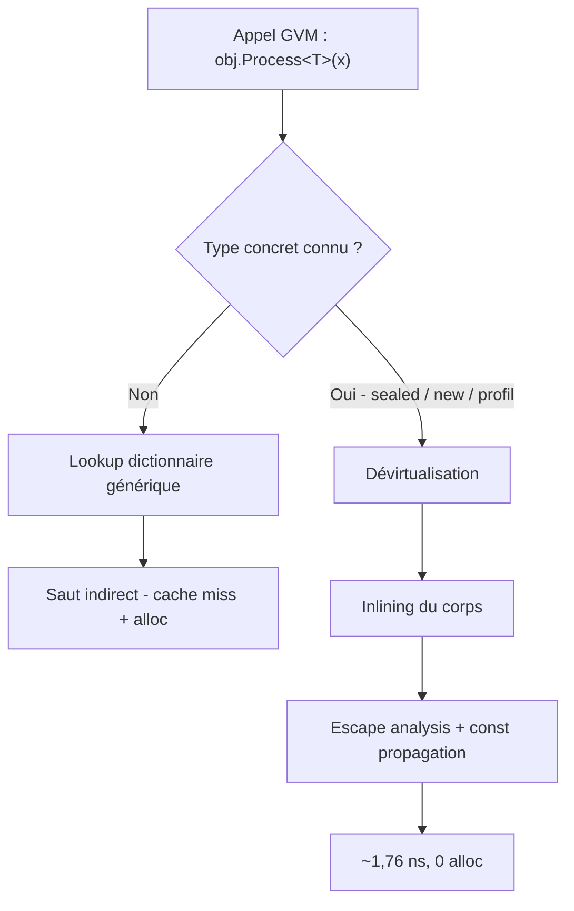
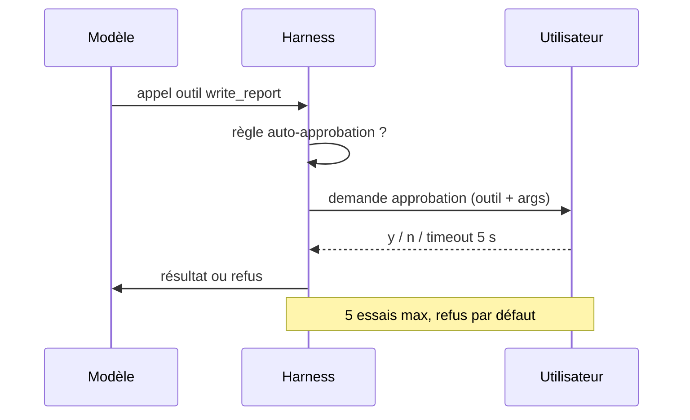

# CSharp — Détail du samedi 19 septembre 2026

## 1. .NET 11 — dévirtualisation des méthodes génériques virtuelles et runtime async en opt-in

**Source :** .NET Blog (Stephen Toub) — https://devblogs.microsoft.com/dotnet/performance-improvements-in-net-11/
**Date :** 15 septembre 2026

### Contexte

Chaque année Stephen Toub publie un article-fleuve qui recense les optimisations de performance du millésime. Ce n'est pas du marketing : c'est un document de travail, benchmarks BenchmarkDotNet à l'appui, qui explique quel bounds check a disparu, quelle allocation ne se produit plus, quel verrou n'est plus pris. La thèse est toujours la même — les gains individuels sont minuscules, mais ils se composent, et au bout d'un an l'ensemble est mesurablement plus rapide.

Le morceau le plus structurant de .NET 11 concerne les **méthodes génériques virtuelles**, les GVM. Une GVM est une méthode à la fois virtuelle et générique sur sa propre signature : `T Process<T>(T input)` déclarée `virtual` ou sur une interface. C'est un cas que le JIT traitait mal depuis toujours.

### Comment ça marche

Pour comprendre le gain, il faut voir comment un appel virtuel classique est résolu. Sur un appel `obj.Method()`, le JIT lit le pointeur de table virtuelle depuis l'en-tête de l'objet, va chercher le slot correspondant, et saute. Quand le JIT sait statiquement que `obj` est toujours d'un type scellé ou qu'un seul type implémente l'interface, il peut **dévirtualiser** : remplacer le saut indirect par un appel direct, puis potentiellement **inliner** le corps de la méthode. C'est là que la vraie performance apparaît, parce que l'inlining débloque à son tour l'escape analysis, la propagation de constantes et la suppression de bornes.

Le blocage sur les GVM venait de la résolution générique. Une méthode générique virtuelle ne vit pas dans un slot de vtable simple : le runtime doit résoudre le couple (type concret, argument de type) à travers un dictionnaire générique, résolu à l'exécution. Ce lookup coûtait un cache miss et souvent une allocation. Le JIT ne pouvait donc ni dévirtualiser ni inliner.

.NET 11 change ça : quand le JIT connaît le type concret du receveur — parce qu'il vient d'un `new`, parce que la classe est scellée, ou grâce au profil dynamique du tiered compilation — il résout la GVM à la compilation et l'inline. Le benchmark cité passe de **6,678–7,166 ns en .NET 10 à environ 1,764 ns en .NET 11, avec zéro allocation**. Un facteur 4 sur un motif que tu rencontres dans tout code qui fait de l'abstraction générique : sérialiseurs, pipelines de validation, dispatchers de handlers MediatR.

Le second chantier est le **runtime async**. Aujourd'hui, le compilateur C# réécrit chaque méthode `async` en une machine à états : une struct qui capture l'état local, un `AsyncTaskMethodBuilder`, et une boucle de reprise. Le runtime async déplace cette mécanique dans le runtime lui-même, ce qui supprime une partie de l'objet Task et des allocations de continuation. En .NET 11 c'est **opt-in via un feature switch**, pas activé par défaut. Le plan annoncé est d'en faire le défaut en .NET 12.



### En pratique — exemple de code

Le motif qui bénéficie le plus est l'abstraction générique sur type scellé. Voici la forme avant / après du point de vue du code machine produit, à source identique.

```csharp
// Le code source ne change PAS. C'est le JIT qui change de comportement.
public interface IMapper { TOut Map<TIn, TOut>(TIn source); }

public sealed class FastMapper : IMapper            // sealed : indice clé pour le JIT
{
    public TOut Map<TIn, TOut>(TIn source) => (TOut)(object)source!;
}

// Avant — .NET 10 : lookup du dictionnaire générique à chaque appel,
// pas d'inlining possible -> 6,678 à 7,166 ns, avec allocation.
// Après — .NET 11 : le JIT voit FastMapper (sealed), dévirtualise,
// inline le corps, puis élimine le boxing -> ~1,764 ns, 0 alloc.
IMapper mapper = new FastMapper();
var result = mapper.Map<int, int>(42);
```

Le runtime async, lui, s'active par configuration projet. Mesure avant d'activer : le gain dépend fortement de ton taux d'await qui complètent de façon synchrone.

```xml
<!-- Directory.Build.props ou .csproj -->
<Project>
  <PropertyGroup>
    <TargetFramework>net11.0</TargetFramework>
  </PropertyGroup>

  <ItemGroup>
    <!-- Runtime async : opt-in en .NET 11, prévu par défaut en .NET 12.
         Supprime une partie des allocations de machine à états async. -->
    <RuntimeHostConfigurationOption
        Include="System.Runtime.CompilerServices.RuntimeAsync"
        Value="true"
        Trim="true" />
  </ItemGroup>
</Project>
```

### Pourquoi ça compte pour toi

Ton code ASP.NET Core est saturé d'abstractions génériques : handlers, validators, repositories, convertisseurs JSON. Scelle tes implémentations concrètes — `sealed class` est maintenant un levier de performance mesurable, pas un choix de style. Sur le runtime async, reste prudent : c'est un opt-in en RC, benchmarke ton propre chemin chaud avant de l'activer, et prévois de le tester sérieusement avant .NET 12 où il deviendra le défaut.

### Pour aller plus loin

.NET 11 RC1 est sorti le 8 septembre avec licence go-live, C# 15 et F# 11 en versions de langage par défaut. La GA est attendue le 10 novembre 2026, avec un support STS de deux ans jusqu'au 9 novembre 2028.

---

## 2. Microsoft Agent Framework — le harness d'agent en C#, des outils à l'approbation humaine

**Source :** .NET Blog (Bruno Capuano) — https://devblogs.microsoft.com/dotnet/build-your-own-ai-agent-harness-in-csharp-the-maf-claw-live-series/
**Date :** 16 septembre 2026

### Contexte

Un modèle de langage génère du texte. Un agent fait autre chose : il tourne en boucle, appelle des outils, inspecte les résultats, met à jour un plan, mémorise ce qui sert, demande une validation avant les actions risquées, gère une fenêtre de contexte qui grossit, et continue jusqu'à ce que la tâche soit finie. Ce runtime autour du modèle, c'est le **harness**.

Le problème est que chaque équipe le réécrit. Boucle d'outils, sérialisation de l'historique après chaque appel de service, planification, compaction de contexte, couche mémoire, protocole d'approbation, chargement de skills, workers de fond, instrumentation : tu réimplémentes le même orchestrateur avant même de commencer ton domaine métier. Microsoft Agent Framework livre ce harness prêt à l'emploi, et Bruno Capuano en construit un agent complet en direct, en quatre sessions, sur la chaîne YouTube .NET et Microsoft Reactor.

### Comment ça marche

L'entrée est une seule extension sur `IChatClient`. `chatClient.AsHarnessAgent(options)` te rend un `AIAgent` qui embarque déjà l'invocation automatique de fonctions, la persistance d'historique après chaque appel modèle, la planification avec providers todo et agent-mode, la compaction de contexte, la mémoire fichier, la recherche web quand le service modèle la supporte, l'approbation d'outils, les skills et l'instrumentation OpenTelemetry. Chaque capacité est remplaçable, désactivable, ou extensible par ton propre provider.

Le vrai apport conceptuel est la **gradation des frontières**. L'agent d'exemple est un assistant d'éducation financière, choisi parce qu'il produit naturellement des niveaux de risque distincts : consulter un cours est une lecture pure ; lire un portefeuille touche des données utilisateur ; écrire un rapport modifie un fichier ; passer un ordre simulé est un effet de bord.

Deux mécanismes matérialisent ces frontières. Le premier est le **file store** : tu fournis un `FileSystemAgentFileStore` enraciné sur un répertoire, et le harness n'expose ses outils fichier que contre cette racine. Le modèle ne reçoit jamais un accès filesystem arbitraire. Le second est `ApprovalRequiredAIFunction` : la fonction enveloppée peut être *demandée* par le modèle, mais le harness émet d'abord une requête d'approbation vers l'application hôte, qui affiche l'outil et ses arguments, et retourne la décision humaine dans la même session.

La nuance qui compte est la règle d'auto-approbation. Si chaque lecture anodine interrompt l'utilisateur, l'approbation devient du bruit et se fait cliquer machinalement. L'objectif n'est pas d'afficher plus de dialogues, c'est de rendre visibles les actions conséquentes.



### En pratique — exemple de code

Le squelette complet d'un agent borné tient en une vingtaine de lignes. Note que l'outil métier est du C# ordinaire : le framework dérive le schéma depuis la signature et les `[Description]`.

```csharp
var workingDirectory = Path.Combine(AppContext.BaseDirectory, "working");

AIAgent agent = chatClient.AsHarnessAgent(new HarnessAgentOptions
{
    // Frontière 1 : l'accès disque est enraciné sur UN répertoire.
    FileAccessStore = new FileSystemAgentFileStore(workingDirectory),

    // Frontière 2 : les lectures passent seules, le reste demande l'humain.
    ToolApprovalAgentOptions = new ToolApprovalAgentOptions
    {
        AutoApprovalRules = [FileAccessProvider.ReadOnlyToolsAutoApprovalRule],
    },

    ChatOptions = new ChatOptions
    {
        Instructions = "Le portefeuille est dans portfolio.csv. Lis-le avant de répondre.",
        Tools = [StockTools.GetStockPrice, StockTools.RequestSimulatedTrade],
    }
});
```

```csharp
// Un outil à effet de bord n'est PAS exécutable par le modèle :
// il est enveloppé, donc il produit une demande d'approbation.
public static AIFunction RequestSimulatedTrade { get; } =
    new ApprovalRequiredAIFunction(
        AIFunctionFactory.Create(RequestSimulatedTradeOrder, "request_simulated_trade"));

// Le silence n'est pas un consentement : deadline + plafond d'essais,
// refus automatique au dernier essai, refus collant pour le reste du prompt.
const int maxApprovalAttempts = 5;
var approvalTimeout = TimeSpan.FromSeconds(5);
var approvalPolicy = new TimedApprovalPolicy(maxApprovalAttempts, approvalTimeout);
```

### Pourquoi ça compte pour toi

Si tu dois exposer un agent depuis ton backend .NET, ne réécris pas la boucle d'orchestration : tu passerais des semaines sur de la plomberie avant de toucher ton domaine. Retiens surtout les deux frontières — racine filesystem et approbation par niveau de risque — parce que ce sont exactement les contrôles qu'un audit te réclamera. Et méfie-toi d'un flux d'approbation qui attend indéfiniment : c'est un déni de service sur ta propre session.

### Points de vigilance

Le confinement n'est pas l'isolation. Les capacités shell et CodeAct présentées en session 3 restent dangereuses même avec politique et approbation : une vraie isolation process ou VM reste nécessaire. Et un conteneur hébergé partagé ne doit pas hériter des accès filesystem ou shell locaux simplement parce qu'ils étaient pratiques en développement.
