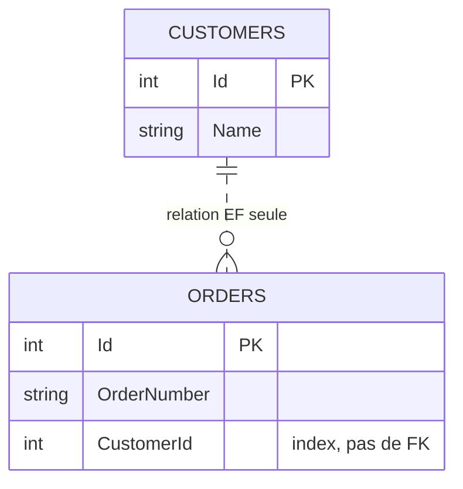
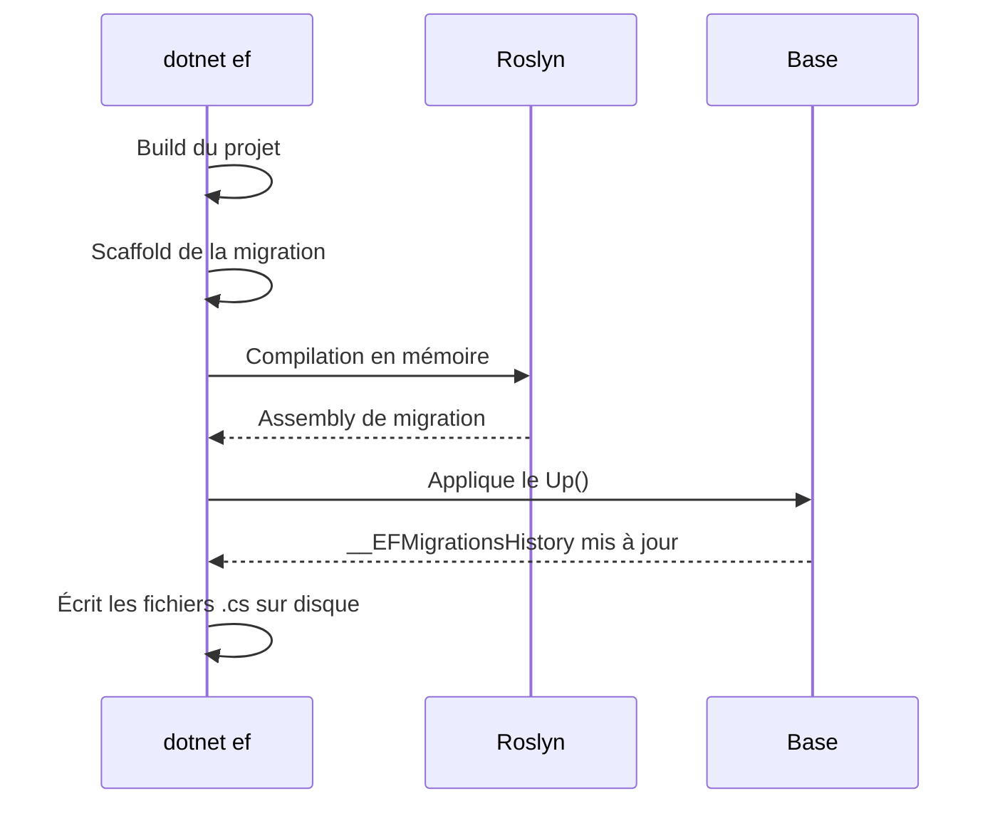

# CSharp — Détail du dimanche 20 septembre 2026

## 1. EF Core 11 — `ExcludeForeignKeyFromMigrations()`, la relation sans la contrainte physique

**Source :** Jaliya's Blog — https://jaliyaudagedara.blogspot.com/2026/09/ef-core-110-whats-new-with-migrations.html
**Date :** 11 septembre 2026

### Contexte

EF Core a toujours traité le modèle et le schéma comme deux faces d'une même pièce. Tu déclares une navigation, EF en déduit une relation, et la migration émet une `FOREIGN KEY` en base. Ce couplage est une bonne chose par défaut — mais il devient un problème dans deux situations très courantes.

La première, c'est la base historique. Tu reprends un schéma existant qui n'a jamais eu de contraintes de clé étrangère, parce qu'il a été conçu avant, ou parce que l'équipe a choisi de les gérer applicativement. Tu veux qu'EF connaisse la relation pour générer des jointures et charger les entités liées, mais tu ne veux surtout pas que `dotnet ef migrations add` te propose de créer trente contraintes sur des données qui ne les respectent pas.

La seconde, c'est la synchronisation de données. Tu ingères des lots venant d'un système tiers, et l'ordre d'arrivée ne garantit pas que le parent précède l'enfant. Une contrainte référentielle te bloque à l'insertion, alors que la cohérence sera atteinte à la fin du lot. Les contournements classiques — désactiver la contrainte, l'ajouter après coup dans une migration manuelle, exclure la table du modèle — sont tous fragiles.

### Comment ça marche

EF Core 11 introduit `ExcludeForeignKeyFromMigrations()` sur le builder de relation. L'appel pose une annotation sur la clé étrangère du modèle, et le **migrations assembly** lit cette annotation au moment de générer le diff de schéma.

Le mécanisme pas à pas :

1. Tu configures la relation normalement dans `OnModelCreating` : `HasOne`, `WithMany`, `HasForeignKey`.
2. Tu ajoutes `ExcludeForeignKeyFromMigrations()` en fin de chaîne.
3. Le modèle EF reste **complet** : la navigation existe, le change tracker connaît le lien parent/enfant, le générateur de requêtes produit l'`INNER JOIN` attendu.
4. Le générateur de migration, lui, omet l'appel `migrationBuilder.AddForeignKey(...)` dans le `Up()`.
5. **L'index sur la colonne de clé étrangère est toujours créé.** C'est délibéré : sans contrainte, c'est cet index qui garantit que tes jointures ne dégénèrent pas en scan.

Le point conceptuel à retenir : tu déplaces la garantie d'intégrité référentielle du moteur de base vers ton code. EF ne la vérifiera pas pour toi. C'est un arbitrage explicite, pas un raccourci gratuit.



### En pratique — exemple de code

```csharp
// Avant — EF Core 10 : la relation implique toujours une FOREIGN KEY en base
modelBuilder.Entity<Order>()
    .HasOne(x => x.Customer)
    .WithMany()
    .HasForeignKey(x => x.CustomerId);

// Après — EF Core 11 : relation conservée côté modèle, contrainte absente côté schéma
modelBuilder.Entity<Order>()
    .HasOne(x => x.Customer)
    .WithMany()
    .HasForeignKey(x => x.CustomerId)
    .ExcludeForeignKeyFromMigrations();
```

```csharp
// La migration générée : plus d'AddForeignKey, mais l'index reste
migrationBuilder.CreateTable(
    name: "Orders",
    columns: table => new
    {
        Id = table.Column<int>(type: "int", nullable: false)
            .Annotation("SqlServer:Identity", "1, 1"),
        OrderNumber = table.Column<string>(type: "nvarchar(max)", nullable: false),
        CustomerId = table.Column<int>(type: "int", nullable: false)
    },
    constraints: table => { table.PrimaryKey("PK_Orders", x => x.Id); });

// L'index survit -> les jointures restent performantes
migrationBuilder.CreateIndex(
    name: "IX_Orders_CustomerId", table: "Orders", column: "CustomerId");
```

```csharp
// Côté requête, rien ne change : EF produit toujours la jointure
foreach (Order order in await context.Orders.Include(x => x.Customer).ToListAsync())
    Console.WriteLine($"Order: '{order.OrderNumber}', Customer: '{order.Customer.Name}'.");
// SELECT [o].[Id], [o].[CustomerId], [o].[OrderNumber], [c].[Id], [c].[Name]
// FROM [Orders] AS [o] INNER JOIN [Customers] AS [c] ON [o].[CustomerId] = [c].[Id]
```

### Pourquoi ça compte pour toi

Sur PostgreSQL comme sur SQL Server, tu as sûrement une base reprise où le diff de migration propose des contraintes que tu refuses d'appliquer. Cet appel fluent résout le cas proprement, sans `Exclude FromMigrations()` sur la table entière ni migration éditée à la main. En contrepartie, l'intégrité devient ta responsabilité : prévois un contrôle applicatif ou un job de réconciliation, sinon tu découvriras les orphelins en production.

### Points de vigilance

- L'exclusion ne supprime pas une contrainte déjà présente en base : elle l'ignore, ce qui crée une divergence silencieuse entre le snapshot et le schéma réel.
- Sans contrainte, les suppressions en cascade côté moteur disparaissent — EF applique encore sa cascade logique en mémoire, mais uniquement sur les entités qu'il a chargées.

---

## 2. EF Core 11 — `database update --add`, et la fin de la dépendance implicite à la base

**Source :** Microsoft Learn — https://learn.microsoft.com/en-us/ef/core/what-is-new/ef-core-11.0/whatsnew
**Date :** EF Core 11 RC1, septembre 2026

### Contexte

Le cycle de migration EF est une chorégraphie à deux temps depuis EF Core 1.0 : `dotnet ef migrations add <Nom>` génère la classe de migration, puis `dotnet ef database update` l'applique. Chaque commande relance un build complet du projet. En développement, quand tu itères sur un modèle et que tu ajoutes une colonne toutes les dix minutes, tu payes deux compilations pour un changement.

Deuxième irritant, plus vicieux : `dotnet ef migrations remove` se connecte à la base. Pourquoi ? Parce qu'il doit savoir si la migration a déjà été appliquée, auquel cas la supprimer laisserait la table `__EFMigrationsHistory` incohérente. Résultat : tu ne peux pas annuler une migration que tu viens de générer si ton conteneur Postgres est arrêté, si tu es dans un train, ou si la chaîne de connexion du `DbContext` pointe vers un environnement auquel tu n'as pas accès depuis ce poste.

### Comment ça marche

EF Core 11 attaque les deux points.

**`--add` sur `database update`.** La commande accepte désormais un nom de migration et un drapeau `--add`. Le déroulé interne est le suivant :

1. Build du projet, comme d'habitude.
2. Scaffolding de la migration à partir du diff entre le snapshot du modèle et le modèle courant.
3. **Compilation de la migration à la volée avec Roslyn**, en mémoire — sans second build MSBuild.
4. Application immédiate à la base, puis insertion de la ligne dans `__EFMigrationsHistory`.
5. Écriture des fichiers `.cs` sur disque, pour que tu les commites normalement.

L'étape 3 est la clé : c'est elle qui économise le cycle de build, et c'est aussi elle qui explique pourquoi les fichiers restent générés — ils devront être recompilés lors du prochain build normal du projet.

**`--offline` et `--connection` sur `migrations remove`.** `--offline` court-circuite purement la vérification en base : EF suppose que la migration n'a pas été appliquée, supprime les fichiers et rembobine le snapshot du modèle. `--connection` permet de passer la chaîne en argument plutôt que de dépendre de ce qu'expose le `DbContext` ou la factory de design-time. Les deux drapeaux `--offline` et `--force` sont mutuellement exclusifs, et c'est logique : `--force` annule une migration appliquée, ce qui exige une connexion.



### En pratique — exemple de code

```bash
# Avant — EF Core 10 : deux commandes, deux builds
dotnet ef migrations add InitialCreate
dotnet ef database update

# Après — EF Core 11 : une commande, compilation Roslyn en mémoire
dotnet ef database update InitialCreate --add
# Les options de "migrations add" restent disponibles :
dotnet ef database update AddProducts --add --output-dir Migrations/Products
```

```bash
# Annuler une migration sans base joignable (impossible avant EF Core 11)
dotnet ef migrations add AddOrderDate
dotnet ef migrations remove --offline
# Removing migration '20260911004851_AddOrderDate'. Reverting the model snapshot. Done.

# --offline et --force sont incompatibles : --force a besoin de la base
# dotnet ef migrations remove --offline --force   # erreur

# Chaîne de connexion explicite, indépendante du DbContext
dotnet ef migrations remove --connection "Host=localhost;Database=veille;Username=app"
dotnet ef database drop --connection "Host=localhost;Database=veille_test" --force
```

```powershell
# Équivalents Package Manager Console
Update-Database -Migration InitialCreate -Add
Remove-Migration -Offline
Drop-Database -Connection "<Connection String>" -Force
```

### Pourquoi ça compte pour toi

Ton boucle de dev sur PostgreSQL gagne un build complet par itération de schéma. Plus utile encore : `--connection` rend tes scripts CI déterministes, puisque la cible ne dépend plus d'une factory de design-time ni d'une variable d'environnement. Une réserve : ne mets jamais `--add` dans un pipeline de déploiement — tu veux que la migration soit revue et commitée avant d'atteindre un environnement partagé.

### Limites

- `--add` reste un outil de développement : il applique sans passer par la revue de code ni par un script SQL idempotent.
- `--offline` ne vérifie rien ; si la migration était appliquée, tu laisses `__EFMigrationsHistory` désynchronisée du code.
