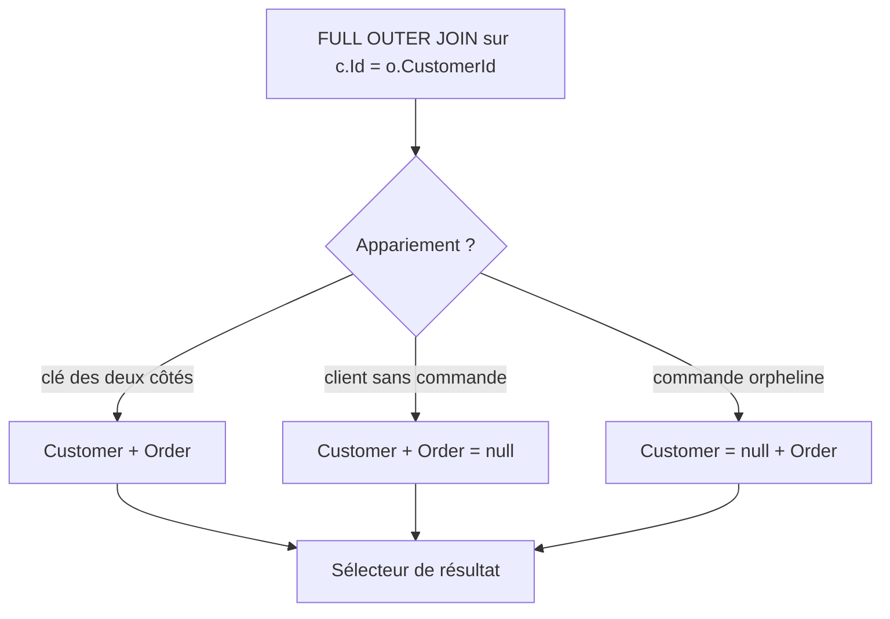

# CSharp — Détail du lundi 21 septembre 2026

## 1. EF Core 11 — `Queryable.FullJoin` et les nouvelles simplifications SQL

**Source :** dotnet/core release notes — https://github.com/dotnet/core/blob/main/release-notes/11.0/preview/preview6/efcore.md
**Date :** 21 septembre 2026 (notes de version EF Core dans .NET 11, RC1 go-live)

### Contexte

LINQ to Entities savait faire `INNER JOIN` depuis toujours. Le `LEFT JOIN` demandait le tour de passe-passe `GroupJoin` + `SelectMany` + `DefaultIfEmpty`, jusqu'à ce que .NET 10 introduise les opérateurs `LeftJoin` et `RightJoin`. Le `FULL OUTER JOIN`, lui, restait hors d'atteinte.

Or c'est exactement l'opération dont tu as besoin quand tu réconcilies deux référentiels. Des clients sans commande d'un côté, des commandes orphelines de l'autre, et tu veux les deux dans un seul résultat. Jusqu'ici la solution consistait à écrire deux requêtes et les unir, ou à passer par du SQL brut. Les deux coûtent cher : la première fait deux allers-retours et duplique les lignes appariées, la seconde te fait perdre la composabilité et le typage.

EF Core 11 ajoute `Queryable.FullJoin` et le traduit directement en `FULL OUTER JOIN`.

### Comment ça marche

L'opérateur prend la même forme que `LeftJoin` : la séquence externe, la séquence interne, le sélecteur de clé externe, le sélecteur de clé interne, puis le sélecteur de résultat.

Le point à comprendre est la nullabilité du résultat. Dans un `LeftJoin`, seul le côté droit peut être nul. Dans un `FullJoin`, les deux côtés peuvent l'être, mais jamais simultanément. Chaque ligne retournée correspond donc à l'un de trois cas : appariée, orpheline à gauche, orpheline à droite. Ton sélecteur de résultat doit traiter les trois. Si tu projettes `c.Name` sans garde, tu prends une `NullReferenceException` sur les lignes orphelines à droite.

Deux autres optimisations arrivent dans la même vague et méritent ton attention, parce qu'elles changent le SQL que tu lis dans les logs.

La première génère `NULLIF`. Un `x.Status == 0 ? null : x.Status` produisait un `CASE WHEN ... THEN NULL ELSE ... END`. Il produit maintenant `NULLIF([x].[Status], 0)`. L'optimisation s'applique à la construction de l'expression SQL, donc chez tous les providers relationnels, PostgreSQL inclus.

La seconde supprime les `CASE` qui ne font que répliquer la propagation de null native de SQL. Un `CASE WHEN [o].[Date] IS NOT NULL THEN [o].[Date] ELSE NULL END` devient simplement `[o].[Date]`. Le SQL raccourcit, et le plan d'exécution s'en trouve parfois meilleur.

Enfin, `List<T>.Exists(predicate)` est réécrit en `Queryable.Any` et traduit en sous-requête `EXISTS`. Avant, il provoquait une évaluation côté client, donc un chargement complet de la collection. Si tu as ce pattern quelque part, tu viens de gagner une requête.



### En pratique — exemple de code

```csharp
// Avant — EF Core 10 : deux requêtes puis union côté SQL, ou pire, côté client.
var left  = context.Customers.LeftJoin(context.Orders,
                c => c.Id, o => o.CustomerId, (c, o) => new { C = c, O = o });
var right = context.Orders.LeftJoin(context.Customers,
                o => o.CustomerId, c => c.Id, (o, c) => new { C = c, O = o });
var result = await left.Union(right).ToListAsync();   // doublons appariés à filtrer
```

```csharp
// Après — EF Core 11 : un seul FULL OUTER JOIN, une seule requête.
var result = await context.Customers
    .FullJoin(
        context.Orders,
        c => c.Id,
        o => o.CustomerId,
        (c, o) => new { Customer = c, Order = o })   // les deux côtés sont nullables
    .ToListAsync();

// SQL émis :
// SELECT [c].[Id], [c].[Name], [o].[Id], [o].[CustomerId], [o].[Total]
// FROM [Customers] AS [c]
// FULL OUTER JOIN [Orders] AS [o] ON [c].[Id] = [o].[CustomerId]
```

### Pourquoi ça compte pour toi

Tu écris des rapprochements — stock contre inventaire, facturation contre encaissement — et tu les fais aujourd'hui en deux requêtes ou en SQL brut. Tu peux les ramener dans LINQ, typés et composables. Attention en revanche : PostgreSQL n'accepte `FULL OUTER JOIN` qu'avec une condition d'égalité, ce que `FullJoin` respecte par construction. Vérifie ton plan avant de généraliser sur de gros volumes.

---

## 2. EF Core 11 — indexer une propriété de complex type, et les index JSON SQL Server

**Source :** dotnet/core release notes — https://github.com/dotnet/core/blob/main/release-notes/11.0/preview/preview6/efcore.md
**Date :** 21 septembre 2026 (notes de version EF Core dans .NET 11, RC1 go-live)

### Contexte

Les complex types sont arrivés pour modéliser proprement une valeur composite sans en faire une entité. Une adresse, un montant avec devise, un intervalle de dates. Ils se mappent à plat dans la table du propriétaire, ce qui est exactement ce que tu veux.

Le problème était la configuration. `HasIndex` refusait tout chemin traversant un complex type. Tu pouvais donc avoir une colonne `Address_ZipCode` dans la table, mais pas déclarer d'index dessus depuis le model builder. Il fallait descendre en SQL brut dans la migration, ce qui casse la cohérence entre le modèle et le schéma, et se perd au prochain scaffolding.

### Comment ça marche

`HasKey`, `HasAlternateKey` et `HasIndex` acceptent désormais des lambdas à chemin pointé. Tu écris `c => c.Address.ZipCode` et EF Core résout la colonne aplatie correspondante.

Une conséquence importante suit automatiquement. Toute propriété utilisée dans une clé ou un index devient obligatoire, ainsi que chaque complex type du chemin. C'est logique — une clé ne peut pas être nulle — mais cela modifie ton schéma sans que tu l'aies demandé explicitement. Si `Address` était optionnel, il ne l'est plus. Relis ta migration générée avant de l'appliquer.

EF Core lève des erreurs de validation dans deux cas : un complex type de collection sur le chemin, ou un complex type optionnel utilisé dans une clé. Le message est explicite, mais le mieux reste de ne pas y arriver.

Côté SQL Server, une seconde capacité arrive : tu peux définir un index sur une propriété située à l'intérieur d'une colonne mappée en JSON. Tu gardes ton document dans une colonne unique et tu indexes le champ qui sert de filtre, sans quitter le model builder.

Dernier point, côté migrations. Quand seule une facette d'index change — fill factor, unicité, filtre, ordre de tri — SQL Server émet maintenant un unique `CREATE INDEX ... WITH (DROP_EXISTING = ON)`. Auparavant il générait un `DROP INDEX` suivi d'un `CREATE INDEX`, laissant une fenêtre pendant laquelle la table tournait sans index. Sur une table chaude, cette fenêtre se paie en timeouts.

### En pratique — exemple de code

```csharp
// Avant — EF Core 10 : impossible depuis le model builder, SQL brut dans la migration.
migrationBuilder.Sql(
    "CREATE INDEX IX_Customers_Zip ON Customers (Address_ZipCode);");
```

```csharp
// Après — EF Core 11 : le chemin pointé est résolu vers la colonne aplatie.
protected override void OnModelCreating(ModelBuilder modelBuilder)
{
    modelBuilder.Entity<Customer>()
        .ComplexProperty(c => c.Address);

    modelBuilder.Entity<Customer>()
        .HasIndex(c => c.Address.ZipCode);        // Address devient requis

    modelBuilder.Entity<Order>()
        .HasAlternateKey(o => o.ShippingAddress.Street);
}
```

```sql
-- Migration d'un changement de facette : une seule instruction, sans trou d'index.
CREATE UNIQUE INDEX [IX_People_X] ON [People] ([X]) WITH (DROP_EXISTING = ON);
```

### Pourquoi ça compte pour toi

Tu gagnes la possibilité de modéliser proprement sans sacrifier les index. Concrètement : tes value objects cessent d'être une raison de retomber sur des propriétés plates. Vérifie toutefois l'impact du passage en obligatoire sur tes colonnes existantes — une migration qui rend `NOT NULL` une colonne contenant des nulls échoue à l'application. Prépare un script de backfill avant.

### Limites

Ces API arrivent dans les préversions de .NET 11 et le RC1 porte une licence go-live. Le provider PostgreSQL `Npgsql.EntityFrameworkCore.PostgreSQL` suit le cycle en parallèle : vérifie que ta version est synchronisée sur le RC avant de compter sur la traduction. L'index sur colonne JSON est spécifique à SQL Server, sans équivalent immédiat côté `jsonb`.
