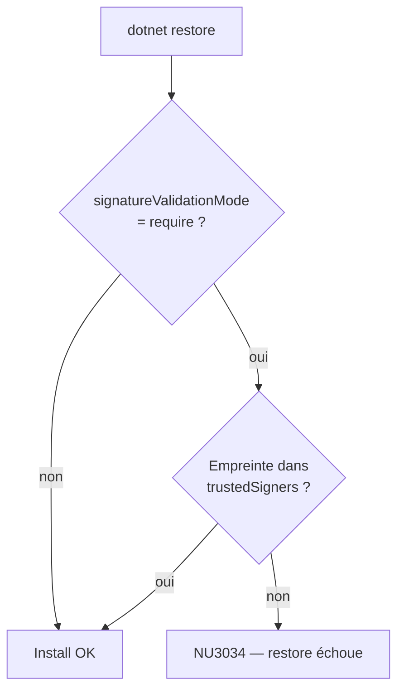
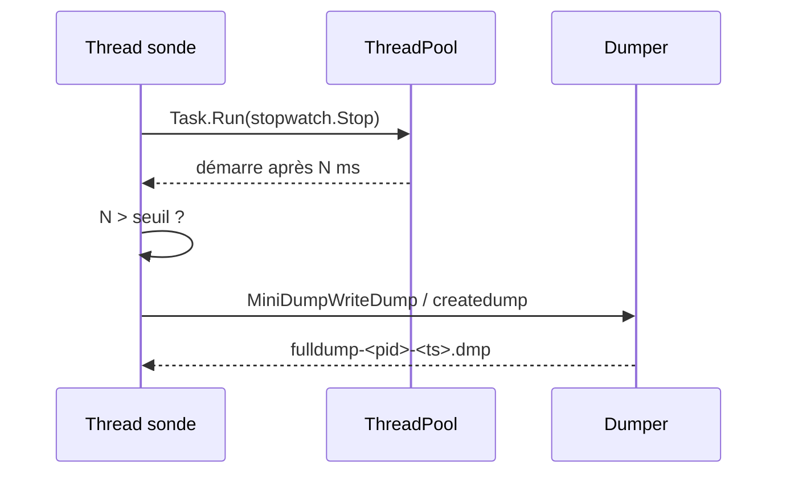

# CSharp — Détail du vendredi 25 septembre 2026

## 1. NuGet — Microsoft change son certificat de signature auteur le 23 septembre 2026

**Source :** .NET Blog (NuGet Team) — https://devblogs.microsoft.com/dotnet/microsoft-author-signing-certificate-update-2026/
**Date :** 23 septembre 2026

### Contexte

NuGet supporte deux signatures distinctes sur un paquet. La **signature auteur** (author signing) atteste que tel éditeur a produit ce `.nupkg`. La **signature dépôt** (repository signing) est apposée par nuget.org au moment de la publication. Microsoft signe ses paquets avec un certificat X.509 d'auteur, et ce certificat, comme tous les certificats, expire.

Une nouvelle empreinte devient le défaut pour les paquets Microsoft à partir du 23 septembre 2026. Les paquets déjà publiés gardent leur signature existante — rien n'est invalidé rétroactivement. Mais **tout nouveau paquet** sera signé avec le nouveau certificat. Si ta chaîne de build vérifie l'identité du signataire par empreinte, tu as une bombe à retardement dans ton `nuget.config`.

Le piège est que la majorité des équipes ne sont pas concernées : sans politique d'allowlist explicite, NuGet installe les paquets Microsoft signés par le nouveau certificat exactement comme avant. Ce sont précisément les équipes les plus rigoureuses sur la supply chain qui vont casser.

### Comment ça marche

Deux mécanismes déclenchent le problème, et un seul suffit.

**Le premier, c'est la politique client.** Dans `nuget.config`, la combinaison `<config><add key="signatureValidationMode" value="require" /></config>` et un bloc `<trustedSigners>` transforme la vérification de signature en **allowlist fermée**. NuGet ne se contente plus de vérifier que la signature est cryptographiquement valide et que la chaîne remonte à une racine de confiance ; il exige que l'empreinte SHA-256 du certificat de signature figure dans ta liste. Une empreinte absente = refus, avec le code d'erreur **NU3034**.

Ces fichiers se cumulent par portée : machine, utilisateur, solution. Il peut donc y avoir plusieurs `nuget.config` actifs, et celui qui te casse n'est pas forcément celui de ton repo — pense à vérifier le niveau machine sur les agents de CI.

**Le second, c'est la vérification explicite.** Si un step de pipeline appelle `dotnet nuget verify` avec une liste de `--certificate-fingerprint`, la même logique s'applique : le paquet fraîchement signé ne matchera aucune empreinte connue et le step échouera.

La correction est additive dans les deux cas. Tu **ajoutes** la nouvelle empreinte sans retirer les anciennes, sinon tu perds la capacité d'installer les paquets historiques. Microsoft liste quatre empreintes à maintenir en parallèle après la transition.



### En pratique — exemple de code

La nouvelle empreinte SHA-256 est `9A1B131BEE0605433056A4EA3815478A8E177961A968C6C0027C1093D1FEB630`. L'ancienne empreinte par défaut était `566A31882BE208BE4422F7CFD66ED09F5D4524A5994F50CCC8B05EC0528C1353`.

```xml
<!-- Avant — nuget.config : trois empreintes, aucune ne couvre les paquets signés après le 23/09 -->
<trustedSigners>
  <author name="Microsoft">
    <certificate fingerprint="3F9001EA83C560D712C24CF213C3D312CB3BFF51EE89435D3430BD06B5D0EECE" hashAlgorithm="SHA256" allowUntrustedRoot="false" />
    <certificate fingerprint="AA12DA22A49BCE7D5C1AE64CC1F3D892F150DA76140F210ABD2CBFFCA2C18A27" hashAlgorithm="SHA256" allowUntrustedRoot="false" />
    <certificate fingerprint="566A31882BE208BE4422F7CFD66ED09F5D4524A5994F50CCC8B05EC0528C1353" hashAlgorithm="SHA256" allowUntrustedRoot="false" />
  </author>
</trustedSigners>
```

```console
# Après — une seule commande, disponible depuis le SDK .NET 6. Elle édite le nuget.config applicable.
# --configfile <chemin> pour viser un fichier précis (utile sur un agent de CI mutualisé).
dotnet nuget trust author Microsoft 9A1B131BEE0605433056A4EA3815478A8E177961A968C6C0027C1093D1FEB630 --algorithm SHA256

# Et si tu vérifies explicitement dans un step de pipeline : ajoute, ne remplace pas.
dotnet nuget verify <PackagePath> \
  --certificate-fingerprint 566A31882BE208BE4422F7CFD66ED09F5D4524A5994F50CCC8B05EC0528C1353 \
  --certificate-fingerprint 9A1B131BEE0605433056A4EA3815478A8E177961A968C6C0027C1093D1FEB630
```

### Pourquoi ça compte pour toi

Si tu as durci ta supply chain NuGet, tu es exactement la cible. Fais le test maintenant : cherche `signatureValidationMode` et `trustedSigners` dans tous tes `nuget.config`, y compris au niveau machine sur tes agents de build. Ajoute l'empreinte avant que le prochain patch Microsoft ne tombe, sinon ton restore casse un lundi matin sur un `NU3034` incompréhensible. Garde les quatre empreintes : retirer les anciennes te bloquerait sur les paquets déjà publiés.

---

## 2. Créer un dump mémoire depuis ton propre process C# — la sonde thread pool comme déclencheur

**Source :** .NET Blog (Aaron Powell) — https://devblogs.microsoft.com/dotnet/creating-a-memory-dump-in-csharp/
**Date :** 22 septembre 2026

### Contexte

Il y a deux familles de pannes en production. Celles qui crashent — tu as une stack trace, un log, un `IExceptionHandler` qui a fait son travail. Et celles où l'application **ne répond plus** sans rien signaler. Là, les logs ne servent à rien : ils te disent ce que le code a fait, pas dans quel état il est maintenant.

Le dump mémoire répond à cette seconde famille. Un dump complet capture l'espace d'adressage du process : objets vivants, objets en attente de GC, handles, modules chargés, et surtout **l'état de chaque thread**. Ouvert dans Visual Studio en debug managé, tu parcours les call stacks comme si tu étais en pause dans le debugger, au moment exact de la panne.

L'article prend un cas classique de gel sans crash : la **saturation du thread pool**. Trop de travail bloquant posté sur le pool, celui-ci n'arrive plus à suivre, et tout ce qui dépend d'un thread du pool — y compris ta pipeline ASP.NET Core — attend.

### Comment ça marche

L'idée du déclencheur est élégante et tient en une phrase : **si le thread pool est sain, une tâche triviale qu'on lui poste démarre immédiatement**.

Un thread dédié (pas un thread du pool, sinon la sonde se noie avec le reste) dort un intervalle fixe, puis démarre un `Stopwatch` et poste un `Task.Run` dont le seul travail est d'arrêter ce chronomètre. Le temps mesuré n'est donc pas un temps de calcul : c'est le **délai d'ordonnancement**. Si le pool a un thread libre, c'est quelques microsecondes. Si le pool est saturé, la tâche reste en file et le chronomètre dépasse le seuil.

Quand le seuil est franchi, on écrit le dump. La mécanique diffère selon l'OS.

**Sur Windows**, on appelle `MiniDumpWriteDump` dans `dbghelp.dll` via P/Invoke. Les flags choisis décident du contenu, donc de la taille : `WithFullMemory` embarque tout l'espace d'adressage, `WithHandleData` les handles, `WithThreadInfo` l'état des threads. L'exemple cumule tout et produit environ 125 Mo.

**Sur Linux**, on passe par `createdump`, l'utilitaire livré à côté du runtime. Il s'attache au process cible par `ptrace`. Le détail qui coince : sur les distributions avec le LSM **Yama** (Ubuntu, Debian) et `ptrace_scope` à 1, seul un descendant peut tracer un process. `createdump` est bien lancé comme enfant, mais en conteneur la politique peut être plus restrictive — d'où l'appel `prctl(PR_SET_PTRACER, PR_SET_PTRACER_ANY)` en amont, best-effort, silencieusement ignoré sur musl/Alpine. Le dump produit tourne autour de 800 Mo.



### En pratique — exemple de code

Le cœur de la sonde, réduit à l'essentiel. Le garde anti-répétition compte : un dump complet pèse des centaines de mégaoctets.

```csharp
// Thread dédié : on ne mesure pas le pool depuis le pool.
private static void Watcher(int interval)
{
    while (true)
    {
        Thread.Sleep(interval);

        Stopwatch stopwatch = Stopwatch.StartNew();
        Task task = Task.Run(stopwatch.Stop);   // travail nul : on mesure l'ordonnancement

        if (!task.Wait(interval))
            Console.WriteLine($"Task did not complete within {interval} ms");

        if (stopwatch.ElapsedMilliseconds <= interval) continue;   // pool sain

        lock (DumpLock)
        {
            if (dumpCount++ > 0) continue;      // un seul dump par run : ils sont énormes
        }

        string path = Path.Combine(AppContext.BaseDirectory,
            $"fulldump-{Environment.ProcessId}-{DateTime.Now:yyyyMMdd-HHmmss}.dmp");

        if (OperatingSystem.IsWindows())    WindowsDumper.WriteCurrentProcess(path);
        else if (OperatingSystem.IsLinux()) LinuxDumper.WriteCurrentProcess(path);
    }
}
```

```csharp
// Le P/Invoke Windows. Les flags décident de ce qu'il y a dedans, donc du poids du fichier.
[DllImport("dbghelp.dll", SetLastError = true, CharSet = CharSet.Unicode)]
private static extern bool MiniDumpWriteDump(
    IntPtr hProcess, uint processId, SafeHandle hFile,
    DumpType dumpType, IntPtr exceptionParam, IntPtr userStreamParam, IntPtr callbackParam);

// Reproduire la panne : 1000 tâches bloquantes, pool saturé en quelques secondes.
Parallel.For(0, 1000, i => { Console.WriteLine("Running task {0}", i); Thread.Sleep(10_000); });
```

### Pourquoi ça compte pour toi

Tu as forcément déjà vécu le service ASP.NET Core qui se fige sans exception. Cette sonde te donne une preuve matérielle au lieu d'une hypothèse. Traite-la comme du code temporaire, dans un build dédié, pas comme un composant permanent. Et considère le `.dmp` comme un secret : il contient chaînes de connexion, tokens et mots de passe en clair. Répertoire restreint, cooldown, purge automatique.

### Points de vigilance

- **`LibraryImport` plutôt que `DllImport`** : l'auteur l'a reconnu en commentaire, le générateur source est la forme moderne en .NET 7+.
- **Se dumper soi-même peut deadlocker** : `MiniDumpWriteDump` suspend tous les threads sans égard pour les verrous qu'ils tiennent. La doc Microsoft recommande explicitement d'appeler depuis un process séparé. Le thread dédié et l'absence de verrous partagés atténuent, sans supprimer.
- **Alternatives moins invasives** : `dotnet-dump`, les variables d'environnement de dump sur crash, ou `Microsoft.Diagnostics.NETCore.Client` (ce qu'utilise `dotnet-dump` hors Windows, via IPC). La sonde in-process garde un avantage : elle est proactive et attrape les gels qui se résorbent seuls avant qu'un opérateur n'ait le temps de réagir.
