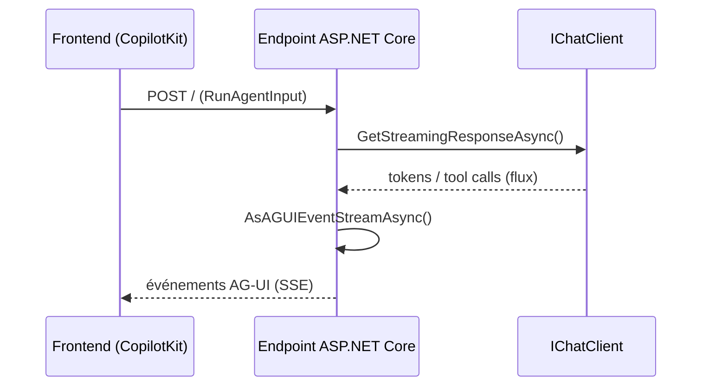

# CSharp — Détail du samedi 26 septembre 2026

## 1. AG-UI .NET SDK — le protocole agent-vers-interface arrive côté C#

**Source :** .NET Blog (Microsoft) — https://devblogs.microsoft.com/dotnet/ag-ui-dotnet-sdk/
**Date :** 25 septembre 2026

### Contexte

Les frameworks d'agents (LangChain, Semantic Kernel, Microsoft Agent Framework) génèrent chacun leur propre format d'événements pour transmettre la réponse d'un agent à une interface : un chunk de texte, un appel d'outil, une délégation à un sous-agent. Sans standard, chaque frontend doit réécrire un parseur par framework, et chaque backend invente son propre contrat JSON. AG-UI (Agent-User Interaction Protocol) est né pour combler ce vide côté frontend JS/TS. Microsoft publie maintenant, avec CopilotKit, un SDK .NET dédié — ce qui manquait pour brancher un backend C# sur ce protocole sans coller du JSON à la main à chaque projet.

### Comment ça marche

Le SDK expose cinq packages NuGet, découpés par responsabilité. `AGUI.Abstractions` porte les types du protocole et leur sérialisation — c'est le contrat partagé entre client et serveur. `AGUI.Formatting` gère le format sur le fil, par défaut des Server-Sent Events (SSE) : un flux HTTP texte que le navigateur consomme nativement, sans avoir besoin d'ouvrir une connexion WebSocket. `AGUI.Protobuf` est un codec binaire optionnel, pour les cas où le volume d'événements justifie un format plus compact que du JSON texte. `AGUI.Server` produit les événements côté backend ; `AGUI.Client` les consomme côté appelant, qu'il s'agisse d'un autre service .NET ou d'un outil de test.

Le point d'intégration central, c'est `IChatClient`, l'abstraction standard de `Microsoft.Extensions.AI`. N'importe quelle implémentation existante de `IChatClient` — que ton backend appelle Azure OpenAI, un modèle local via Ollama, ou un agent Microsoft Agent Framework — devient compatible AG-UI par une simple extension de méthode : `AsAGUIEventStreamAsync()` transforme le flux de réponse standard en flux d'événements typés AG-UI, prêt à être renvoyé en SSE depuis un endpoint minimal ASP.NET Core.



### En pratique — exemple de code

```csharp
// Côté serveur — expose ton IChatClient existant en flux AG-UI
var builder = WebApplication.CreateBuilder(args);
builder.Services.AddSingleton(CreateChatClient()); // ton client existant

var app = builder.Build();
app.MapPost("/", (RunAgentInput input, IChatClient chatClient,
    IOptions<JsonOptions> jsonOptions, CancellationToken ct) =>
{
    var context = input.ToChatRequestContext(jsonOptions.Value.SerializerOptions);
    var events = chatClient
        .GetStreamingResponseAsync(context.Messages, context.ChatOptions, ct)
        .AsAGUIEventStreamAsync(context, ct);
    return TypedResults.ServerSentEvents(events);
});

// Côté client — consomme le même flux comme un IChatClient standard
using var http = new HttpClient();
var remoteAgent = new AGUIChatClient(new(http, "http://localhost:5001"));
```

### Pourquoi ça compte pour toi

Si tu exposes déjà du chat ou de l'agent côté ASP.NET Core, ça t'évite d'inventer ton propre format d'événements ou de recopier un contrat pensé pour Next.js. Tu branches ton `IChatClient` existant — Semantic Kernel, Microsoft Agent Framework, ou un simple wrapper Azure OpenAI — et n'importe quel frontend AG-UI (CopilotKit ou autre) le consomme sans adaptateur maison à maintenir.

### Limites

Le SDK est jeune et développé en collaboration communautaire avec CopilotKit, pas encore annoncé GA par Microsoft. Valide la stabilité de l'API avant de le mettre en prod, et surveille le versioning des packages `AGUI.*` sur NuGet.
