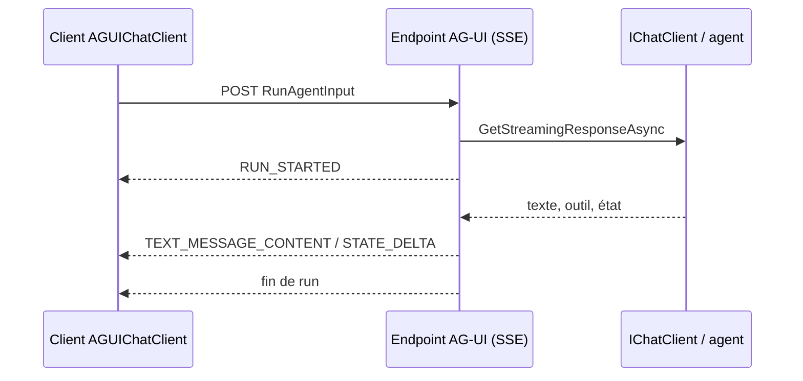

# CSharp — Détail du dimanche 4 octobre 2026

## 1. AG-UI .NET SDK — un protocole d'événements entre ton agent et son interface

**Source :** .NET Blog — https://devblogs.microsoft.com/dotnet/ag-ui-dotnet-sdk/
**Date :** 25 septembre 2026

### Contexte

Un agent IA ne renvoie pas un simple texte : il émet des morceaux de réponse, appelle des outils, demande une approbation, met à jour un état partagé. Chaque équipe réinventait son format de flux entre le backend et l'interface. AG-UI est un protocole ouvert qui standardise ces échanges, avec des implémentations Python et TypeScript.

Microsoft publie maintenant un SDK .NET de première classe, avec CopilotKit, sous licence MIT.

### Comment ça marche

Le SDK est découpé en cinq paquets NuGet. `AGUI.Abstractions` porte les types du protocole : événements, messages, outils, interruptions, état. `AGUI.Formatting` définit le format de transport, avec une implémentation Server-Sent Events. `AGUI.Protobuf` ajoute un codec optionnel, qui ne couvre qu'une partie des événements. `AGUI.Client` consomme un endpoint, `AGUI.Server` en produit un.

Le point clé est l'appui sur `IChatClient` de Microsoft.Extensions.AI. Côté serveur, tu prends le flux de `GetStreamingResponseAsync` et tu le convertis en événements AG-UI. Côté client, `AGUIChatClient` fait l'inverse et se présente comme un `IChatClient` ordinaire. Ton code applicatif ne voit pas la différence entre un modèle local et un agent distant.

Le flux est typé : `RUN_STARTED` ouvre l'exécution, `TEXT_MESSAGE_CONTENT` diffuse le texte, `STATE_DELTA` envoie un changement d'état, et ainsi de suite. Les appels d'outils parallèles, les blocs de raisonnement et les interruptions sont couverts. Comme le format est commun, un client TypeScript peut parler à ton serveur .NET.



### En pratique — exemple de code

Serveur minimal, tel que présenté par l'équipe (extrait abrégé, les points de suspension remplacent des paramètres omis) :

```csharp
// Enregistre le client de chat (modèle ou agent) dans le DI
builder.Services.AddSingleton(CreateChatClient());

// Un endpoint POST qui rejoue le flux sous forme d'événements AG-UI
app.MapPost("/", (RunAgentInput input, IChatClient chatClient /* ... */) =>
{
    var context = input.ToChatRequestContext(/* ... */);
    var events = chatClient.GetStreamingResponseAsync(/* ... */)
        .AsAGUIEventStreamAsync(context, cancellationToken);
    return TypedResults.ServerSentEvents(events); // SSE natif ASP.NET Core
});

// Côté client : un IChatClient qui parle AG-UI
var chatClient = new AGUIChatClient(new(httpClient, "http://localhost:5001"));
```

### Pourquoi ça compte pour toi

Tu peux exposer un agent .NET avec un endpoint minimal et le consommer depuis Angular ou Blazor sans inventer ton protocole. Comme tout passe par `IChatClient`, tu gardes tes middlewares existants (logs, cache, limites). Le SDK vise aussi .NET Framework 4.7.2, utile pour du legacy.

### Limites

Le codec Protobuf ne couvre qu'un sous-ensemble des événements. Le protocole est jeune : vérifie la stabilité des paquets avant de les mettre en production.

---

## 2. Blazor AI components — construire une interface d'agent avec `UIAgent`

**Source :** .NET Blog — https://devblogs.microsoft.com/dotnet/build-agentic-ui-blazor/
**Date :** 28 septembre 2026

### Contexte

Une interface d'agent demande plus qu'une zone de chat. Il faut afficher un texte qui arrive par morceaux, montrer les outils appelés, bloquer l'agent tant que l'utilisateur n'a pas approuvé, et éditer un état commun. Microsoft publie des composants Blazor expérimentaux qui couvrent ces cas.

### Comment ça marche

Le paquet est `Microsoft.AspNetCore.Components.AI`, en prérelease, et il demande le SDK .NET 11 RC1. Le point d'entrée haut niveau est `ChatPage`, qui fournit liste de messages, saisie, état de streaming et reprise. En dessous, `AgentBoundary`, `MessageList`, `MessageInput` et `BlockRenderer<TBlock>` te laissent composer ta propre interface.

Le cœur est `UIAgent` (et `UIAgent<TState>` pour un état typé). Il enveloppe un `IChatClient`, consomme les `ChatResponseUpdate` en flux et les transforme en `ContentBlock` observables. Un bloc peut être du texte, un appel d'outil, une demande d'approbation ou une action frontend. Ton composant Razor choisit comment afficher chaque type de bloc.

Les approbations passent par `FunctionApprovalBlock` : l'agent s'arrête jusqu'à ce que l'utilisateur accepte ou refuse. Les outils frontend s'exécutent dans l'application Blazor (navigation, dialogues) avec le même modèle que les outils serveur. L'état partagé se synchronise avec l'agent par `STATE_SNAPSHOT` et `STATE_DELTA`, ce dernier suivant RFC 6902 (JSON Patch).

L'intégration avec le sujet précédent est directe : `AGUIChatClient` traduit les événements AG-UI en mises à jour Microsoft.Extensions.AI, que `UIAgent` consomme.

### En pratique — exemple de code

Exemple de l'article : un bloc typé pour un outil `get_weather`, généré par source generator.

```csharp
// Bloc typé : mappe l'appel d'outil "get_weather" vers une classe
[ToolBlock("get_weather")]
public partial class WeatherToolBlock : FunctionInvocationContentBlock
{
    [ToolParameter(Name = "location")]
    public string? Location { get; set; }   // argument envoyé par l'agent

    [ToolResult]
    public WeatherInfo? Weather { get; set; } // résultat renvoyé par le serveur
}

// Enregistrement : l'agent connaît les blocs générés
_agent = new UIAgent(_chatClient,
    options => options.AddGeneratedToolBlocks());
```

### Pourquoi ça compte pour toi

Si tu fais du Blazor, tu obtiens un chat d'agent avec approbations sans écrire la plomberie de streaming. Si ton front est Angular, retiens surtout le modèle : blocs typés, approbation bloquante, état par JSON Patch. L'exemple AgenticUI de Dan Roth (dépôt `danroth27/AgenticUI`) montre tous les motifs.

### Limites

Expérimental, en prérelease dans .NET 11 RC1. `MessageInput` ne gère que du texte : images, fichiers et audio sont à ta charge.
