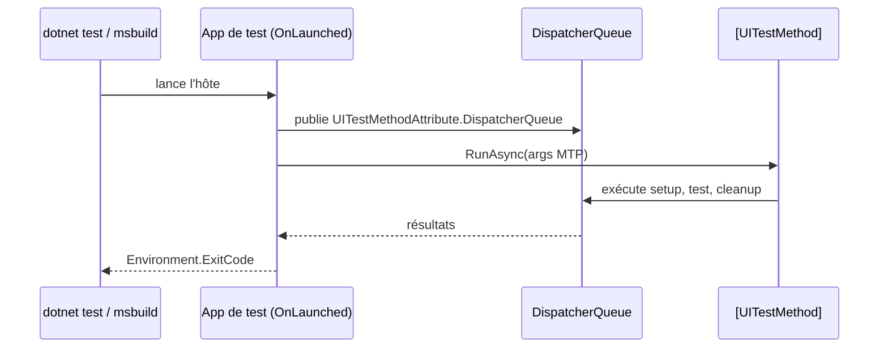

# CSharp — Détail du mardi 6 octobre 2026

## 1. MSTest 4.5 — tester l'interface UWP et WinUI 3 sur le vrai dispatcher UI

**Source :** .NET Blog (Microsoft) — https://devblogs.microsoft.com/dotnet/testing-uwp-and-winui-3-apps-with-mstest/
**Date :** 5 octobre 2026

### Contexte

Tester du code qui touche des contrôles XAML est resté longtemps pénible. Les contrôles exigent un thread UI avec un dispatcher, ce que ne fournit pas un runner de tests classique. Les équipes contournaient le problème avec des hôtes maison, des attributs spécifiques à VSTest ou des déploiements via Visual Studio.

MSTest 4.5, adossé à Microsoft.Testing.Platform (MTP) 2.5, apporte un chemin unifié pour UWP et WinUI 3. Plus besoin du runtime VSTest ni de fournisseurs de déploiement liés à Visual Studio : l'application de test est elle-même l'exécutable qui héberge le runner.

### Comment ça marche

L'idée centrale est l'exécution « consciente du dispatcher ». Au lieu de simuler un thread STA, le test s'exécute sur le `DispatcherQueue` réel de la fenêtre de l'application. Le setup, le corps du test et le cleanup gardent donc tous l'accès au thread UI.

Mécanique pas à pas :

1. L'application de test démarre comme une vraie app (`OnLaunched`).
2. Elle crée une fenêtre, l'active, et publie son `DispatcherQueue` dans `UITestMethodAttribute.DispatcherQueue`.
3. Elle appelle `MicrosoftTestingPlatformApplication.RunAsync` avec les arguments de ligne de commande.
4. Chaque méthode marquée `[UITestMethod]` est marshalée sur ce dispatcher.
5. À la fin, le code de sortie est propagé et la fenêtre fermée.

Le billet distingue cinq modèles de déploiement, qui changent l'identité, le niveau de confiance et la façon de lancer l'hôte : UWP classique (`uap10.0`, MSIX, AppContainer, contrôleur « sidecar »), UWP moderne (`UseUwp`, hôte Native AOT), WinUI 3 non packagé (confiance totale, apphost direct), WinUI 3 packagé (MSIX, sidecar plus enregistrement) et WinUI 3 en AppContainer (sandboxé, autorisation par SID).



### En pratique — exemple de code

Le test ci-dessous crée un `Grid` et vérifie qu'on est bien sur le thread UI. Il vient du billet ; seul le commentaire est ajouté.

```csharp
// S'exécute sur le dispatcher réel de l'app, pas sur un thread STA simulé
[UITestMethod]
public async Task GridCanBeCreatedOnTheUIThread()
{
    await Task.Yield();                       // le retour se fait toujours sur l'UI
    var grid = new Grid();
    Assert.IsTrue(grid.DispatcherQueue.HasThreadAccess);
}
```

La configuration du projet passe par le SDK MSTest et le runner MTP :

```json
{
  "test": { "runner": "Microsoft.Testing.Platform" },
  "msbuild-sdks": { "MSTest.Sdk": "4.5.0" }
}
```

Pour WinUI 3 non packagé, `dotnet run` ou `dotnet test --project .\MyWinUiTests.csproj -c Release -a x64` suffit. Pour UWP et les apps packagées, utilise `msbuild ... /t:InvokeTestingPlatform` depuis une Developer PowerShell.

### Pourquoi ça compte pour toi

Si tu maintiens un client lourd Windows en plus de ton backend C#, tu peux enfin mettre des tests UI dans la même CI que le reste. Le piège est l'environnement : un build vert ne prouve rien tant que l'hôte packagé n'a pas tourné sur un agent propre.

### Limites

- Les apps packagées exigent le mode développeur (ou une politique de sideloading) sur la machine de test.
- Les tests AppContainer doivent tourner non élevés.
- Il faut Windows, le SDK .NET 10 et l'outillage Windows App SDK.
- `[STATestMethod]` fournit un thread STA mais ne crée pas de dispatcher WinUI.
