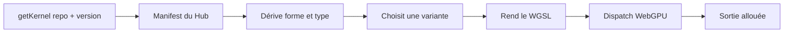
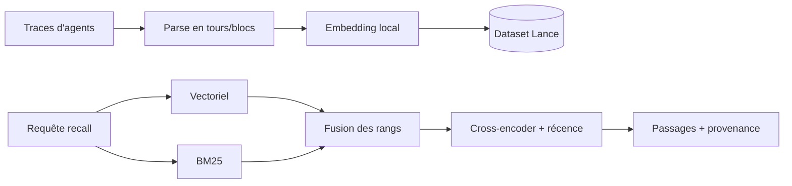
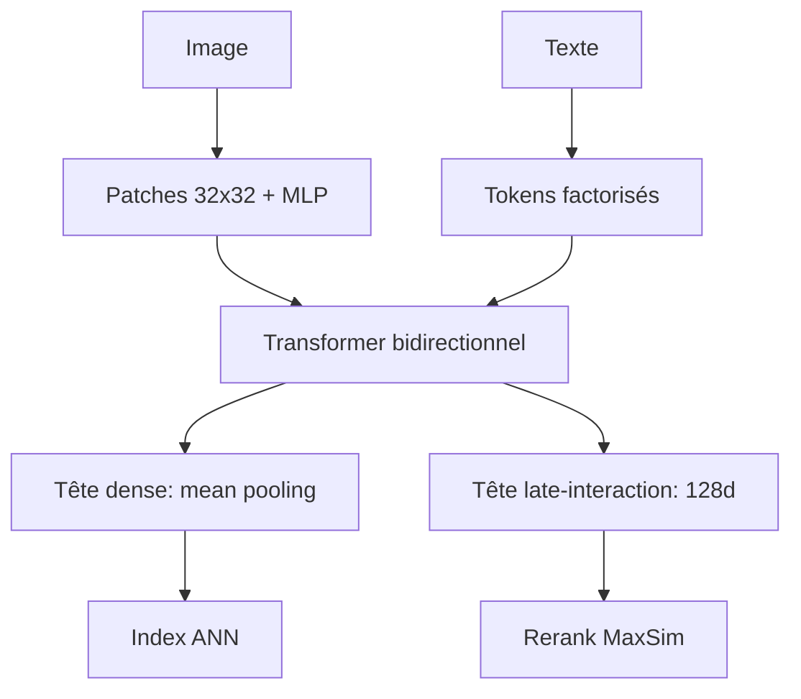

# IA — Détail du samedi 6 septembre 2026

## 1. `@huggingface/kernels` — 207 kernels WebGPU publiés comme des dépôts versionnés

**Source :** Hugging Face Blog — https://huggingface.co/blog/webgpu-kernels
**Date :** 1er septembre 2026

### Contexte

Un modèle qui tourne dans le navigateur finit par n'être qu'une séquence d'opérations GPU : multiplications matricielles, normalisations, convolutions, primitives d'attention, quantification, transformations de layout. WebGPU rend ces opérations portables entre navigateurs modernes, et WGSL fournit le langage commun des shaders.

Mais portabilité ne veut pas dire performance. Deux shaders peuvent implémenter la même opération, produire exactement la même sortie, et se comporter très différemment selon l'accélérateur. La taille des workgroups, les motifs d'accès mémoire, la vectorisation, les types de données et les stratégies de fusion changent tout — et le meilleur choix dépend en plus de la forme des entrées, du device, du navigateur et des fonctionnalités WebGPU disponibles. Tant que ces shaders restaient enfouis dans les runtimes, personne ne pouvait les comparer sérieusement.

### Comment ça marche

L'idée centrale est de traiter un kernel comme un **artefact logiciel**, pas comme un fichier de shader. Chaque opération a son propre dépôt sur le Hub, avec cinq éléments. Le `manifest.json` est la source de vérité du contrat : entrées, sorties, attributs, contraintes de types, règles de dérivation de forme. Le `metadata.json` porte l'identifiant, les empreintes et la provenance. Le `test.json` contient les cas de correction, le `bench.json` les cas de benchmark et de tuning. Enfin, les `*.wgsl.jinja` sont les implémentations WGSL paramétrées.

Le loader JavaScript s'appuie sur ce contrat. Tu demandes un dépôt et une **version de contrat** — distincte d'un opset ONNX, d'un `since_version` d'opérateur ou d'une révision de modèle. Le loader télécharge le dépôt, dérive la forme et le type logique de sortie depuis le manifeste et les entrées, choisit une variante adaptée au device, génère le shader depuis le template, alloue la sortie, et exécute.



C'est ce choix de variante qui justifie tout l'édifice. `ai.onnx.Add` embarque des variantes pour formes égales, broadcast vectorisé, traitement scalaire et broadcast général : le runtime bascule sans que l'API applicative bouge.

Les chiffres viennent de 1 756 cas de test sur 207 opérations, réduits aux 809 où les deux implémentations produisaient des sorties concordantes et des mesures fiables, sur GPU Apple M4 face à ONNX Runtime Web `1.30.0-dev`. Résultat : **2,57× en moyenne géométrique**, 1,90× à la médiane. Add à 3,52×, Softmax à 2,11×, LayerNormalization à 2,22×, MatMul à 1,14× seulement. Les extrêmes existent — un Einsum bilinéaire `i,ij,j` en taille 4096 passe de 1 396 ms à 0,136 ms — mais ce sont des chemins lents d'implémentation généraliste, pas une promesse générale.

### En pratique — exemple de code

```bash
npm install @huggingface/kernels@preview
# Nécessite un navigateur avec WebGPU : "gpu" in navigator
```

```js
import { getKernel } from "@huggingface/kernels";

// version: 1 = version du CONTRAT du kernel, pas de l'opset ONNX
const add = await getKernel("webgpu-kernels/ai.onnx.Add", { version: 1 });

const { c } = await add({
  a: { data: new Float32Array([1, 2, 3, 4, 5, 6]), shape: [2, 3] },
  b: { data: new Float32Array([10, 20, 30]), shape: [3] }, // broadcast sur dim 0
});
// c a la forme [2, 3] : le loader l'a dérivée du manifeste, pas toi.
// Le même appel vaut pour ai.onnx.MatMul : seuls l'id et les entrées changent.
```

### Pourquoi ça compte pour toi

Si tu envisages de l'inférence locale dans une app Angular, ceci déplace la question. Tu n'es plus dépendant d'un runtime monolithique : tu peux profiler une opération isolée, épingler une version de contrat, et vérifier la correction sur le matériel de tes utilisateurs via Fleet. La discipline est celle d'une dépendance NuGet — contrat explicite, version figée, tests qui voyagent avec le code.

### Limites

947 cas ont été écartés faute de résultats concordants ou de timings fiables, sans taxonomie publiée. Les mesures excluent le chargement, la création de session, l'upload des entrées, la compilation des shaders et le readback. Ce sont des opérations isolées, pas des modèles complets.

---

## 2. funes — transformer les traces de tes agents de code en mémoire indexée

**Source :** Hugging Face Blog — https://huggingface.co/blog/funes
**Date :** 3 septembre 2026

### Contexte

Tu changes de machine, tu changes d'agent selon la tâche, et chacun redécouvre ton projet en inconnu. Le raisonnement de mardi dernier disparaît à la fin de la session. Pourtant les agents produisent déjà exactement le registre qu'on perd : en cherchant dans un dépôt, en essayant des approches, en rencontrant des erreurs, en lisant de la doc et en changeant de direction, ils laissent un compte rendu dense de *ce qui a changé* et surtout de *pourquoi*.

Le diagnostic est juste, mais des traces ne sont qu'une mémoire potentielle. Les logs de session restent une archive : tu ne `grep` pas ta route vers « pourquoi on a abandonné le parseur en streaming » à travers dix mille tours. Pour qu'un agent s'en serve pendant qu'il travaille, il faut de l'indexation, de la récupération, du classement et une provenance exacte.

### Comment ça marche

funes est un binaire unique, dont le backend d'inférence par défaut n'a aucune dépendance à un runtime ML — l'embedding et le reranking s'exécutent sur ta machine. Une commande, `funes add claude`, construit le premier index, greffe les outils `recall` et `get` à l'agent, et installe l'automatisation qui indexe chaque tour terminé. L'indexation est incrémentale : les nouvelles exécutions ajoutent des tours au lieu de ré-embedder tout l'historique, et le contenu ancien se remplit par lots bornés.

Le pipeline mérite d'être détaillé, parce que c'est un RAG classique bien assemblé. Chaque trace supportée est parsée vers la même forme tour-et-bloc, découpée en chunks, embeddée par un modèle local épinglé, puis écrite dans un dataset **Lance** local. À la requête, funes combine recherche vectorielle et BM25, fusionne les deux classements, reclasse les candidats avec un cross-encoder, repondère par récence, et attache les chunks voisins.



Trois propriétés découlent de ce design. Une **mémoire unique** couvre plusieurs agents (Claude Code, Codex, pi, Hermes) qui écrivent tous la même forme. Les **preuves brutes restent intactes** : rien n'est distillé en fait à l'écriture, donc un résultat ramène toujours au tour qui l'a produit. Et `recall` est **local par défaut** : aucun compte, aucun dépôt Hub requis.

Pour faire suivre la mémoire, tu la lies à un dataset Hugging Face privé par défaut. Les credentials sont expurgés à l'indexation, puis chaque chunk est rescanné à la publication.

Le chiffre à retenir vient du benchmark handoff-vs-recall, sur deux tâches dont la réponse ne peut pas se reconstruire sans le contexte antérieur. La compaction — comportement par défaut de la plupart des agents — a réussi sur une tâche et jamais abouti sur l'autre, son résumé ayant aplati les constats qui comptaient. Le rappel a été le moins cher des trois canaux : **8× moins cher** qu'un handoff écrit sur une tâche, 4× sur l'autre.

### En pratique — exemple de code

```bash
# 1) Installer, puis greffer la mémoire à l'agent que tu utilises déjà
curl -fsSL https://huggingface.co/buckets/huggingface/funes/resolve/install.sh | sh
funes add claude                    # ou: codex, pi, hermes

# 2) Lier une mémoire partagée (dataset HF privé par défaut) : elle te suit d'une machine à l'autre
funes add codex acme/funes-memory

# 3) Interroger toi-même, sans installer d'intégration (lecture seule)
funes ask claude "what did we decide about the streaming parser"
funes ask claude "why is funes append-only" --memory huggingface/funes-memory
```

### Pourquoi ça compte pour toi

Le problème que ça règle t'est familier : la décision d'archi expliquée en session, jamais écrite dans la PR, et perdue trois semaines plus tard. Ici la mémoire est un dataset que tu possèdes, pas un service que tu loues. Et si tu vises l'onboarding, publier la mémoire d'un projet vaut mieux qu'un `CLAUDE.md` que quelqu'un doit réécrire à la main.

### Points de vigilance

Le scanner de secrets est documenté dans le `SECURITY.md` du dépôt, avec ce qu'il couvre et ce qu'il ne couvre pas. Une mémoire append-only conserve aussi les répétitions et les fausses pistes : c'est voulu, mais ça pèse sur le classement.

---

## 3. NeoMME — un encodeur multimodal single-tower de 260 M qui tient tête à des modèles 14× plus gros

**Source :** Hugging Face Blog — https://huggingface.co/blog/Hcompany/neomme
**Date :** 3 septembre 2026

### Contexte

Beaucoup de retrievers de documents visuels sont dérivés de modèles génératifs vision-langage. Un encodeur de vision pré-entraîné produit des features, un projecteur les mappe dans l'espace d'entrée du modèle de langage, et un décodeur causal traite l'ensemble. Or la recherche, la classification et l'étiquetage de tokens ne génèrent pas de texte en autorégressif : ils n'ont besoin ni du décodeur causal, ni de son coût en paramètres et en calcul.

NeoMME, publié par H Company, tire la conclusion. C'est une famille de deux encodeurs, 260 M et 800 M paramètres, sans tour de vision pré-entraînée, sans encodeur de texte pré-entraîné, sans décodeur — tout est entraîné de zéro. Les poids sont sous licence Apache 2.0 et l'implémentation Transformers est disponible dès le premier jour.

### Comment ça marche

Un seul Transformer bidirectionnel traite les deux modalités. Le texte passe par des embeddings de tokens factorisés ; les images sont découpées en patches non chevauchants de 32×32 et projetées par un petit MLP. Les deux entrent dans le même encodeur. La résolution est dynamique : l'image garde son ratio et sa taille, donc une page de document dense consomme plus de tokens qu'une petite image. Le contexte va jusqu'à 16 384 tokens, avec attention par fenêtre glissante symétrique sur la plupart des couches, et attention globale sur une couche sur six plus la dernière.

Le pré-entraînement est la partie la plus instructive. NeoMME est entraîné comme un **débruiteur de texte par diffusion discrète masquée**. Pour un exemple texte seul, on tire un taux de corruption uniformément entre 0 et 1, puis on masque chaque token éligible à ce taux. Pour les exemples multimodaux, le taux est tiré entre 0,3 et 1, et les patches d'image restent visibles pendant que le modèle reconstruit le texte masqué.

L'intuition est simple et redoutable. Avec un masquage léger, « chat » complète très bien « Le [MASK] est assis sur le tapis » sans regarder l'image : le modèle apprend un raccourci linguistique. En forçant un masquage élevé, on supprime ce raccourci et on oblige le modèle à s'appuyer sur les preuves visuelles.



Pour l'évaluation, NeoMME est fine-tuné en retrieval de documents visuels selon la méthode page-image de ColPali : on classe des captures de pages, sans étape OCR, ce qui préserve mise en page, graphiques, tableaux et typographie. Deux têtes entraînées conjointement sortent d'une seule passe avant — dense par mean pooling, et late-interaction projetant chaque token ou patch en vecteur normalisé de 128 dimensions.

Les résultats : 0,523 nDCG@10 sur ViDoRe v3 pour le 260 M, meilleur score de tous les modèles strictement sous 800 M, et à 0,002 de ColQwen2.5 qui pèse 3,75 Md. Le 800 M atteint 0,556. Débit : environ 51 pages/s en 2048×2048 sur une NVIDIA L40S, soit près du double de ColModernVBERT.

Reste le coût de stockage : une page 2048×2048 produit 4 200 vecteurs, ~2,1 Mo en float32, ~1,5 Mo en moyenne sur ViDoRe v3. Deux compressions combinées répondent : pooling hiérarchique de tokens (on regroupe les vecteurs similaires et on garde la moyenne) et quantification asymétrique (les documents en int8 ou binaire, les requêtes générées à la volée restent en précision haute). Facteur 10 + int8 partout : 39 ko/page, plus de 99 % du nDCG@10. Facteur 8 + documents binaires : **6 ko/page, 255× plus petit, plus de 95 % de la qualité**.

### En pratique — exemple de code

```python
from sentence_transformers.util import cos_sim, mean_maxsim
from transformers import NeoMMEForRetrieval, NeoMMEProcessor

model_name = "Hcompany/NeoMME-260M-Retriever"
processor = NeoMMEProcessor.from_pretrained(model_name)
model = NeoMMEForRetrieval.from_pretrained(model_name, device_map="auto")

# Une seule passe avant renvoie les DEUX représentations : late-interaction et dense
with torch.inference_mode():
    doc_out = model(**inputs_documents)   # pages scannées, sans OCR
    qry_out = model(**inputs_text)        # requêtes multilingues

late = mean_maxsim(qry_out.embeddings, doc_out.embeddings,
                   a_mask=inputs_text["attention_mask"],
                   b_mask=inputs_documents["attention_mask"])
dense = cos_sim(qry_out.dense_embeddings, doc_out.dense_embeddings)
# Stratégie recommandée sur gros corpus : ANN sur `dense`, puis rerank `late` sur le top-k.
```

### Pourquoi ça compte pour toi

Si tu dois indexer des PDF métier — factures, contrats, rapports — la voie page-image supprime tout ton pipeline OCR et ses erreurs silencieuses sur les tableaux. Et 6 ko par page rend un index late-interaction viable dans Postgres avec `pgvector` ou dans Qdrant, sans budget de stockage délirant. Un modèle de 260 M s'auto-héberge sur un GPU modeste.

### Limites

Les scores viennent en partie d'évaluations maison, en partie de MTEB — les conditions ne sont pas strictement identiques. Le budget d'entraînement texte (290 Md de tokens) reste petit face aux 2 000 Md de ModernBERT.
