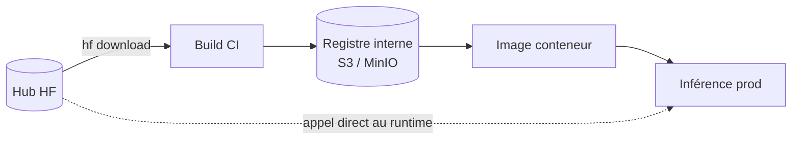
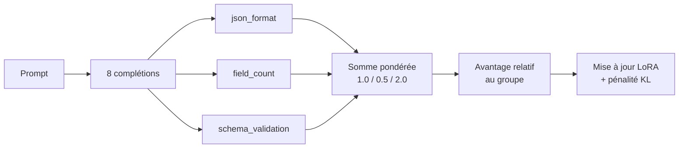
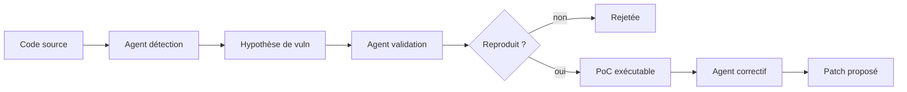

# IA — Détail du lundi 7 septembre 2026

## 1. NVIDIA acquiert Hugging Face pour 12,93 Md$ — et ce que ça implique pour ta chaîne d'approvisionnement

**Source :** NVIDIA Blog — https://blogs.nvidia.com/blog/nvidia-to-acquire-hugging-face/
**Date :** 3 septembre 2026

### Contexte

NVIDIA a annoncé le 3 septembre l'acquisition de Hugging Face pour 12 930 300 000 dollars. Le Hub héberge plus de 3 millions de modèles et 500 000 datasets, utilisés par plus de 18 millions de développeurs et 200 000 entreprises. Autrement dit : l'infrastructure de distribution de fait de l'IA open weights passe sous le contrôle du fabricant du matériel sur lequel elle s'exécute.

Jensen Huang a pris des engagements précis dans l'annonce : Hugging Face reste une plateforme ouverte, les développeurs choisiront leurs modèles, frameworks, clouds et fournisseurs d'inférence, le calcul NVIDIA ne sera pas requis pour construire ou déployer via Hugging Face, et le support des modèles open source et open weights de tout l'écosystème continue. Ce sont des engagements crédibles et publics. Ce n'est pas une raison pour ignorer ce que l'opération révèle de ton architecture.

### Comment ça marche

Le sujet technique n'est pas l'acquisition, c'est ta **chaîne d'approvisionnement modèles**. La plupart des pipelines la traitent comme un détail d'implémentation, alors qu'elle a exactement la même surface de risque qu'un registre npm ou NuGet.

Regarde le trajet réel d'un poids, du Hub jusqu'à ta production :



La flèche pointillée est celle qui pose problème. Si ton service télécharge ses poids depuis `huggingface.co` au démarrage d'un pod, alors ta disponibilité, ta reproductibilité et ta conformité dépendent d'un tiers. Trois conséquences concrètes :

1. **Disponibilité.** Une panne du Hub, une restriction géographique ou une simple limite de débit devient une panne chez toi, au pire moment — un redémarrage en cascade.
2. **Reproductibilité.** Un dépôt de modèle n'est pas immuable. La branche `main` peut recevoir de nouveaux poids, une licence peut changer, un dépôt peut être retiré. Ton build d'il y a six mois n'est pas rejouable si tu n'épingles pas la révision.
3. **Conformité.** Si un audit te demande quel poids exact tournait le 12 juillet, « la dernière version de `main` » n'est pas une réponse.

La parade tient en deux règles. Épingle toujours une **révision** (le SHA du commit du dépôt, pas un tag mouvant). Et miroite les poids dans un stockage que tu contrôles, une fois, au build — pas à chaque démarrage de pod. La variable `HF_ENDPOINT` permet en plus de rediriger tout le SDK vers un miroir compatible sans toucher au code.

### En pratique — exemple de code

```bash
# Avant — le runtime tire depuis le Hub, sur une révision mouvante.
#   Chaque pod qui démarre dépend d'un service tiers, et rien n'est reproductible.
python -c "from transformers import AutoModel; AutoModel.from_pretrained('LiquidAI/LFM2.5-350M')"

# Après — on fige une révision au build, on miroite, le runtime ne sort plus.
REV=$(hf api "models/LiquidAI/LFM2.5-350M" | jq -r .sha)   # SHA du commit
hf download LiquidAI/LFM2.5-350M --revision "$REV" --local-dir ./weights
aws s3 sync ./weights "s3://mlops-models/lfm2.5-350m/$REV/"   # miroir interne
echo "MODEL_REV=$REV" >> build.env                            # tracé dans l'artefact
```

```python
# Runtime : plus aucun appel sortant vers le Hub, et la révision est explicite.
import os
os.environ["HF_HUB_OFFLINE"] = "1"          # aucun accès réseau au Hub
# Alternative si tu veux garder l'API du SDK : pointer vers un miroir maison
# os.environ["HF_ENDPOINT"] = "https://hf-mirror.interne.example.com"

model = AutoModel.from_pretrained(f"/models/lfm2.5-350m/{os.environ['MODEL_REV']}")
```

### Pourquoi ça compte pour toi

Tu appliques déjà cette discipline à NuGet et npm : lockfile, révision figée, miroir interne. Traite les poids de modèles pareil. Le rachat ne change rien à ton exécution demain matin, mais il rend visible une dépendance que beaucoup d'équipes n'ont jamais inventoriée. Passe une heure à lister ce que tes services téléchargent au démarrage — tu seras surpris.

### Limites

Un miroir a un coût de stockage réel : un modèle de 70 Md de paramètres en bf16 pèse environ 140 Go. Miroite ce qui tourne en production, pas tout ce que ton équipe R&D essaie.

---

## 2. GRPO sur LFM2.5-350M — 22,6 % à 29,7 % de conformité structurée en 100 pas

**Source :** Hugging Face Blog — https://huggingface.co/blog/grpo-with-trl-ifstruct
**Date :** 3 septembre 2026

### Contexte

Faire produire du JSON valide à un LLM est le cas d'usage le plus banal en intégration backend, et l'un des moins bien mesurés : la plupart des benchmarks noient la conformité de schéma dans un score de raisonnement global. Le benchmark **IFStruct** de Liquid AI l'isole : 2 000 cas où la question est uniquement « la sortie est-elle parseable, dans le format demandé, et conforme au schéma ? ».

Le billet publié le 3 septembre montre qu'un petit modèle peut être considérablement amélioré sur cet axe pour presque rien. Point de départ : `LiquidAI/LFM2.5-350M` mesuré à **22,6 %** sur IFStruct. Après environ 500 échantillons et 100 pas de GRPO, il monte à **29,7 %** — soit +7,1 points, avec +13,9 sur le sous-score JSON. L'entraînement tient sur un GPU 16 Go de Colab gratuit.

### Comment ça marche

GRPO — *Group Relative Policy Optimization* — est un apprentissage par renforcement sans modèle de valeur séparé, ce qui le rend beaucoup plus léger que PPO. Le mécanisme, pas à pas :

1. Pour un prompt donné, le modèle génère un **groupe** de complétions (ici 8).
2. Chaque complétion reçoit un score par des fonctions de récompense déterministes.
3. On calcule l'avantage de chaque complétion **relativement à la moyenne de son groupe**. C'est le cœur de « group relative » : pas besoin d'un critique entraîné pour estimer une baseline, le groupe la fournit.
4. On met à jour la politique pour rendre plus probables les complétions au-dessus de la moyenne du groupe.
5. Une pénalité KL (`beta=0.01`) empêche la politique de dériver trop loin du modèle de référence.



La qualité du résultat tient entièrement aux fonctions de récompense. Trois sont utilisées ici, chacune sur `[0, 1]` :

- `json_format_reward` : la sortie est-elle parseable et dans la forme demandée ? `1.0` pour la bonne forme (bloc de code ou brut, selon la consigne), `0.2` pour une forme parseable mais fausse, `0.0` sinon.
- `field_count_reward` : le nombre de champs de premier niveau est-il celui attendu ? Décroissance linéaire selon l'écart.
- `schema_validation_reward` : la sortie valide-t-elle le JSON Schema de la ligne ? Le crédit partiel est conditionné à la couverture des clés obligatoires.

Pondération `[1.0, 0.5, 2.0]` : la validation de schéma pèse le double. Détail méthodologique important : le dataset d'entraînement (`nvidia/Nemotron-RL-instruction_following-structured_outputs`) a été augmenté pour combler deux écarts avec l'évaluation — 40 % des prompts reçoivent une consigne « réponds dans un bloc de code », et 20 % disjoints sont convertis en tâches à liste de premier niveau. Les gains mesurés sont exactement là : listes nues +13,1 points.

### En pratique — exemple de code

```python
from trl import GRPOConfig
from peft import LoraConfig

# LoRA ciblant les modules spécifiques à l'archi hybride attention/convolution de LFM2.5
lora_config = LoraConfig(
    r=16, lora_alpha=32, bias="none", task_type="CAUSAL_LM",
    target_modules=["q_proj", "k_proj", "v_proj", "out_proj", "in_proj",
                    "w1", "w2", "w3"],   # ~6 M params entraînés, soit 1,66 % du modèle
)

training_args = GRPOConfig(
    learning_rate=5e-5,
    max_steps=100,
    num_generations=8,               # taille du groupe : la baseline vient de là
    per_device_train_batch_size=4,
    gradient_accumulation_steps=8,   # 4 groupes de prompts par pas d'optimisation
    max_completion_length=1024,      # de la place pour du JSON imbriqué
    temperature=1.1,                 # échantillonnage plus chaud = groupes variés
    beta=0.01,                       # pénalité KL vers le modèle de référence
    reward_weights=[1.0, 0.5, 2.0],  # json_format, field_count, schema_validation
)
```

La `temperature=1.1` n'est pas un détail : si toutes les complétions d'un groupe se ressemblent, les avantages relatifs s'annulent et le signal d'apprentissage disparaît.

### Pourquoi ça compte pour toi

Si tu appelles un gros modèle uniquement pour transformer du texte en JSON conforme à un schéma, tu paies une capacité de raisonnement que tu n'utilises pas. Cette recette montre le chemin : prends un modèle de 350 M, écris trois fonctions de récompense déterministes à partir de **ton** schéma, entraîne 100 pas. Tu gardes le contrôle, tu sers en local via `llama.cpp`, et la latence tombe. Le résultat reste imparfait — 29,7 % — donc valide toujours côté serveur.

### Limites

Le score absolu reste bas : IFStruct est dur. Ne remplace pas une validation JSON Schema côté backend par la confiance dans le modèle. Le gain démontré est sur la *forme*, pas sur l'exactitude du contenu.

---

## 3. Google Mantis — un harnais agentique où la validation compte plus que la détection

**Source :** InfoQ — https://www.infoq.com/news/2026/09/google-mantis-vulnerability-scan/
**Date :** 6 septembre 2026

### Contexte

Google a ouvert le code de Mantis, un framework d'agents IA qui automatise le cycle de vie d'une vulnérabilité logicielle : identification, validation, reproduction, correction. Google explique l'avoir développé pour répondre au taux élevé de faux positifs et de vulnérabilités hallucinées produits par les scanners de code conventionnels à base d'IA.

C'est le bon diagnostic. Un LLM lâché sur une base de code trouve des vulnérabilités partout, parce qu'il raisonne sur des motifs syntaxiques sans exécuter quoi que ce soit. Le coût réel d'un scanner n'est pas le temps de scan, c'est le temps que ton équipe passe à trier des rapports qui n'en sont pas. Un outil à 40 % de faux positifs est un outil que plus personne n'ouvre au bout d'un mois.

### Comment ça marche

L'idée structurante de Mantis est de refuser de considérer une détection comme un résultat. Une détection est une **hypothèse**, et une hypothèse doit être réfutable.



Le pipeline se lit comme une chaîne de filtres, où chaque étape est plus coûteuse et plus sélective que la précédente :

1. **Détection.** Un agent parcourt le code et émet des hypothèses. On accepte volontairement un rappel élevé et une précision faible à ce stade.
2. **Validation.** Un second agent tente de construire une preuve de concept exécutable dans un environnement isolé. C'est le filtre décisif : ce qui ne se reproduit pas est éliminé, quelle que soit la conviction du modèle qui l'a proposé.
3. **Reproduction.** Le PoC retenu devient un artefact reproductible — un test qui échoue. C'est ce qui transforme un rapport en ticket exploitable.
4. **Correction.** Un troisième agent propose un patch, et le critère de succès est objectif : le test de l'étape 3 doit passer.

Le point à retenir dépasse la sécurité. Ce que Mantis illustre, c'est un pattern d'architecture d'agents : quand le générateur est peu fiable, ajoute un **vérificateur mécanique** en aval, et fais du passage du vérificateur — pas de la confiance du modèle — le critère d'acceptation. Le même schéma marche pour la génération de code, de requêtes SQL ou de migrations.

### En pratique — exemple de code

```python
# Le pattern générateur / vérificateur, réduit à son squelette.
# La leçon : le critère d'acceptation est mécanique, jamais la confiance du LLM.
def triage(finding, sandbox):
    poc = agent_validate.write_poc(finding)          # hypothèse -> tentative de preuve
    result = sandbox.run(poc, timeout=60)            # exécution isolée, budget borné
    if not result.exploited:
        return {"status": "rejected", "reason": result.stderr[:200]}

    patch = agent_fix.propose(finding, poc)          # correctif proposé
    sandbox.apply(patch)
    recheck = sandbox.run(poc, timeout=60)           # le MÊME PoC doit maintenant échouer
    return {
        "status": "fixed" if not recheck.exploited else "patch_insufficient",
        "poc": poc, "patch": patch,
    }
```

Le `recheck` est la partie que la plupart des implémentations maison oublient : sans lui, tu proposes des patchs que personne n'a vérifiés.

### Pourquoi ça compte pour toi

Avant de brancher un scanner IA sur ton dépôt .NET ou Symfony, pose la question du taux de faux positifs et de l'existence d'une étape de validation exécutée. Sans elle, tu achètes du bruit. Et si tu construis tes propres agents, retiens le pattern : accepte un générateur peu fiable, mais ajoute un vérificateur déterministe et fais-en la condition de sortie. C'est ce qui rend un pipeline agentique exploitable en production.

### Points de vigilance

Exécuter des PoC demande un bac à sable réel — conteneur jetable, réseau coupé, budget CPU borné. Un « validateur » qui tourne sur ta machine de dev est une vulnérabilité de plus, pas une mitigation.
