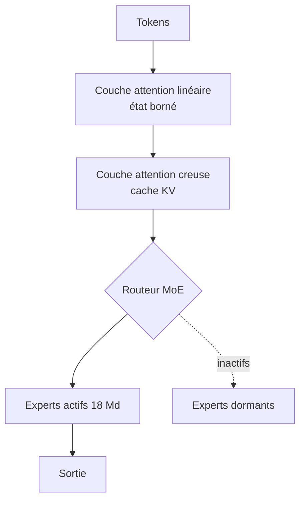

# IA — Détail du mardi 8 septembre 2026

## 1. GLM-5.3-Flash — 320 Md de paramètres, 18 Md actifs, et l'attention hybride creuse/linéaire

**Source :** Hugging Face — https://huggingface.co/zai-org/GLM-5.3-Flash
**Date :** 7 septembre 2026

### Contexte

Le coût de servir un LLM en contexte long est dominé par l'attention. Un Transformer classique compare chaque token à tous les précédents : le calcul croît en carré de la longueur, et le cache clé/valeur croît linéairement en mémoire. À 300 000 tokens de contexte, ce cache pèse plus lourd que les poids actifs du modèle.

Deux familles de contournements existent. L'**attention creuse** ne calcule qu'un sous-ensemble de paires, choisi par fenêtre glissante ou par sélection apprise : elle garde la précision locale mais reste coûteuse. L'**attention linéaire** remplace le softmax par une récurrence à état fixe : le coût devient linéaire et le cache constant, mais on perd la capacité à retrouver un détail précis loin en arrière.

GLM-5.3-Flash, publié le 7 septembre par Z.ai sous licence MIT, est le premier modèle de la série GLM-5 à combiner les deux dans la même pile. C'est aussi le premier nativement multimodal de la série, entraîné depuis un modèle de base neuf sur un corpus de 30 000 milliards de tokens.

### Comment ça marche

Trois mécanismes se superposent.

**Le MoE.** Sur 320 milliards de paramètres, seuls **18 milliards** sont activés par token — moins de 6 %. Un routeur sélectionne quelques experts par couche ; les autres restent en mémoire mais ne consomment pas de FLOPs. Tu paies la RAM du modèle entier, tu paies le calcul d'un modèle de 18 Md.

**L'attention hybride.** Les couches alternent entre attention creuse et attention linéaire. Les couches creuses conservent la capacité de rappel exact — retrouver une valeur précise citée 200 000 tokens plus tôt. Les couches linéaires portent le flux général du contexte à état borné. Résultat : le cache KV ne croît que sur une fraction des couches, ce qui fait chuter le coût de service en contexte long tout en préservant, selon Z.ai, la précision du rappel.

**mHC.** Les *Manifold-Constrained Hyper-Connections* remplacent les connexions résiduelles simples par des connexions multiples contraintes sur une variété. L'objectif annoncé est l'efficacité de passage à l'échelle : plus de capacité utile pour un budget de calcul donné.

S'ajoute un levier d'exploitation direct : `reasoning_effort` accepte `low`, `high` ou `max`, et pilote le budget de réflexion avant la réponse. La valeur par défaut est `max` — y compris si tu passes une valeur inconnue.



### En pratique — exemple de code

Le modèle se sert localement via vLLM. Note bien les deux paramètres spécifiques : sans eux, tu paies le budget de raisonnement maximal sur chaque appel de chat.

```python
from openai import OpenAI  # vLLM expose une API compatible OpenAI

client = OpenAI(base_url="http://localhost:8000/v1", api_key="EMPTY")

resp = client.chat.completions.create(
    model="zai-org/GLM-5.3-Flash",
    messages=[{"role": "user", "content": "Résume ce dump SQL en 5 points."}],
    # Sans reasoning_effort explicite, le modèle retombe sur "max" -> latence et tokens maximaux
    extra_body={
        "reasoning_effort": "low",     # low | high | max
        "chat_template_kwargs": {
            "clear_thinking": True,     # défaut False : sinon la trace de réflexion s'accumule
        },
    },
)
print(resp.choices[0].message.content)
```

```bash
# Servir les poids FP8 ; adapte tensor-parallel-size à ton nombre de GPU
vllm serve zai-org/GLM-5.3-Flash --tensor-parallel-size 8 --max-model-len 300000
```

### Pourquoi ça compte pour toi

Si tu évalues un modèle ouvert pour de l'analyse de gros corpus — logs, dumps PostgreSQL, bases de code entières — c'est le ratio contexte/coût qui décide, pas le score de benchmark. L'attention hybride attaque exactement ce ratio. La licence MIT lève les questions de redistribution. Et `reasoning_effort` est un bouton de coût direct : mets-le à `low` sur tes chemins interactifs, garde `max` pour le batch.

### Points de vigilance

Les 320 Md de paramètres doivent tenir en mémoire même si 18 Md seulement s'activent : ce n'est pas un modèle de poste de travail. Les valeurs par défaut du template de chat sont contre-intuitives — `clear_thinking` vaut `false` sauf si tu le passes explicitement, ce qui fait grossir le contexte au fil des tours. Enfin, les scores publiés sont ceux du fournisseur, mesurés avec des harnais et des juges qu'il a choisis ; refais tes mesures sur tes propres tâches.

---

## 2. MiniCPM5-2B — un dense de 2,5 Md conçu pour l'appareil, pas pour le cluster

**Source :** Hugging Face — https://huggingface.co/openbmb/MiniCPM5-2B
**Date :** 8 septembre 2026

### Contexte

La course aux paramètres a une contrepartie discrète : chaque gain de qualité sur les gros modèles finit, quelques mois plus tard, distillé dans des petits. MiniCPM est la série d'OpenBMB dédiée à ce segment. Le 8 septembre, l'équipe publie **MiniCPM5-2B**, deuxième modèle de la génération MiniCPM5 après le 1B, sous licence Apache 2.0.

L'annonce est claire sur la cible : appareil embarqué, déploiement local, environnement à ressources contraintes. Pas un modèle de datacenter miniaturisé, mais un modèle dimensionné dès le départ pour ce contexte — avec les tâches qui vont avec : appel d'outils, contexte long, agents.

### Comment ça marche

MiniCPM5-2B est un **Transformer dense** d'environ **2,52 milliards de paramètres**, en architecture llama. Dense signifie que tous les paramètres s'activent à chaque token : pas de routeur MoE, pas d'experts dormants. C'est le bon choix pour l'embarqué, où la mémoire est la contrainte dure — un MoE t'obligerait à charger l'intégralité des experts pour n'en utiliser qu'une fraction.

L'équipe décrit MiniCPM5-2B comme la montée en échelle de la même recette d'entraînement que le 1B. Cette recette se lit dans les jeux de données déclarés sur la fiche du modèle, et elle est instructive : `Ultra-FineWeb` et `Ultra-FineWeb-L3` pour le pré-entraînement filtré, `UltraData-Math` et `UltraData-Code` pour les capacités de raisonnement, `UltraData-SFT-Agent-2609` pour l'ajustement supervisé orienté agent, `UltraData-RL-2609` pour l'apprentissage par renforcement final. Autrement dit, l'usage d'outils et le comportement agentique ne sont pas un effet secondaire : ils ont leur propre corpus, à leur propre étape.

Le positionnement revendiqué : SOTA open source dans la classe des 2 milliards, et compétitivité générale face aux modèles de classe 4 milliards, avec un avantage affiché sur le code, les mathématiques, la compréhension de contexte long, l'usage d'outils et les tâches agentiques.

### En pratique — exemple de code

Le modèle se charge directement via `transformers`. Sur ta machine, un dense de 2,5 Md en `bfloat16` demande environ 5 Go de VRAM ; en quantifié 4 bits, il descend sous les 2 Go.

```python
import torch
from transformers import AutoModelForCausalLM, AutoTokenizer

model_id = "openbmb/MiniCPM5-2B"
tok = AutoTokenizer.from_pretrained(model_id, trust_remote_code=True)
model = AutoModelForCausalLM.from_pretrained(
    model_id,
    torch_dtype=torch.bfloat16,   # ~5 Go de VRAM ; passe en 4 bits pour tenir sous 2 Go
    device_map="auto",
    trust_remote_code=True,
)

messages = [{"role": "user", "content": "Écris une requête SQL qui liste les 10 clients les plus actifs."}]
inputs = tok.apply_chat_template(messages, add_generation_prompt=True, return_tensors="pt").to(model.device)

out = model.generate(inputs, max_new_tokens=512, temperature=0.7, do_sample=True)
print(tok.decode(out[0][inputs.shape[-1]:], skip_special_tokens=True))
```

### Pourquoi ça compte pour toi

Un modèle de 2,5 Md entraîné explicitement pour l'appel d'outils change ce que tu peux mettre hors ligne. Classification de tickets, extraction d'entités, routage de requêtes, première passe sur des logs : autant de tâches qui n'ont pas besoin d'un modèle frontière, et pour lesquelles un appel réseau facturé au token est un coût et une fuite de données. Apache 2.0 signifie que tu peux l'embarquer dans un produit sans négocier de licence.

### Pour aller plus loin

Une démo WebGPU tourne dans le navigateur (`ProCreations/minicpm5-2b-webgpu` sur Hugging Face Spaces), ce qui est le test le plus rapide pour te faire une idée avant de télécharger quoi que ce soit. Les chiffres de comparaison viennent de l'équipe et de son propre ensemble de modèles de référence : mesure sur tes tâches avant de conclure.
