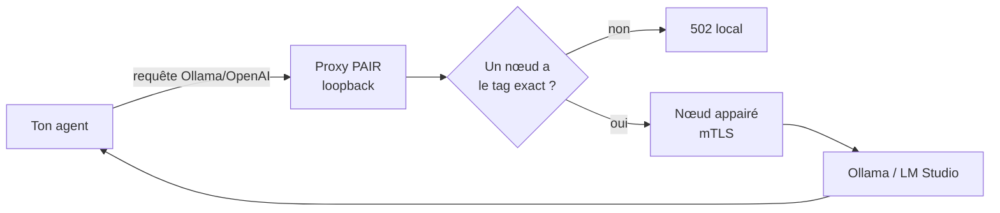
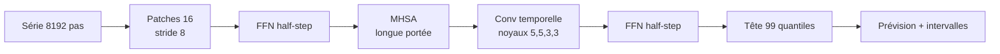
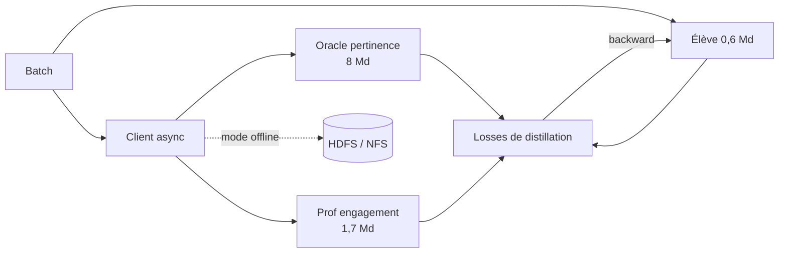

# IA — Détail du samedi 12 septembre 2026

## 1. NVIDIA Personal AI Router (PAIR) — router l'inférence sur ton réseau local

**Source :** InfoQ — https://www.infoq.com/news/2026/09/nvidia-pair-ai-task-router/
**Date :** 11 septembre 2026

### Contexte

Quand tu fais tourner un harnais d'agents en local, le goulot n'est pas la qualité du modèle : c'est le fait que cinq sous-agents se disputent un seul GPU. Ton portable a une RTX, ta tour en a une autre, et rien ne les fait travailler ensemble. Les solutions existantes répondent à une autre question — Petals et Mesh LLM découpent un modèle **trop gros** entre plusieurs machines.

NVIDIA publie **Personal AI Router (PAIR)** en bêta, sous Apache 2.0 (dépôt `NVIDIA/Personal-AI-Router`). Le positionnement est précis et vaut d'être énoncé d'emblée, parce que la confusion est générale : PAIR **n'est pas un moteur d'inférence**. Ollama ou LM Studio exécute toujours le modèle. PAIR fait découverte, suivi d'état, ordonnancement et proxy.

### Comment ça marche

La topologie est **pair-à-pair stricte** : ni serveur, ni contrôleur, ni nœud primaire. Chaque machine exécute exactement le même binaire, et appartient à au plus un cluster.

Le cycle se déroule en cinq étapes : **Start → Discover → Pair → Prepare → Serve**, dont les trois premières sont ponctuelles. La découverte se fait par **mDNS**, avec ajout manuel par IP en secours. Point important : voir une machine ne donne aucun droit dessus. Toute communication nœud-à-nœud est bloquée avant appariement. Celui-ci passe par une invitation et un **code PIN à 6 chiffres** saisi par un humain, puis bascule sur du **mTLS** avec certificats générés, restreint aux membres du cluster.

Le routage est la partie intéressante. Un nœud est éligible pour une requête si trois conditions tiennent : il est joignable, un moteur compatible tourne, et **l'inventaire courant du moteur annonce le tag de modèle exact demandé**. Pas de fallback sur une quantization voisine, pas d'alias. Si aucun nœud ne qualifie, le proxy local renvoie un **`502`**.

Le scheduler classe ensuite les candidats par travail en attente cumulé sur les deux moteurs. Chaque proxy compte en plus les requêtes qu'il vient de dispatcher, pour qu'une rafale concurrente se réparte sans attendre la remontée des rapports de charge.



Les limites sont assumées et documentées. PAIR **ne met pas la VRAM en pool**, ne fusionne pas plusieurs GPU en un GPU logique, ne shard pas un modèle, ne découpe pas une requête en vol et **ne migre pas** une requête en cours. Chaque requête s'exécute entière sur un seul nœud. La formule du README est sans ambiguïté : ajouter des machines augmente le nombre de requêtes simultanées, **ça ne rend pas une requête individuelle plus rapide**.

La politique d'ordonnancement elle-même est reconnue comme naïve : elle ignore le modèle de GPU, la mémoire disponible, la chaleur du cache et le coût estimé de la requête. NVIDIA le formule ainsi — PAIR convient mieux à des machines **similaires** qu'à un parc très hétérogène.

### En pratique — exemple de code

```bash
# Installation Linux (le .deb de la release)
sudo apt install ./NVPAIR-Setup-*.deb

# PAIR prend le port par défaut d'Ollama : ton code ne change pas.
# Si le nœud local n'a pas le modèle, la requête part vers un pair appairé.
curl http://127.0.0.1:11434/v1/chat/completions \
  -H "Content-Type: application/json" \
  -d '{"model":"qwen4:12b","messages":[{"role":"user","content":"In one sentence, what does a router do?"}]}'
```

```csharp
// Côté client .NET : le 502 n'est PAS une erreur moteur, c'est "aucun nœud
// ne détient ce tag". À distinguer explicitement dans ta politique de retry.
using var res = await http.PostAsJsonAsync("/v1/chat/completions", payload, ct);

if (res.StatusCode == HttpStatusCode.BadGateway)
    throw new ModelUnavailableException(payload.Model); // pré-déployer le tag

res.EnsureSuccessStatusCode();
```

### Pourquoi ça compte pour toi

Si ton service parle déjà à `http://127.0.0.1:11434`, tu ne changes rien : PAIR détourne le port. Modélise-le comme un **load balancer L7 conscient des modèles**, pas comme un cluster de calcul. Deux conséquences pratiques : gère le `502` à part dans tes retries, et impose une convention de tags stricte, puisque le matching est exact. Les nœuds partent en veille — l'idempotence côté appelant n'est pas optionnelle.

### Points de vigilance

Le PIN à 6 chiffres est un bootstrap de confiance, pas un authentifiant fort ; la doc le dit explicitement. N'appairie pas sur un LAN d'entreprise partagé sans lire `SECURITY.md`. La démo NVIDIA (18 min → 8 min 48 s sur trois machines) est présentée par NVIDIA elle-même comme spécifique à une configuration, et non comme une promesse de scaling linéaire.

---

## 2. Granite Time Series PatchTST-FM-r2 — un modèle de fondation séries temporelles sous licence permissive

**Source :** Hugging Face Blog — https://huggingface.co/blog/ibm-research/ibm-releases-sota-granite-time-series
**Date :** 9 septembre 2026

### Contexte

La prévision de séries temporelles en entreprise suit encore un schéma artisanal : un modèle par série, entraîné sur son propre historique, avec son job, son artefact et son entrée de registry. Multiplie par le nombre de métriques que tu surveilles, et tu obtiens une dette MLOps qui grossit linéairement.

Les modèles de fondation séries temporelles cassent ce schéma : un seul artefact, entraîné une fois, appliqué en **zero-shot** à n'importe quelle série régulièrement échantillonnée. Le blocage était jusqu'ici juridique autant que technique — les modèles les mieux classés portaient des licences peu compatibles avec un usage commercial.

IBM publie `ibm-granite/granite-timeseries-patchtst-fm-r2` : **385 M de paramètres**, en **double licence Apache 2.0 et OpenMDW 1.0**, l'utilisateur choisissant l'une ou l'autre.

### Comment ça marche

PatchTST découpe la série en **patches** — des fenêtres contiguës traitées comme des tokens — puis applique un transformer dessus. La r2 change deux choses par rapport à la r1.

D'abord le bloc. On passe du transformer standard (MHSA + FFN) au bloc **Conformer**, emprunté à la reconnaissance vocale : **deux FFN « half-step » encadrant le MHSA, plus une couche de convolution temporelle**. Les tailles de noyau alternent 3 et 5 selon le motif répété `{5, 5, 3, 3}`.

Le raisonnement est élégant. La convolution capture l'information **inter-patches de court terme** — la continuité locale entre deux fenêtres voisines. Elle décharge donc l'attention, qui peut se concentrer sur le long terme. IBM le vérifie empiriquement sur ETTh1 : l'attention du transformer se masse près de la diagonale, celle du conformer montre un focus **loin de la diagonale**.

Ensuite le découpage. Les patches font 16 pas avec un **stride de 8**, soit 50 % de recouvrement. Ce chevauchement crée un artefact de frontière que deux mécanismes corrigent : une **pondération de loss par fenêtre de Hamming** à l'entraînement, et une approche **overlap-and-add** à l'inférence.



Le nombre de blocs passe de 20 à 30, la dimension cachée est de 1024, le contexte de **8192 pas** — une année de données horaires tient largement. La tête produit **99 quantiles**, donc des intervalles d'incertitude natifs, sans bootstrap ni ensembling.

### En pratique — exemple de code

```python
# pip install "granite-tsfm>=0.3.9"
import pandas as pd
from tsfm_public import PatchTSTFMForPrediction, TimeSeriesForecastingPipeline

# Un seul artefact : pas d'entraînement par série.
model = PatchTSTFMForPrediction.from_pretrained(
    "ibm-granite/granite-timeseries-patchtst-fm-r2"
)

df = pd.read_csv(
    "https://raw.githubusercontent.com/zhouhaoyi/ETDataset/main/ETT-small/ETTh1.csv",
    parse_dates=["date"],
)

pipe = TimeSeriesForecastingPipeline(
    model=model,
    id_columns=[],
    timestamp_column="date",
    target_columns=["HUFL"],
    max_context_length=model.config.context_length,  # 8192
    context_length=512,        # réduire pour baisser la latence
    prediction_length=64,
    impute_method=None,        # les trous sont un cas de première classe
    quantile_levels=[0.1, 0.5, 0.9],  # la tête en couvre 99
    explode_forecasts=True,
    freq="1h",
)

forecast = pipe(df.iloc[-512:])  # zero-shot, aucun fine-tuning
```

### Pourquoi ça compte pour toi

385 M de paramètres, ça se sert dans un service Python standard, sans GPU dédié. Tu remplaces « un modèle par métrique » par un artefact unique chargé une fois. La sortie quantile se branche directement sur de l'alerting ou du capacity planning, sans couche d'incertitude maison. Et la licence, enfin, ne bloque plus la revue juridique.

### Limites

Deux avertissements à porter en revue d'architecture. Les résultats GIFT-Eval — CRPS 0,467, MASE 0,6846, 2e du classement zero-shot — sont **dans une PR soumise, pas encore mergée** au leaderboard. Et le disclaimer IBM est explicite : le code ne sera pas maintenu. Pour de la production, budgète le fork et la maintenance interne de `granite-tsfm`. Note aussi que le tag de licence du Hub n'affiche qu'`openmdw-1.0` ; le double licensing figure dans le corps de la model card.

---

## 3. LinkedIn — la distillation multi-teacher servie par SGLang dans la boucle d'entraînement

**Source :** InfoQ — https://www.infoq.com/news/2026/09/linkedin-ai-multi-teacher/
**Date :** 11 septembre 2026

### Contexte

Un moteur de ranking industriel doit absorber des centaines de milliers de requêtes par seconde. Mettre un LLM frontier sur le chemin critique est exclu par la latence et par le coût. Mais la qualité de ranking d'un cross-encoder, elle, reste souhaitable.

La distillation résout ce dilemme : un gros modèle **professeur** produit des cibles riches, un petit modèle **élève** apprend à les reproduire, et c'est l'élève qui part en production. LinkedIn documente sa version de l'exercice pour la recherche d'emploi en langage naturel, live pour les utilisateurs américains.

La topologie est asymétrique et volontairement modeste : deux professeurs spécialisés par objectif — un **oracle de pertinence de 8 Md** et un **professeur d'engagement de 1,7 Md** — pour un élève de **0,6 Md**.

### Comment ça marche

La contribution n'est pas la recette de distillation, c'est l'**infrastructure de serving des professeurs**. L'approche naïve consiste à charger les professeurs comme des modules PyTorch et à faire un forward pass à chaque batch. Elle sature la mémoire GPU et gaspille le calcul, parce qu'un forward pass d'inférence n'a pas les mêmes besoins qu'une passe d'entraînement.

LinkedIn bâtit à la place un framework sur **SGLang**, un moteur de serving d'inférence, et le place **dans la boucle d'entraînement**. Le framework charge des professeurs de tailles différentes, gère les configurations tensor-parallel et data-parallel, et un **client asynchrone** interroge les professeurs pendant l'entraînement, traite leurs sorties et les injecte dans les losses de distillation. L'équipe appelle ça l'**Online Multi-teacher Distillation**.

Le passage à l'échelle multi-nœuds repose sur des **répliques locales de professeurs** : chaque nœud héberge sa copie, ce qui supprime l'aller-retour réseau vers un pool centralisé. Gain mesuré : distillation **3× plus rapide**, au prix de mémoire GPU dupliquée.

Un second mode complète le premier. En **Offline Multi-teacher Distillation**, les sorties des professeurs sont pré-calculées et stockées sur HDFS ou NFS, puis consommées directement. La règle de décision est claire : interroger en ligne tant que le choix des professeurs bouge encore, basculer sur le cache une fois la sélection stabilisée.



Le facteur 8× annoncé n'est pas une astuce unique, c'est un empilement : **Liger-Kernel** réduit la mémoire et permet des batches deux fois plus grands, l'entraînement multi-nœuds apporte jusqu'à 3,5×, **FSDP2** ajoute 20 %, et les clusters H200 encore 30 %.

### En pratique — exemple de code

```python
# Schéma du pattern "professeur servi en HTTP dans la boucle d'entraînement".
# Reconstruction pédagogique : LinkedIn ne publie pas son code.
import asyncio, torch, torch.nn.functional as F

async def teacher_logits(session, base_url, batch):
    # SGLang est interrogé comme un service, pas chargé comme un module.
    async with session.post(f"{base_url}/generate", json=batch) as r:
        return torch.tensor((await r.json())["logits"])

async def step(session, batch, student, opt, T=2.0):
    # Les deux professeurs sont interrogés EN PARALLÈLE du forward élève.
    relevance, engagement = await asyncio.gather(
        teacher_logits(session, "http://localhost:30000", batch),  # 8 Md
        teacher_logits(session, "http://localhost:30001", batch),  # 1,7 Md
    )
    s = student(batch)  # 0,6 Md
    # Une loss KL par objectif : les professeurs sont spécialisés, pas moyennés.
    loss = sum(
        F.kl_div(F.log_softmax(s / T, -1), F.softmax(t / T, -1), reduction="batchmean")
        for t in (relevance, engagement)
    ) * T * T
    loss.backward(); opt.step(); opt.zero_grad()
    return loss.item()
```

### Pourquoi ça compte pour toi

Le pattern transposable, c'est de traiter le professeur comme un **service à scaler**, pas comme un module à charger. Si tu as déjà vLLM ou SGLang en production, tu as la moitié de la brique. Retiens aussi le résultat négatif : n'active pas FP8 par défaut sous 8 Md de paramètres, l'overhead de cast mange le gain. Et priorise les optimisations par coût — kernels fusionnés d'abord, matériel en dernier.

### Pour aller plus loin

Le gain de qualité est réel : NDCG@10 passe de **0,7583 à 0,9432**, soit +24,48 %, sur une baseline déjà correcte. Côté inférence, un chantier distinct — pruning structuré et compression de contexte — fait passer le débit de ranking d'environ 290 à plus de 2 000 items par seconde et par GPU. La distillation seule ne t'y amène pas.
