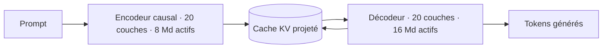
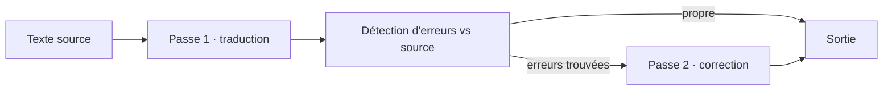

# IA — Détail du dimanche 13 septembre 2026

## 1. DeepSeek-V4.1-Flash — le Causal Encoder-Decoder, ou pourquoi lire coûte moins cher qu'écrire

**Source :** Baseten — https://www.baseten.co/blog/deepseek-v41-flash-more-efficient-prefill-for-coding-agents/
**Date :** 10 septembre 2026

### Contexte

DeepSeek a publié les poids ouverts de **V4.1-Flash** sur Hugging Face sous licence **MIT**. Les chiffres d'affiche : **552 Md** de paramètres totaux, **1 M** de tokens de contexte, entrée multimodale texte + image, sortie texte, tarif API annoncé à **0,15 $ par million de tokens d'entrée**. Le label « Flash », popularisé par Gemini, désigne un modèle allégé censé tenir le niveau d'un plus gros.

L'intérêt réel n'est pas la taille, c'est la forme. V4.1-Flash est le seul modèle de cette échelle à utiliser une architecture **Causal Encoder-Decoder** (CED). Et elle est taillée pour un cas d'usage précis : les agents de code, dont les boucles génèrent bien plus de tokens de prefill que de decode.

### Comment ça marche

Une inférence LLM se découpe en deux étapes de coûts très différents. Le **prefill** lit l'entrée : il traite tout le prompt d'un coup, en parallèle. Le **decode** génère la sortie, token par token, séquentiellement. Dans un MoE classique, les deux étapes activent **le même nombre** de paramètres.

Le CED casse cette symétrie. Les 40 couches sont scindées en un **encodeur causal de 20 couches** et un **décodeur de 20 couches**. Le cache clé-valeur du décodeur n'est pas calculé indépendamment couche par couche : il est **projeté directement depuis la sortie de l'encodeur**. Conséquence directe, le prefill n'a besoin de faire tourner que l'encodeur — **8 Md** de paramètres activés par token — tandis que le decode fait tourner le modèle complet, à **16 Md**. Le pari sous-jacent : générer est plus dur que lire, donc on met le calcul là où il sert. Pour comparaison, V4-Flash activait 13 Md pour les deux.



Le second effet est mémoire. Comme les états clé-valeur du décodeur descendent de la sortie de l'encodeur au lieu d'être recalculés partout, le cache rétrécit. DeepSeek annonce un **cache KV global au quart** de celui de V4-Flash, soit environ **890 octets par token**. Deux techniques s'ajoutent au CED : **Compressed Sparse Attention 2**, qui partage des entrées clé-valeur entre couches d'attention, et le **cache KV en FP4**, qui stocke ces entrées en précision réduite.

Et là se joue la vraie économie. Moins de mémoire par token, c'est plus de contexte qui tient en cache, donc un **taux de hit plus élevé**. Quand le préfixe d'un prompt est déjà en cache, le modèle saute le recalcul de l'attention sur ces tokens : le time-to-first-token baisse, le débit par GPU monte. Un agent de code renvoie quasiment le même contexte à chaque tour de boucle — c'est le profil qui capitalise le plus dessus. Encore faut-il que ton routage envoie la requête sur le réplica qui détient déjà le préfixe, sinon le gain s'évapore.

### En pratique — exemple de code

```bash
# Servir le modèle derrière une API OpenAI-compatible, avec cache de préfixe activé
vllm serve deepseek-ai/DeepSeek-V4.1-Flash \
  --enable-prefix-caching \
  --max-model-len 1000000
```

```python
# Boucle d'agent : le préfixe SYSTEM + contexte repo est identique à chaque tour.
# Le garder en tête de prompt, octet pour octet, maximise le hit du cache KV.
from openai import OpenAI

client = OpenAI(base_url="http://localhost:8000/v1", api_key="local")
PREFIX = [
    {"role": "system", "content": SYSTEM_RULES},   # figé
    {"role": "user",   "content": REPO_CONTEXT},   # figé sur toute la session
]

for step in agent_steps:
    resp = client.chat.completions.create(
        model="deepseek-ai/DeepSeek-V4.1-Flash",
        messages=PREFIX + step.messages,           # la variation reste en QUEUE
        max_tokens=1024,
    )
    step.apply(resp.choices[0].message.content)
```

### Pourquoi ça compte pour toi

Si tu fais tourner un agent de code, la facture part majoritairement en prefill. Un modèle qui divise ce coût par plus de deux change ton arbitrage build/buy. Retiens surtout la règle de prompt : garde le contexte figé **en tête**, les variations en queue. C'est ce qui rend le cache de préfixe efficace, quel que soit le modèle. Et planifie la migration : V4-Flash est retiré, V4-Pro est rerouté dès le 14 septembre.

### Limites

- **54,8 sur Automation-Bench** : environ un workflow complexe sur deux échoue. Ce n'est pas un modèle qu'on laisse tourner sans supervision.
- Le score **ZeroBench reste sous 50**. Pour du raisonnement sur images — captures, dashboards, maquettes — garde une relecture humaine sur tout ce qui est conséquent.

---

## 2. Cohere North Small Translate 1.0 — 218 Md de poids ouverts, et une licence qui ferme la porte

**Source :** The New Stack — https://thenewstack.io/cohere-translation-commercial-licensing/
**Date :** 11 septembre 2026

### Contexte

Cohere a publié le 10 septembre **North Small Translate 1.0**, premier modèle de traduction de la famille North, développé en partenariat avec **RWS**. C'est un mixture-of-experts de **218 Md** de paramètres totaux pour **25 Md actifs**, couvrant plus de **50 langues**, avec 16K tokens de contexte en entrée et 16K en sortie. Sur WMT26 toutes langues, il obtient **83,60**, et **84,36** pour une variante agentique multi-passes.

L'histoire n'est pas le score. Les poids FP8 sortent sous **CC BY-NC 4.0** : recherche et usage non commercial. L'usage commercial passe par **Model Vault**, sous licence séparée. Pour une entreprise qui met en avant la souveraineté de l'IA, le contraste a été relevé publiquement.

### Comment ça marche

Deux mécanismes méritent d'être compris, l'un technique, l'autre juridique.

Le technique, c'est le **multi-passes agentique**. Une traduction neuronale classique fait une passe : encodeur, décodeur, sortie. Ici, le modèle produit d'abord une traduction candidate, puis relit cette sortie face à la source pour **détecter des erreurs** — contresens, omissions, terminologie incohérente — et produit une passe de correction. Les **+0,76 point** entre 83,60 et 84,36 mesurent exactement le rendement de cette relecture. C'est le même patron que tu retrouves partout en agentique : générer, critiquer, corriger. Le coût est d'au moins doubler les tokens pour un gain sous le point.



Le juridique est plus piégeux, parce que le vocabulaire trompe. « Poids ouverts » (*open weights*) signifie uniquement que le fichier est téléchargeable. **Ce n'est pas de l'open source.** La clause **NC** de CC BY-NC 4.0 interdit tout usage « principalement destiné à un avantage commercial ». Cette formulation ne se limite pas à la revente du modèle : traduire la documentation de ton produit, localiser une interface facturée, alimenter un support client payant — tout cela tombe raisonnablement dedans. Le prototype interne est couvert ; la mise en production commerciale ne l'est pas. La clause **BY** impose en plus l'attribution.

Trois voies existent donc : l'API Chat V2 en free tier, les poids FP8 non commerciaux, et Model Vault avec licence commerciale. Seule la troisième t'autorise une production facturée.

### En pratique — exemple de code

```python
# Avant de télécharger 218 Md de poids : lire le champ licence, pas le README marketing.
from huggingface_hub import HfApi

info = HfApi().model_info("CohereLabs/North-Small-Translate-1.0")
print(info.cardData.get("license"))        # -> 'cc-by-nc-4.0'

BLOQUANTES = {"cc-by-nc-4.0", "cc-by-nc-sa-4.0", "creativeml-openrail-m"}
if info.cardData.get("license") in BLOQUANTES:
    raise SystemExit("Usage commercial interdit : passer par une licence dédiée.")
```

```bash
# Plancher matériel annoncé, en quantification W4A4 : 1× B200 ou 2× H100.
# À vérifier AVANT de budgéter un POC — ce n'est pas un modèle de laptop.
nvidia-smi --query-gpu=name,memory.total --format=csv
```

### Pourquoi ça compte pour toi

Ajoute un contrôle de licence automatisé à ton pipeline d'ingestion de modèles, au même titre que ton audit NuGet. Un `cc-by-nc-4.0` qui atterrit en production, c'est une exposition juridique que personne ne verra avant un audit. Retiens aussi le patron multi-passes : il est réutilisable avec n'importe quel modèle, et tu peux mesurer chez toi si le doublement de tokens vaut le gain.

### Points de vigilance

- « Open weights » n'est pas « open source ». Le fichier téléchargeable ne dit rien des droits d'usage.
- Le plancher matériel — **un B200 ou deux H100 en W4A4** — écarte d'emblée l'auto-hébergement opportuniste.
