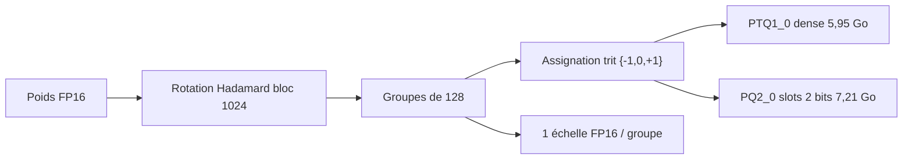
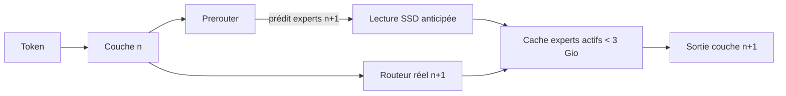

# IA — Détail du samedi 19 septembre 2026

## 1. Ternary Bonsai 2 27B (PrismML) — ternaire g128, rotation de Hadamard et 1,72 bit par poids

**Source :** Hugging Face — https://huggingface.co/prism-ml/Ternary-Bonsai-2-27B-gguf
**Date :** 17 septembre 2026

### Contexte

La quantification consiste à remplacer des poids FP16 par une représentation plus courte. Le problème connu du domaine est que sous les 4 bits, la qualité s'effondre : un build IQ2_XXS de Qwen3.8-27B tombe à 72,59 de moyenne sur les benchmarks thinking, contre 86,66 pour l'original. Le raisonnement pas à pas et le tool calling sont les premiers à partir.

Second problème, plus insidieux : **les étiquettes mentent**. Un build annoncé « 2-bit » garde en réalité des tenseurs sensibles en précision supérieure, si bien que sa largeur moyenne réelle est de 2,8 bits pour 9,4 Go. PrismML publie Bonsai 2 27B, dérivé de Qwen3.8-27B, avec une promesse inverse : la largeur annoncée est la largeur réelle.

### Comment ça marche

Le format est le **ternaire g128**. Chaque poids prend une valeur dans {−1, 0, +1}. Trois états seuls ne peuvent évidemment pas exprimer l'amplitude d'un poids : c'est le rôle d'un facteur d'échelle FP16 unique partagé par **groupe de 128 poids**. La valeur effective d'un poids est donc `trit × scale_du_groupe`.

Le calcul de coût est direct. Une valeur ternaire porte log₂3 ≈ 1,585 bit d'information. Ajoute l'échelle 16 bits amortie sur 128 poids (16/128 = 0,125 bit) et tu obtiens ~1,71 bit/poids. En comptant le petit ensemble de tenseurs restés au-dessus du ternaire — 26,2 M de paramètres, soit 0,0976 % du modèle de langage : le chemin d'état récurrent des couches d'attention linéaire et les poids de normalisation — l'ensemble revient à **1,72 bit/poids**, soit ~9,3× de réduction idéale face au FP16.

Le mécanisme qui rend ça viable est la **rotation de Hadamard par blocs**. Avant d'assigner les trits, chaque matrice est transformée par une rotation orthogonale (blocs de 1024, signes ±1 fixes). Pourquoi ? Parce que les poids d'un transformeur ont des valeurs aberrantes : quelques coefficients très grands qui dominent le groupe et forcent une échelle énorme, écrasant tous les autres poids vers zéro. Une rotation orthogonale étale ces outliers sur toutes les dimensions du bloc sans changer la fonction calculée. Le groupe devient homogène, et trois états suffisent à le représenter. La rotation est **repliée hors ligne dans les poids stockés** : elle ne coûte aucun bit et aucun trafic mémoire supplémentaire. Le runtime applique la transformation correspondante aux activations, et le fichier déclare sa rotation en métadonnée — un runtime qui ne sait pas l'appliquer refuse de charger le fichier plutôt que de produire du bruit.

Deux empaquetages GGUF sont livrés. **PTQ1_0** compacte les trits densément (1,75 bit/poids, 5,95 Go), au plus près de la cible théorique. **PQ2_0** loge chaque trit dans un emplacement de 2 bits (2,13 bit/poids, 7,21 Go) : plus gros, mais dépaquetage moins coûteux. Aucun des deux n'est uniformément plus rapide. Les poids empaquetés sont consommés directement par les kernels, jamais redéployés en FP16.

Résultat : 84,78 de moyenne sur 14 benchmarks thinking, soit 98,2 % du FP16. Le math tient à moins d'un demi-point (96,57), le code est au niveau de la baseline (89,42), et c'est l'agentique qui souffre le plus (74,92). La tour de vision part dans un pack mmproj Q8_0 séparé de 0,63 Go, chargé seulement quand une image arrive.



### En pratique — exemple de code

Le modèle se sert avec llama.cpp — mais le fork PrismML, car les kernels ternaires hybrid-attention n'existent pas encore en amont.

```bash
# 1. Récupérer le pack dense (5,95 Go). Le mmproj vision est optionnel :
#    ne le télécharge que si tu envoies vraiment des images.
huggingface-cli download prism-ml/Ternary-Bonsai-2-27B-gguf \
  --include "*PTQ1_0*" --local-dir ./bonsai2

# 2. Servir avec les kernels ternaires (fork PrismML de llama.cpp, CUDA ou Metal).
#    -c 32768 : ne réserve pas les 262K de contexte, le KV cache te mangerait la RAM.
./llama-server \
  -m ./bonsai2/Ternary-Bonsai-2-27B-PTQ1_0.gguf \
  -c 32768 -ngl 99 --host 0.0.0.0 --port 8080
```

Les paramètres d'échantillonnage sont portés dans les métadonnées GGUF (`general.sampling.*`), donc un client qui lit les défauts du modèle les applique seul. Si ton client ne le fait pas, voici les valeurs de référence — ce sont celles utilisées pour les benchmarks publiés.

```json
{
  "_commentaire": "Mode thinking - valeurs des benchmarks publiés",
  "temperature": 1.0, "top_p": 0.95, "top_k": 20,
  "min_p": 0.0, "presence_penalty": 0.0, "repetition_penalty": 1.0,

  "_commentaire_instruct": "Mode instruct / non-thinking",
  "instruct": { "temperature": 0.7, "top_p": 0.80, "top_k": 20,
                "presence_penalty": 1.5 }
}
```

### Pourquoi ça compte pour toi

Un modèle 27B de qualité quasi-FP16 qui tient dans 6 Go change ta décision d'architecture : tu peux envisager de l'inférence locale sur un poste de dev ou un petit serveur maison, sans API externe ni données qui sortent. Attention au point faible : 74,92 en tool calling, contre 79,74 pour le FP16. Si ton usage est agentique — appel d'outils, orchestration — mesure avant de t'engager. Pour de la génération, de la synthèse ou de l'assistance au code, l'écart est négligeable.

### Limites

Les 262K de contexte sont hérités du modèle de base et rendus praticables par un backbone à ~75 % d'attention linéaire. Mais le KV cache, lui, n'est pas ternaire : un contexte long te ramènera vite au-dessus de tes 16 Go. Et les kernels ne sont pas encore dans llama.cpp amont, donc tu dépends d'un fork.

---

## 2. Edge0-35B-A3B preview — servir un MoE de 35 milliards depuis le SSD

**Source :** Hugging Face — https://huggingface.co/Edge0/Edge0-35B-A3B-preview
**Date :** 17 septembre 2026

### Contexte

Un Mixture-of-Experts est architecturalement asymétrique : Edge0-35B-A3B compte 256 experts par couche mais n'en active que 4 par token (K=4), sur 40 couches. Le calcul par token ne mobilise donc qu'une fraction minuscule des poids. Le problème est que la pratique habituelle charge **tous** les experts en RAM, parce qu'on ne sait pas lesquels le routeur choisira. Tu paies la mémoire du nombre total de paramètres pour le calcul du sous-ensemble actif.

C'est ce que les auteurs appellent « l'autre moitié du mur mémoire ». Leur papier (arXiv 2609.18063) propose de garder la base int4 **sur le stockage** et de ne faire résider que les poids actifs.

### Comment ça marche

Trois mécanismes se combinent, et l'ordre compte.

Le premier est le **SSD expert offload**. Les poids d'experts restent sur le disque et sont lus à la demande, seulement quand le routeur les désigne. Le pic mémoire est borné par l'ensemble actif, pas par le nombre de paramètres. Il n'y a ni sharding ni téléchargement préalable des poids en mémoire. Mesuré : **2,9 Gio de pic mémoire active**.

Le problème évident est la latence : une lecture SSD au milieu de la passe forward stalle le calcul. D'où le second mécanisme, le **prerouter**. C'est une tête entraînée qui **prédit le routage un pas à l'avance** — elle devine quels experts la couche suivante va demander, avant que le calcul n'y arrive. Les lectures disque sont donc lancées en recouvrement de la passe forward en cours, au lieu de la bloquer. Gain mesuré : **jusqu'à +59 % de débit en décodage**, et l'avantage grandit avec la latence du stockage, la taille du modèle et la largeur de routage K. C'est du prefetch classique, appliqué à des experts MoE, avec un prédicteur appris plutôt qu'heuristique.

Le troisième est **Recover-LoRA**. Quantifier en int4 coûte de la qualité. Plutôt que de re-quantifier finement, ils gèlent la base int4 et entraînent des adaptateurs LoRA **par distillation depuis le professeur FP**. L'écart final tombe à 3,9 points de moyenne : 79,2 contre 83,2. Détail d'ingénierie important, les adaptateurs restent **non fusionnés** : une seule base en lecture seule peut servir plusieurs jeux d'adaptateurs, ce qui rend le service multi-tenant viable sur une machine unique.

Le détail des benchmarks, tous passés avec OpenCompass dans des réglages identiques : AIME 2026 à 86,6 (vs 92,7), HumanEval à 90,9 (vs 95,1), GPQA-Diamond à 79,8 (vs 81,8), MMLU-Pro à 81,0 (vs 84,6), IFBench à 57,9 (vs 61,7).



### En pratique — exemple de code

Le dépôt est autonome : base int4, `lora_edge0_35b.safetensors` et `prerouter_edge0_35b.safetensors` sont colocalisés et chargés automatiquement.

```bash
# Backend MLX -> Apple Silicon pour l'instant ; autres backends à la roadmap.
pip install -e 'git+https://github.com/Edge0-AI/edge0.git#egg=edge0[fetch]'

huggingface-cli download Edge0/Edge0-35b-a3b-preview \
  --local-dir ./Edge0-35b-a3b-preview

export EDGE0_35B_MODEL=$PWD/Edge0-35b-a3b-preview

# Chat direct : la base reste sur le SSD, seuls les experts routés montent en RAM.
edge0 chat --name edge0-35b --prompt "Présente-toi"

# Ou serveur HTTP compatible OpenAI -> branchable derrière ton backend .NET/Symfony.
edge0 serve --name edge0-35b --port 8085
```

```python
# Vérifier que le gain vient bien du prerouter : compare décodage avec et sans.
# Sur Mac mini M4 Pro 24 Go : 14,9-17,7 tok/s en décodage,
# prefill 113 tok/s à froid, 140 tok/s à chaud, pic actif 2,9 Gio.
import subprocess
for flag in ["--prerouter", "--no-prerouter"]:
    subprocess.run(["python", "examples/bench.py", "--name", "edge0-35b", flag])
    # L'écart attendu grandit avec la latence de ton stockage :
    # sur un SSD SATA lent, l'anticipation rapporte bien plus que sur du NVMe.
```

### Pourquoi ça compte pour toi

C'est le même raisonnement que ton cache applicatif : ne garde en mémoire chère que l'ensemble actif, et anticipe la prochaine lecture pour masquer la latence du stockage. Le motif prerouter est transposable — un prédicteur appris qui déclenche un prefetch vaut souvent mieux qu'une heuristique LRU. Côté usage direct, reste prudent : cette préversion est explicitement faible en agentique, tool use et planification multi-étapes.

### Limites

Backend MLX uniquement, donc Apple Silicon pour l'instant. Les contextes longs font grossir le KV cache et te sortent des 3 Gio. Et le statut « preview » n'est pas décoratif : la couverture et la qualité sont annoncées comme encore en extension.
