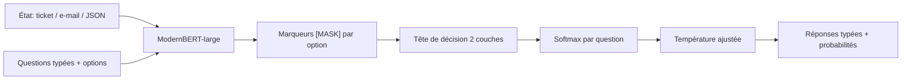
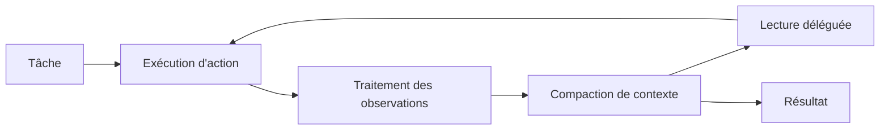

# IA — Détail du dimanche 20 septembre 2026

## 1. Laya — un modèle de décision non autorégressif, calibré par RLCD

**Source :** Hugging Face — https://huggingface.co/convaiinnovations/laya
**Date :** 19-20 septembre 2026

### Contexte

Une part énorme de ce qu'on demande aujourd'hui à un LLM n'est pas de la génération : c'est du routage de ticket, de la classification d'e-mail, du scoring d'urgence, de la modération, de la lecture de trace d'agent. On envoie un prompt, on demande du JSON, on parse la réponse, et on prie pour que le modèle n'invente pas une catégorie qui n'existe pas. Le coût est double : la latence d'un décodage token par token, et la fragilité d'une sortie textuelle qu'il faut valider.

Laya prend le problème par l'autre bout. C'est un **encodeur bidirectionnel**, pas un décodeur. Tu lui donnes un état — un texte, un e-mail, un ticket, un objet JSON — et des questions typées, et il rend des réponses typées avec une distribution de probabilité, en un seul passage avant. Il ne génère jamais de texte, donc il n'y a rien à parser et rien à halluciner : l'espace de réponse est celui que tu as fourni. La famille compte trois checkpoints : `laya` (ModernBERT-large, 421 M, contexte 512, anglais), `laya-multilingual` (mmBERT-base, 322 M, contexte 1024, 100+ langues, environ 2× plus rapide) et `laya-typed-decisions` (421 M, contexte 1024, spécialisé sur quatre workflows métier).

### Comment ça marche

Le cœur du dispositif tient en deux idées : les **marqueurs d'option** et l'**entraînement à règle de score propre**.

Côté architecture, le backbone ModernBERT-large (395 M) est entièrement fine-tuné, et on lui greffe une tête de décision entraînée de zéro : deux couches Transformer, un scorer de marqueurs d'option, et une tête act/escalate. Total 421 M. Chaque option d'une question est scorée **à son propre token `[MASK]`**, puis on applique un softmax sur les options de cette question uniquement. La conséquence pratique est importante : l'espace de réponse est défini à la requête, donc un nouveau schéma de décision ne demande aucun réentraînement. Le budget est de 512 tokens par question — question, options et état confondus — et toutes les questions d'un appel passent dans le même forward.

Côté entraînement, c'est le mécanisme RLCD (*Reinforcement Learning for Calibrated Decisions*) qui fait le travail intéressant. La politique ne produit pas un label, elle produit une **distribution**. L'exploration ajoute un bruit gaussien de moyenne nulle aux logits. Et la récompense est une règle de score **strictement propre** : log-score et score sphérique, plus le *ranked probability score* pour les questions ordinales. La propriété mathématique d'une règle strictement propre, c'est que l'espérance de récompense est maximisée uniquement quand le modèle reporte ses vraies probabilités. Autrement dit, sur-confiancer est directement pénalisé par la fonction objectif — ce n'est pas une régularisation ajoutée après coup. Les mises à jour sont du REINFORCE avec baseline de moyenne de groupe, à la GRPO ; les conversations multi-tours utilisent TD(λ=1,0) sur des tranches de préfixe. L'entraînement complet : 7 313 mises à jour, une époque, environ 1 h 56.



Trois types de question sont disponibles : `choice` rend l'option retenue, la probabilité de chaque option et une confiance ; `score` rend un niveau attendu sur ta rubrique ordinale plus la distribution ; `noul` rend une probabilité calibrée que la proposition soit vraie.

### En pratique — exemple de code

```python
import laya

agent = laya.load("convaiinnovations/laya")
result = agent.predict(
    # L'état : ce que le modèle doit lire
    {"subject": "Duplicate charge on invoice 4411",
     "body": "We were billed twice for March. Please refund the duplicate."},
    # Les questions : l'espace de réponse est défini ICI, pas à l'entraînement
    {"department": {"type": "choice", "instructions": "Which team should handle this?",
                    "criteria": {"billing": "invoices, payments, refunds",
                                 "technical": "bugs and outages", "sales": "pricing"}},
     "urgency":    {"type": "score",  "instructions": "How urgent is this?",
                    "criteria": ["not urgent", "soon", "blocking"]},
     "churn_risk": {"type": "noul",   "instructions": "Does the user threaten to cancel?"}},
)
print(result["answers"]["department"]["choice"])  # -> "billing"
```

```python
# Routage automatique entre checkpoints selon la langue détectée
from laya import Router

router = Router()                                             # charge à la demande
router.predict({"body": "I was charged twice"}, questions)     # -> laya (anglais)
router.predict({"body": "मुझसे दो बार शुल्क लिया गया"}, questions)  # -> laya-multilingual
router.predict(state, questions, model="typed-decisions")      # choix explicite
# Astuce : augmente max_loaded sur du trafic multilingue, sinon rechargement à chaque bascule
```

### Pourquoi ça compte pour toi

Tu as probablement des appels LLM qui ne font que classer : trier des retours, router un ticket, détecter une intention. Un encodeur de 421 M à 33 ms sur une T4 remplace ça sans clé d'API ni facture au token, et te rend une probabilité exploitable pour un seuil d'escalade. Mais lis les limites avant de câbler : en zero-shot, il est quasi au hasard. Le vrai travail, c'est ton fine-tuning sur tes propres cas.

### Limites à connaître avant de l'adopter

- **Zero-shot médiocre** : 0,362 sur typed-decisions, contre 0,461 pour la classe majoritaire. Les 0,766 annoncés appartiennent au checkpoint fine-tuné sur le split d'entraînement de ce benchmark.
- **Garde les questions `choice` sous ~20 options.** Les options partagent un budget fixe (192 tokens ici) ; un grand espace de labels laisse quelques tokens par label et l'exactitude s'effondre. Découpe en choix grossier puis fin.
- **Livré sur-confiant** : refitter une température par couple (type de question, nombre d'options) fait passer l'ECE moyenne de 0,466 à 0,081. À faire sur tes données.
- **Le multilingue est fragile** : sur MASSIVE intent, 51 langues, la macro-moyenne est de 0,227 et seules 23 langues dépassent 3× le hasard. Le khmer atteint 0,000 d'exactitude à 0,952 de confiance — la confiance ne prévient pas quand l'entrée est illisible.
- Les chiffres opposés à Jev sont **publiés par des tiers**, pas mesurés en comparaison contrôlée.

---

## 2. CUA-S1-FORMS — 706 k paramètres qui décident au lieu de générer

**Source :** Cua (Show HN, dépôt trycua/cua) — https://github.com/trycua/cua
**Date :** 19 septembre 2026

### Contexte

Les agents de *computer use* tournent aujourd'hui autour d'un LLM généraliste qui regarde un écran et décide quoi cliquer. C'est nécessaire quand la tâche demande d'élaborer un plan, d'explorer plusieurs chemins et de récupérer après un échec. Mais l'équipe de Cua a posé la bonne question : quelle proportion des décisions d'un agent relève vraiment de ce registre ?

Beaucoup de décisions sont **locales et bornées** : cette valeur va-t-elle dans ce champ, faut-il cocher cette case, faut-il ignorer cet élément. Le contenu et la disposition d'un formulaire varient assez pour qu'un script devienne ingérable, mais l'ensemble des décisions possibles reste étroit et bien défini. Entre le script fragile et la boucle d'agent généraliste, il y a un espace — et c'est celui que CUA-S1 occupe. Le nom renvoie au découpage de Kahneman : système 1 rapide, automatique, intuitif ; système 2 lent, analytique.

### Comment ça marche

CUA-S1-FORMS n'est pas un modèle de langage au sens habituel. Il ne génère pas token par token : on lui donne une interface — le contexte courant et un ensemble de choix possibles — et il **rend une probabilité pour chaque choix**. Cette sortie est vérifiable, seuillable, et directement exploitable par ton code.

Le déroulé opérationnel :

1. Un extracteur produit, depuis un document, des éléments structurés et des valeurs candidates.
2. Pour chaque élément du formulaire, le modèle score quatre actions possibles : utiliser la valeur fournie, `CHECK`, `CLICK`, ou `SKIP`.
3. Les décisions de l'ensemble des éléments sont scorées **conjointement**, pas une par une.
4. Ton code ordonne les actions retenues, puis le Driver de Cua les exécute une à une.

Deux restrictions de périmètre sont assumées et méritent d'être notées : le modèle ne prédit **pas** de nouvelles valeurs pour les champs texte, et il ne regarde **pas** les captures d'écran. Il décide, il n'invente pas et il ne perçoit pas.

Le checkpoint fait 706 k paramètres, soit 2,8 Mo. La première itération d'entraînement a pris moins de trente minutes sur des données synthétiques. L'évaluation face à un Jev hébergé donne 99,7 % de décisions correctes sur l'ensemble contre 83,6 % ; 100 % contre 96 % sur le sous-ensemble des étapes qui exigent une action ; et 100 % contre 74 % sur les étapes où il faut laisser tranquille un champ déjà rempli. C'est ce dernier chiffre qui est parlant : le modèle généraliste rejoue des champs déjà bons dans un quart des cas.

Côté latence, 7-9 ms pour scorer un formulaire en local contre 260-280 ms par appel à Jev hébergé, réseau compris. L'équipe précise que les deux mesures ne portent pas exactement sur la même chose et ne constituent pas un temps de complétion bout en bout.

### En pratique — exemple de code

```python
# Schéma d'intégration : le spécialiste score, ton code ordonne, le Driver exécute
ELEMENTS = [
    {"id": "email",    "label": "Email",       "current": "charles@example.com"},
    {"id": "newsletter", "label": "Subscribe", "current": None, "kind": "checkbox"},
    {"id": "country",  "label": "Country",     "current": None, "value": "France"},
]

scores = s1_forms.score(context=DOC_CONTEXT, elements=ELEMENTS)
# -> [{"id": "email", "SKIP": 0.98, "use_value": 0.01, "CLICK": 0.005, "CHECK": 0.005}, ...]

for element in ELEMENTS:
    decision = max(scores[element["id"]], key=scores[element["id"]].get)
    if scores[element["id"]][decision] < 0.9:
        escalate_to_general_agent(element)   # système 2 : le cas n'est pas routinier
    elif decision != "SKIP":
        driver.execute(decision, element)    # système 1 : décision locale, sortie vérifiable
```

### Pourquoi ça compte pour toi

Le patron est transposable bien au-delà des formulaires : chaque fois que tu appelles un gros modèle pour une décision à quatre issues, tu payes une latence et un coût sans rapport avec le problème. Regarde tes propres boucles — classification de logs, routage de webhook, choix de branche — et demande-toi si un scoreur local seuillable ne ferait pas le travail, avec escalade vers le gros modèle sur les cas incertains.

### Pour aller plus loin

Génération de données synthétiques, entraînement, évaluation et intégration Driver sont publiés sous MIT dans `libs/cua-s1`. L'équipe cherche explicitement des retours sur les décisions récurrentes « trop variables pour être scriptées, trop étroites pour justifier un appel LLM ».

---

## 3. SoL-Pi — réduire de moitié le trafic de tokens sans changer de modèle

**Source :** Hugging Face Papers (arXiv 2609.20519) — https://huggingface.co/papers/2609.20519
**Date :** 17 septembre 2026, daily papers du 18 septembre

### Contexte

Quand un agent de code passe de la complétion supervisée à l'exploration non surveillée sur de longues durées, son travail cesse d'être une suite de prédictions isolées. Ça devient une trajectoire : raisonnement, appels d'outils, lecture de retours, correction, nouvelle tentative. Et une trajectoire consomme des tokens de façon quadratique, parce que chaque tour recharge le contexte accumulé.

L'intuition dominante consiste à optimiser le modèle : quantifier, distiller, allonger le contexte. SoL-Pi prend un autre angle : optimiser le **harnais**, c'est-à-dire la couche qui décide comment les actions sont exécutées, comment le contexte est compacté, comment les observations sont traitées et ce qui est lu. Le harnais n'est pas entraîné, il est conçu — donc il peut être exploré automatiquement.

### Comment ça marche

Les auteurs appliquent au harnais une approche inspirée de l'auto-amélioration récursive. Des boucles d'auto-recherche sont mises à l'échelle sur des environnements de plus en plus nombreux et variés, chacune produisant des *rollouts* de harnais. À cette échelle, un phénomène intéressant apparaît : les améliorations découvertes **transfèrent au-delà de leur environnement de développement**. Elles ne sont pas du surapprentissage au banc d'essai.

Quatre mécanismes survivent à la sélection et forment SoL-Pi :

1. **Exécution d'action** — comment les appels d'outils sont émis et groupés.
2. **Compaction de contexte** — ce qui est conservé du passé et sous quelle forme.
3. **Traitement des observations** — comment les retours d'outils, souvent volumineux, sont réduits avant d'entrer dans le contexte.
4. **Lecture déléguée** — déporter la lecture de gros documents hors de la trajectoire principale.



Les résultats, sur l'évaluation EdgeBench à 51 tâches : performance comparable à Pi sur GPT-5.6 Sol et Opus 5, avec **44,7 à 49 % de trafic de tokens enregistré en moins** et environ un tiers de coût API en moins. Traduit en économies horaires estimées, cela donne 8,75 à 13,50 $ face aux harnais natifs Codex et Claude Code, et 4,36 à 5,71 $ face à Pi.

### En pratique — exemple de code

```python
# Le principe des mécanismes 3 et 4, transposable à n'importe quel harnais maison
MAX_OBS = 2_000  # budget de caractères pour une observation d'outil

def handle_observation(tool_name: str, raw: str, ctx) -> str:
    """Réduit l'observation AVANT qu'elle n'entre dans le contexte de la trajectoire."""
    if len(raw) <= MAX_OBS:
        return raw
    # Lecture déléguée : le gros document sort de la trajectoire principale
    handle = ctx.store(raw)                       # stockage hors contexte
    digest = ctx.sub_agent_summarize(raw, budget=MAX_OBS)  # résumé par un modèle bon marché
    return f"[{tool_name}: {len(raw)} car. stockés sous {handle}]\n{digest}"

def compact(history, keep_last: int = 6):
    """Compaction : les tours anciens deviennent un résumé, les récents restent verbatim."""
    if len(history) <= keep_last:
        return history
    old, recent = history[:-keep_last], history[-keep_last:]
    return [{"role": "system", "content": summarize_turns(old)}] + recent
```

### Pourquoi ça compte pour toi

Si tu construis un agent sur ton code — revue, migration, génération de tests — ta facture vient surtout des observations d'outils réinjectées en boucle. Tronquer ou résumer les sorties volumineuses avant qu'elles n'entrent dans le contexte est le levier le plus rentable, et il ne demande aucun changement de modèle. Mesure d'abord ton trafic de tokens par tour : tu sauras vite où passe l'argent.

### Limites

- Les gains sont mesurés sur EdgeBench et sur deux modèles ; ton domaine peut avoir un profil d'observations très différent.
- Le « trafic de tokens enregistré » n'est pas exactement la facture : la mise en cache de prompt déplace une partie de l'économie.
