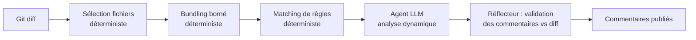
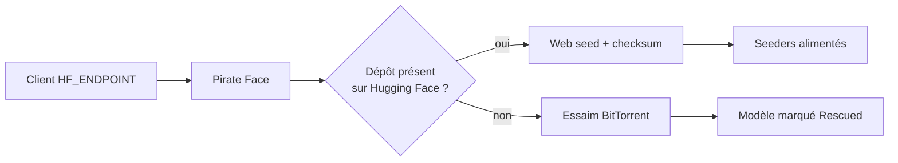

# IA — Détail du lundi 21 septembre 2026

## 1. OpenCodeReview (Alibaba) — le déterminisme comme architecture d'agent

**Source :** InfoQ — https://www.infoq.com/news/2026/09/alibaba-opencodereview/
**Date :** 20 septembre 2026

### Contexte

La revue de code assistée par LLM souffre de quatre défauts récurrents, bien documentés. La couverture est incomplète : l'agent ne regarde pas tous les fichiers du diff. Les numéros de ligne dérivent, donc les commentaires atterrissent à côté. Les prompts sont instables d'une exécution à l'autre. Et tout se dégrade sur les gros changesets, quand le contexte sature.

La réponse habituelle consiste à prendre un modèle plus gros et une fenêtre de contexte plus large. Alibaba a pris l'autre voie : réduire la surface où le modèle décide. OpenCodeReview est sorti sous licence Apache-2.0, écrit en Go, après deux ans d'usage interne par des dizaines de milliers de développeurs.

### Comment ça marche

Le principe tient en une phrase : n'appeler l'IA que là où le déterminisme échoue.

Le pipeline découpe la revue en étapes, chacune avec un niveau de déterminisme différent. La sélection des fichiers est du code classique — filtres de chemins, extensions, taille du diff. Le regroupement en lots l'est aussi : on borne la taille des bundles pour éviter la saturation de contexte. Le matching de règles est du code : une règle déclare sur quels langages et quels patterns elle s'applique, et le dispatcher choisit sans consulter de modèle.

L'agent LLM n'intervient que pour l'analyse dynamique du code, avec un accès aux outils borné par l'étape. Les vérifications intégrées couvrent les classiques : déréférencement nul, sûreté des threads, XSS, injection SQL.

Vient ensuite la partie la plus intéressante, le réflecteur. Chaque commentaire produit par l'agent est validé de façon déterministe contre le diff réel avant d'être publié. Si le commentaire cite une ligne qui n'existe pas dans le changeset, il est rejeté. C'est ce filtre, et pas le modèle, qui élimine la dérive de numéros de ligne et une grande partie des hallucinations.

Le chiffre avancé côté coût vient de là : la précision monte parce qu'on jette les faux positifs avant publication, et le coût baisse parce qu'on n'envoie au modèle que des lots pertinents et bornés.



### En pratique — exemple de code

L'outil tourne en local ou s'intègre à GitHub, GitLab, Gerrit, VS Code, MCP, et aux agents de code comme Claude Code, Codex ou Cursor. Il accepte les modèles compatibles OpenAI et Anthropic.

```bash
# Revue du diff de la branche courante contre la cible, en local.
# Le modèle n'est appelé qu'après sélection et bundling déterministes.
export OCR_API_BASE="https://api.anthropic.com"
export OCR_API_KEY="$ANTHROPIC_API_KEY"

open-code-review review \
  --base origin/dev \
  --head HEAD \
  --rules ./.ocr/rules.yaml \
  --max-bundle-bytes 60000 \
  --format sarif > review.sarif
```

```yaml
# .ocr/rules.yaml — le dispatch est déterministe : pas de LLM pour choisir la règle.
rules:
  - id: csharp-npe
    languages: [csharp]
    paths: ["src/**/*.cs"]
    prompt: "Signale les déréférencements potentiellement nuls introduits par ce diff."
  - id: sql-injection
    languages: [csharp, php]
    paths: ["**/Repositories/**", "**/Dao/**"]
    prompt: "Signale toute concaténation de chaîne dans une requête SQL."
```

### Pourquoi ça compte pour toi

Le patron est plus réutilisable que l'outil. Dans tes propres agents, demande-toi pour chaque étape si un `if` suffit. Sélection, routage, validation de sortie : tout ça se code. Tu gagnes en reproductibilité, en coût et en testabilité. Garde le modèle pour ce qu'il fait seul — lire du code et formuler une hypothèse.

### Points de vigilance

Les chiffres d'Alibaba sont internes : 200 pull requests, 10 langages, meilleure précision et meilleur F1 que Claude Code pour environ un neuvième des tokens. Le seul benchmark indépendant publié a donné environ 12 % de précision sur 10 PR du benchmark Martian. Le mainteneur l'attribue à une anomalie d'appel d'outil depuis corrigée, sans validation indépendante post-correctif. Surtout, le rappel est délibérément bas : 20 % dans la meilleure configuration, selon l'analyse de Daniel Vaughan. Quatre problèmes sur cinq identifiés par des experts ne sont pas trouvés. Le dispatch déterministe qui fait la précision limite mécaniquement la découverte des problèmes transverses et architecturaux. Ce n'est pas un filet de sécurité, c'est un filtre de précision.

---

## 2. Pirate Face — quand les poids d'un modèle basculent sur BitTorrent

**Source :** Pirate Face — https://pirateface.co/
**Date :** 20 septembre 2026

### Contexte

Ta chaîne d'approvisionnement de modèles a un point unique de défaillance : le dépôt Hugging Face. Un retrait DMCA, un changement de licence, une demande de suppression de l'auteur, et le checkpoint sur lequel tourne ton service disparaît. Si tu n'as pas de copie locale, ton build casse et ta reproductibilité aussi.

Le problème n'est pas théorique. Des modèles ont déjà été retirés après coup, parfois des mois après leur publication initiale. Un `from_pretrained("org/model")` figé dans un Dockerfile devient alors un échec de build sans recours.

Pirate Face propose un mécanisme de repli. L'analogie revendiquée est celle d'Internet Archive, appliquée aux poids.

### Comment ça marche

Le système combine un web seed et un essaim BitTorrent, et le basculement est automatique.

Tant que le modèle est présent sur Hugging Face, les octets viennent de Hugging Face. Pirate Face agit en miroir transparent : il sert la requête depuis la source officielle et vérifie la somme de contrôle. Rien ne change pour toi, ni en débit ni en fraîcheur.

En parallèle, les octets vérifiés alimentent un torrent. Chaque utilisateur qui télécharge devient un seeder potentiel. L'empreinte du fichier est la même que celle publiée à l'origine, ce qui permet de prouver que la copie n'a pas dérivé.

Quand Hugging Face retire le dépôt, le web seed renvoie une erreur. Le client retombe alors sur l'essaim pair à pair et le modèle est marqué « Rescued ». Tant qu'il reste des seeders, le téléchargement aboutit.

L'intégration côté client tient dans une variable d'environnement. Les bibliothèques de l'écosystème Hugging Face respectent `HF_ENDPOINT`, qui remplace l'URL de base des appels au Hub.



### En pratique — exemple de code

```bash
# Router tous les appels au Hub via Pirate Face, avec repli P2P automatique.
export HF_ENDPOINT="https://pirateface.co"

# Le téléchargement réussit même si le dépôt d'origine a été retiré.
hf download some-org/some-model --local-dir ./models/some-model
```

```python
# Variante en code : l'endpoint doit être posé AVANT l'import des libs HF,
# car il est lu à l'initialisation du module.
import os
os.environ["HF_ENDPOINT"] = "https://pirateface.co"

from huggingface_hub import snapshot_download

path = snapshot_download(
    repo_id="some-org/some-model",
    local_dir="./models/some-model",
    # Épingle la révision : c'est ta vraie garantie de reproductibilité.
    revision="a1b2c3d4e5f6",
)
```

### Pourquoi ça compte pour toi

Si un modèle est dans ton chemin de build, ne dépends pas d'un dépôt distant. Épingle la révision, miroir le checkpoint dans ton propre stockage, et vérifie la somme de contrôle à l'installation. Pirate Face est un filet, pas une politique. Le filet dépend de seeders bénévoles et d'un statut juridique contesté : tu ne bâtis pas une chaîne de production dessus.

### Limites

Le projet héberge des poids retirés pour motifs de DMCA, de licence ou à la demande de l'auteur. Selon ta juridiction et ta politique interne, router ton trafic via `HF_ENDPOINT` peut te faire télécharger des artefacts que tu n'as pas le droit d'utiliser en production. Un modèle « Rescued » n'a pas de garantie de disponibilité : s'il ne reste aucun seeder, il disparaît aussi. Et une copie fidèle des octets ne restaure ni la licence, ni le droit d'usage commercial.
