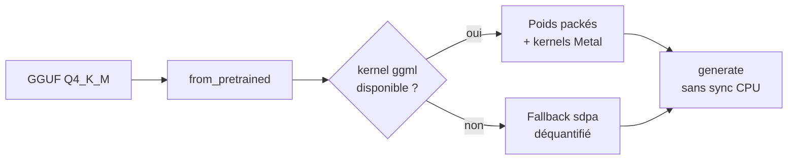
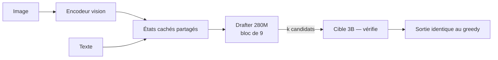

# IA — Détail du vendredi 25 septembre 2026

## 1. `transformers` exécute les quants llama.cpp — GGUF chargé par `from_pretrained`

**Source :** Hugging Face Blog — https://huggingface.co/blog/transformers-llama-cpp-quants
**Date :** 22 septembre 2026

### Contexte

Depuis des années, l'inférence locale et l'expérimentation vivent dans deux mondes séparés. D'un côté `llama.cpp` et son format **GGUF** : un runtime C++ taillé pour la vitesse, qui alimente Ollama, LM Studio et Jan, avec des millions de téléchargements de checkpoints quantifiés publiés par `ggml-org`, Unsloth, bartowski ou LM Studio Community. De l'autre `transformers` : la définition canonique des architectures en PyTorch, où tu peux poser un hook, modifier un forward, écrire un logits processor — mais où tu chargeais des poids `safetensors` pleine précision qui ne rentrent pas dans un laptop.

Ces deux mondes convergent. Hugging Face a ajouté le chargement natif des fichiers GGUF dans `transformers`, avec une contrainte explicite : la compatibilité ne vaut rien si le modèle est pénible à faire tourner. La cible initiale est l'inférence locale sur **Apple Silicon**, avec l'architecture Qwen3.5 en premier.

### Comment ça marche

Trois briques se combinent.

**La brique format.** GGUF empaquette dans un seul fichier les poids, les métadonnées, les infos de tokenizer et un chat template optionnel. Les variantes `Q4_K_M`, `Q5_K_M`, `Q6_K` mélangent les précisions par tenseur : l'essentiel en 4 bits, les tenseurs sensibles conservés plus haut. Sur Qwen3.5-4B, ça donne 8,42 Go en BF16 contre 2,74 Go en `Q4_K_M`.

**La brique kernels.** Le point clé : les poids **restent empaquetés** en mémoire. Plutôt que de déquantifier la matrice entière avant chaque décodage, `transformers` charge les kernels Metal de ggml — distribués sur le Hub via la bibliothèque `kernels` — et les appelle depuis PyTorch. Cinq kernels sont en jeu : `ggml-quantization` lit les poids packés pour les produits matriciels (y compris les experts sélectionnés d'un MoE), `ggml-norm` fusionne les normalisations dont le RMSNorm zéro-centré de Qwen3.5, `ggml-attn` fournit la flash attention Metal, `ggml-gated-delta-net` accélère les couches d'attention linéaire des architectures hybrides, et un `topk` maison fusionne softmax et routage. Si un kernel n'est pas récupérable, le modèle retombe sur `"sdpa"` avec un avertissement.

**La brique boucle de génération.** Des kernels rapides ne servent à rien si le GPU attend le CPU. Deux changements dans `generate` suppriment des points de synchronisation, et ils profitent à **tous** les modèles `transformers`, pas seulement au GGUF :

- **PR #48814** — quand une entrée decoder-only n'a pas de padding, son masque tout-à-un est supprimé dès le début de la génération. Le code d'attention en aval n'a plus à inspecter ce masque à chaque pas. La causalité est préservée.
- **PR #47975** — la décision d'arrêt est copiée depuis le GPU de manière asynchrone et consommée au pas suivant. Le CPU continue d'empiler du travail pendant que le GPU calcule. Le pas superflu au-delà de la condition d'arrêt est retiré du résultat.



### En pratique — exemple de code

Une seule ligne change par rapport à un chargement `transformers` habituel : l'argument `gguf_file`.

```python
import torch
from transformers import AutoModelForCausalLM, AutoTokenizer

model_id = "unsloth/Qwen3.5-4B-GGUF"
filename = "Qwen3.5-4B-Q4_K_M.gguf"   # 2,74 Go au lieu de 8,42 Go en BF16

# Aucune config supplémentaire : les kernels ggml/Metal sont chargés automatiquement
# et ggml-org/ggml-attn devient l'implémentation d'attention.
tokenizer = AutoTokenizer.from_pretrained(model_id, gguf_file=filename)
model = AutoModelForCausalLM.from_pretrained(model_id, gguf_file=filename)

messages = [{"role": "user", "content": "Explain why the sky is blue."}]
inputs = tokenizer.apply_chat_template(
    messages, tokenize=True, add_generation_prompt=True,
    return_dict=True, return_tensors="pt",
).to(model.device)

with torch.inference_mode():
    print(tokenizer.decode(model.generate(**inputs, max_new_tokens=256)[0]))
```

```bash
# Servir le même checkpoint derrière une API OpenAI-compatible.
# La syntaxe <repo>:<fichier>.gguf sélectionne une quantification précise dans le dépôt.
transformers serve "unsloth/Qwen3.5-4B-GGUF:Qwen3.5-4B-Q4_K_M.gguf"
# Base URL cliente : http://localhost:8000/v1
```

```python
# Cas fine-tuning : on déquantifie explicitement pour repasser en entraînement standard.
from transformers import GgufConfig
model = AutoModelForCausalLM.from_pretrained(
    "unsloth/Qwen3.5-4B-GGUF", gguf_file="Qwen3.5-4B-Q4_K_M.gguf",
    quantization_config=GgufConfig(dequantize=True), dtype=torch.bfloat16,
)
```

### Pourquoi ça compte pour toi

Si tu prototypes un service .NET ou Symfony qui appelle un LLM local, tu peux maintenant garder une seule chaîne d'outils. Tu sers en `transformers serve` derrière une API OpenAI-compatible, tu valides une conversion GGUF en chargeant les deux versions côte à côte, et tu instrumentes le forward avec des hooks PyTorch quand un résultat te surprend. Attention : le chemin rapide est MPS-only aujourd'hui. Sur un serveur Linux/CUDA, tu restes sur vLLM ou llama.cpp.

### Limites

- **Chemin packé MPS uniquement.** Le support du format n'implique pas la disponibilité des kernels sur toutes les cibles.
- **Couverture d'architectures étroite** : Qwen3.5 dense et MoE, plus les checkpoints Qwen3.8 compatibles.
- **Batching padé pénalisé** : l'optimisation du masque ne s'applique qu'aux entrées non padées. `generate_batch` sur MPS reste un chantier.
- Hugging Face maintient sa recommandation : **llama.cpp reste le moteur conseillé** quand la priorité est l'inférence locale efficace. L'intérêt de cette intégration est ailleurs — l'évaluation, l'instrumentation, et l'ouverture des kernels ggml à des architectures que llama.cpp n'implémentera jamais.

---

## 2. LFM2.5-VL-DSpark — le décodage spéculatif sur un modèle vision-langage, et la loi d'Amdahl

**Source :** Hugging Face Blog (Liquid AI) — https://huggingface.co/blog/LiquidAI/lfm2-5-vl-dspark
**Date :** 24 septembre 2026

### Contexte

Le décodage spéculatif est aujourd'hui la technique la plus rentable pour accélérer la génération : un petit modèle « brouillon » propose plusieurs tokens d'avance, le gros modèle les vérifie en un seul passage, et on garde le préfixe accepté. Liquid AI avait publié en août ses drafters **DSpark** pour les modèles texte LFM2.5. Ils viennent d'en sortir une version expérimentale pour leur modèle vision-langage **LFM2.5-VL-3B**.

L'intérêt du sujet ne tient pas seulement aux chiffres, mais à ce qu'il révèle : appliquer une accélération de décodage à un workload multimodal expose brutalement le fait que **le décodage n'est pas le goulot d'étranglement** sur appareil.

### Comment ça marche

Le drafter vision reprend exactement l'architecture des drafters texte, et c'est le point astucieux. Il ne relit pas l'entrée : il **capte les états cachés** de la cible à un ensemble fixe de couches instrumentées, puis conditionne sur ces vecteurs pour proposer un bloc de `k` tokens candidats.

Pourquoi ça marche indifféremment sur du texte ou de l'image : dans un VLM, les patches d'image et les tokens de texte sont projetés dans une **représentation partagée** avant d'atteindre ces couches. Le drafter ne voit donc que des vecteurs d'états cachés de dimension identique, quelle que soit la modalité d'origine. L'algorithme d'inférence est inchangé.

Le drafter retenu après ablations est un modèle attention-only à **4 couches**, avec un bloc de 9, entraîné 10 epochs sur un mélange SFT vision-langage. Décomposition des 279,5 M de paramètres : 193 M pour la pile décodeur, 21 M pour la projection d'états cachés, 65,5 M pour la tête de Markov, le reste en normes et tête de confiance. Soit +8,9 % sur une cible de 3 B.

La garantie importante : la spéculation est **exacte**. La cible vérifie chaque token proposé, donc la sortie greedy est strictement identique à celle du modèle seul. Tu n'échanges pas de la qualité contre de la vitesse, tu échanges de la mémoire contre de la vitesse.

Et voilà le mur. Dans un LLM texte, le prefill est surtout compute-bound et son coût croît avec la longueur du prompt. Un VLM ajoute une étape : l'image traverse d'abord l'encodeur vision, puis le backbone langage traite des **centaines de tokens visuels** en plus du prompt. Sur un appareil edge, qui a bien moins de compute qu'un GPU datacenter, ces étapes pèsent une part majeure de la latence totale. La spéculation n'accélère **que** le décodage. D'où l'écart entre les deux séries de chiffres.



### En pratique — exemple de code

Le drafter s'attache à la cible au lancement du serveur. Rien à changer dans ton code client.

```sh
# SGLang — nécessite un build avec le support DSpark pour les cibles LFM2 (PR #40651).
# Le baseline, c'est exactement la même commande SANS les trois flags --speculative-*.
python -m sglang.launch_server \
  --model-path LiquidAI/LFM2.5-VL-3B \
  --speculative-algorithm DSPARK \
  --speculative-draft-model-path LiquidAI/LFM2.5-VL-3B-DSpark \
  --speculative-draft-attention-backend flashinfer \
  --speculative-dspark-block-size 9 \
  --disable-radix-cache
# Endpoint OpenAI-compatible sur http://localhost:30000/v1
```

```sh
# llama.cpp — le drafter est passé en -md, avec le mmproj pour la partie vision.
llama-server -m models/LFM2.5-VL-3B-F16.gguf \
  --mmproj models/mmproj-LFM2.5-VL-3B-F16.gguf \
  -md LFM2.5-2.6B-DSpark-F16.gguf \
  --spec-type draft-dspark --spec-draft-n-max 8 --spec-draft-n-min 0 \
  -fa on -ngl 99 -c 8192

# MLX-VLM — la forme la plus courte, la block size est lue dans les métadonnées sidecar.
mlx_vlm.server --model LiquidAI/LFM2.5-VL-3B --draft-model LiquidAI/LFM2.5-VL-3B-DSpark
```

Le taux d'acceptation se lit par réponse dans les `timings`, via `draft_n` et `draft_n_accepted`. C'est la métrique à surveiller : c'est elle qui détermine le gain réel, pas le chiffre du communiqué.

### Pourquoi ça compte pour toi

Retiens surtout la leçon de méthode. Avant d'investir dans une optimisation de décodage, mesure la part du décodage dans ta latence end-to-end. Ici, 3,13× sur le décodage ne donne que 2,62× perçu — et sur des tâches à images lourdes, l'écart se creuse encore. Le même raisonnement vaut pour tes propres optimisations backend : accélérer la phase qui n'est pas dominante te coûte du temps pour un gain plafonné.

### Points de vigilance

- Le blog annonce « 20,4x to 2,66x » pour le décodage sur H100 — la borne basse est manifestement une coquille pour 2,04×. Fie-toi aux mesures que tu feras toi-même via `draft_n_accepted`.
- Le modèle est explicitement **expérimental**, et le support day-one dépend de PR spécifiques dans SGLang, llama.cpp et MLX-VLM. Vérifie ta version avant de conclure à une régression.
- Block size recommandée : 8 ou 9 selon le matériel. Au-delà, le taux d'acceptation chute et tu paies des vérifications inutiles.
