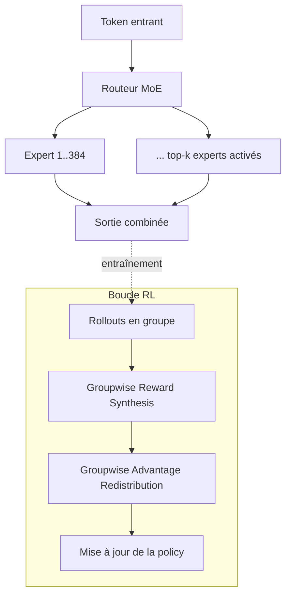
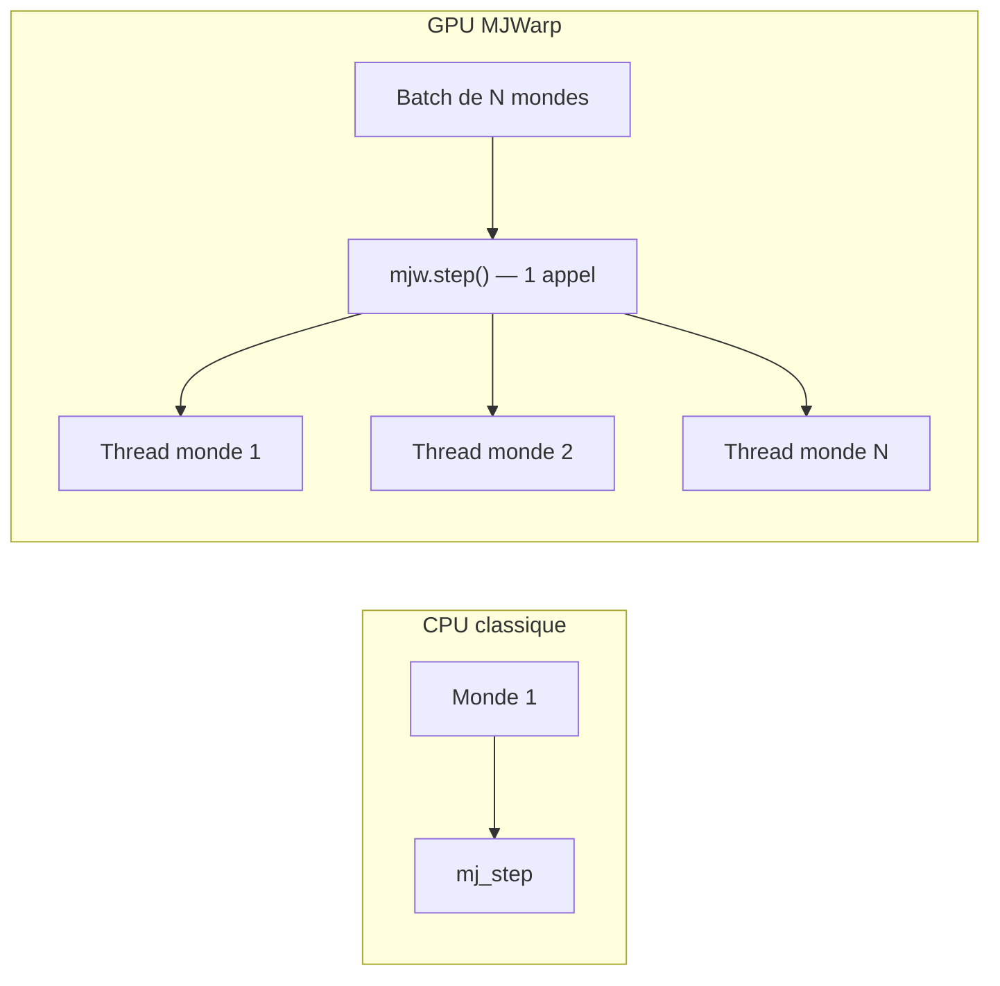
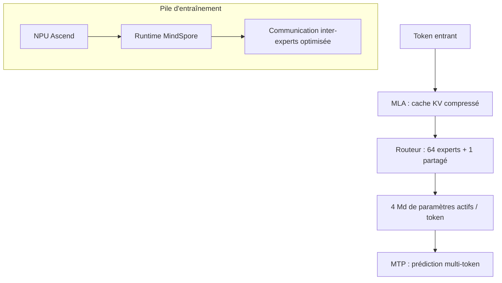

# IA — Détail du samedi 26 septembre 2026

## 1. MiMo-V2.6-Pro-RL (Xiaomi) — un MoE de 1 000 milliards de paramètres entraîné par RL agentique pur

**Source :** Hugging Face — https://huggingface.co/XiaomiMiMo/MiMo-V2.6-Pro-RL
**Date :** 25 septembre 2026

### Contexte

Xiaomi publie MiMo-V2.6-Pro-RL, la déclinaison « RL » de sa famille MiMo, avec un objectif explicite : faire tourner du reinforcement learning à grande échelle pour que le modèle s'améliore lui-même sur des tâches agentiques — code, usage d'outils, sécurité — plutôt que de se contenter d'un fine-tuning supervisé classique sur des exemples humains. Le modèle traite texte, image, vidéo et audio dans une même fenêtre de contexte de 1M tokens, et sort sous licence MIT — donc utilisable en prod sans les frictions d'une licence type Llama.

### Comment ça marche

L'architecture est un MoE (Mixture of Experts) creux : 1,02 billion de paramètres au total, mais seulement 42 milliards s'activent par token — un ratio d'environ 1 pour 24, typique des gros MoE récents (DeepSeek, Qwen). Le backbone compte 70 couches, dont 60 en attention à fenêtre glissante (moins coûteuse) et seulement 10 en attention globale, plus 384 experts routés. Un encodeur vision (681M paramètres) et un système audio (308M pour la tokenisation, 127M pour l'encodage) alimentent la même colonne vertébrale, et un module de décodage spéculatif à 5 couches accélère l'inférence en proposant plusieurs tokens par passe.

Le training est l'aspect le plus intéressant. Xiaomi décrit « un run RL mixte » sur du code, des agents généralistes, du visuel et de la cybersécurité, avec du GRPO (Group Relative Policy Optimization) — la même famille d'algorithme que DeepSeek-R1. Deux idées s'ajoutent au GRPO standard : la « Groupwise Reward Synthesis », qui génère des rubriques de récompense spécifiques à chaque tâche plutôt qu'une reward générique, et la « Groupwise Advantage Redistribution », qui classe les solutions d'un même groupe entre elles pour redistribuer l'avantage vers les réponses les plus efficaces — pas seulement les plus correctes.



### En pratique — exemple de code

```python
# Inférence via transformers — le MoE ne charge que les experts activés par token
from transformers import AutoModelForCausalLM, AutoTokenizer

tok = AutoTokenizer.from_pretrained("XiaomiMiMo/MiMo-V2.6-Pro-RL")
model = AutoModelForCausalLM.from_pretrained(
    "XiaomiMiMo/MiMo-V2.6-Pro-RL",
    device_map="auto",        # répartit les 384 experts sur les GPU disponibles
    torch_dtype="bfloat16",
)

prompt = tok.apply_chat_template(
    [{"role": "user", "content": "Corrige ce bug Python et explique la cause."}],
    tokenize=False, add_generation_prompt=True,
)
inputs = tok(prompt, return_tensors="pt").to(model.device)
out = model.generate(**inputs, max_new_tokens=512)
print(tok.decode(out[0], skip_special_tokens=True))
```

### Pourquoi ça compte pour toi

Les benchmarks (89,9 % sur Terminal-Bench 2.1, 94 % sur CyberGym) le placent parmi les modèles agentiques les plus solides en open source. Si tu évalues des outils de codage assisté ou d'audit de sécurité automatisé, c'est une alternative auto-hébergeable sous licence MIT aux API propriétaires — à condition d'avoir le GPU multi-cartes que 42 milliards de paramètres actifs exigent.

---

## 2. NVIDIA Warp + MuJoCo Warp (MJWarp) — paralléliser des milliers de simulations sur un seul GPU

**Source :** Hugging Face — https://huggingface.co/blog/nvidia/how-to-use-nvidia-warp-and-mjwarp
**Date :** 23 septembre 2026

### Contexte

La simulation physique (MuJoCo, PyBullet) tourne traditionnellement sur CPU, un monde à la fois. Pour du reinforcement learning ou du sampling à grande échelle, la métrique qui compte n'est plus la latence d'un pas de simulation mais le débit agrégé — combien de mondes tu peux avancer par seconde. NVIDIA documente comment son framework Warp, qui permet d'écrire des kernels GPU en Python, s'utilise avec MuJoCo Warp (MJWarp) pour paralléliser des milliers de simulations robotiques indépendantes sur un seul GPU.

### Comment ça marche

Warp compile du code Python annoté (`@wp.kernel`) directement en CUDA natif : tu écris la logique par « thread logique » — un point, un contact, un corps, un monde — et le même kernel scale de deux entités à des millions sans branchement spécifique au GPU. C'est le modèle SIMT (single instruction, multiple threads) : chaque thread exécute le même code sur une donnée différente, en parallèle.

MJWarp réécrit le pipeline physique de MuJoCo dans ce modèle. Au lieu d'optimiser un seul monde sur CPU, il traite un batch entier : un seul appel `mjw.step()` avance l'intégralité du batch, avec une dimension « monde » en tête de chaque tableau device. La bascule d'API est minimale — `mujoco.MjModel` devient `mjw.put_model()` pour charger le modèle sur GPU, et `mujoco.mj_step()` devient `mjw.step()`. Deux optimisations réduisent l'overhead restant : la capture de CUDA graphs, pour éviter de redispatcher les kernels à chaque pas, et un dimensionnement soigné des buffers de contact, pour éviter les débordements quand des milliers de mondes entrent en collision simultanément.



### En pratique — exemple de code

```python
import warp as wp

@wp.kernel
def integrate(
    positions: wp.array(dtype=wp.vec3),
    velocities: wp.array(dtype=wp.vec3),
    dt: float,
):
    i = wp.tid()                                     # index du thread = index de l'entité
    velocities[i] += wp.vec3(0.0, 0.0, -9.81) * dt   # gravité appliquée en parallèle
    positions[i] += velocities[i] * dt               # intégration explicite

# Un thread par particule/monde, quel que soit N — même code, ça scale
wp.launch(integrate, dim=len(positions), inputs=[positions, velocities, dt])
```

### Pourquoi ça compte pour toi

Même hors robotique, le pattern généralise à tout backend qui doit faire tourner la même pipeline sur des milliers d'instances indépendantes — scoring par lot, simulation multi-tenant, tests de charge synthétiques. Le principe « un seul appel, une dimension batch en tête, zéro branchement GPU-spécifique » est réutilisable dès que Python/CUDA via Warp est une option pour toi.

---

## 3. Xing4.0-29B-A4B (XingChen-AGI) — un MoE agent-first entraîné hors de l'écosystème CUDA

**Source :** Hugging Face — https://huggingface.co/XingChen-AGI/Xing4.0-29B-A4B
**Date :** 25 septembre 2026

### Contexte

XingChen-AGI publie Xing4.0-29B-A4B, un modèle pensé pour le tool calling et le raisonnement multi-étapes plutôt que pour le chat généraliste. Sa particularité ne tient pas qu'à l'architecture : c'est, selon ses auteurs, le premier modèle de cette taille entraîné entièrement sur des NPU Ascend (Huawei) avec le framework MindSpore — donc en dehors de l'écosystème CUDA/PyTorch qui domine l'open source depuis des années.

### Comment ça marche

L'architecture combine trois briques. mHC gère l'organisation hiérarchique du contexte. MLA (Multi-head Latent Attention, popularisée par DeepSeek) compresse le cache KV pour réduire la mémoire à contexte long. MTP (Multi-Token Prediction) prédit plusieurs tokens par passe pour accélérer l'inférence, un peu comme le décodage spéculatif. Le MoE compte 64 experts routés plus 1 expert partagé, sur 40 couches et une taille cachée de 3584 ; sur 29 milliards de paramètres totaux, seuls 4 milliards s'activent par token. Le contexte natif de 256K tokens, extensible à 512K, cible explicitement les tâches agentiques à long horizon : lire une base de code entière, suivre une conversation d'outils sur des dizaines d'étapes.

Le fait notable est surtout industriel : entraîner un MoE à cette échelle sur Ascend/MindSpore demande de réoptimiser toute la pile logicielle — communication inter-experts, recomputation sélective (ne recalculer que certaines activations à la volée pour économiser la mémoire), et kernels de fusion spécialisés absents de l'écosystème CUDA. Les auteurs revendiquent environ 96 % de gain de débit d'entraînement grâce à ces optimisations, un signal que l'entraînement de gros MoE n'est plus verrouillé sur une seule pile matérielle.



### En pratique — exemple de code

```python
# Tool calling avec Xing4.0 — le routeur n'active que 4B de paramètres par token
from transformers import AutoModelForCausalLM, AutoTokenizer

tok = AutoTokenizer.from_pretrained("XingChen-AGI/Xing4.0-29B-A4B")
model = AutoModelForCausalLM.from_pretrained(
    "XingChen-AGI/Xing4.0-29B-A4B", device_map="auto", torch_dtype="bfloat16"
)

tools = [{"type": "function", "function": {
    "name": "get_weather", "parameters": {"type": "object", "properties": {"city": {"type": "string"}}}
}}]
prompt = tok.apply_chat_template(
    [{"role": "user", "content": "Quel temps fait-il à Lyon ?"}],
    tools=tools, tokenize=False, add_generation_prompt=True,
)
out = model.generate(**tok(prompt, return_tensors="pt").to(model.device), max_new_tokens=256)
```

### Pourquoi ça compte pour toi

Licence Apache 2.0, seulement 4 milliards de paramètres actifs pour de l'auto-hébergement raisonnable, et surtout une preuve que la pile CUDA n'est plus le seul chemin pour entraîner de gros MoE. Pour toi qui choisis des modèles à déployer en interne, c'est un signal de diversification de la chaîne d'approvisionnement matérielle — utile si tu veux limiter ta dépendance à un seul fournisseur GPU.
