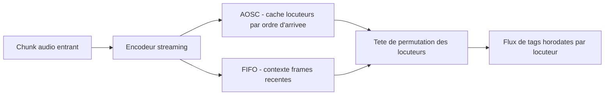
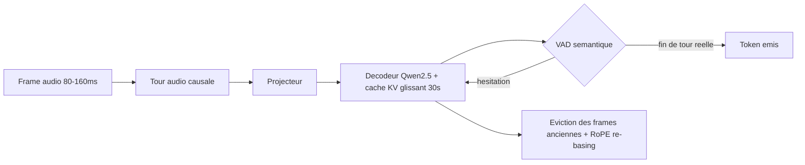

# IA — Détail du dimanche 27 septembre 2026

## 1. NVIDIA Nemotron 3 Diarization — la diarisation qui tient un flux audio infini sans perdre le fil

**Source :** NVIDIA (Hugging Face) — https://huggingface.co/nvidia/Nemotron-3-Diarization
**Date :** 23 septembre 2026

### Contexte

La diarisation répond à une question simple mais coûteuse à résoudre : dans un flux audio à plusieurs voix, qui a parlé, et quand. C'est le prérequis de toute transcription de réunion, de centre d'appel ou de sous-titrage automatique. Sans diarisation, un moteur ASR te renvoie un mur de texte sans savoir à qui attribuer chaque phrase — inutilisable dès qu'il y a plus d'un interlocuteur.

Les approches historiques faisaient ce travail hors-ligne : on enregistre l'intégralité de la conversation, on extrait des embeddings de voix, puis on les regroupe par clustering une fois l'enregistrement terminé. Ça fonctionne bien en post-traitement, mais c'est inexploitable pour un centre d'appel qui veut afficher en direct qui parle, ou pour une passerelle de sous-titrage live. Nemotron 3 Diarization, dérivé de l'architecture Sortformer de NVIDIA, est pensé dès le départ pour le flux continu — le mode offline classique reste disponible en option de configuration.

### Comment ça marche

Le problème central de la diarisation en streaming, c'est la permutation : le modèle découvre les locuteurs au fur et à mesure, donc il doit décider sur quel « canal » de sortie assigner chaque nouvelle voix, sans jamais revenir en arrière. Sortformer résout ça en ordonnant les canaux de sortie selon l'ordre d'arrivée de chaque locuteur dans l'audio — le premier qui parle reçoit le canal 1, le deuxième le canal 2, et ainsi de suite, jusqu'à 8 locuteurs simultanés.

Pour le mode streaming, le modèle combine deux mémoires complémentaires. L'AOSC (Arrival-Order Speaker Cache) retient les caractéristiques vocales de chaque locuteur identifié depuis le début du flux, pour ne jamais « oublier » qui est qui même après une longue absence de parole. La file FIFO fournit en parallèle le contexte acoustique local — les frames les plus récentes — nécessaire pour trancher qui parle à l'instant présent. À chaque nouveau segment audio, l'encodeur combine ces deux sources avant que la tête de permutation ne décide de l'étiquetage. La résolution de sortie est configurable par pas de 10 ms, et un seul et même checkpoint couvre un buffer d'entrée aussi bas que 80 ms (temps réel critique) jusqu'à un mode quasi-offline avec un buffer de 30,4 s — sans durée maximale de flux grâce au découpage en chunks.



### En pratique — exemple de code

```bash
# Installation du runtime C++ léger (une fois)
# voir https://github.com/NVIDIA/NeMo-Speech.cpp#installation

# 1. Diarisation seule : qui a parlé, et quand, sur un fichier local
nemo-speech diarize meeting.wav
# -> renvoie une timeline de segments {locuteur, debut, fin}

# 2. Diarisation + transcription combinées, sortie JSON exploitable
#    par un service backend (ex. enrichir des logs de support client)
nemo-speech transcribe meeting.wav --diarize --json > meeting.json

# Le JSON contient un texte horodaté et étiqueté par locuteur,
# prêt à être inséré dans une base ou un pipeline de recherche.
```

### Pourquoi ça compte pour toi

Si tu construis un pipeline de transcription (support client, réunions, monitoring d'appels), tu peux t'autohéberger avec une latence sous les 100 ms au lieu de payer une API propriétaire à la minute. C'est un modèle à poids ouverts, utilisable en commercial. Limite à connaître : plafond dur à 8 locuteurs simultanés — au-delà, il faut repartir sur un pipeline de clustering classique.

### Limites

Le plafond de 8 locuteurs exclut les grandes tables rondes ou les événements à plusieurs dizaines d'intervenants. La démo et les benchmarks publiés portent surtout sur des scénarios réunion/centre d'appel à 2-4 voix ; les performances au-delà ne sont pas documentées par NVIDIA à ce stade.

---

## 2. Edge0 Audio8-ASR-Infinite — l'ASR streaming qui ignore la durée du flux grâce à un cache KV glissant

**Source :** Edge0-AI (Hugging Face) — https://huggingface.co/Edge0/Audio8-ASR-Infinite
**Date :** 24 septembre 2026

### Contexte

Un modèle de reconnaissance vocale (ASR) streaming classique bute tôt ou tard sur son contexte : au-delà d'une fenêtre fixe (souvent 30 secondes), il faut soit tronquer, soit re-segmenter — ce qui introduit des coupures ou une dérive de précision sur un flux long. Pour un centre d'appel qui tourne 24h/24 ou du sous-titrage live continu, c'est bloquant : la mémoire ne peut pas croître indéfiniment avec la durée du flux.

Audio8-ASR-Infinite (Edge0-AI) s'attaque directement à ce problème. Le modèle hérite de la tour audio causale de Voxtral Realtime et d'un décodeur Qwen2.5-3B-Instruct, assemblés selon un schéma de streaming de type DSM (decoder-synchronous mapping). Il est bilingue chinois/anglais et livré sous licence Apache 2.0, donc réutilisable sans contrainte commerciale.

### Comment ça marche

Le cœur du système, c'est un cache KV glissant à fenêtre fixe de 30 secondes : au lieu de laisser le cache grandir avec la durée du flux, le modèle évince en continu les entrées les plus anciennes tout en réappliquant un ré-encodage positionnel (RoPE re-basing) exact sur les entrées conservées. Résultat : la mémoire et la latence restent constantes, même après des heures de flux ininterrompu — le contexte est « infini » en pratique, mais la fenêtre physique reste bornée.

Le modèle émet un token à chaque tick d'une horloge audio sélectionnable (80, 120 ou 160 ms), avec un délai de transcription configurable (240 à 560 ms) : plus le délai toléré est grand, plus la précision augmente, à toi de choisir le compromis pour ton cas d'usage. Une deuxième mécanique notable est la VAD sémantique : plutôt qu'une détection acoustique classique (silence = fin de phrase), des têtes dédiées évaluent la probabilité de fin de tour de parole sur plusieurs horizons (0,5 à 3 s), ce qui permet de distinguer une hésitation ou un bégaiement d'une vraie fin de phrase — un point faible connu des VAD acoustiques classiques.



### En pratique — exemple de code

```python
# Décodage streaming simulé (batch) avec les poids Hugging Face
import numpy as np
import torch
from transformers import AutoFeatureExtractor, AutoTokenizer
from audio8_asr_infinite.modeling.modeling_audio8_asr_infinite import (
    Audio8ASRInfiniteForConditionalGeneration,
    resolve_qwen_language_token_id,
    resolve_qwen_streaming_special_token_ids,
)
from audio8_asr_infinite.streaming_inference import simulated_streaming_greedy_decode_batch

checkpoint = "Edge0/Audio8-ASR-Infinite"
tokenizer = AutoTokenizer.from_pretrained(checkpoint, trust_remote_code=True)
model = Audio8ASRInfiniteForConditionalGeneration.from_pretrained(
    checkpoint, trust_remote_code=True, torch_dtype=torch.bfloat16
).eval().cuda()

waveform = np.load("sample.npy").astype(np.float32)  # [-1, 1], 16 kHz mono
results = simulated_streaming_greedy_decode_batch(
    model=model, tokenizer=tokenizer,
    waveforms=[waveform],
    language_token_ids=[resolve_qwen_language_token_id(tokenizer, "en")],
    num_delay_tokens=[480 // 80],  # 480ms de délai toléré, horloge 80ms
    max_new_tokens=512,
)
print(results[0]["final_text"])
```

### Pourquoi ça compte pour toi

Sous Apache 2.0, tu peux t'auto-héberger (déploiement vLLM fourni via Docker Compose) pour un service de transcription 24/7 sans coût par minute. Les benchmarks publiés le montrent nettement meilleur que Voxtral-Mini-Realtime sur le chinois, mais légèrement en retrait sur l'anglais (LibriSpeech). Vérifie sur tes propres données avant de trancher.

### Limites

C'est une version « preview » : seule la transcription de base est livrée, la perception sémantique temps réel annoncée sur la roadmap n'est pas encore là. Sur l'anglais, le WER reste au-dessus de Voxtral-Mini-Realtime — à évaluer selon ta langue cible avant de remplacer un ASR existant.
