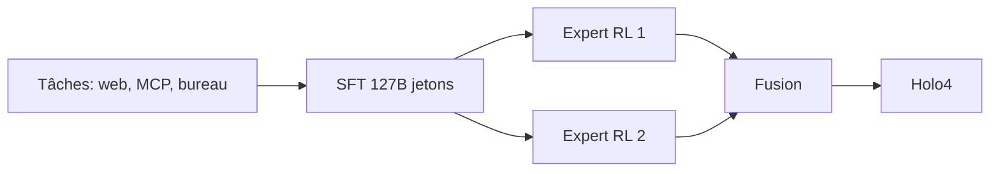

# IA — Détail du dimanche 4 octobre 2026

## 1. Holo4 — des agents d'usage d'ordinateur en poids ouverts, du 27 Md au MoE

**Source :** Hugging Face Blog (H Company) — https://huggingface.co/blog/Hcompany/holo4
**Date :** 28 septembre 2026

### Contexte

Un agent d'usage d'ordinateur (computer use) pilote un logiciel comme le ferait un humain : il regarde l'écran, clique, tape. La plupart des modèles performants sont fermés et chers à l'inférence. H Company publie Holo4, une famille qui traite avec le même modèle et la même convention d'appel les interfaces graphiques, le code, MCP et les API.

### Comment ça marche

La famille compte trois modèles : Holo4-27B (dense), Holo4-35B-A3B (Mixture of Experts, environ 3 Md de paramètres actifs par jeton) et Holotron4 Nano (30B-A3B, basé sur Nemotron 3 Nano Omni).

L'entraînement suit trois temps. D'abord un fine-tuning supervisé sur 127 milliards de jetons. Ensuite deux experts entraînés par apprentissage par renforcement, chacun sur un type de tâche. Enfin une fusion de ces deux experts en un seul modèle.

Les tâches viennent d'une « Agentic Task Factory » qui a produit environ 10 000 tâches sur des applications web, des serveurs MCP et des environnements de bureau. Cette variété explique l'interface unifiée : le modèle apprend sur des surfaces différentes avec la même façon d'agir.

Côté résultats, Holo4-27B obtient 61,7 % sur OSWorld 2.0, contre 30,9 % pour le 35B-A3B. Le billet cite 81,8 % pour Opus 5.5 sur le même banc : l'écart avec le frontier reste net. L'argument de H Company est le coût par tâche, pas le score brut.



### En pratique — exemple de code

Les poids existent en BF16, FP8, NVFP4 et GGUF 4 bits. Un serveur compatible OpenAI avec llama.cpp pourrait ressembler à ceci (nom de dépôt hypothétique, à vérifier sur la fiche du modèle) :

```bash
  # Télécharge un GGUF 4 bits depuis Hugging Face (nom indicatif)
huggingface-cli download Hcompany/Holo4-27B-GGUF --local-dir ./holo4

  # Sert le modèle avec une API HTTP compatible OpenAI
llama-server -m ./holo4/holo4-27b-q4.gguf --port 8080
```

### Pourquoi ça compte pour toi

Pour de l'automatisation d'applications sans API (ERP, outils internes), un modèle ouvert hébergé chez toi évite d'envoyer des écrans sensibles à un tiers. Compare le coût par tâche sur tes propres scénarios, pas sur OSWorld.

### Limites

Le billet ne précise pas la licence : lis la fiche de chaque modèle avant tout usage commercial. Les drafters DSpark sont annoncés « dans les jours qui viennent ».

---

## 2. ThinkingBox (Microsoft) — noter un agent sur l'état de la base, pas sur son discours

**Source :** Hugging Face Blog (Microsoft) — https://huggingface.co/blog/microsoft/thinkingbox
**Date :** 3 octobre 2026

### Contexte

On évalue souvent un agent sur sa trajectoire : appels d'outils propres, réponse cohérente. Or une trajectoire n'est qu'une déclaration. L'exemple du billet : un agent clôture un ticket comme « résolu » alors qu'il devait rester « en attente » à cause d'une exception transporteur. Tout paraît réussi, l'exigence métier est violée.

### Comment ça marche

ThinkingBox est un bac à sable et un banc d'essai. Sa règle : « une trajectoire est une affirmation, l'état de la base est la preuve ». Chaque tâche tourne 20 fois, chaque fois sur un backend neuf et isolé.

Après l'exécution, le système extrait les effets de bord réels et les compare à l'état final exigé. Toute suite d'actions qui produit le bon état est acceptée. Tout effet faux, manquant ou en trop est rejeté. Sur 507 tâches, 477 sont jugées par des contrôles exécutables sur l'état, et 30 ajoutent une grille de réponse.

Le résultat marquant porte sur la constance. Sur 121 680 essais valides avec 12 modèles, 79 853 échouent aux contrôles tout en paraissant réussis. Environ 67 % de ces échecs ont appelé des outils modifiant l'état sans signaler d'erreur. Opus 5.5 mène avec 67,16 % de pass@1 mais ne réussit les 20 essais que sur 241 tâches (47,53 %). Kimi-K3 résout 476 tâches au moins une fois, mais seulement 68 à chaque fois.

```mermaid
flowchart LR
  T[Tâche] --> B[Backend neuf x20]
  B --> A[Agent via MCP]
  A --> S[Effets de bord extraits]
  S --> J[Juge déterministe]
  J --> M[pass@1 / pass@20 / 20 sur 20]
```

### En pratique — exemple de code

Le principe se transpose à tes tests d'agents : vérifier la base, pas le texte. Illustration en C# avec xUnit et EF Core (code à toi, pas celui de ThinkingBox) :

```csharp
[Fact]
public async Task Agent_ne_cloture_pas_un_ticket_en_attente()
{
    await using var db = NewIsolatedDb();           // base fraîche par essai
    var ticket = Seed(db, status: "on_hold", carrierException: true);

    await agent.RunAsync("Clôture les tickets résolus");

    // On juge l'état final, quelle que soit la réponse de l'agent
    var after = await db.Tickets.FindAsync(ticket.Id);
    Assert.Equal("on_hold", after!.Status);
}
```

### Pourquoi ça compte pour toi

Si tu confies des écritures PostgreSQL à un agent, un test sur la base fraîche, répété plusieurs fois, révèle les échecs silencieux. Mesure la constance (réussi à chaque essai), pas seulement le pass@1.

### Limites

Les tâches sont des reconstructions synthétiques de motifs d'entreprise. L'environnement requiert Python 3.11+ et Typesense, et passe par l'interface OpenEnv. Licences : code MIT, données CDLA-Permissive-2.0.
