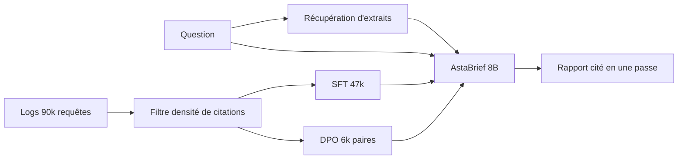
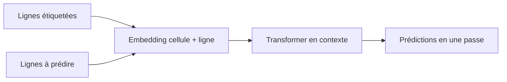
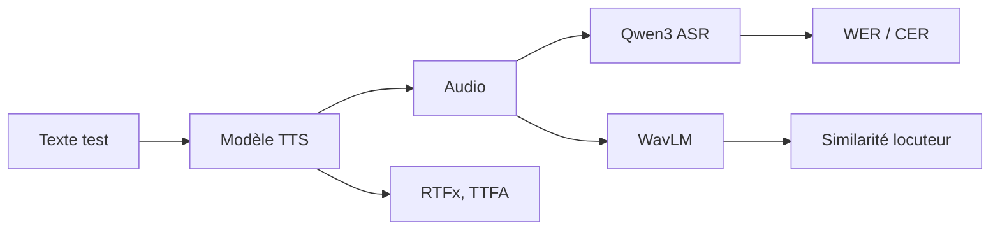

# IA — Détail du lundi 5 octobre 2026

## 1. AstaBrief (AI2) — un 8 Md qui écrit des rapports cités en une seule passe

**Source :** Hugging Face Blog (Allen Institute for AI) — https://huggingface.co/blog/allenai/astabrief
**Date :** 2 octobre 2026

### Contexte

AstaBrief est un modèle à poids ouverts de 8 milliards de paramètres, construit sur Qwen3-8B. Il sert de « mode rapide » dans la plateforme Asta d'AI2, en face d'un mode « Thinking » plus lent, piloté par Claude. Sa mission : transformer une question de recherche et des extraits de littérature récupérés en un rapport structuré, avec citations.

Le problème visé est le coût de latence des pipelines de rapport classiques. Ils enchaînent résumé de chaque extrait, regroupement thématique, puis rédaction section par section. Chaque étape ajoute des appels de modèle et du temps d'attente.

### Comment ça marche

Premier choix : AI2 supprime les étapes intermédiaires. Le modèle reçoit la question et tous les extraits d'un coup, puis génère le rapport complet en une seule passe. Le gain mesuré est de 51,1 s par rapport en moyenne, contre 178,5 s pour le mode Thinking, soit environ 3,5 × plus rapide sur le pipeline Asta complet.

Deuxième choix : pas d'apprentissage par renforcement. L'équipe utilise un fine-tuning supervisé (SFT) puis une optimisation directe des préférences (DPO). C'est plus simple à stabiliser et à reproduire.

Le SFT part d'environ 90 000 vraies requêtes issues des logs Asta, filtrées pour la qualité et la vie privée, ce qui laisse 47 000 exemples. Les rapports cibles sont générés par plusieurs modèles propriétaires. Le DPO utilise environ 6 000 paires de rapports concurrents, jugées par deux modèles ; seules les paires où les juges sont d'accord sont gardées.

L'enseignement central porte sur le filtrage des données. Quatre statistiques ont été testées : ratio de tokens sortie/entrée, pertinence des citations, densité de citations et diversité de citations. La plus efficace est la plus simple : la densité de citations, c'est-à-dire la part des affirmations qui citent une source.



L'évaluation s'appuie sur SQABench-CS2 (200 questions d'informatique) avec quatre mesures : couverture par grille, précision des réponses, précision et rappel des citations. DeepScholarBench et une petite étude humaine (14 questions, 3 chercheurs) complètent le tableau. Côté usage, 374 premiers utilisateurs ont donné des retours similaires pour les deux modes (84,2 % contre 85,2 % de positifs).

### En pratique — exemple de code

Le billet ne fournit pas de snippet. Voici un squelette illustratif (non issu du billet) pour réutiliser le principe « une passe, citations numérotées » avec n'importe quel modèle ouvert :

```python
# Illustratif : prompt « une passe » avec extraits numérotés
snippets = [("S1", "texte de l'extrait 1"), ("S2", "texte de l'extrait 2")]
context = "\n".join(f"[{sid}] {txt}" for sid, txt in snippets)

prompt = f"""Question : {question}

Extraits :
{context}

Rédige un rapport structuré. Chaque affirmation doit citer [S#].
N'affirme rien qui ne soit pas soutenu par un extrait."""

# Densité de citations : part des phrases qui portent au moins une citation
import re
sentences = [s for s in re.split(r"(?<=[.!?])\s+", report) if s.strip()]
density = sum(bool(re.search(r"\[S\d+\]", s)) for s in sentences) / len(sentences)
```

Le calcul de densité reprend l'idée de filtre du billet : il sert à écarter les rapports peu sourcés avant fine-tuning.

### Pourquoi ça compte pour toi

Si tu construis du RAG avec citations, le message est net : un filtre simple sur la densité de citations bat des combinaisons complexes. Et réduire les étapes intermédiaires peut diviser la latence par trois. À tester sur ton propre corpus avant de généraliser, les auteurs signalent eux-mêmes des limites.

### Limites

Les auteurs notent qu'un modèle peut citer correctement tout en sur-généralisant la source. La plupart de l'entraînement date de 2025, et la comparaison n'inclut pas les modèles de pointe actuels. La licence n'est pas précisée dans le billet : vérifie la fiche du modèle avant tout usage.

---

## 2. NVIDIA Kumo Tabular — prédire sur un tableau sans entraîner, par apprentissage en contexte

**Source :** Hugging Face Blog (NVIDIA) — https://huggingface.co/blog/nvidia/kumo-tabular
**Date :** 29 septembre 2026

### Contexte

Sur les données tabulaires, les arbres boostés (XGBoost, LightGBM) restent la référence : il faut pourtant entraîner, régler et faire du feature engineering pour chaque table. Les modèles de fondation tabulaires visent à supprimer ce travail. Kumo Tabular de NVIDIA en est un : il fait de la classification et de la régression sans entraînement ni réglage, en une seule passe avant.

### Comment ça marche

Le principe est l'apprentissage en contexte, comme pour un LLM. Tu fournis des lignes étiquetées (le contexte) et des lignes à prédire (les requêtes). Le modèle déduit la relation dans sa passe avant, sans mise à jour de poids.

L'architecture est un Transformer en trois étages. Le plongement de cellule passe chaque valeur dans des caractéristiques de Fourier, avec des poids distincts pour le numérique et le catégoriel ; les valeurs manquantes sont traitées sans imputation. Le plongement de ligne alterne attention par colonne (distribution des valeurs) et attention par ligne (interactions entre variables), et quatre jetons apprenables compressent chaque ligne. Enfin, le Transformer d'apprentissage en contexte laisse les lignes de contexte s'attendre entre elles, tandis que les lignes requêtes n'attendent que le contexte. Une « température d'attention sensible à la longueur » met à l'échelle les requêtes de façon logarithmique selon la taille de la table.

Le point surprenant : le pré-entraînement n'utilise que des tables synthétiques, générées par des modèles causaux structurels (graphes aléatoires, variables cachées, valeurs manquantes, cibles à queue lourde). L'entraînement se fait en trois étapes (1 024 lignes, contextes variables de 400 à 10 240, puis jusqu'à 60 000 lignes). Les modèles Small, Medium et Large ont vu environ 35, 71 et 137 millions de tables.



Résultats annoncés : premier sur TabArena (ELO 1950, 17 × plus rapide que LimiX-2 sur une RTX 6000 Pro), BeyondArena (ELO 1418), TALENT, et premier/deuxième sur ScoringBench avec les variantes Medium et Large. Licence OpenMDW 1.1, usage commercial permis.

### En pratique — exemple de code

Adapté du billet (`pd.load_csv` y est écrit, la fonction pandas réelle est `read_csv`) :

```python
import pandas as pd
import sdm  # paquet fourni par NVIDIA

df = pd.read_csv("clients.csv")
table = sdm.TableTensor.from_pandas(df, device="cuda")
na_mask = table["target"].isnan()  # lignes sans étiquette = à prédire

model = sdm.models.KumoTabular(device="cuda")
pred = model(
    x_context=table[~na_mask].drop_columns("target"),   # features étiquetées
    y_context=table[~na_mask, "target"],                 # cibles connues
    x_query=table[na_mask].drop_column("target"),        # features à prédire
)
```

### Pourquoi ça compte pour toi

Sur une base PostgreSQL de taille moyenne, tu peux obtenir une prédiction de référence (churn, score) sans pipeline d'entraînement. C'est un excellent baseline à comparer à ton gradient boosting. Valide toujours sur des données retenues, comme le recommandent les auteurs.

### Limites

Seules les colonnes numériques et catégorielles sont gérées ; texte, images et dates demandent un prétraitement. Dix classes en natif, au-delà via codes correcteurs d'erreurs. La précision peut baisser au-delà des tailles vues à l'entraînement ou si les requêtes diffèrent du contexte.

---

## 3. Open TTS Leaderboard — comparer des modèles de synthèse vocale en quelques heures, sans vote humain

**Source :** Hugging Face Blog — https://huggingface.co/blog/open-tts-leaderboard
**Date :** 30 septembre 2026

### Contexte

Les classements de synthèse vocale existants reposent surtout sur des « arènes » : des humains comparent deux audios et votent. C'est fidèle à la perception, mais il faut environ deux semaines pour récolter assez de votes pour un nouveau modèle. L'Open TTS Leaderboard propose l'inverse : une évaluation automatique, multilingue, qui prend quelques heures.

### Comment ça marche

Le leaderboard mesure trois dimensions. L'intelligibilité : on transcrit l'audio généré avec Qwen3 ASR et on compare au texte demandé, ce qui donne un WER (taux d'erreur de mots), ou un CER (caractères) pour le chinois, le japonais et le coréen. La vitesse : RTFx en inférence offline par lots sur H200, et TTFA (délai avant le premier audio) en streaming sur H200 et sur CPU à batch 1. La similarité de locuteur : cosinus entre embeddings WavLM de l'audio généré et d'un audio de référence, utile pour le clonage de voix.

Le classement principal trie par WER macro-moyen sur les splits anglais de Seed TTS Eval et CV3 Eval. On peut filtrer par langue, par capacité de clonage et par matériel. En tête sur l'anglais : Kokoro-82M, Supertone/supertonic-3 et fishaudio/s2-pro. En multilingue : k2-fsa/OmniVoice, fishaudio/s2-pro et Fun-CosyVoice3-0.5B-2512. En streaming, kyutai/pocket-tts se distingue sur GPU comme sur CPU.



### En pratique — exemple de code

Le billet ne donne pas de code. Voici le principe de la boucle WER, illustratif :

```python
# Illustratif : intelligibilité = WER entre texte demandé et transcription
import jiwer

def score_tts(tts_fn, asr_fn, prompts):
    refs, hyps = [], []
    for text in prompts:
        audio = tts_fn(text)          # synthèse
        hyps.append(asr_fn(audio))    # re-transcription par un ASR fixe
        refs.append(text)
    return jiwer.wer(refs, hyps)      # plus bas = plus intelligible
```

Fixer l'ASR rend les scores comparables entre modèles : seul le TTS varie.

### Pourquoi ça compte pour toi

Si tu intègres de la voix dans un produit, le filtre CPU/streaming t'évite de choisir un modèle inutilisable sans GPU. Le WER te dit si on comprend la voix, pas si elle est agréable : garde une écoute humaine pour la décision finale.

### Limites

Les auteurs précisent que le WER par ASR est un proxy de l'intelligibilité. Il ne mesure ni la naturalité, ni l'expressivité, ni la préférence des auditeurs. Le billet ne détaille pas la procédure de soumission.
