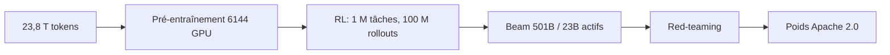
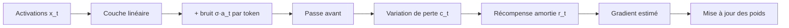
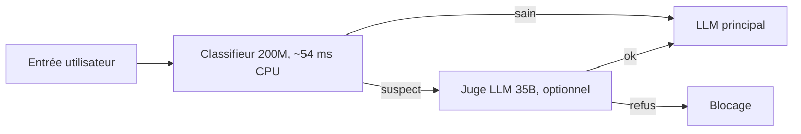

# IA — Détail du mardi 6 octobre 2026

## 1. Beam (Reflection AI) — un MoE de 501 Md de paramètres sous Apache 2.0, poids attendus ce mois-ci

**Source :** Reflection AI — https://reflection.ai/blog/introducing-beam
**Date :** 5 octobre 2026

### Contexte

Reflection AI présente Beam, un modèle à poids ouverts de très grande taille, sous licence Apache 2.0. Le modèle est encore en red-teaming et en évaluations finales : les poids, le rapport technique et la model card sont annoncés pour « plus tard ce mois-ci ». Aujourd'hui, tu ne peux donc pas le télécharger. Les chiffres ci-dessous viennent uniquement de l'annonce, sans vérification indépendante.

### Comment ça marche

Beam est un Mixture-of-Experts creux : 501 Md de paramètres au total, mais seulement 23 Md actifs par token, sur 52 couches. Pour chaque token, un routeur choisit quelques experts et ignore les autres. Le coût de calcul suit donc les paramètres actifs, tandis que la mémoire doit toujours contenir l'ensemble des poids.

L'attention alterne couches locales et globales, et le contexte atteint 1 million de tokens. Le pré-entraînement a porté sur 23,8 billions de tokens en moins de quatre semaines, sur 6 144 GPU NVIDIA GB300 NVL72, avec un goodput de 92,3 %.

La phase d'apprentissage par renforcement est décrite en détail : plus de 100 millions de rollouts, environ 1 million de tâches, environ 1,3 milliard d'évaluations en bac à sable, 10,5 k GPU GB300 pendant quatre semaines. Le contexte maximal d'un rollout est de 256 k tokens, avec 110 k rollouts concurrents en moyenne. Reflection revendique 3 à 4 fois moins de calcul d'inférence que GLM-5.2 sur des tâches de raisonnement.



### En pratique — exemple de code

Les poids n'étant pas publiés, voici un calcul d'ordre de grandeur de la mémoire nécessaire, à partir des seuls chiffres annoncés. C'est une estimation de ma part, pas une donnée du billet.

```python
total, active = 501e9, 23e9
print(f"part active par token : {active/total:.1%}")   # ~4,6 %
for name, bytes_per_param in {"bf16": 2, "fp8": 1, "4 bits": 0.5}.items():
    # la mémoire doit contenir TOUS les experts, pas seulement les actifs
    print(f"{name:>6} : {total*bytes_per_param/1e9:,.0f} Go de poids")
```

### Pourquoi ça compte pour toi

Si tu héberges des modèles toi-même, Beam illustre le piège du MoE : le calcul est léger, la mémoire non (de l'ordre de 250 Go en 4 bits, avant cache KV). Attends les poids et les benchmarks indépendants avant de planifier quoi que ce soit.

### Points de vigilance

Les scores cités (SWE Bench Pro v2-Hard 77,2 ; Terminal Bench v2.1 80,1) sont ceux de l'éditeur.

---

## 2. Dust — pré-entraîner un transformer sans rétropropagation

**Source :** QLabs — https://qlabs.sh/research/dust
**Date :** 5 octobre 2026

### Contexte

La rétropropagation calcule le gradient exact, au prix de stocker les activations et d'exiger un graphe différentiable. Les méthodes d'ordre zéro, comme les stratégies d'évolution, estiment le gradient par essais bruités, mais elles passent mal à l'échelle : il faut une passe avant par membre de la population. Dust propose une astuce pour amortir ce coût. Le code est public sur https://github.com/qlabs-eng/dust.

### Comment ça marche

Au lieu de perturber les poids, Dust perturbe les activations. Chaque sortie de couche linéaire reçoit un bruit gaussien indépendant à chaque position de token : `y_t → y_t + σ·a_t`. Une seule passe avant évalue ainsi des milliers de perturbations, une par token. Les auteurs parlent de « population virtuelle ».

Ensuite :

1. On mesure pour chaque token la variation de perte, avec un amortissement temporel `r_t = Σ γ^(s−t) c_s` pour tenir compte de l'effet sur les tokens suivants via l'attention.
2. On estime le gradient de la sortie en moyennant le bruit pondéré par la récompense.
3. On en déduit le gradient du poids par produit extérieur avec l'entrée : `Ĝ_W = Σ_t ĝ_t x_tᵀ`.
4. Pour l'intérieur de l'attention, on recalcule seulement la sortie d'attention à partir d'activations propres mises en cache.

Les résultats sont encourageants mais modestes : à 20 M de tokens, la limite extrapolée (4,43) passe sous la rétropropagation (4,633), tout en restant sur une courbe décroissante. EGGROLL, une stratégie d'évolution dans l'espace des poids, a besoin d'une population 10³ à 10⁴ fois plus grande pour égaler Dust. Les modèles testés vont de 2 M à 243 M de paramètres, entraînés sur FineWeb. Les auteurs écrivent que Dust n'est « pas assez efficace en calcul pour remplacer la rétropropagation aujourd'hui ».



### En pratique — exemple de code

Esquisse simplifiée de ma part, d'après les formules de l'article ; ce n'est pas le code du dépôt.

```python
import numpy as np

def dust_grad(x, y_fn, loss_fn, sigma=0.1, K=64, gamma=0.9):
    """x: (T, d_in). Estime le gradient de la sortie par token, sans backprop."""
    T = x.shape[0]
    g = 0.0
    for _ in range(K):                       # K tirages = population
        a = np.random.randn(T, y_fn(x).shape[1])
        c = loss_fn(y_fn(x) + sigma * a)     # perte par token (T,)
        r = np.array([sum(gamma**(s-t) * c[s] for s in range(t, T)) for t in range(T)])
        g += r[:, None] * a
    return -g / (K * sigma)                  # ĝ_t ; puis Ĝ_W = ĝ.T @ x
```

### Pourquoi ça compte pour toi

Rien à brancher en production aujourd'hui. L'intérêt est de savoir que l'entraînement sans gradient s'améliore, ce qui pourrait un jour autoriser des architectures non différentiables. À suivre, sans plus.

### Limites

Les expériences sont petites (jusqu'à 243 M de paramètres, une époque) et l'efficacité de calcul reste inférieure à la rétropropagation.

---

## 3. Guardrails Red Hat — un classifieur de 200 M de paramètres égale un LLM de 35 Md sur l'injection de prompt

**Source :** The New Stack — https://thenewstack.io/red-hat-guardrail-benchmark/
**Date :** 5 octobre 2026

### Contexte

Pour filtrer les injections de prompt et les contenus dangereux, deux familles s'affrontent : des LLM utilisés comme juges, puissants mais lents, et des classifieurs spécialisés, petits et rapides. Red Hat a comparé les deux dans un benchmark publié le 2 octobre (https://developers.redhat.com/articles/2026/10/02/benchmarking-ai-decision-models-against-traditional-guardrails).

### Comment ça marche

Le benchmark confronte trois catégories : des classifieurs (DeBERTa de Red Hat ~200 M, Granite Guardian ~125 M, Laya ~421 M, BART-large-mnli), des LLM juges (Qwen3.6-35B, NVIDIA Nemotron-3.5-Content-Safety 4 B) et des « modèles de décision » (TypeSafe Jev, DiffusionGemma).

Sur l'injection de prompt, le classifieur DeBERTa atteint 89,01 % d'exactitude avec 54,1 ms de latence médiane, contre 89,31 % pour Qwen3.6-35B. Jev monte à 86,35 % avec 348,1 ms. Sur la sécurité du contenu, la hiérarchie s'inverse : Jev fait 86,20 %, DiffusionGemma 85,53 %, Qwen 85,47 %, et Granite Guardian 80,27 % pour 33,2 ms.

La leçon est architecturale : un classifieur tourne sur CPU, en ligne, avant l'appel au LLM principal. Un juge de 35 Md se réserve aux cas ambigus.



### En pratique — exemple de code

Les modèles sont sur Hugging Face (`RedHatAI/deberta-v3-base-prompt-injection-v2`). Les noms d'étiquettes ne figurent pas dans l'article : inspecte-les avant de coder ton seuil.

```python
from transformers import pipeline

clf = pipeline("text-classification",
               model="RedHatAI/deberta-v3-base-prompt-injection-v2")  # tourne sur CPU

def is_suspect(text: str, threshold: float = 0.8) -> bool:
    out = clf(text, truncation=True)[0]       # {'label': ..., 'score': ...}
    # vérifie out['label'] sur quelques exemples connus avant de t'y fier
    return out["label"].lower().startswith("inj") and out["score"] >= threshold
```

### Pourquoi ça compte pour toi

Si ton backend expose un LLM, ce garde-fou coûte presque rien en latence et en infra. Mesure-le sur tes propres attaques : 89 % sur un benchmark laisse passer un cas sur dix.

### Limites

C'est un benchmark unique, publié par un éditeur qui vend ses propres modèles.
