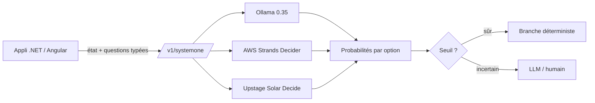
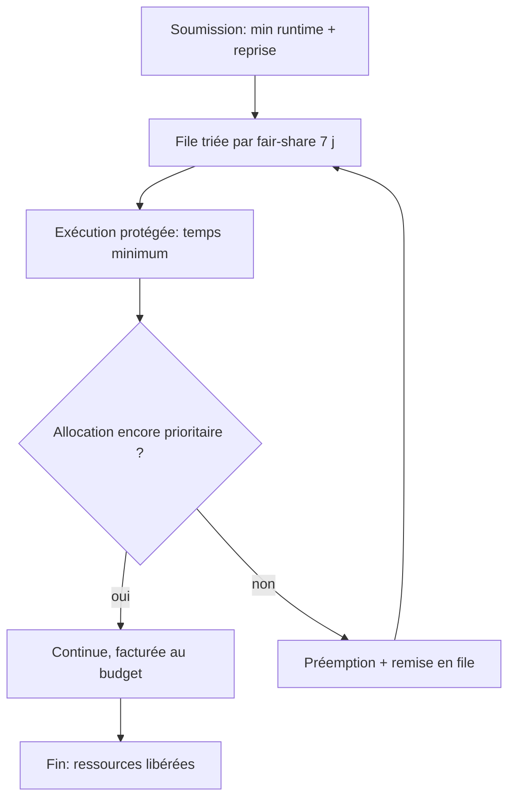
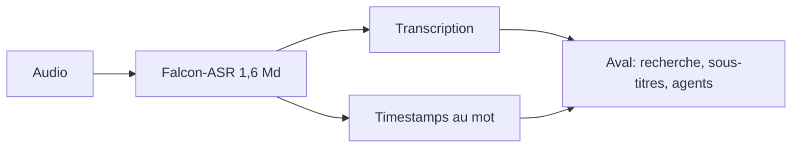

# IA — Détail du samedi 10 octobre 2026

## 1. System One — un contrat d'API commun pour les modèles de décision (Ollama 0.35, AWS, Upstage)

**Source :** The New Stack — https://thenewstack.io/decision-models-system-one/
**Date :** 9 octobre 2026

### Contexte

Un modèle de décision n'écrit ni prose ni code. Il reçoit l'état de ton application (un message client, la politique applicable) et des questions typées, puis renvoie des réponses structurées avec une probabilité par option. L'article le compare à « l'`if` de l'application IA » : le LLM génère, lui tranche.

Jusqu'ici chaque éditeur exposait son propre format. TypeSafe AI a introduit System One avec son modèle Jev, et d'autres vendeurs adoptent maintenant ce schéma, même sous leurs propres URLs.

### Comment ça marche

Toute décision se réduit à trois types de questions, combinables dans une même requête :

1. **Choice** : choisir une option dans une liste.
2. **Score** : placer l'entrée sur une grille ordonnée.
3. **Oui/non** : renvoyer la probabilité qu'une condition soit vraie.

Les serveurs conformes répondent sur `/v1/systemone`. Les SDK TypeSafe fonctionnent avec n'importe quel serveur compatible en changeant seulement l'URL de base. La « confiance » de Jev mesure la concentration de la distribution de probabilité, pas la chance que la réponse soit correcte. C'est un piège classique : ne la lis pas comme une calibration.

Les adoptants : AWS (Strands Decider 2B, poids ouverts basés sur Qwen3.5, sorti le 1ᵉʳ octobre), Upstage (Solar Decide, basé sur Solar Mini 4, un MoE de 35 Md dont 3 Md actifs, via Upstage et OpenRouter) et Ollama 0.35, qui ajoute l'endpoint. OpenAI n'a pas signé : sa Decisions API, sur une version spécialisée de GPT-6 Luna, est en préversion limitée, schéma et prix non publiés.



### En pratique — exemple de code

Les noms de champs ci-dessous sont illustratifs : l'article ne publie pas le schéma exact. Seuls l'endpoint et les trois types de questions sont documentés.

```csharp
// Illustratif — champs hypothétiques, à vérifier dans la doc TypeSafe/Ollama.
// Idée : router un ticket sans appeler un LLM génératif.
var body = new {
    input = "Le client demande un remboursement après 45 jours.",
    questions = new object[] {
        new { type = "choice", id = "route", options = new[] { "support", "billing", "legal" } },
        new { type = "yesno",  id = "urgent" }
    }
};
// Même code pour Ollama local ou un autre vendeur : seule BaseAddress change.
var res = await http.PostAsJsonAsync("/v1/systemone", body);
// Si la probabilité max < seuil, on escalade vers un LLM ou un humain.
```

### Pourquoi ça compte pour toi

Si tu as des classifications dans un backend (routage, modération, priorisation), un endpoint standardisé évite le couplage à un vendeur. Tu peux tester en local avec Ollama 0.35 puis changer l'URL. Avant d'automatiser, mesure toi-même la calibration : la « confiance » n'est pas une probabilité d'exactitude.

### Limites

Les serveurs divergent sur le nombre d'options, le calcul de confiance et la qualité des réponses. Le contrat est partagé, pas la garantie de résultat.

---

## 2. Ai2 — ordonnancer des milliers de GPU par budgets et fair-share hiérarchique

**Source :** Hugging Face Blog (Ai2) — https://huggingface.co/blog/allenai/impactful-scheduling
**Date :** 9 octobre 2026

### Contexte

L'équipe infra d'Ai2 gère des milliers de GPU H100, B200 et B300 en clusters de 88 à 1 024 GPU, pour environ 150 chercheurs. La demande dépasse l'offre de 2 à 3 fois. L'ancien ordonnanceur par priorités a produit trois dérives : GPU « squattés » par des jobs vides gardés en réserve, inflation de priorité (100 % des workloads en HIGH) et astreinte épuisée à négocier des arrêts sur des hôtes défaillants.

### Comment ça marche

Le principe : tout GPU protégé doit être financé par un budget. La direction répartit le temps GPU en parts de capacité, de manière hiérarchique (programme, projet, chercheur). Les poids sont des budgets fixés par les managers, pas des quotas statiques.

L'ordonnanceur suit l'occupation sur une fenêtre glissante de 7 jours. Les allocations sous-consommées passent avant les sur-consommées (fair-share, dans la lignée de Hadoop, SLURM Fair Tree et YARN).

Chaque workload déclare un **temps minimum d'exécution**, protégé de la préemption (plafond : 8 h). À zéro, le workload est « non alloué » : gratuit, mais préemptible à tout moment. Cela garde le cluster plein, car 18 % du temps GPU livré était non alloué. Les hôtes défaillants se vident naturellement quand les workloads atteignent leur minimum, ce qui permet d'automatiser les réparations.



### En pratique — exemple de code

L'article ne contient pas de code. Voici une version simplifiée du tri, illustrative, pour fixer l'idée.

```python
# Illustratif : tri fair-share = ratio occupation réelle / allocation (fenêtre 7 j).
def sort_key(req):
    # Plus le ratio est bas, plus l'équipe est "en retard" sur son budget.
    return req.occupancy_7d / max(req.allocated_share, 1e-9)

queue.sort(key=sort_key)
# Un workload à min_runtime = 0 n'est pas facturé : il passe en dernier,
# et n'importe quelle requête allouée peut le préempter.
```

### Pourquoi ça compte pour toi

Même sans GPU, le schéma s'applique à tout pool partagé : runners CI, workers de jobs, quotas de base de données. Un budget explicite remplace l'inflation de priorité. Les chiffres sont solides : 98 % des GPU-heures dues livrées, attente p90 des jobs de debug passée de 2 h à 30 s, interventions humaines de réparation en baisse de 74 %.

### Limites

Le plafond de 8 h pénalise les sessions interactives longues (état perdu à la préemption). Le risque de fragmentation de capacité pour les très gros jobs reste à mesurer.

---

## 3. Falcon-ASR (TII) — reconnaissance vocale 1,6 Md centrée sur l'arabe et l'émirati

**Source :** Hugging Face Blog (TII) — https://huggingface.co/blog/tiiuae/falcon-asr
**Date :** 7 octobre 2026

### Contexte

Les modèles de reconnaissance vocale généralistes se dégradent sur les dialectes arabes, peu représentés dans les corpus. Le Technology Innovation Institute d'Abu Dhabi publie Falcon-ASR, un modèle de 1,6 Md de paramètres bâti sur Falcon3-Audio (arXiv:2509.07526), avec un accent sur le dialecte émirati.

### Comment ça marche

Un seul jeu de poids couvre arabe, anglais, français, espagnol et portugais, sans drapeau de langue : le modèle transcrit dans la langue entendue. La sortie inclut des timestamps au mot, qui relient chaque mot à sa position audio.

L'entraînement a couvert l'émirati, l'arabe standard moderne, d'autres dialectes du Golfe et l'anglais. Les données ont été augmentées par bruit de fond, parole superposée, musique, réverbération, effets de téléphonie, variations de vitesse et de hauteur : l'objectif est la robustesse hors studio. L'architecture détaillée (encodeur, décodeur, tokenizer) n'est pas décrite dans l'article.

Résultats annoncés : WER moyen arabe de 20,92 % sur six jeux de test (contre 23,17 % pour le meilleur résultat publié du snapshot du 30 septembre, soit 2,25 points de mieux), WER émirati de 22,73 % (CER 10,19 %, interne TII, 4,07 points sous Qwen3-Omni), WER anglais moyen de 5,74 % sur sept jeux publics. Le détail de l'évaluation émiratie est interne au TII : compare avec prudence.



### En pratique — exemple de code

L'article ne fournit aucun snippet et la licence n'est pas indiquée. Voici, à titre illustratif, la structure d'un client de transcription côté backend.

```csharp
// Illustratif : consommer une transcription avec timestamps au mot.
public record Word(string Text, double Start, double End);

// Cas d'usage : sous-titres. On regroupe les mots en segments de 5 s max.
var segments = words
    .GroupBy(w => (int)(w.Start / 5))
    .Select(g => (Start: g.First().Start, Text: string.Join(' ', g.Select(w => w.Text))));
```

### Pourquoi ça compte pour toi

Si tu intègres de la transcription dans un backend, tu peux viser un modèle unique multilingue plutôt qu'un routage par langue. Avant tout usage en production, vérifie la licence (non précisée) : l'API et les applications natives sont annoncées mais pas encore sorties. Seule une démo Hugging Face (clips de 60 s) est disponible.

### Limites

Pas d'architecture détaillée, pas de licence indiquée, évaluation émiratie interne.
