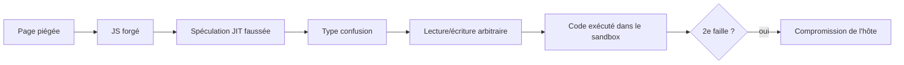
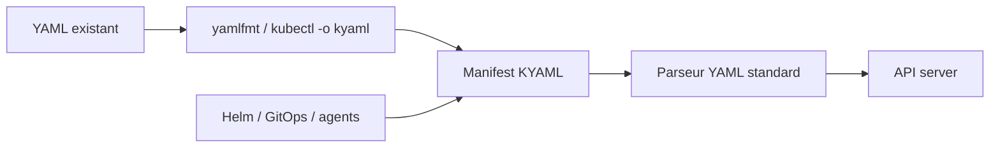
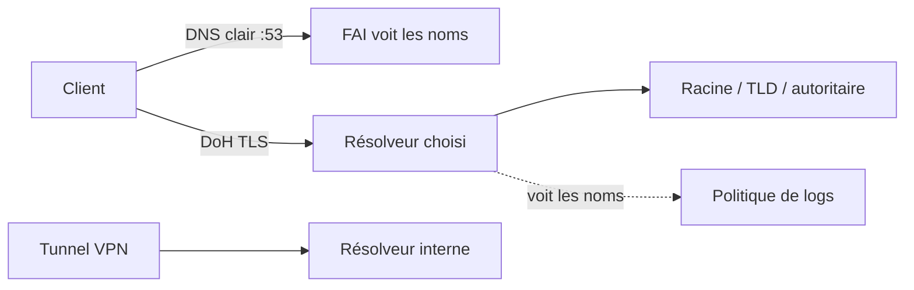

# Tech — Détail du samedi 6 septembre 2026

## 1. CVE-2026-85046 — confusion de types dans V8, exploitée, au KEV avec échéance au 18 septembre

**Source :** SOC Prime — https://socprime.com/blog/cve-2026-85046-analysis/
**Date :** 3 septembre 2026 (correctif) — ajout au KEV le 4 septembre 2026

### Contexte

Google a publié le correctif le 3 septembre 2026 en confirmant qu'un exploit existait déjà dans la nature. La CISA a inscrit la faille à son catalogue Known Exploited Vulnerabilities le 4, avec une date de remédiation au **18 septembre 2026** pour les systèmes fédéraux couverts. C'est le sixième zero-day Chrome de l'année.

Le point souvent mal compris tient à la portée. V8 est le moteur JavaScript et WebAssembly partagé par **tout** le code Chromium. Chaque navigateur qui en dérive hérite du même code vulnérable : Microsoft Edge, Brave, Opera, Vivaldi. Et par extension, toute application empaquetée avec un runtime Chromium embarqué — c'est-à-dire une bonne partie de tes outils de bureau.

### Comment ça marche

Une **confusion de types** est une classe de bug simple à énoncer et redoutable à exploiter. Le moteur alloue un objet d'un certain type, puis accède plus tard à cette zone mémoire en la traitant comme un autre type. Le décalage entre les deux dispositions mémoire devient une primitive : ce que la victime croit être un entier peut être lu comme un pointeur, et inversement.

Dans un moteur JavaScript, la source classique est l'optimiseur. Le compilateur JIT spécule sur le type d'une variable — « à cet endroit, c'est toujours un tableau de Smi » — et génère du code rapide qui saute les vérifications. Si un attaquant trouve un chemin où la spéculation reste valide pour l'optimiseur mais fausse à l'exécution, le code optimisé opère sur le mauvais type sans jamais vérifier.

À partir de là, la montée en puissance est mécanique. Lire ou écrire hors des bornes d'un objet donne d'abord une primitive de lecture/écriture relative, qu'on transforme en lecture/écriture **arbitraire** dans l'espace d'adressage du renderer, puis en exécution de code attaquant — **dans le bac à sable**.



C'est le point à retenir pour calibrer ta réponse. CVE-2026-85046 seule ne donne pas le contrôle du système d'exploitation. Un attaquant visant la compromission complète de l'hôte doit chaîner cette exécution de code avec une **seconde** faille : évasion de bac à sable ou élévation de privilèges. Ça ne réduit pas l'urgence — l'exécution dans le renderer suffit déjà à voler sessions, cookies et contenus d'onglets.

Le scénario d'entrée n'a rien d'exotique : un lien de phishing, une publicité malveillante, ou un site légitime compromis.

### En pratique — exemple de code

```bash
# 1) Vérifier la version installée (Linux) — cible : >= 152.0.7977.82
google-chrome --version
# Windows : chrome://settings/help force la vérification et le redémarrage

# 2) Inventorier les runtimes Chromium embarqués, souvent oubliés du patching
find /opt /usr/lib /Applications -name "*.pak" -path "*lectron*" 2>/dev/null
npx electron --version   # pour tes propres apps : rebuild sur un Electron corrigé
```

```csharp
// Rappel côté serveur : ta CSP ne bloque pas la faille, mais réduit la surface
app.Use(async (ctx, next) =>
{
    ctx.Response.Headers["Content-Security-Policy"] =
        "default-src 'self'; script-src 'self'; object-src 'none'; frame-ancestors 'none'";
    await next();
});
```

### Pourquoi ça compte pour toi

Ta priorité du jour n'est pas ton navigateur — il se met à jour tout seul. Ce sont les runtimes Chromium que tu embarques et que personne ne patche : applications Electron internes, WebView2, headless Chrome dans ta CI, conteneurs de scraping. Une image Docker figée sur un Chromium ancien reste vulnérable indéfiniment. Vérifie aussi tes machines de build, où un navigateur headless a souvent accès à des secrets.

### Points de vigilance

Aucun PoC public n'était disponible au moment de l'analyse, mais l'exploitation confirmée signifie que du code fonctionnel circule déjà. Les versions corrigées sont 152.0.7977.82/.83 sur Windows et macOS, 152.0.7977.82 sur Linux.

---

## 2. KYAML — un dialecte strict de YAML pour des manifests Kubernetes non ambigus

**Source :** InfoQ — https://www.infoq.com/news/2026/09/kubernetes-kyaml-manifests/
**Date :** 4 septembre 2026

### Contexte

YAML s'est imposé dans Kubernetes parce qu'il est lisible et accepte les commentaires. Sa flexibilité est aussi son défaut : l'indentation porte la structure, et les valeurs non quotées peuvent être interprétées dans un type que l'auteur n'avait pas prévu. Ces problèmes deviennent particulièrement pénibles quand les manifests sont produits ou manipulés par des systèmes de templating comme Helm.

KYAML répond à ça sans casser l'écosystème. Ce n'est **pas** un nouveau langage de configuration : c'est un sous-ensemble strict de YAML, donc les parseurs et l'outillage Kubernetes existants continuent de le traiter. Il a été introduit en alpha dans Kubernetes v1.34 et est passé bêta, activé par défaut, en v1.35.

### Comment ça marche

L'approche est de **réduire le nombre de choix syntaxiques**. Les objets utilisent `{}`, les tableaux `[]`, les chaînes sont entre guillemets doubles. Les commentaires et les virgules finales restent disponibles. Le résultat ressemble davantage à du JSON, tout en demeurant du YAML valide.

Le gain principal est l'élimination de la **coercition de types implicite**. C'est le piège historique de YAML : `no` devient un booléen, `1.10` devient un flottant qui perd son zéro final, une version comme `1.30` se transforme en `1.3`, et une chaîne qui commence par `*` déclenche une résolution d'alias. Quoter systématiquement supprime toute cette classe d'erreurs — non pas en interdisant les erreurs, mais en supprimant l'ambiguïté qui les rend possibles.

La migration ne demande aucune réécriture manuelle. `kubectl` accepte `-o kyaml` comme format de sortie, et les outils `yamlfmt` (Kubernetes et Google) convertissent l'existant. Comme KYAML reste du YAML valide, un `kubectl` plus ancien consomme le résultat sans broncher.



Le timing n'est pas anodin. Les configurations Kubernetes sont de plus en plus **générées** plutôt qu'écrites : Helm, plateformes GitOps, infrastructure-as-code, et désormais agents de codage. Un humain repère souvent un problème d'indentation en relisant un petit manifest ; un système qui génère des centaines de ressources n'a pas ce jugement contextuel. Une représentation plus stricte réduit le nombre de façons d'exprimer la même configuration et rend les erreurs structurelles et de typage plus faciles à détecter — pour les humains comme pour les machines.

Kubernetes ne fait délibérément pas de KYAML le format par défaut. Les équipes qui préfèrent le YAML conventionnel continuent ; celles qui veulent l'explicite l'adoptent sélectivement. C'est une pratique d'ingénierie incrémentale, pas une migration disruptive.

### En pratique — exemple de code

```yaml
# Avant — YAML conventionnel : trois pièges de typage implicite
apiVersion: v1
kind: ConfigMap
metadata:
  name: app-config
data:
  featureEnabled: no        # -> booléen false, pas la chaîne "no"
  version: 1.30             # -> flottant 1.3, le zéro final disparaît
  logLevel: on              # -> booléen true
```

```yaml
# Après — KYAML : structure et types explicites, toujours du YAML valide
apiVersion: "v1"
kind: "ConfigMap"
metadata: {
  name: "app-config",
}
data: {
  featureEnabled: "no",     # chaîne, sans ambiguïté
  version: "1.30",          # chaîne, zéro final préservé
  logLevel: "on",           # chaîne, pas un booléen
}
```

```bash
# Convertir sans réécrire à la main, et vérifier que le résultat reste consommable
kubectl get configmap app-config -o kyaml > app-config.kyaml
kubectl apply -f app-config.kyaml --dry-run=server
```

### Pourquoi ça compte pour toi

Si tes manifests passent par Helm ou par un agent, tu as déjà perdu du temps sur un `1.30` devenu `1.3` ou un `no` devenu `false`. KYAML supprime la classe entière sans changer ton outillage ni ton parseur. Adopte-le d'abord sur les manifests générés, où personne ne relit ligne à ligne — c'est là que l'ambiguïté coûte le plus cher.

### Limites

KYAML ne valide pas ta configuration : il en fige la représentation. Un manifest KYAML parfaitement formé peut toujours référencer une image inexistante ou un `resources.limits` absurde. Il complète tes policies, il ne les remplace pas.

---

## 3. Mullvad ferme ses DNS chiffrés publics le 2 novembre et finance Quad9

**Source :** Mullvad VPN — https://mullvad.net/en/blog/2026/9/3/shutting-down-our-public-encrypted-dns-servers-and-sponsoring-quad9-instead
**Date :** 3 septembre 2026

### Contexte

Mullvad opère depuis 2022 des serveurs DNS chiffrés publics, utilisables gratuitement par n'importe qui, avec ou sans abonnement VPN. L'entreprise annonce leur arrêt au **2 novembre 2026** et le financement de la fondation Quad9 à la place. L'argument est celui de la non-duplication : Quad9 est le référent établi du DNS public orienté vie privée, et Mullvad préfère y consacrer ses ressources plutôt que de maintenir un service concurrent.

Le raisonnement technique est cohérent avec le produit. Quand tu utilises le VPN Mullvad, le tunnel chiffre déjà tout le trafic et le résolveur interne traite toutes les requêtes : les serveurs publics n'apportaient rien à ces utilisateurs. Ils servaient donc surtout à des tiers, hors du périmètre du produit.

### Comment ça marche

Il vaut la peine de reposer le problème que résout le DNS chiffré, parce qu'on le confond souvent avec la confidentialité globale. Le DNS classique voyage en clair sur le port 53 : ton fournisseur d'accès, et tout intermédiaire réseau, voit chaque nom de domaine que tu résous, même quand la connexion suivante est en HTTPS.

DoH (DNS over HTTPS) enveloppe la requête dans une session HTTPS vers un résolveur. Deux effets distincts. D'abord, l'intermédiaire réseau ne lit plus les noms résolus. Ensuite — et c'est la partie qu'on oublie — le **résolveur choisi** les voit tous. Chiffrer le DNS ne supprime pas l'observateur : ça le déplace, de ton FAI vers l'opérateur du résolveur. Tout le débat porte donc sur la politique de journalisation et la gouvernance de cet opérateur.



Pour les abonnés VPN, la transition est conçue pour être invisible. Si tu as gardé les réglages DoH par défaut ou la variante avec blocage de publicités, ton navigateur bascule automatiquement vers Quad9. Ceux qui ont configuré **manuellement** les adresses publiques de Mullvad — dans un `resolv.conf`, un Pi-hole, un routeur ou un profil DoH de navigateur — doivent migrer avant la date de coupure.

### En pratique — exemple de code

```bash
# 1) Repérer les endroits où un résolveur est câblé en dur
resolvectl status | grep -i "DNS Servers"
grep -rn "nameserver" /etc/resolv.conf /etc/systemd/resolved.conf 2>/dev/null

# 2) Vérifier qu'un résolveur DoH répond avant de basculer dessus
curl -sH 'accept: application/dns-json' \
  'https://dns.quad9.net/dns-query?name=example.com&type=A' | head -c 200
```

```ini
# systemd-resolved : DoT vers Quad9, avec repli désactivé pour ne pas fuir en clair
# /etc/systemd/resolved.conf
[Resolve]
DNS=9.9.9.9#dns.quad9.net 2620:fe::fe#dns.quad9.net
DNSOverTLS=yes
DNSSEC=yes
FallbackDNS=
```

### Pourquoi ça compte pour toi

L'action concrète tient en une vérification : cherche si une adresse DNS Mullvad traîne dans un `resolv.conf`, un Pi-hole, un routeur ou un profil DoH. Le 2 novembre, une résolution qui échoue se manifeste comme une panne réseau diffuse, pas comme une erreur DNS lisible. Et retiens le principe général : choisir un résolveur, c'est choisir qui voit ta liste de domaines.

### Pour aller plus loin

Si tu tiens à ne déléguer à personne, un résolveur récursif local (Unbound) supprime l'intermédiaire — au prix d'une latence à froid plus élevée et d'un cache à entretenir.
