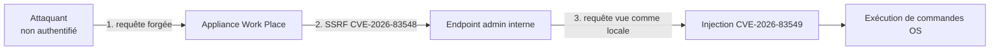
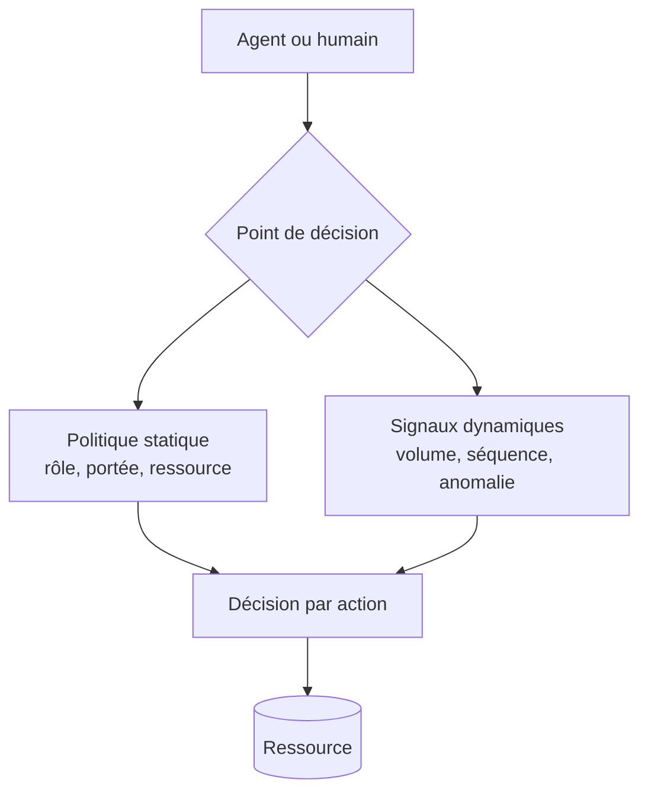

# Tech — Détail du lundi 7 septembre 2026

## 1. SonicWall SMA1000 — CVE-2026-83548 et CVE-2026-83549, la SSRF qui déverrouille l'injection de commandes

**Source :** Rapid7 — https://www.rapid7.com/blog/post/etr-critical-sonicwall-sma1000-vulnerabilities-cve-2026-83548-cve-2026-83549-exploited-in-the-wild/
**Date :** 1er septembre 2026

### Contexte

SonicWall a divulgué le 1er septembre deux vulnérabilités dans ses appliances SMA1000, exploitées dans la nature. Prises isolément, aucune des deux ne donne une exécution de code non authentifiée. Chaînées, si. C'est exactement le type de scénario que les scores CVSS pris séparément décrivent mal, et qui explique pourquoi la chaîne s'est retrouvée au catalogue KEV de la CISA.

Le SMA1000 est une passerelle d'accès distant : par construction, elle est exposée sur Internet et elle voit le réseau interne. C'est le pire endroit possible pour une RCE non authentifiée. Appareils concernés : 6210, 7210 et 8200v.

### Comment ça marche

**CVE-2026-83548** est une SSRF — *Server-Side Request Forgery* — pré-authentification, notée CVSS 10,0. Elle provient d'un chemin d'accès alternatif non prévu dans l'interface *Appliance Work Place*. Un attaquant distant sans identifiants peut faire émettre à l'appliance des requêtes de son choix, et donc atteindre des fonctions internes normalement inaccessibles depuis l'extérieur.

**CVE-2026-83549** est une injection de commandes OS post-authentification, de sévérité haute. Dans certaines conditions, un attaquant distant **authentifié avec des droits administrateur** peut exécuter des commandes arbitraires sur le système.

Séparément, la seconde est un risque modéré : elle suppose déjà un compte admin. C'est la composition qui change tout.



L'étape 3 est le cœur du mécanisme, et la leçon d'architecture à retenir. L'endpoint d'administration ne vérifie pas *qui* appelle, il fait confiance à *d'où* vient l'appel : une requête émise par l'appliance elle-même est traitée comme légitime. La SSRF fabrique précisément cette origine. Le contrôle d'authentification n'est pas contourné au sens cryptographique — il est satisfait, par une requête que l'attaquant contrôle intégralement.

C'est le pattern classique du périmètre de confiance implicite : « si ça vient de localhost, c'est de confiance ». Ce raccourci est présent dans quantité d'applications internes, y compris les tiennes. Un endpoint d'admin filtré uniquement sur `127.0.0.1` ou sur un en-tête `X-Forwarded-For` est vulnérable à la même chaîne dès qu'une SSRF existe ailleurs dans le produit.

### En pratique — exemple de code

```bash
# 1) Identifier la version installée (SSH admin sur l'appliance).
show version | grep -i "SMA1000"

# 2) Versions corrigées : 12.4.3-03526 ou 12.5.0-02952 et supérieures.
#    Toute version inférieure = exposée à une RCE non authentifiée.

# 3) Chasse rétrospective : la SSRF laisse une trace côté sortie de l'appliance.
#    Cherche des requêtes de l'appliance VERS ses propres endpoints d'administration.
grep -E "workplace.*(admin|cgi-bin)" /var/log/httpd/access_log \
  | awk '$1 == "127.0.0.1" || $1 ~ /^10\./' | tail -50
```

Et côté application, la contre-mesure générique dans ton propre code :

```csharp
// Avant — confiance à l'origine : toute SSRF ailleurs devient un bypass d'auth.
if (context.Connection.RemoteIpAddress is { } ip && IPAddress.IsLoopback(ip))
    return AuthorizationResult.Success();

// Après — l'origine n'est qu'un signal, jamais une preuve d'identité.
//   L'appel interne porte sa propre identité vérifiable (mTLS ou jeton signé).
var identity = await _tokenValidator.ValidateAsync(context.Request.Headers["X-Svc-Token"]);
if (identity is null || !identity.HasScope("appliance.admin"))
    return AuthorizationResult.Fail();
```

### Pourquoi ça compte pour toi

Si tu exploites un SMA1000, applique le hotfix aujourd'hui : l'exploitation est confirmée et l'appareil est exposé par nature. Au-delà, cherche dans tes propres services les autorisations qui reposent sur l'adresse d'origine plutôt que sur une identité vérifiable. Un endpoint de santé ou d'administration protégé par « seulement depuis le réseau interne » est à une SSRF près d'être public. Fais porter à chaque appel interne une identité, pas une provenance.

### Pour aller plus loin

Dix vulnérabilités activement exploitées ont rejoint le KEV entre le 31 août et le 6 septembre, dont deux sur PaperCut NG/MF (authentification manquante et réflexion non sûre). Si tu exposes un serveur d'impression, il est aussi sur la liste.

---

## 2. ASCII smuggling — le bloc Unicode Tags recyclé pour l'évasion de filtres anti-phishing

**Source :** Microsoft Security Blog — https://www.microsoft.com/en-us/security/blog/2026/09/03/ascii-smuggling-crosses-over-from-ai-prompt-injection-to-phishing-evasion/
**Date :** 3 septembre 2026

### Contexte

Les chercheurs de Microsoft ont publié le 3 septembre une analyse née d'un accident heureux. En construisant la détection de prompt injection pour Defender for Office 365, ils ont écrit une signature de chasse pour l'**ASCII smuggling** — l'usage de caractères Unicode invisibles pour dissimuler des instructions destinées à un modèle. La signature s'est mise à hurler. Mais ce qu'elle a trouvé n'était pas du prompt injection : c'était une campagne de phishing financier à très haut volume, qui utilisait la même plage Unicode pour un objectif inverse.

### Comment ça marche

Le bloc **Unicode Tags**, `U+E0000` à `U+E007F`, contient une copie fantôme de l'ASCII imprimable : `U+E0041` reflète `A`, `U+E0061` reflète `a`. Prévu à l'origine pour l'étiquetage de langue, il est aujourd'hui largement déprécié. Sa propriété intéressante pour un attaquant : la plupart des polices et interfaces **ne le rendent pas**. Une chaîne peut donc porter un message invisible pour un humain, mais parfaitement lisible par tout logiciel qui reçoit le texte brut.

L'usage connu, celui du prompt injection, exploite l'écart entre ce que voit l'humain et ce que lit le modèle : instructions cachées dans une page ou un e-mail, invisibles à l'écran, ingérées par l'assistant.

La campagne observée **inverse l'intention en gardant le mécanisme**. Aucune instruction n'est encodée. Un unique caractère invisible — une TAG SPACE, `U+E0020` — est inséré **à l'intérieur** des mots-clés financiers :

`funding` devient `fun⟨U+E0020⟩ding`

Pour le destinataire, rien ne change : le mot s'affiche normalement. Pour un filtre qui fait une correspondance littérale sur « funding », le mot n'existe plus. La même propriété — invisible à l'humain, présent au niveau du traitement de texte — sert ici à **obscurcir un mot-clé avant que le détecteur ne l'évalue**.

Les chiffres donnent l'échelle. Le 8 février, la signature déclenchait sur environ 21 000 messages. Le lendemain, sur **plus de 1,3 million**. Le pic dépasse 2,3 millions le 11 février. Environ 150 domaines expéditeurs à thème financier, une cadence strictement hebdomadaire — silence quasi total le week-end, typique d'une infrastructure d'envoi programmée — et un arrêt net de la phase à haut volume après le 15 mai.

Le détail méthodologique le plus instructif concerne les faux positifs. La première version de la signature marquait *tout* code point de la plage, et se déclenchait sur des messages parfaitement légitimes contenant l'un de **trois emojis de drapeaux** : Angleterre, Écosse et pays de Galles. Ces drapeaux subdivisionnels sont encodés avec ces mêmes caractères de tag — le drapeau gallois est un code point de base `U+1F3F4` suivi d'une séquence invisible épelant `gbwls`, puis d'un tag terminal `U+E007F`. Une détection naïve casse sur eux.

### En pratique — exemple de code

```csharp
// Normalisation défensive à appliquer AVANT toute comparaison, indexation ou log.
// Règle : ce que ton filtre évalue doit être ce que l'humain voit.
static readonly Regex TagBlock = new(@"[\U000E0000-\U000E007F]", RegexOptions.Compiled);

public static string StripUnicodeTags(string input, out int removed)
{
    // On préserve les séquences de drapeaux : base U+1F3F4 suivie de tags légitimes.
    var flagsPreserved = Regex.Replace(input,
        @"\U0001F3F4[\U000E0000-\U000E007F]+", m => m.Value);

    var cleaned = TagBlock.Replace(flagsPreserved, "");
    removed = input.Length - cleaned.Length;
    return cleaned;   // removed > 0 => signal à journaliser, pas forcément à bloquer
}
```

```bash
# Détection rapide dans un corpus : repérer les fichiers porteurs de tags invisibles.
grep -rlP '[\x{E0000}-\x{E007F}]' ./inbox/ | head
```

Le principe généralisable : **normalise puis compare, jamais l'inverse**. Un pipeline qui indexe le texte brut et applique ses règles dessus est contournable par n'importe quel caractère invisible.

### Pourquoi ça compte pour toi

Partout où tu compares une chaîne fournie par un utilisateur à une liste — modération, anti-fraude, détection de doublons, filtre de commandes — normalise d'abord : retire les caractères non rendus, puis compare. Cela vaut aussi pour tes agents : un texte issu du web ou d'un e-mail peut porter des instructions invisibles avant d'atteindre ton LLM. Journalise la présence de ces caractères comme un signal, plutôt que de bloquer aveuglément — les drapeaux gallois sont légitimes.

### Points de vigilance

La télémétrie de Microsoft montre que la majorité de ces messages ont été bloqués par des protections en couches, pas par un signal Unicode isolé. Une signature unique ne suffit jamais : elle sert de sonde, pas de rempart.

---

## 3. Google Beyond Zero — quand la décision d'accès descend de l'application à la ressource

**Source :** InfoQ — https://www.infoq.com/news/2026/09/google-beyond-zero/
**Date :** 5 septembre 2026

### Contexte

BeyondCorp, publié par Google il y a une décennie, a popularisé le Zero Trust : plus de réseau de confiance, l'accès dépend de l'identité de l'utilisateur et de la posture de son appareil, à chaque requête. Ce modèle suppose une chose que personne n'avait besoin d'énoncer à l'époque : derrière chaque requête, il y a un humain, avec une session, un appareil, un contexte d'authentification.

Un agent autonome casse cette hypothèse. Il n'a pas d'appareil dont on mesure la posture, il agit souvent au nom d'un humain absent, il enchaîne des centaines d'actions par seconde, et rien ne distingue son trafic d'un abus automatisé. Google a publié un article de recherche décrivant **Beyond Zero**, présenté comme un « modèle de sécurité pour l'ère de l'IA » qui étend le Zero Trust aux agents autonomes.

### Comment ça marche

Le déplacement conceptuel tient en une phrase : la décision d'accès quitte le niveau de l'**application** pour descendre au niveau de la **ressource** et de l'**action**.

Sous BeyondCorp, le proxy décide si tu peux atteindre l'application X. Une fois dedans, tu as ce que l'application te donne. Ce grain est acceptable pour un humain — sa vitesse d'action est bornée par sa vitesse de lecture. Il ne l'est pas pour un agent : autoriser un agent à « accéder au CRM » revient à l'autoriser à lire les 400 000 fiches clients en trois minutes.



Le modèle combine deux familles de contrôles :

- **Statiques.** Des autorisations déclaratives, exprimées par ressource et par action, pas par application. « Peut lire la fiche client 4711 », pas « peut accéder au CRM ». C'est ce qui rend le principe de moindre privilège réellement applicable à un agent.
- **Dynamiques.** Des décisions pilotées par IA sur des signaux de comportement : volume, séquence d'appels, écart au profil habituel. C'est ce qui permet d'attraper l'agent qui fait exactement ce qu'il a le droit de faire, mais dix mille fois.

L'objectif affiché est une application **à vitesse machine** : la décision doit tenir dans le budget de latence d'un appel d'agent, pas dans celui d'une revue d'accès trimestrielle. C'est là que se situe la vraie difficulté d'implémentation — un point de décision synchrone sur chaque action est un composant critique de plus sur ton chemin chaud.

### En pratique — exemple de code

```csharp
// Avant — autorisation au grain de l'application : un agent y a tout le CRM.
[Authorize(Policy = "CrmAccess")]
public async Task<Customer> Get(int id) => await _repo.FindAsync(id);

// Après — autorisation au grain de la ressource ET de l'action, plus un budget.
[HttpGet("customers/{id}")]
public async Task<IActionResult> Get(int id, CancellationToken ct)
{
    var principal = _agentContext.Current;           // humain OU agent, identité explicite
    var decision = await _pdp.EvaluateAsync(new AccessRequest(
        Subject:  principal,
        Resource: $"crm/customer/{id}",              // la ressource, pas l'app
        Action:   "read",
        Signals:  _rate.Snapshot(principal)          // volume observé sur la fenêtre
    ), ct);

    if (!decision.Allowed) return Forbid(decision.Reason);
    return Ok(await _repo.FindAsync(id, ct));
}
```

Le paramètre `Signals` est ce qui distingue ce modèle d'un simple RBAC fin : la même identité, la même ressource et la même action peuvent être refusées selon le rythme observé.

### Pourquoi ça compte pour toi

Si tu ouvres tes API à des agents — MCP, Copilot, scripts LLM — ton modèle d'autorisation actuel est probablement au grain de l'application, donc trop large. Commence simple : donne une identité propre à chaque agent, distincte de l'utilisateur qu'il sert, et pose un quota par identité et par ressource. Tu n'as pas besoin d'un moteur de politique piloté par IA pour capter 80 % du risque, tu as besoin d'arrêter de traiter un agent comme un utilisateur.

### Limites

Un point de décision synchrone par action ajoute de la latence et un point de défaillance. Prévois une politique de repli explicite — *fail closed* sur les écritures, *fail open* borné sur les lectures — avant de le mettre sur ton chemin critique.
