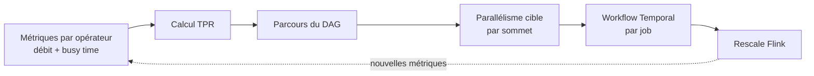
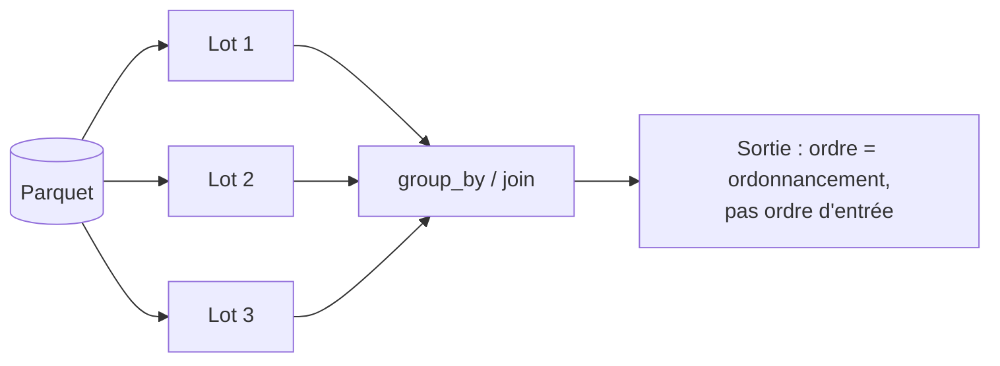

# Tech — Détail du mardi 8 septembre 2026

## 1. Netflix — l'autoscaler Flink open source, ou pourquoi scaler un cluster ne suffit plus

**Source :** InfoQ — https://www.infoq.com/news/2026/09/netflix-flink-autoscaler/
**Date :** 7 septembre 2026

### Contexte

Netflix fait tourner Apache Flink depuis 2017 et a construit son propre autoscaler vers 2019. Ce système vivait sur Mantis et consommait de la télémétrie de niveau cluster remontée par Atlas : CPU, utilisation réseau, retard Kafka, débit d'entrée, débit de consommation. Il ajustait le **nombre total de TaskManagers** et réduisait la consommation de ressources de 25 % à 45 % sur des milliers de pipelines.

Le problème n'était pas la qualité de la boucle de régulation, mais son **unité de décision**. En raisonnant sur le cluster, tous les opérateurs d'un job partageaient la même décision de scaling. Pour un pipeline linéaire, c'est raisonnable. Pour un job avec des branches, des jointures et des téraoctets d'état, où un opérateur de parsing sature pendant qu'une jointure s'ennuie, c'est structurellement faux.

Netflix bascule donc vers l'**autoscaler Apache Flink open source**, pour plus de 30 000 jobs répartis sur plusieurs régions AWS. Une équipe rapporte **58 % de baisse de dépense de calcul annualisée**, soit environ **1,1 million de dollars par an**.

### Comment ça marche

Le mécanisme central s'appelle le **True Processing Rate** (TPR), issu du projet de recherche DS2 et formalisé dans FLIP-271.

L'idée est simple à énoncer. Flink expose, pour chaque opérateur d'un job en cours, deux métriques : le **débit observé** (enregistrements par seconde effectivement traités) et le **busy time** (fraction du temps où l'opérateur travaille vraiment, par opposition à attendre de la donnée ou subir de la contre-pression). Le débit observé seul ne dit rien : un opérateur peut afficher 1 000 enr/s parce qu'il est saturé, ou parce qu'il n'en reçoit pas plus.

Le TPR corrige cela : `TPR = débit observé / busy time`. Un opérateur à 1 000 enr/s occupé à 20 % du temps a un TPR de 5 000 enr/s — c'est sa vraie capacité. À partir de là, l'autoscaler parcourt le **graphe du job** (le DAG des sommets), et pour chaque sommet calcule le parallélisme requis : `débit entrant attendu / (TPR × cible d'utilisation)`.

L'équipe de recherche derrière DS2, notamment Vasiliki Kalavri, avait d'abord exploré l'analyse de chemin critique avant d'adopter le TPR comme base plus simple. Cette idée très simple a très bien fonctionné.

Netflix a intégré l'autoscaler à son plan de contrôle interne plutôt que de le déployer via l'opérateur Kubernetes de Flink. Un service Spring Boot utilise des **workflows Temporal** pour isoler les décisions d'autoscaling job par job. L'équipe a aussi modifié la collecte de métriques du JobManager pour supporter jusqu'à 3 000 sous-tâches, ajouté un filtrage de métriques côté serveur, préservé les sous-graphes connectés en FORWARD lors du scaling, et ajouté la gestion de la contre-pression sur les sinks.



### En pratique — exemple de code

La configuration de l'autoscaler tient dans quelques clés. Le point le plus intéressant est la cible d'utilisation.

```yaml
# Avant — autoscaling au niveau cluster : une seule décision pour tout le job
# (nombre total de TaskManagers piloté par CPU + lag Kafka)

# Après — autoscaler Flink : décision par opérateur, dérivée du True Processing Rate
job.autoscaler.enabled: "true"
job.autoscaler.stabilization.interval: "5m"     # laisser le job se stabiliser après rescale
job.autoscaler.metrics.window: "10m"            # fenêtre d'observation du TPR

# 0.7 est le défaut communautaire. Netflix descend à 0.45 : plus de marge, donc
# moins de rescales agressifs sur les jobs à état volumineux (le rescale coûte cher).
job.autoscaler.target.utilization: "0.45"
job.autoscaler.target.utilization.boundary: "0.1"

job.autoscaler.vertex.max-parallelism: "3000"   # JobManager patché pour tenir la charge
job.autoscaler.scale-down.max-factor: "0.6"     # freiner la descente plus que la montée
```

### Pourquoi ça compte pour toi

Le principe est transposable bien au-delà de Flink. Chaque fois que tu autoscales sur du débit brut — pods ASP.NET Core, workers de file, consommateurs Kafka — tu confonds « ce que le composant traite » et « ce qu'il pourrait traiter ». Diviser par le taux d'occupation te donne la capacité réelle et corrige le biais. Retiens aussi la cible à 0,45 : quand le redimensionnement est coûteux, mieux vaut surprovisionner que rescaler souvent.

### Limites

Le TPR suppose que le busy time est mesuré correctement, ce qui n'est pas toujours vrai sous contre-pression forte. Un ticket ouvert, FLINK-38538, souligne les cas où des opérateurs occupés se retrouvent pénalisés par des décisions fondées sur le ratio de sortie. Et changer le parallélisme à travers une connexion FORWARD peut forcer une redistribution : l'implémentation Netflix garde ces opérateurs groupés pour l'éviter. Enfin, à la différence de KEDA, qui scale depuis des métriques ou événements externes, cet autoscaler raisonne sur le graphe interne — il ne remplace pas le premier, il répond à une autre question.

---

## 2. Le CERN quitte RHEL pour Debian 13 sur 2 200 machines, à cause d'un drapeau de compilation

**Source :** InfoQ — https://www.infoq.com/news/2026/09/cern-debian-infra/
**Date :** 7 septembre 2026

### Contexte

Le CERN est une institution Red Hat de longue date : Scientific Linux d'abord, CentOS ensuite, RHEL et AlmaLinux aujourd'hui. Les ingénieurs Federico Vaga et Nikos Tsipinakis viennent d'annoncer, à la MiniDebConf de Winterthour, la migration des systèmes de contrôle d'accélérateur vers **Debian 13 « Trixie »**, avec un achèvement visé au quatrième trimestre 2026.

Le périmètre compte autant que la décision : **plus de 2 200 machines de contrôle industriel**, réparties sur environ 43 km² de tunnels, bâtiments de surface et halls d'équipement, pilotant à elles toutes de l'ordre de 17 000 appareils. Les fermes de calcul et l'infrastructure Tier-0 du CERN, elles, restent sur RHEL et AlmaLinux.

### Comment ça marche

La cause tient dans un drapeau de compilation : **`-march=x86-64-v2`**.

`x86-64` définit des **niveaux de microarchitecture**, des paliers de jeu d'instructions garanties. Le niveau de base, `x86-64` (parfois noté v1), correspond au x86-64 d'origine : SSE et SSE2. Le niveau `x86-64-v2` ajoute SSE3, SSSE3, SSE4.1, SSE4.2 et POPCNT — des instructions apparues autour de 2009 avec Nehalem. `v3` ajoute AVX et AVX2, `v4` ajoute AVX-512.

Quand une distribution compile l'intégralité de ses paquets avec `-march=x86-64-v2`, elle ne rend pas les binaires « plus lents » sur du matériel ancien : elle les rend **impossibles à exécuter**. Le processeur rencontre une instruction qu'il ne connaît pas et lève une exception d'instruction illégale. Il n'y a pas de dégradation progressive, pas de repli — le binaire ne démarre simplement pas.

Pour le CERN, cette bascule signifie que près des **deux tiers du matériel embarqué** de contrôle d'accélérateur devient inutilisable. Ce matériel n'est pas un parc de serveurs banalisés : ce sont des cartes industrielles, souvent conçues sur mesure, intégrées à des châssis et à des chaînes de mesure. Les remplacer suppose de les redessiner. L'estimation avancée est de **5,4 millions de francs suisses**. Les équipes avaient envisagé CentOS Stream comme voie plus naturelle ; le drapeau a été, selon leurs mots, la goutte qui a fait déborder le vase — une obsolescence forcée.

Debian, à l'inverse, maintient un niveau de référence bas pour son portage amd64. C'est un choix de politique, pas de technique : la distribution privilégie l'étendue du matériel supporté sur le gain de performance marginal des instructions récentes.

### En pratique — exemple de code

Avant de supposer quoi que ce soit sur ton propre parc, mesure. Le noyau expose les capacités du processeur, et la glibc récente expose le niveau atteint.

```bash
# Quel niveau de microarchitecture ce processeur satisfait-il ?
# La glibc >= 2.33 le calcule pour toi :
ld.so --help | grep -A3 'Subdirectories of glibc-hwcaps'
# Sortie typique : x86-64-v2 (supported, searched), x86-64-v3 (supported, searched)

# Vérification manuelle : v2 exige sse3 ssse3 sse4_1 sse4_2 popcnt
for f in sse3 ssse3 sse4_1 sse4_2 popcnt; do
  grep -qw "$f" /proc/cpuinfo && echo "OK   $f" || echo "MANQUE $f -> pas de v2"
done

# Un binaire donné exige-t-il plus que ce que tu as ?
# Affiche le niveau minimal requis par l'ELF (property NT_GNU_PROPERTY_TYPE_0)
readelf -n /usr/bin/ls | grep -i 'x86 feature\|ISA'
```

### Pourquoi ça compte pour toi

Tu ne pilotes pas d'accélérateur de particules, mais tu as sans doute des machines que personne n'a auditées depuis des années : runners de CI sur vieux matériel, hyperviseurs, appliances, VM dont le modèle de CPU exposé est volontairement conservateur. Une montée de version majeure de distribution peut les rendre non démarrables, sans avertissement lisible. Lance la vérification `ld.so --help` sur ton parc avant, pas après. Et retiens l'arbitrage : la portabilité du matériel est une contrainte de conception, pas un détail d'exploitation.

---

## 3. Polars 2.0-rc — le moteur de streaming par défaut, et la garantie d'ordre qui disparaît

**Source :** The New Stack — https://thenewstack.io/polars-streaming-row-order/
**Date :** 6 septembre 2026

### Contexte

Polars est la bibliothèque de manipulation de tables devenue l'alternative sérieuse à pandas côté Python, écrite en Rust et bâtie sur Apache Arrow. Son modèle central est la **`LazyFrame`** : tu décris une suite d'opérations, rien ne s'exécute, puis `collect()` déclenche l'optimisation du plan et son exécution.

Jusqu'ici, `collect()` utilisait le moteur en mémoire : tout le jeu de données passe en RAM, puis les opérations s'enchaînent. Simple, rapide sur ce qui tient en mémoire, fatal au-delà. La première release candidate de **Polars 2.0**, publiée la semaine dernière, change ce défaut : `collect()` bascule sur le **moteur de streaming**, annoncé « facilement 5× plus rapide » en agrégé, avec des gains mémoire importants.

Le prix à payer est écrit noir sur blanc dans le guide de migration, dans un encadré rouge « danger » : le changement « peut silencieusement impacter les résultats de tes pipelines ».

### Comment ça marche

Le moteur de streaming exécute la requête **par lots** plutôt qu'en une passe sur l'ensemble. Il lit un morceau, l'applique aux opérateurs, produit une sortie partielle, passe au suivant. C'est ce qui lui permet de traiter des jeux de données plus gros que la mémoire disponible.

C'est aussi ce qui casse l'ordre. Quand plusieurs lots sont traités en parallèle, l'ordre d'arrivée des résultats dépend de l'ordonnancement, pas de l'ordre d'entrée. Polars le dit explicitement : « le moteur de streaming ne garantit pas l'ordre des lignes par défaut pour certaines opérations ». Les opérations concernées sont celles qui agrègent ou recombinent : **`join`**, **`group_by`**, **`unpivot`**.

Le danger est qu'aucune erreur n'est levée. Un pipeline qui prenait `.head(10)` après un `group_by` en supposant un ordre stable continuera de tourner et de produire dix lignes — simplement, pas les mêmes. Le bug se manifeste en aval, souvent des semaines plus tard, dans un rapport que personne ne rapproche de la montée de version.

Trois échappatoires existent : trier explicitement, passer `maintain_order=True` là où c'est applicable, ou conserver le moteur en mémoire par défaut en définissant l'affinité de moteur.



### En pratique — exemple de code

```python
import polars as pl

lf = pl.scan_parquet("commandes.parquet")

# Avant — Polars 1.x : moteur en mémoire, ordre incident stable en pratique
top = (
    lf.group_by("client_id")
      .agg(pl.col("montant").sum().alias("total"))
      .head(10)            # ordre non spécifié, mais reproductible avant 2.0
      .collect()
)

# Après — Polars 2.0 : streaming par défaut, ce head(10) devient non déterministe.
# Option A : rendre l'ordre explicite (recommandé — c'est ce que tu voulais dire)
top = (
    lf.group_by("client_id")
      .agg(pl.col("montant").sum().alias("total"))
      .sort("total", descending=True)      # intention désormais écrite dans le code
      .head(10)
      .collect()
)

# Option B : forcer la conservation de l'ordre (coût en performance)
top = lf.group_by("client_id", maintain_order=True).agg(pl.col("montant").sum()).collect()

# Option C : filet de sécurité le temps de l'audit — revenir au moteur en mémoire
top = lf.group_by("client_id").agg(pl.col("montant").sum()).collect(engine="in-memory")
```

Polars 2.0 durcit aussi les conversions : beaucoup de casts ambigus disparaissent, et il faut désormais passer par `.str.to_date()` ou `.str.to_datetime()` pour parser des chaînes en types temporels. La 2.x annonce ensuite un nouveau design de plugins d'E/S, un lecteur S3 plus rapide, un planificateur à base de coûts, la réorganisation des jointures et une couverture SQL étendue.

### Pourquoi ça compte pour toi

Tout code SQL ou dataframe qui dépend d'un ordre non explicité est un bug en sursis — PostgreSQL te le rappelle déjà quand tu fais un `SELECT ... LIMIT` sans `ORDER BY`. Polars 2.0 transforme ce bug latent en bug actif, sans message d'erreur. Si tu as des pipelines Polars en production, ouvre le guide de migration avant la GA et cherche tous les `head`, `first`, `slice` et écritures de fichiers qui suivent un `join` ou un `group_by`. Ajoute les `sort` manquants maintenant, pendant que c'est une release candidate.
