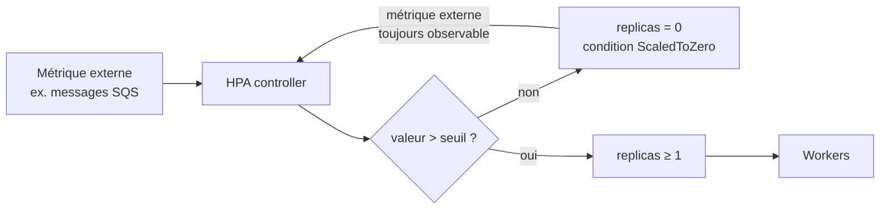
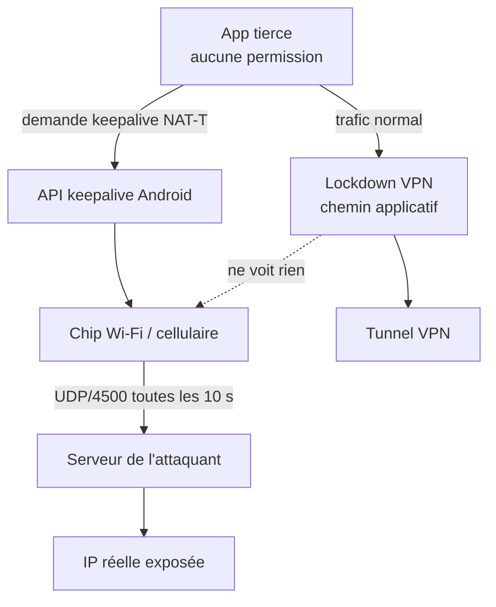
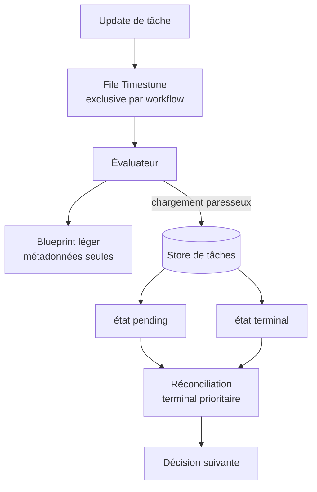

# Tech — Détail du samedi 12 septembre 2026

## 1. Kubernetes v1.37 « Garhwal » — le scale-to-zero HPA et le cache de watch résilient

**Source :** The New Stack — https://thenewstack.io/kubecon-kubernetes-updates-security/
**Date :** 11 septembre 2026

### Contexte

Kubernetes v1.37, nom de code **Garhwal**, contient **67 enhancements** : 16 passés stable, 23 en bêta, 27 en alpha, une dépréciation. Le chiffre qui dit le plus sur la release n'est pas celui-là, mais les **118 PR d'API review** — un record du projet, contre 88 en v1.36 et 41 en v1.21 il y a cinq ans.

Deux graduations méritent que tu changes quelque chose dans tes manifestes. La première résout un besoin pour lequel tout le monde installait KEDA : descendre un Deployment à **zéro pod** quand il n'y a plus rien à traiter. La seconde attaque un mode de panne bien connu des gros clusters : la tempête de récupération du control plane après un redémarrage.

### Comment ça marche

Le **scale-to-zero du HorizontalPodAutoscaler** passe en bêta et est **activé par défaut**. Le mécanisme est simple à énoncer : `minReplicas` accepte désormais la valeur `0`.

Le piège est ailleurs, et il est structurel. Cela ne fonctionne **que pour les métriques de type `object` ou `external`** — jamais pour CPU ni mémoire. La raison est logique : un Deployment à zéro pod ne produit aucune métrique CPU ou mémoire, donc rien ne pourrait jamais déclencher la remontée. Une métrique externe, elle, continue d'exister indépendamment des pods : la profondeur d'une file SQS, le lag d'un consumer group Kafka, le nombre de jobs en attente en base.

Le contrôleur expose une nouvelle condition de statut, `ScaledToZero`, avec le motif `ScaledToZero`, ce qui te donne un signal observable propre pour l'alerting.



Le second changement est invisible dans tes manifestes mais très visible en incident. **etcd RangeStream** et le **décodage concurrent des objets de watch** passent en bêta, tous deux activés par défaut. etcd streame désormais ses réponses par chunks au lieu de bufferiser en mémoire un gros ensemble de clés, et l'API server décode les événements de watch sur un **pool de goroutines** au lieu d'une seule séquence. Les bancs upstream sur **150 000 pods** mesurent un temps d'initialisation du cache **réduit de plus de 50 %**.

Deux autres items à noter. **KYAML passe stable** : c'est un dialecte strict de YAML qui élimine la sensibilité à l'indentation et le fameux « Norway Problem », où `NO` est interprété comme le booléen `false`. Tout fichier KYAML reste du YAML valide — aucune réécriture de manifeste. Et la condition **`Unused` sur les PersistentVolumeClaim** passe en bêta : le contrôleur marque les volumes dont plus aucun pod ne dépend, **sans jamais les supprimer**.

### En pratique — exemple de code

```yaml
# HPA à zéro pod — v1.37. Fonctionne car la métrique est externe (SQS),
# donc observable même quand plus aucun pod ne tourne.
apiVersion: autoscaling/v2
kind: HorizontalPodAutoscaler
metadata:
  name: queue-worker-hpa
spec:
  scaleTargetRef:
    apiVersion: apps/v1
    kind: Deployment
    name: queue-worker
  minReplicas: 0          # avant v1.37 : minimum 1, ou installer KEDA
  maxReplicas: 10
  metrics:
    - type: External
      external:
        metric:
          name: aws_sqs_approximate_number_of_messages_visible
        target:
          type: Value
          averageValue: 30
```

```bash
# Chasser les volumes orphelins grâce à la nouvelle condition Unused
kubectl get pvc -A -o custom-columns=\
'NAMESPACE:.metadata.namespace,\
NAME:.metadata.name,\
CAPACITY:.status.capacity.storage,\
UNUSED:.status.conditions[?(@.type=="Unused")].status,\
IDLE_SINCE:.status.conditions[?(@.type=="Unused")].lastTransitionTime'

# Sortie KYAML : plus de "NO" transformé en false
kubectl get deployment queue-worker -o kyaml
```

### Pourquoi ça compte pour toi

Si tu as installé KEDA uniquement pour descendre à zéro sur une file, tu peux probablement le retirer — vérifie d'abord que ta métrique est bien `external` ou `object`. Supprime aussi ton script de chasse aux PVC morts : la condition `Unused` fait le travail. Sur un gros cluster, RangeStream réduit les boucles d'OOM du control plane pendant une reprise. Rien à changer côté manifeste pour en profiter.

### Points de vigilance

`SELinuxMount` passe stable et activé par défaut pour les drivers CSI compatibles : le montage utilise un **contexte SELinux unique** au lieu d'un relabeling récursif. Conséquence sournoise — plusieurs pods aux labels SELinux différents partageant un même volume sur un même nœud peuvent **échouer au montage**. Audite tes volumes partagés avant l'upgrade, ou pose `seLinuxChangePolicy: Recursive` dans le `securityContext`.

---

## 2. Android — le keepalive NAT-T offloadé contourne le lockdown VPN

**Source :** Mullvad — https://mullvad.net/en/blog/another-way-to-leak-traffic-on-android-has-been-discovered
**Date :** 10 septembre 2026

### Contexte

Android propose un réglage présenté comme une garantie : « **Block all connections without VPN** ». L'idée est qu'aucun paquet ne quitte l'appareil en dehors du tunnel. Mullvad documente la quatrième manière connue de le contourner, découverte par le chercheur **Armin Šupuk**.

Le vecteur est un mécanisme parfaitement légitime. Pour maintenir vivantes les associations IPsec derrière un NAT, le système peut demander au **chip Wi-Fi ou cellulaire** d'émettre lui-même des paquets keepalive périodiques. On appelle ça la traversée de NAT, ou NAT-T. Le point clé est l'**offload** : c'est le matériel qui génère les paquets, pas la pile réseau applicative.

### Comment ça marche

Le raisonnement tient en une phrase : le lockdown VPN d'Android s'applique au chemin réseau **applicatif**. Les paquets générés par le chip réseau naissent **en dessous** de ce point de contrôle. Ils ne sont donc jamais soumis à la règle qui force tout le trafic dans le tunnel.

Une application ordinaire demande la création d'un keepalive UDP offloadé, en pointant **n'importe quel serveur sur Internet**, sur le port **4500**. L'appareil émet alors ces paquets sur l'interface physique, quel que soit l'état du VPN. Le serveur à l'autre bout observe l'**adresse IP réelle** du terminal et le timing des paquets.



Le PoC tourne sur un **Pixel 8 Pro sous Android 16**. Une capture faite sur un routeur externe montre des paquets **UDP/4500 toutes les 10 secondes** sortant par le Wi-Fi physique, alors que le client VPN et le lockdown Android sont actifs. Le mécanisme est également déclenchable sur des appareils Samsung et Nothing sous Android 16 ; le chercheur estime que la plupart des appareils Android 12 et ultérieurs sont concernés, sans les avoir tous testés.

Deux limites bornent la gravité. L'attaque **n'exfiltre pas de données arbitraires** : c'est Android qui contrôle le format du paquet keepalive. Le canal révèle une identité réseau, il ne transporte pas de charge utile. Et l'attaque nécessite qu'une app malveillante soit installée — mais **sans aucune permission spéciale**, ni root, ni permission classée dangereuse.

Le volet divulgation est le plus instructif. Signalé au **Android Vulnerability Reward Program le 15 mai**, le rapport a été marqué duplicate d'un ticket existant, puis clos sans action selon le chercheur. **Aucun CVE, aucun correctif** communiqué. Mullvad estime qu'un correctif propre exige des changements dans le système Android lui-même, et juge peu probable que Google agisse.

Mullvad refuse par ailleurs la mitigation évidente. Le matériel ne supporte qu'un nombre limité de keepalives simultanés ; une app VPN pourrait donc **épuiser les slots** pour bloquer les autres. Trois raisons de ne pas le faire : cela enverrait quand même des paquets hors tunnel, l'efficacité n'est pas garantie, et une app malveillante peut avoir créé son keepalive **avant** le démarrage du client VPN.

### En pratique — exemple de code

```bash
# Détection côté réseau : des UDP/4500 périodiques sortant de l'IP du terminal
# alors qu'un tunnel VPN est censé être exclusif = signal de fuite.
sudo tcpdump -i eth0 -n 'udp port 4500 and host 192.168.1.42'

# Repérer le motif périodique (~10 s) plutôt que le volume :
sudo tcpdump -i eth0 -n -tt 'udp port 4500' | awk '{print $1, $3, $5}'
```

```bash
# Côté infra : ne pas se reposer sur le lockdown côté OS.
# Forcer le tunnel au niveau réseau, sur le routeur/gateway.
iptables -A FORWARD -i wlan-guest ! -o wg0 -j DROP
iptables -A FORWARD -i wlan-guest -p udp --dport 4500 ! -o wg0 -j DROP
```

### Pourquoi ça compte pour toi

Le lockdown VPN d'Android n'est pas une frontière de sécurité. Traite-le comme du best-effort. Si tu conçois du BYOD ou du MDM, l'enforcement doit remonter au **niveau réseau** — un routeur qui impose le tunnel — ou reposer sur un OS durci. Ajoute ce vecteur à ton analyse de risque supply-chain mobile : une app sans permission peut désanonymiser un terminal.

### Limites

Le papier technique du chercheur n'a pas pu être consulté pour cette analyse. Le nom exact de l'API Android concernée et la structure du paquet n'y sont donc pas repris — le billet Mullvad ne cite aucune classe ni identifiant d'API. Le seul correctif annoncé vient de GrapheneOS, qui traite le sujet mais le place derrière d'autres classes de fuites VPN.

---

## 3. Netflix Conductor 4.0 — décider sans charger l'état complet

**Source :** InfoQ — https://www.infoq.com/news/2026/09/netflix-conductor-4-workflow/
**Date :** 11 septembre 2026

### Contexte

Conductor est l'orchestrateur de workflows de Netflix : environ **200 000 définitions** réparties sur **150 applications**, pour **420 millions d'exécutions par mois**. Content and Studio Engineering, Ads et Games en dépendent.

L'histoire de son architecture est une suite de goulots déplacés. Les données d'exécution sont passées de Dynomite à Cassandra. Les gros inputs et outputs de tâches ont été déportés vers **S3**, ne laissant que des références dans le store. Les files DynoQueues ont cédé la place à **Timestone**. Kafka a été introduit pour découpler l'indexation du chemin d'exécution, avec Elasticsearch pour l'index et Apache Iceberg pour le stockage long terme.

Il restait un goulot que ces migrations n'adressaient pas : **l'évaluation du workflow elle-même**.

### Comment ça marche

Le défaut de conception est ancien et bien documenté dans les issues du projet. À chaque évaluation, le moteur **chargeait l'état complet du workflow en mémoire**. La pression mémoire croissait donc avec la taille du workflow, pas avec la complexité de la décision à prendre. Une discussion de 2022 rapporte 55 745 workflows et 310 000 tâches poussant le heap JVM à 5 Go. Une autre décrit un workflow de 1,7 Mo, 5 000 entrées de tâche, dont le simple stockage de définition prenait près de deux minutes.

Conductor 4.0 sépare les **métadonnées de workflow** des **données de tâche et données utilisateur**. Les tâches sont stockées indépendamment. L'évaluateur travaille alors sur un **blueprint léger** et ne charge que les données de tâche nécessaires à la prochaine décision. Le résultat : de ~2 500 à **30 000 tâches** par workflow, et une latence p99 d'évaluation en baisse d'environ **40 %**.

Le second changement est plus subtil et plus réutilisable. Le locking disparaît de la coordination d'état des tâches. Au lieu de verrouiller, les états **pending** et **terminal** sont **stockés séparément**, puis **réconciliés dans la couche applicative avec priorité à l'état terminal**. Ça marche parce qu'un état terminal est monotone et idempotent : il ne redevient jamais pending, donc l'ordre d'arrivée n'a pas d'importance. Les échecs d'acquisition de lock, qui atteignaient ~2 700 par intervalle en contention, sont tombés à pratiquement zéro.

Enfin, l'évaluation sort du chemin de requête synchrone. Les mises à jour sont déposées dans des **files Timestone exclusives**, traitées séquentiellement en asynchrone. C'est du partitionnement d'écriture par clé, pas du verrouillage distribué.



### En pratique — exemple de code

```csharp
// Le pattern anti-lock, transposé en C#. Pending et terminal vivent dans
// deux partitions distinctes ; on ne verrouille jamais, on réconcilie.
public sealed record TaskState(string TaskId, TaskStatus Status, DateTimeOffset At);

public static TaskState Reconcile(TaskState? pending, TaskState? terminal)
    // Un état terminal est monotone : il ne redevient jamais pending.
    // L'ordre d'arrivée n'a donc aucune importance -> pas d'exclusion mutuelle.
    => terminal ?? pending
       ?? throw new InvalidOperationException("Aucun état pour cette tâche.");

// Écritures concurrentes sans verrou : chaque producteur écrit dans SA partition.
await Task.WhenAll(
    pendingStore.UpsertAsync(new TaskState(id, TaskStatus.Running, now), ct),
    terminalStore.UpsertIfAbsentAsync(new TaskState(id, TaskStatus.Completed, now), ct));
```

```sql
-- Version PostgreSQL du même principe : plus de SELECT ... FOR UPDATE.
-- L'état terminal est écrit une seule fois, les pending s'écrasent librement.
INSERT INTO task_terminal (task_id, status, at)
VALUES ($1, $2, now())
ON CONFLICT (task_id) DO NOTHING;   -- premier terminal gagne, idempotent

SELECT COALESCE(t.status, p.status) AS status
FROM task_pending p
FULL JOIN task_terminal t USING (task_id)
WHERE COALESCE(p.task_id, t.task_id) = $1;
```

### Pourquoi ça compte pour toi

Deux patterns à voler, indépendamment de Conductor. Ne charge jamais l'état complet d'un agrégat pour prendre une décision incrémentale : sépare blueprint immuable et données d'instance chargées à la demande. Et quand un état est monotone, remplace le verrou par deux partitions et une règle de réconciliation. C'est directement applicable à tes machines à états en PostgreSQL.

### Points de vigilance

Ne bâtis rien sur Conductor OSS. Netflix a **arrêté la maintenance du dépôt public en décembre 2023** au profit d'un fork interne, et tout ce qui est décrit ici concerne ce fork — rien n'indique que la 4.0 sera publiée. Les modules communautaires vivent dans un dépôt séparé. Pour un besoin réel, regarde les forks maintenus ou un autre orchestrateur.
