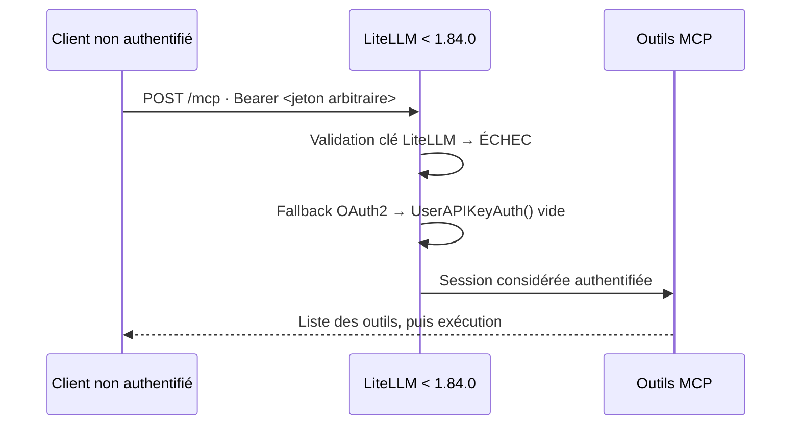
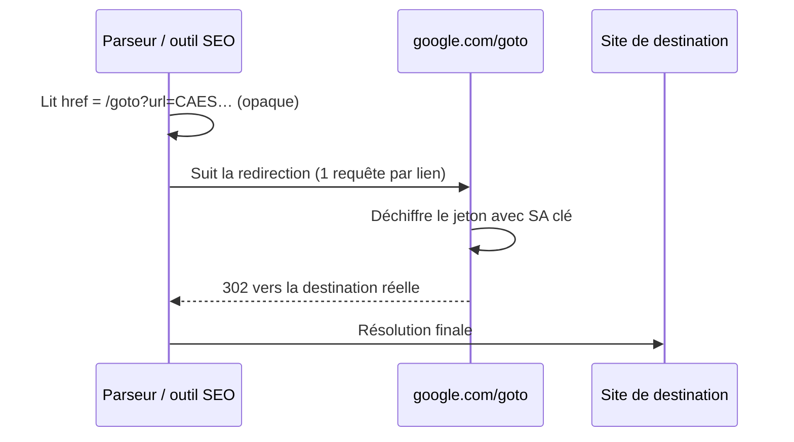
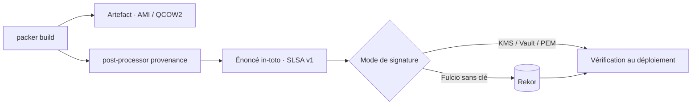

# Tech — Détail du dimanche 13 septembre 2026

## 1. CVE-2026-59822 (LiteLLM) — quand l'échec d'authentification produit un utilisateur valide

**Source :** GitLab Advisory Database — https://advisories.gitlab.com/pypi/litellm/CVE-2026-59822/
**Date :** septembre 2026

### Contexte

**LiteLLM** est une passerelle qui unifie l'accès à des dizaines de fournisseurs de LLM derrière une API compatible OpenAI. Comme beaucoup de passerelles en 2026, elle expose aussi un endpoint **MCP** (Model Context Protocol) en transport Streamable HTTP, pour que des agents puissent découvrir et appeler des outils via un point d'entrée unique.

Cet endpoint supporte un mécanisme de **passthrough OAuth2** : quand la passerelle relaie vers un serveur MCP en amont qui gère sa propre authentification, le jeton du client est transmis tel quel. C'est dans le chemin de repli de ce mécanisme que la faille se loge. La CISA a ajouté **CVE-2026-59822** à son catalogue KEV — c'est, à notre connaissance, **la première faille spécifiquement MCP** à y entrer.

### Comment ça marche

La logique fautive tient en une confusion classique entre *« la validation a échoué »* et *« il n'y a rien à valider »*.

Le handler d'authentification MCP valide d'abord le `Authorization: Bearer …` comme clé LiteLLM. Si cette validation échoue, le code n'interrompt pas la requête : il bascule sur la branche passthrough OAuth2, en partant du principe que le jeton appartient au serveur amont et sera vérifié plus loin. Pour poursuivre, il a besoin d'un contexte d'identité — et il en fabrique un **vide**, `UserAPIKeyAuth()`, au lieu de rejeter.

Ce contexte vide se propage ensuite comme s'il représentait un appelant authentifié. La requête atteint l'outillage MCP : énumération des outils configurés, puis appel. Et un outil MCP, par construction, est un pont vers un système réel — base de données, API interne, système de fichiers, service tiers. L'attaquant n'a pas besoin de deviner une clé valide : **n'importe quelle chaîne dans le header suffit**, parce que c'est justement son invalidité qui déclenche le repli.



L'ampleur vient de l'exposition. Un relevé FOFA cité publiquement dénombre **plus de 80 600 surfaces LiteLLM accessibles depuis Internet**. Beaucoup sont des déploiements internes qu'on a « juste exposés le temps d'un test ». Le score est coté **CVSS 8,8** sur la plupart des bases, **8,2** sur certains trackers.

### En pratique — exemple de code

```python
# Avant — le repli transforme un échec de validation en identité vide (schématisé)
auth = validate_litellm_key(bearer)
if auth is None and oauth2_passthrough_enabled:
    auth = UserAPIKeyAuth()          # <-- aucun appelant réel derrière cet objet
return auth                          # la session MCP démarre

# Après — le repli n'est ouvert que si le jeton est REELLEMENT destiné à l'amont
auth = validate_litellm_key(bearer)
if auth is None:
    if not (oauth2_passthrough_enabled and is_upstream_audience(bearer)):
        raise HTTPException(401, "invalid credentials")
    auth = verify_upstream_token(bearer)   # vérification, pas fabrication
return auth
```

```bash
# Vérifier ta version, puis corriger
pip show litellm | grep -i version
pip install -U 'litellm>=1.84.0'
# Et pendant que tu y es : l'endpoint /mcp n'a rien à faire sur une IP publique.
```

### Pourquoi ça compte pour toi

Si tu exposes une passerelle LLM, monte en **1.84.0** aujourd'hui et sors l'endpoint MCP d'Internet. Retiens surtout le patron de bug, qui n'a rien de spécifique à LiteLLM : ne fabrique jamais un objet d'identité pour « continuer » après un échec d'authentification. En C#, c'est exactement le `new ClaimsPrincipal()` vide qui sort d'un `catch`. Échec d'auth signifie 401, pas identité anonyme implicite.

### Points de vigilance

- Un outil MCP est une **capacité**, pas une lecture. Compromettre la session, c'est atteindre tout ce que la passerelle sait appeler.
- Vérifie les journaux d'appels d'outils sur la fenêtre antérieure au correctif, pas seulement les journaux d'authentification : un contexte vide ne laisse pas de trace côté auth.

---

## 2. `google.com/goto` — quand la destination d'un lien devient un secret chiffré

**Source :** Search Engine Land — https://searchengineland.com/google-confirms-deploying-goto-url-redirects-to-search-results-links-485926
**Date :** fin août – septembre 2026

### Contexte

Depuis quinze ans, un résultat Google contenait un `href` lisible pointant vers le site de destination. C'est sur cette hypothèse qu'est bâtie toute une industrie : suivi de positions, reporting SEO, analyses concurrentielles, et plus récemment l'alimentation de moteurs de réponse IA.

Fin août 2026, Google a réécrit **tous** les liens de résultats organiques. Chacun passe désormais par `google.com/goto`, une redirection côté serveur. Le test avait commencé en juillet ; fin août, Derek Perkins (Nozzle) constatait un déploiement proche de **100 %** sur les fournisseurs d'IP résidentielles. Google assume la mesure comme une protection technique contre l'abus de ses résultats.

### Comment ça marche

Le paramètre ressemble à `?url=CAES…`. Ce n'est pas une URL encodée en base64 qu'un `atob()` suffirait à ouvrir. C'est un **blob Protocol Buffers chiffré avec Tink**, la bibliothèque cryptographique de Google. Le préfixe `CAES` est simplement le début de l'enveloppe protobuf sérialisée.

La distinction est capitale. Un encodage — base64, URL-encoding, protobuf nu — est **réversible par n'importe qui** : il ne protège rien, il transporte. Un chiffrement authentifié exige une **clé**. Ici la clé appartient à Google. Aucun outil local, aucune bibliothèque, aucune reverse-ingénierie du format protobuf ne permet de retrouver la destination : l'information n'est pas obfusquée, elle est absente du document.



La seule voie restante pour obtenir la destination est donc de **suivre la redirection** — une requête réseau supplémentaire par résultat, côté Google, précisément sur le chemin qu'il instrumente. C'est le cœur du dispositif : le coût de la résolution est déplacé de ton parseur vers un point que Google contrôle, observe et peut limiter. L'URL affichée sous le titre du résultat reste visible, mais elle est tronquée et ne fournit pas le chemin complet. **SerpApi** a annoncé le 5 septembre avoir déployé un correctif restituant les adresses réelles dans son API.

### En pratique — exemple de code

```python
# AVANT — le href portait la destination : parsing local, zéro requête réseau
from urllib.parse import urlparse
from bs4 import BeautifulSoup

soup = BeautifulSoup(html, "html.parser")
for a in soup.select("a[href^='http']"):
    domaine = urlparse(a["href"]).netloc          # 'exemple.fr' directement

# APRÈS — le href est un wrapper Google ; le jeton CAES… est chiffré, pas encodé
for a in soup.select("a[href*='/goto?']"):
    print(a["href"])          # https://www.google.com/goto?url=CAES...
    # base64/protobuf n'aident pas : la clé de déchiffrement est côté Google.
    # Seule option : résoudre la redirection, donc une requête par lien.
```

### Pourquoi ça compte pour toi

Si un de tes outils lit des SERP — monitoring de marque, veille concurrentielle, reporting client — il est probablement cassé depuis fin août, et il l'a peut-être été en silence. Vérifie d'abord si ton fournisseur a livré un correctif, comme SerpApi. Et note le signal de fond : une donnée publiquement affichée peut devenir structurellement inaccessible sans que rien ne change à l'écran.

### Limites

- Le changement casse le parsing, pas l'affichage. Un contrôle visuel ne détectera rien.
- Suivre les redirections à grande échelle est exactement le comportement que la mesure vise à décourager. Ce n'est pas une stratégie durable.

---

## 3. HashiCorp Packer 1.16 — la provenance SLSA arrive au niveau de l'image machine

**Source :** InfoQ — https://www.infoq.com/news/2026/09/hashicorp-packer-verification/
**Date :** 8 septembre 2026

### Contexte

La supply chain logicielle a bien outillé la couche conteneur : `buildx` produit des attestations SLSA, GitHub signe ses artefacts, Sigstore et Rekor fournissent signature sans clé et journal de transparence. La couche **image machine** — AMI, QCOW2, VHD — était restée à l'écart.

Le problème est pourtant plus grave à ce niveau. Une image machine porte *toutes* les charges de travail qui tournent dessus. Si elle est altérée ou invérifiable, la compromission se propage silencieusement à chaque instance créée. Avant cette version, retrouver l'origine d'une image imposait de fouiller de vieux logs de build : Packer n'avait aucun moyen de dire quel commit, quel pipeline, quelle identité avait produit un artefact donné.

### Comment ça marche

Packer 1.16.0 ajoute un post-processor **`provenance`**. Il produit un **énoncé in-toto** portant un prédicat **SLSA Provenance v1** — un format neutre, déjà compris par l'outillage supply chain existant.

L'attestation capture le commit Git, le dépôt, la ref, le pipeline CI déclenchant et les horodatages de build. Le liage à l'artefact diffère selon sa nature : un artefact **local** est lié à son empreinte **SHA-256** ; un artefact **cloud** sans fichier local — une AMI, typiquement — est lié à un enregistrement d'identité canonique contenant les identifiants du builder et de l'artefact.

Quatre modes de signature couvrent les besoins de gestion de clés : JSON non signé pour un usage interne, clé **PEM locale** pour un environnement isolé, **KMS cloud ou Vault** pour une gestion centralisée, et **Sigstore Fulcio** pour la signature sans clé en CI, avec publication optionnelle dans **Rekor**.



Le mapping sur l'échelle SLSA est direct. **L1** ne demande que le post-processor, signature optionnelle. **L2** s'atteint en exécutant Packer sur une plateforme CI avec signature sans clé : l'identité OIDC du job CI sert de signataire, et la publication Rekor fournit le journal auditable. Un patron **compatible L3** sépare complètement la génération de provenance du job de build, via un job de signature distinct fondé sur `slsa-framework/slsa-github-generator`. HashiCorp précise honnêtement que ce workflow **ne garantit pas à lui seul** la conformité L3 : celle-ci dépend aussi du durcissement de la plateforme et de l'isolation du build.

### En pratique — exemple de code

```hcl
# Ajout opt-in : les templates existants construisent sans modification sous 1.16.0.
build {
  sources = ["source.amazon-ebs.base"]

  post-processor "provenance" {
    # Signature sans clé : l'identité OIDC du job CI devient le signataire (SLSA L2)
    signing_mode = "sigstore"
    rekor_upload = true              # journal de transparence, auditable ensuite

    # Alternative pour un environnement isolé :
    # signing_mode = "pem"
    # private_key_path = "/run/secrets/provenance.pem"
  }
}

# Nouveautés HCL2 de la 1.16 utiles au quotidien
variable "tags" {
  type    = object({ env = string, owner = optional(string, "platform") })
  default = { env = "prod" }
}
```

### Pourquoi ça compte pour toi

Si tu construis des AMI ou des images de VM en CI, tu peux désormais répondre à « quel commit a produit cette instance ? » sans archéologie de logs. Branche le post-processor, puis transforme la vérification en **gate de déploiement** : une image sans attestation valide ne part pas. C'est aussi la pièce qui te permet de corréler une CVE à un commit et aux instances qui tournent encore dessus.

### Pour aller plus loin

Les offres AWS existantes résolvent des problèmes **adjacents, pas identiques**. Les *AMI Watermarks* tracent identité et lignage, sans garantie cryptographique de provenance de build. L'attestation par **NitroTPM** prouve qu'une instance en cours d'exécution correspond à une mesure de référence au boot, sans rien dire de l'endroit où l'image a été construite. Les deux se complètent : provenance de build d'un côté, intégrité au démarrage de l'autre.
