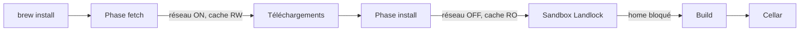
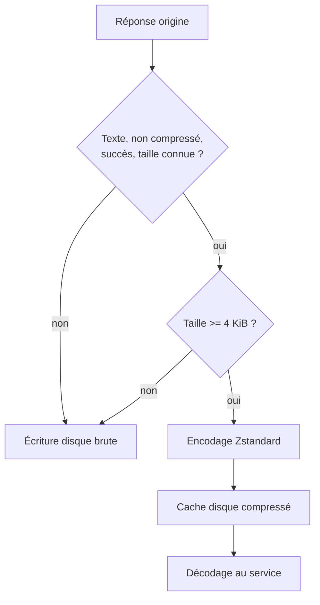
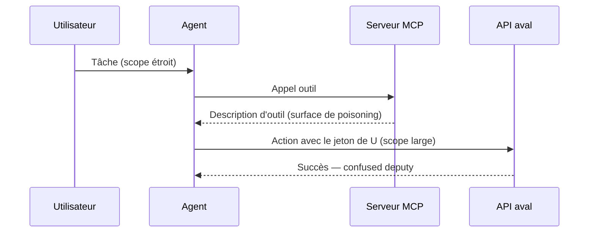

# Tech — Détail du lundi 14 septembre 2026

## 1. Homebrew 7.0.0 — Landlock, phase `fetch` sans réseau à l'install, et `brew vulns`

**Source :** Homebrew — https://brew.sh/2026/09/13/homebrew-7.0.0/
**Date :** 13 septembre 2026

### Contexte

Homebrew 6.0.0, en juin, avait introduit un bac à sable basé sur Bubblewrap côté Linux. L'idée était bonne, la mise en œuvre pénible : Bubblewrap est une dépendance externe et réclame des permissions élevées dans Docker, ce qui cassait des installations en CI. La 7.0.0, publiée le 13 septembre, corrige ce choix et va plus loin sur le modèle d'exécution.

Le contexte plus large est celui d'un gestionnaire de paquets qui exécute historiquement du Ruby arbitraire fourni par un tap tiers, avec ton compte utilisateur. Tant que la formule pouvait faire n'importe quoi, aucune restriction n'était réellement applicable. Le chantier de la 7.0.0 consiste à remplacer ce Ruby arbitraire par des données structurées et signées.

### Comment ça marche

**Le bac à sable Linux passe à Landlock.** C'est un mécanisme du noyau, activable sans privilège par un processus qui souhaite se restreindre lui-même. Pas de dépendance à installer, pas de `--privileged` dans Docker. Homebrew supporte l'ABI 2 dès Linux 6.1 et prévient quand le noyau ne peut pas appliquer les restrictions réseau. Sur un noyau sans Landlock, tout continue de fonctionner dans la configuration moins sûre d'avant la 6.0.0, et `brew doctor` remonte l'absence de protection.

**La séparation `fetch` / `install` est le point le plus intéressant.** Le principe : un build n'a aucune raison d'accéder au réseau. Homebrew migre donc progressivement les téléchargements de dépendances dans une phase `fetch` dédiée, qui dispose du réseau et d'un cache accessible en écriture. Puis `install` s'exécute **réseau coupé, cache en lecture seule**. Un build qui tente de récupérer une dépendance en douce échoue au lieu de réussir silencieusement. La migration est en cours, formule par formule.

Deux verrous complètent le tableau. La lecture du répertoire personnel est bloquée par défaut dans le bac à sable : tes fichiers personnels sortent du périmètre des builds, seuls les chemins Homebrew nécessaires restent lisibles. Et Homebrew rejette désormais les configurations où l'UID réel diffère de l'UID effectif — les wrappers setuid ne sont plus supportés.

**Côté vulnérabilités**, Homebrew publie une **advisory database** au format OSV, sous licence CC0, qui enregistre les failles contre les versions et révisions **réellement distribuées par Homebrew**, correctifs rétroportés inclus. C'est la nuance qui compte : un scanner générique voit la version amont, pas le patch que Homebrew a appliqué. La commande `brew vulns` est intégrée, s'appuie sur OSV.dev, et n'exige ni tap ni gem supplémentaire.



### En pratique — exemple de code

Trois commandes à passer après la mise à jour : vérifier que le bac à sable est actif, auditer l'existant, et repérer ce qui casse.

```bash
# 1. Landlock est-il réellement appliqué sur cette machine ?
brew config | grep -i landlock
# Absent ou ABI 0 -> noyau trop ancien, aucune restriction. brew doctor le signale.

# 2. Audit des vulnérabilités connues, priorisé sur ce qui est corrigeable
brew vulns --severity=high --fix-available
brew vulns --deps            # inclut les dépendances transitives
brew vulns --brewfile        # audite un Brewfile avant de le déployer
brew vulns --list-skipped    # taps non fiables : angles morts du scan

# 3. Ce qui a disparu aujourd'hui et qu'il faut corriger dans ta CI
#    ghcr.io/homebrew/ubuntu22.04   -> ghcr.io/homebrew/brew
#    Homebrew/actions/*@master      -> une release CalVer ou un SHA complet
brew doctor --json | jq '.[] | select(.type=="Warning")'
```

### Pourquoi ça compte pour toi

Si ta CI tire des outils via Homebrew, deux choses cassent aujourd'hui : l'image `ubuntu22.04` a été retirée et `Homebrew/actions/*@master` a disparu sans redirection. Corrige les deux avant ton prochain build. Ensuite, branche `brew vulns --brewfile` dans ton pipeline : c'est le seul scanner qui connaisse les rétroportages propres à Homebrew, là où un audit générique te noiera en faux positifs.

### Points de vigilance

Le calendrier de dépréciation est chargé. `post_install` des formules et les blocs `*flight` des casks sont dépréciés jusqu'au **11 décembre 2027**, à migrer vers les `*_steps` déclaratifs — `brew style --fix` convertit les cas courants, le reste est manuel. Intel macOS tourne encore jusqu'au **1er septembre 2027**, sans bottles ni support ; Homebrew renvoie explicitement vers MacPorts. Et le bac à sable ne rend pas sûr un logiciel non fiable : les applications s'exécutent avec tes privilèges, et les installeurs `.pkg` des éditeurs tournent hors bac à sable.

---

## 2. Cloudflare Cache Transcoding — Zstandard avant l'écriture disque, facteur 2,8 sur le texte

**Source :** InfoQ — https://www.infoq.com/news/2026/09/cloudflare-cache-transcoding/
**Date :** 13 septembre 2026

### Contexte

Un CDN a deux ressources rares : le disque dans chaque point de présence, et la bande passante entre points de présence. Cloudflare décrit un prototype baptisé **Cache Transcoding** qui attaque les deux avec une seule idée, expliquée sur [le blog Cloudflare](https://blog.cloudflare.com/cache-transcoding/) : une part significative de ce qui entre en cache est du texte qui arrive **non compressé**.

Le constat chiffré est net. Le texte compressible — HTML, JSON, CSS, JavaScript — représente 67,3 % des requêtes mais seulement 22,3 % des octets. Et environ 71 % de ce contenu arrive sans compression. À l'inverse, images, vidéo et polices pèsent 21,4 % des requêtes pour 63,3 % des octets, et sont déjà compressés : les recompresser brûlerait du CPU pour rien.

### Comment ça marche

Le mécanisme est asymétrique, et c'est tout l'intérêt. Le contenu éligible est compressé en **Zstandard** une seule fois, au moment où il entre en cache. Il est décompressé à chaque service. Le coût d'encodage — le plus cher des deux — est donc amorti sur toutes les réutilisations de l'objet, tandis que les gains de stockage et de bande passante inter-datacenters se répètent à chaque hit.

L'éligibilité est délibérément étroite. Une réponse est transcodée si elle est du texte compressible, non déjà compressée, retournée en succès, de taille connue, et d'au moins **4 KiB**. Sont exclus les requêtes par plage, le contenu pré-compressé ou binaire, et les réponses de taille inconnue. Le seuil de 4 KiB est un arbitrage assumé : il évite de traiter une myriade de petits objets pour lesquels le surcoût d'encodage n'est pas rentable, en ne sacrifiant qu'environ 1 % des données éligibles.

L'implémentation s'appuie sur **Pingora**, le framework de proxy Rust de Cloudflare. Le seuil de taille comme le niveau de compression Zstandard sont ajustables selon l'arbitrage CPU / stockage retenu. Sur le contenu éligible, la réduction mesurée est d'environ **2,8×**.

Deux questions restent ouvertes, soulevées dans les discussions publiques. Les requêtes par plage : sans compression, servir un intervalle revient à lire la portion correspondante du fichier en cache ; avec compression, ce n'est plus vrai — d'où leur exclusion. Et le choix de cibler le contenu populaire plutôt que le contenu froid, puisque c'est le décodage répété qui consomme du CPU.



### En pratique — exemple de code

Avant de conclure quoi que ce soit sur ton propre trafic, mesure. Ce script compare gzip et Zstandard sur tes assets réels et applique le seuil des 4 KiB.

```bash
#!/usr/bin/env bash
# Ratio de compression réel sur tes assets texte, seuil 4 KiB inclus
set -euo pipefail
DIR="${1:-./dist}"

find "$DIR" -type f \( -name '*.html' -o -name '*.json' -o -name '*.css' -o -name '*.js' \) \
  -size +4k -print0 |
while IFS= read -r -d '' f; do
  raw=$(stat -c%s "$f")
  # -19 : niveau élevé, cohérent avec un encodage payé une seule fois
  zst=$(zstd -19 -c "$f" 2>/dev/null | wc -c)
  gz=$(gzip -9 -c "$f" | wc -c)
  printf '%-45s brut=%7d  zstd=%7d (x%.1f)  gzip=%7d\n' \
    "$(basename "$f")" "$raw" "$zst" "$(echo "$raw/$zst" | bc -l)" "$gz"
done
```

### Pourquoi ça compte pour toi

La leçon transposable n'est pas « compresse tout ». C'est : identifie où la compression est **amortie**. Un cache Redis de réponses JSON, un cache applicatif en mémoire, une table PostgreSQL d'archives — tu écris une fois et tu lis mille fois. Zstandard y gagne massivement sur gzip à niveau élevé. À l'inverse, ne recompresse jamais ce qui l'est déjà : tu paies le CPU sans rien gagner.

### Limites

C'est un prototype. Cloudflare annonce d'autres tests à venir sur différents niveaux de compression, types de contenu, tailles d'objet et scénarios de cache — y compris avec et sans Tiered Cache. Rien n'indique une généralisation à date.

---

## 3. MCP — l'identité des agents, le vrai angle mort du modèle de permissions

**Source :** The New Stack — https://thenewstack.io/mcp-security-permissions-overhaul/
**Date :** 12 septembre 2026

### Contexte

MCP est passé en production fin 2024, s'est répandu très vite, a été adopté par Microsoft, Google et OpenAI, et sa maintenance est aujourd'hui assurée par la Linux Foundation. Le protocole s'est installé comme infrastructure critique entre un agent et les outils qu'il manipule. La plupart des équipes l'ont déployé comme n'importe quel autre standard d'intégration : installation, confiance dans les valeurs par défaut.

L'article d'ingénieurs sécurité de Webflow défend une thèse précise : le problème de 2026 n'est pas dans l'infrastructure MCP, il est dans la couche de permissions **en dessous**. Et cette distinction change tout, parce qu'un correctif règle un problème sur un serveur donné, alors qu'un changement de permissions oblige à poser une question autrement plus inconfortable.

### Comment ça marche

Les chercheurs regroupent les incidents sous deux motifs.

Le **tool poisoning** : la description d'un outil, fournie par le serveur MCP lui-même, embarque des instructions cachées que le modèle lit comme des consignes. La surface d'attaque est le texte de métadonnées, pas le code.

Le **confused deputy** : l'agent hérite de plus de confiance que la tâche devant lui n'en exige. Il agit comme délégué d'un utilisateur, avec les droits de cet utilisateur, sur une requête dont l'origine n'est pas nécessairement cet utilisateur.

La racine est une question d'identité. Aujourd'hui, un agent n'a pas d'identité propre : il hérite du périmètre, du rayon d'explosion et souvent du credential littéral de celui qui l'a lancé. L'article résume la situation d'une formule qui a circulé : « a human's OAuth token wearing a trenchcoat ». C'est tolérable tant que les agents sont éphémères — une tâche démarre, l'agent tourne, il meurt. Ça ne l'est plus quand ils vivent des semaines ou des mois, et une entité qui vit aussi longtemps a besoin de droits qui **se resserrent** avec la durée, pas l'inverse.

OAuth n'a pas été conçu pour ça, et le décalage est structurel plutôt que fonctionnel. Son modèle suppose un humain devant une boîte de dialogue de scopes, qui fait un choix éclairé — en pratique, personne ne lit la liste et tout le monde clique « autoriser ». L'hypothèse s'effondre complètement quand il n'y a plus personne pour lire. La spécification de base n'a aucune notion de « ce client est un agent » ni de « cette autorisation va courir six mois ». Des brouillons IETF commencent à esquisser une réponse — lier la durée de vie du jeton au cycle de vie réel de la tâche, doter les agents d'identités stables distinctes de l'humain qui les invoque — mais ce sont des propositions, pas des standards déployés.

Cinq questions à poser avant d'intégrer un serveur MCP : ce credential atteint quoi **aujourd'hui**, et non pour quel usage il avait été provisionné ? L'autorisation est-elle granulaire par site, dépôt ou espace de travail, ou bien tout-ou-rien ? L'agent hérite-t-il des droits de la personne, ou se crée-t-il des credentials qui contournent ces droits ? Les logs attribuent-ils les actions de l'agent comme ils le feraient pour un humain ? Les changements de l'agent partent-ils directement en production, ou passent-ils par un brouillon et une file d'approbation ?



### En pratique — exemple de code

Le levier concret est la granularité au moment du branchement. Compare deux configurations du même serveur MCP.

```jsonc
// Avant — un PAT d'organisation, permanent, tous droits
{
  "mcpServers": {
    "repo": {
      "command": "npx", "args": ["-y", "@acme/repo-mcp"],
      "env": { "TOKEN": "ghp_orgwide_permanent_token" }
      // L'agent atteint tous les dépôts, écrit partout, pour toujours.
    }
  }
}

// Après — jeton à portée unique, durée bornée, écriture via PR
{
  "mcpServers": {
    "repo": {
      "command": "npx", "args": ["-y", "@acme/repo-mcp"],
      "env": {
        "TOKEN_CMD": "acme-auth mint --repo acme/veille --ttl 15m --scope contents:read,pull_request:write",
        "REQUIRE_REVIEW": "true"   // pas de push direct : branche + file d'approbation
      }
    }
  }
}
```

### Pourquoi ça compte pour toi

La question à te poser n'est pas « ai-je autorisé cet accès ? » mais « cet accès est-il encore justifié aujourd'hui ? ». Si un serveur MCP ne te laisse pas choisir la portée au moment du branchement, ce n'est pas un détail de configuration, c'est le constat d'audit. Applique aux agents la discipline que tu appliques déjà aux humains : périmètre minimal, jeton court, écriture par branche et revue, logs attribuables.

### Limites

L'article est une prise de position d'équipe sécurité, pas une étude. Ses auteurs reconnaissent explicitement ne pas avoir de réponse nette sur l'endroit où placer la frontière entre « tâche courte, accès large » et « agent long, verrouillé ».
