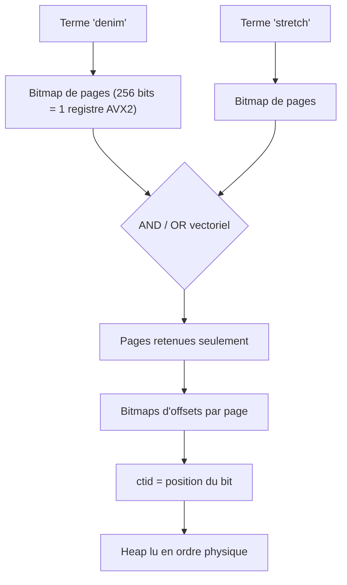
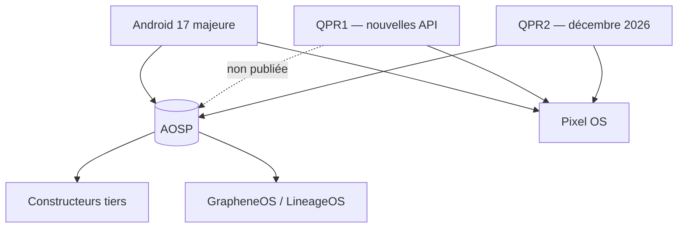

# Tech — Détail du dimanche 20 septembre 2026

## 1. TIN (PlanetScale) — la recherche plein texte Postgres bâtie sur le `ctid`

**Source :** PlanetScale Engineering — https://planetscale.com/blog/introducing-tin
**Date :** 16 septembre 2026

### Contexte

La recherche plein texte dans Postgres est un problème mal résolu depuis quinze ans. Le `GIN` natif sur `tsvector` fonctionne, mais s'effondre sur les disjonctions larges et n'offre pas de vrai BM25. ParadeDB embarque un moteur à la Lucene dans une extension. `pg_textsearch` ne gère que les disjonctions. Face à ces limites, la réponse la plus fréquente reste de sortir la recherche de la base : Elasticsearch ou Meilisearch à côté, avec un pipeline de synchronisation, un décalage de cohérence, et deux systèmes à opérer.

TIN — pour *Text INdex* — vise l'ensemble complet de ce qu'on attend : expressions booléennes, requêtes de phrase et de proximité, correspondance fuzzy, joker et expression régulière sur les termes, repliement de casse et d'accents, `COUNT(*)` exact et top-k scoré en BM25. Et tout cela **dans** Postgres : avec les jointures, les `WHERE` complexes mêlant colonnes texte et autres types, les écritures continues, la réplication, les sauvegardes et une visibilité transactionnelle correcte.

### Comment ça marche

Le choix d'architecture qui explique tous les chiffres tient en une ligne : **TIN utilise le `ctid` de Postgres comme identifiant de document**, au lieu d'attribuer des identifiants séquentiels par segment.

Comprenons pourquoi c'est décisif. Un index texte range ses identifiants de documents dans des listes de postings — une liste par terme, listant tous les documents qui le contiennent. La plupart des moteurs découpent l'index en **segments** et numérotent les documents de 1 à *n* dans chaque segment, parce que des identifiants contigus se compressent très bien (delta-encoding, bit-packing). Mais le document 42 du segment 4 n'est pas le document 42 du segment 7. Deux conséquences coûteuses : il faut une structure de correspondance vers le `ctid` que Postgres exige en retour d'index, et toute fusion de segments impose de **renuméroter** — donc de repacker, recompresser et réécrire l'intégralité des données fusionnées.

Le `ctid` est un entier 48 bits qui désigne physiquement un tuple : 32 bits de numéro de page, 16 bits d'offset dans la page. Postgres l'utilise partout — b-tree, GIN, GiST, hash, bitmap scans. Un index TIN qui renvoie directement des `ctid` n'a **rien à traduire**. Si une recherche touche dix millions de lignes, ParadeDB et `pg_textsearch` font dix millions de recherches dans leur table de correspondance ; TIN en fait zéro.

Restait à compresser des entiers 48 bits discontigus, ce que le delta-encoding gère mal (il casse à chaque frontière de page) et les bitmaps plats aussi (trop creux). La solution est un **bitmap à deux niveaux**, rendu possible par une propriété des pages Postgres : une page de 8 Ko ne peut pas contenir plus de 291 tuples, et avec des colonnes `TEXT` on tombe souvent à 32 ou moins. La liste des numéros de page est donc assez dense pour un bitmap, et dans chaque page la liste des offsets tient dans un tout petit bitmap. Résultat : les termes très fréquents approchent 1 bit par posting, les fréquences moyennes tournent autour de 7 bits, les termes rares approchent 25 bits.



De là découlent les optimisations réelles :

- Un bitmap de pages fait 256 bits et tient dans un registre AVX2 ; un bitmap d'offsets tient dans un registre AVX-512 ou deux AVX2. Conjonctions et disjonctions deviennent de simples instructions `AND` et `OR` vectorielles, sans boucles ni branchements.
- Pour `the AND rareword`, TIN intersecte d'abord les bitmaps de pages. Toute page absente de l'intersection voit son bitmap d'offsets **jamais décodé**.
- Pour un `COUNT(*)` en disjonction, les métadonnées stockent le compte exact de postings par terme. Si deux bitmaps de pages n'ont aucun bit commun, le compte de l'union est la somme des deux comptes : les listes de postings ne sont pas lues du tout.
- Le comptage utilise `POPCNT`, instruction native du CPU.
- Le `ctid` **est** la position du bit : aucune lecture disque pour le reconstituer.
- Les `ctid` renvoyés sont naturellement en ordre de heap, donc Postgres lit les tuples séquentiellement plutôt qu'aléatoirement — un gain gratuit même sur NVMe.

Reste la visibilité MVCC, souvent le talon d'Achille des index texte. TIN la traite à trois niveaux. Les requêtes qui renvoient des colonnes du heap sont vérifiées naturellement à la lecture du tuple. Les requêtes de comptage s'appuient sur la **visibility map** de Postgres, qui est elle aussi un bitmap par page : TIN l'intersecte directement avec ses bitmaps de pages, et seuls les `ctid` des pages non *all-visible* descendent jusqu'au heap. Enfin, un **bitmap de liveness** par segment, un bit par `ctid`, est mis à jour par `VACUUM` pour ne jamais renvoyer un tuple réellement supprimé.

### En pratique — exemple de code

```sql
-- Création de l'index et recherche : deux lignes, pas de sidecar
CREATE INDEX idx_products_description ON products USING tin(description);

-- Top 10 par score BM25 — conjonction implicite sur les mots
SELECT * FROM products
WHERE description ==> 'stretch denim jeans'
ORDER BY tin.score(ctid) DESC
LIMIT 10;
```

```sql
-- Disjonction explicite (crochets) : tout document contenant au moins un terme,
-- sans classement — typique d'un cas de découverte légale
SELECT * FROM emails
WHERE body ==> '[insider trading conspiracy]';

-- Phrase exacte (guillemets) et comptage exact :
-- répondu depuis l'index si les pages sont all-visible, sans toucher le heap
SELECT COUNT(*) FROM photos
WHERE tags ==> '"san francisco"';
```

```sql
-- Le ctid n'est pas magique : tu peux l'observer toi-même
SELECT ctid, id, title FROM books ORDER BY ctid LIMIT 10;  -- ordre physique du heap
SELECT * FROM books WHERE ctid = '(190, 17)';              -- lookup O(1), page 190 slot 17
```

Les chiffres, mesurés sur un corpus Stack Exchange de 85 Go et 150 M de documents, Postgres 18.6 dans un conteneur à 8 vCPU et 32 Go :

| Scénario (top-10) | TIN | ParadeDB | GIN natif |
|---|---|---|---|
| Mixte, lecture seule | 199 QPS / p99 256 ms | 7,9 QPS / p99 6 765 ms | échec (OOM) |
| Conjonction + phrase | 242 QPS / p99 212 ms | 24 QPS / p99 1 279 ms | 0,4 QPS / p99 288 s |
| Disjonction + 1 000 UPDATE/s | 125 QPS | 2,2 QPS | échec (OOM) |

Construction de l'index : 8 min 10 pour TIN (50,7 Go, 32 Go de RAM) contre 2 h 09 pour GIN (28,0 Go, 64 Go de RAM requis). Sur dix minutes d'écriture concurrente, TIN encaisse 270 279 updates là où `pg_textsearch` n'en passe que 735, ses écritures étant affamées par le trafic de lecture.

### Pourquoi ça compte pour toi

Si tu maintiens un Elasticsearch à côté de Postgres uniquement pour de la recherche plein texte, cette extension remet la question sur la table : un système de moins à opérer, et la cohérence transactionnelle gratuite. Surtout, retiens le principe d'ingénierie — épouser les structures de ton hôte plutôt que les recouvrir. C'est exactement le raisonnement à appliquer à tes propres couches d'abstraction sur la base.

### Points de vigilance

- TIN est **propriétaire et hébergé** : GA sur les bases Postgres et Neki de PlanetScale, pas installable sur ton instance. PlanetScale publie `lead`, une extension AGPL compatible TINQL mais volontairement lente, pour le développement, les tests et la CI.
- Les benchmarks sont produits par l'éditeur, sur un *benchmarker* ParadeDB forké. Le fork ajoute un pré-chauffage et des métriques d'E/S, ce qui est documenté mais reste à considérer.
- L'index pèse 50,7 Go pour un corpus de 85 Go, contre 28 Go pour GIN : la vitesse se paie en stockage.

---

## 2. Android 17 QPR1 — des API pour développeurs hors AOSP, une première depuis Honeycomb

**Source :** GrapheneOS (Mastodon) — https://grapheneos.social/@GrapheneOS/117282080803799576
**Date :** 18 septembre 2026

### Contexte

Le contrat implicite d'Android tient depuis quinze ans : Google développe en interne, puis publie le code dans l'Android Open Source Project. Les constructeurs et les forks — LineageOS, GrapheneOS, /e/OS — partent de cette base. Les API applicatives, en particulier, arrivent dans AOSP au moment de la release majeure, de sorte qu'une API documentée sur `developer.android.com` est implémentable par n'importe quelle distribution Android.

Ce contrat s'est effrité par étapes. Depuis Android 16, Google ne publie plus dans AOSP les releases **QPR1 et QPR3** — les mises à jour trimestrielles impaires — qui restent exclusives aux Pixel. Seules QPR2 et la release majeure alimentent AOSP. Jusqu'ici, la conséquence était limitée : les QPR non publiées contenaient des correctifs et des ajustements, pas de surface d'API nouvelle.

Android 17 QPR1 casse cette limite. GrapheneOS documente que c'est **la première release depuis Honeycomb (Android 3.x) à ajouter de nouvelles API pour développeurs d'applications sans publication dans AOSP**. Honeycomb, en 2011, était le cas de figure inverse : une version tablette volontairement gardée fermée par Google avant fusion dans Ice Cream Sandwich.

### Comment ça marche

Le mécanisme n'est pas une décision nouvelle : c'est l'interaction de deux règles existantes qui produit un effet inédit.

1. La règle de publication AOSP en vigueur depuis Android 16 : QPR1 et QPR3 ne sont pas publiées. Elles ne sont diffusées que sous forme binaire, sur Pixel OS.
2. La pratique historique : on n'ajoute pas d'API applicative dans une QPR.

Tant que la règle 2 tenait, la règle 1 était supportable pour l'écosystème. Android 17 QPR1 la rompt. Le résultat est une **fenêtre d'un trimestre** pendant laquelle une API est documentée, utilisable sur Pixel, et impossible à implémenter ailleurs — aucun autre constructeur ni fork ne peut la fournir, faute de source.



Google indique que ces API rejoindront AOSP et les autres constructeurs via **Android 17 QPR2, en décembre 2026**. La situation est donc temporaire, mais le précédent est posé : rien n'empêche que le prochain cycle fasse de même, et GrapheneOS soulève en parallèle la question des correctifs de sécurité soumis au même calendrier.

### En pratique — exemple de code

Concrètement, une API introduite en QPR1 impose de la traiter comme une capacité optionnelle et non comme un niveau d'API garanti.

```kotlin
// Mauvais réflexe : un simple test de SDK_INT ne suffit plus.
// L'appareil peut annoncer Android 17 sans avoir les API de QPR1.
if (Build.VERSION.SDK_INT >= 37) {
    NewQpr1Api.doSomething()   // NoSuchMethodError sur un Android 17 non-Pixel
}
```

```kotlin
// Bon réflexe : détection de capacité + repli explicite
private val hasQpr1Api: Boolean by lazy {
    runCatching {
        Class.forName("android.foo.NewQpr1Api").getMethod("doSomething")
    }.isSuccess
}

fun doWork() {
    if (hasQpr1Api) {
        NewQpr1Api.doSomething()          // Pixel OS sur QPR1
    } else {
        legacyFallback()                  // AOSP, OEM tiers, GrapheneOS jusqu'en QPR2
    }
}
```

```bash
# Vérifier sur un appareil ce qui est réellement présent, plutôt que de croire SDK_INT
adb shell getprop ro.build.version.sdk
adb shell getprop ro.build.version.incremental   # identifie le niveau de QPR
```

### Pourquoi ça compte pour toi

Même si tu ne fais pas d'Android, retiens le signal : la disponibilité d'une API dépend désormais de la **distribution**, pas seulement du numéro de version. Le même raisonnement s'applique à toute plateforme où tu cibles un niveau d'API — tester une capacité plutôt qu'un numéro de version est plus robuste. Et si une de tes applications mobiles vise des appareils non-Pixel, écarte les API de QPR1 jusqu'à décembre.

### Limites de cette lecture

- La formulation exacte compte : il ne s'agit pas d'une fermeture d'AOSP, mais d'un décalage de calendrier d'un trimestre pour un sous-ensemble d'API.
- L'information vient de GrapheneOS, partie prenante et critique de longue date de la politique de publication de Google. La chronologie est vérifiable ; l'intention prêtée à Google, non.
