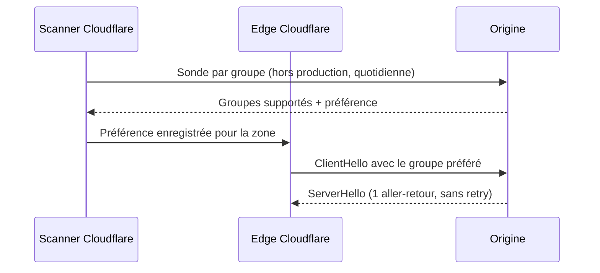
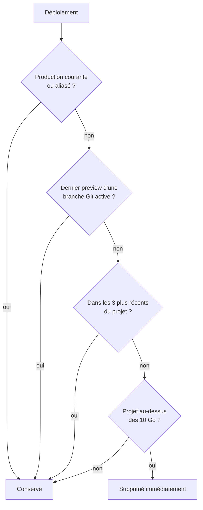

# Tech — Détail du lundi 21 septembre 2026

## 1. Cloudflare Automatic Key Exchange — sonder l'origine au lieu de deviner son algorithme

**Source :** InfoQ — https://www.infoq.com/news/2026/09/cloudflare-automatic-key-exchang/
**Date :** 20 septembre 2026

### Contexte

TLS 1.3 a supprimé un aller-retour par rapport à TLS 1.2, mais au prix d'un pari. Le client doit s'engager sur un algorithme d'accord de clés dès son premier paquet, avant que le serveur n'ait dit quoi que ce soit. Si le pari est bon, la poignée de main tient en un aller-retour. Sinon, le serveur répond par un `HelloRetryRequest`, le client renvoie un second `ClientHello`, et la connexion en coûte deux.

Cloudflare pariait X25519 pour chaque origine de l'internet. Le raisonnement tenait : plus de 95 % des origines le supportent. La mesure a montré autre chose. Ce pari était sous-optimal pour environ 30 % des connexions vers les origines. Plus de 6 % des origines préfèrent P-256 ou P-384, et payaient donc un aller-retour supplémentaire pour des raisons purement classiques.

Le sujet se double d'un enjeu post-quantique. Cloudflare vise 2029, année qu'elle appelle Q-Day, et les attaques « harvest now, decrypt later » où le trafic enregistré aujourd'hui est déchiffré plus tard.

### Comment ça marche

Automatic Key Exchange étend Automatic SSL/TLS. Le principe est simple : mesurer plutôt que supposer.

Le système sonde chaque origine, un groupe d'accord de clés à la fois, pour apprendre ce qu'elle supporte et ce qu'elle préfère. Ces sondes tournent hors du chemin de trafic de production, donc sans risque pour les requêtes réelles. Les origines sont rescannées quotidiennement, ce qui permet de suivre un changement de répartiteur de charge ou une mise à jour de bibliothèque TLS.

Quand une origine gère l'hybride post-quantique X25519MLKEM768, Cloudflare le préfère. Sinon, il mène avec la meilleure courbe classique mesurée.

Il faut comprendre pourquoi ce n'était pas le comportement par défaut avant. Une clé publique X25519MLKEM768 pèse 1 216 octets, contre 32 pour X25519. Le `ClientHello` dépasse alors un paquet réseau. La norme autorise les segments multi-paquets, mais certains middleboxes et serveurs anciens échouent quand un `ClientHello` est découpé sur plusieurs segments TCP. Dans une étude antérieure, environ 0,34 % des origines scannées ne complétaient pas la poignée de main dans ce cas.

Cloudflare utilisait donc le `HelloRetryRequest` comme soupape de sécurité depuis septembre 2023 : annoncer le support post-quantique, mais mener en X25519 classique, et laisser les origines capables demander la montée en gamme par retry. Conséquence, presque toutes les poignées de main post-quantiques payaient un second aller-retour obligatoire.

Le déploiement est prudent. Une nouvelle préférence part sur une petite part du trafic d'une origine, avec surveillance des taux d'échec et de retry contre la ligne de base. Si les retries montent, la préférence est annulée. Le pire cas d'un rollback est un aller-retour de plus, pas une connexion cassée.



### En pratique — exemple de code

La vérification côté origine se fait avec l'outil client de BoringSSL, en confirmant la courbe négociée.

```bash
# Vérifier ce que ton origine négocie réellement, sans passer par Cloudflare.
# On cherche la ligne indiquant le groupe d'accord de clés retenu.
bssl client -connect origin.example.com:443 -server-name example.com \
  | grep -Ei 'ECDHE curve|group'

# Attendu si l'origine est post-quantique :  ECDHE curve: X25519MLKEM768
# Attendu si elle est classique préférée :   ECDHE curve: P-384
```

Le réglage s'active dans le tableau de bord, sous SSL/TLS. Il est déjà activé sur les zones existantes et par défaut sur les nouvelles. Une préférence unique s'applique à toute la zone.

### Pourquoi ça compte pour toi

Si tu sers du dynamique ou si ton taux de cache miss est élevé, chaque nouvelle connexion à l'origine paie la poignée de main. Tu récupères plus de 150 ms au p90 sans changer une ligne de code. Vérifie en revanche le groupe que ton origine annonce : une seule origine en retard bloque la préférence de toute la zone, la granularité par origine n'arrivant que plus tard.

### Points de vigilance

Le nouveau réglage « Compliance requirements » filtre les accords de clés que Cloudflare peut négocier, avec une option hybride post-quantique uniquement et une option FIPS uniquement. Ces options restreignent Cloudflare, elles ne donnent aucune capacité nouvelle à l'origine. Imposer l'hybride post-quantique à une origine qui ne supporte pas X25519MLKEM768 ne laisse aucun algorithme commun : toutes les connexions TLS 1.3 vers elle échouent. Sélectionner les deux options à la fois est rejeté si aucun algorithme ne satisfait les deux.

Autre détail pour tes automatisations : l'API Origin Post-Quantum Encryption reste joignable mais ses requêtes sont devenues des no-ops. Cloudflare annonce sa dépréciation sans donner de date. Enfin, le gain ne porte que sur les nouvelles connexions : les requêtes sur des connexions keep-alive existantes sont inchangées.

---

## 2. Vercel Hobby — la rétention des déploiements passe de 30 jours à zéro au-delà de 10 Go

**Source :** The New Stack — https://thenewstack.io/vercel-hobby-deployment-retention/
**Date :** 19 septembre 2026

### Contexte

Sur Vercel, chaque push produit un déploiement immuable, et chaque déploiement conserve ses artefacts de build. C'est ce qui permet le rollback instantané et les URL de preview stables par commit. Le revers est mécanique : le stockage croît avec le nombre de pushes, pas avec la taille du projet.

Le plan gratuit Hobby inclut 10 Go de Deployment Storage. Jusqu'ici, les déploiements éligibles restaient jusqu'à 30 jours, même au-delà de la limite. Jas Garcha, responsable du pricing chez Vercel, justifie le changement par le volume : la communauté Hobby déploie à un rythme nettement supérieur à celui d'il y a un an.

### Comment ça marche

Le modèle de rétention repose sur deux mécanismes distincts, et il faut les séparer pour comprendre ce qui bouge.

Le premier est le quota. Si tu dépasses les 10 Go inclus, les anciens déploiements non couverts par une exception sont désormais supprimés immédiatement. La fenêtre de 30 jours disparaît pour les équipes au-dessus de la limite.

Le second est la liste d'exceptions, et c'est là que le changement est le plus large, parce qu'il s'applique à tout projet Hobby, y compris sous la limite. Chaque projet conserve ses trois déploiements de production les plus récents, plus ses trois déploiements les plus récents tous types confondus, quel que soit leur âge. L'ancienne exception Hobby en préservait dix en production. Tu passes donc de dix à trois.

Troisième changement, sur les previews. L'exception par comptage disparaît côté Hobby. Les plans Pro et Enterprise gardent leurs vingt derniers déploiements non-production en état `Ready` ; Hobby ne l'a plus. Ce qui reste protégé, sur tous les plans, c'est le dernier preview d'une branche Git active.

Garcha résume les invariants : le déploiement de production courant n'est jamais supprimé, les déploiements aliasés et ceux des branches actives restent protégés, comme les plus récents de chaque projet.



### En pratique — exemple de code

L'action la plus utile aujourd'hui est de mesurer et de figer ce qui compte. Un alias est la protection la plus simple, parce qu'un déploiement aliasé n'est jamais supprimé.

```bash
# 1. Voir ce que tu stockes réellement, par projet.
vercel project ls
vercel deployments ls --scope <ton-scope> --meta

# 2. Protéger une démo durable : l'aliaser au lieu de compter sur la rétention.
#    Un déploiement aliasé sort de la file de suppression.
vercel alias set <deployment-url> demo-client.exemple.dev

# 3. Nettoyer volontairement les previews morts plutôt que subir la purge.
vercel remove <nom-du-projet> --safe --yes
```

### Pourquoi ça compte pour toi

Si tu héberges une démo client ou un environnement de recette sur Hobby, tu viens de perdre neuf déploiements de marge et la fenêtre de 30 jours. Aliase ce que tu veux garder, aujourd'hui. Et ne compte plus sur une URL de preview datée pour une présentation : elle peut disparaître au prochain push. Pour un vrai environnement de test, le plan payant ou ton propre hébergement redeviennent le bon choix.

### Limites

Les exceptions restent documentées côté Vercel et peuvent évoluer. Le point structurant à retenir dépasse Vercel : sur toute plateforme à déploiements immuables, la rétention est un coût de stockage, donc une variable d'ajustement du gratuit. Traite les URL de preview comme éphémères par conception, et non comme un artefact d'archive.
