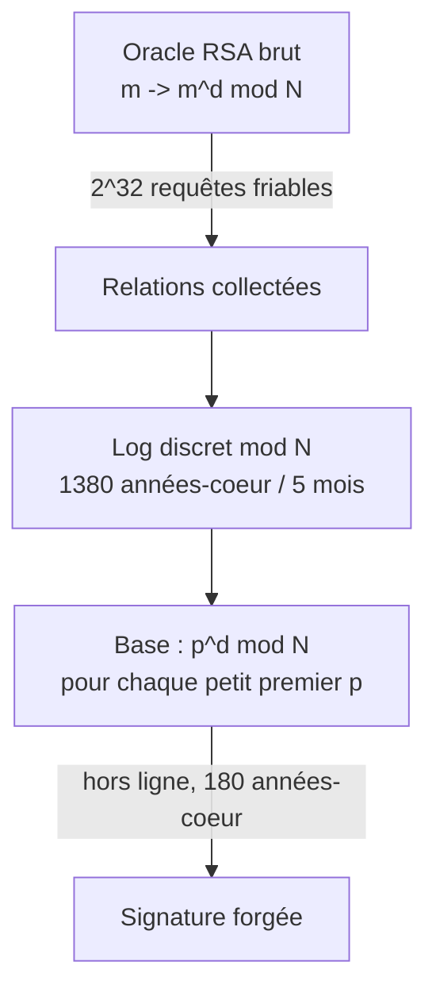
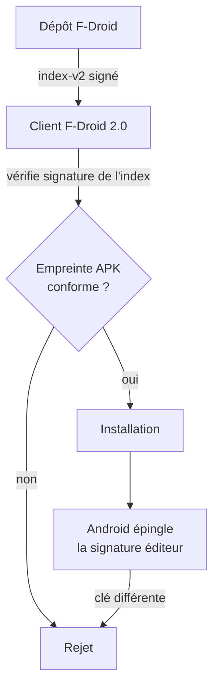

# Tech — Détail du vendredi 25 septembre 2026

## 1. CVE-2026-92973 — XSS wormable dans les logs de build de SourceHut via les séquences OSC 8

**Source :** Arusekk blog — https://blog.arusekk.pl/posts/srht-account-takeover/
**Date :** 24 septembre 2026

### Contexte

Une CI affiche les logs de build. Ces logs contiennent des séquences d'échappement ANSI : couleurs, gras, effacement de ligne. Pour les rendre dans un navigateur, il faut les traduire en HTML. `builds.sr.ht`, le service de CI de SourceHut, utilise pour ça la bibliothèque Python **`ansi2html`**.

Le problème n'est pas dans les séquences de couleur, que tout le monde connaît. Il est dans une extension plus récente et bien moins connue : **OSC 8**, l'hyperlien de terminal. Introduite pour que `ls --hyperlink` ou un runner de tests puisse produire un lien cliquable dans iTerm2 ou dans le terminal de GNOME, elle porte une URL arbitraire à l'intérieur du flux texte. `ansi2html` la traduit naturellement en balise `<a href="…">`.

Or dans une CI, **le contenu du log est contrôlé par l'attaquant**. Le nom d'une branche, le message d'un commit, la sortie d'un test, le nom d'un fichier — tout ce que ton build imprime. Et sur une forge publique, on n'a même pas besoin de compte pour déclencher un build sur certains dépôts.

### Comment ça marche

L'enchaînement tient en quatre étapes.

**Étape 1 — injecter.** L'attaquant fait apparaître dans la sortie de build une séquence OSC 8. Sa forme est `ESC ] 8 ; params ; URI ST`, où `ST` est le terminateur. L'URI est de longueur arbitraire et n'est pas structuré autrement que par ce terminateur.

**Étape 2 — sortir de l'attribut.** `ansi2html` assainissait insuffisamment cet URI avant de le placer dans l'attribut `href`. Un URI contenant un guillemet permet de **fermer l'attribut** et d'ouvrir d'autres attributs sur la même balise `<a>`. On ne sort pas de la balise, on n'a pas besoin : les attributs suffisent.

**Étape 3 — déclencher sans clic.** C'est le détail élégant, et méchant. L'attaquant n'injecte pas un `onclick`, qui exigerait une action de la victime. Il injecte **`onfocus`**, qui exécute du JavaScript dès que l'élément reçoit le focus, **plus `autofocus`**, qui demande au navigateur de donner le focus à cet élément automatiquement au chargement. Le simple affichage de la page exécute le code.

**Étape 4 — pivoter.** Le script s'exécute dans l'origine de la forge, avec la session du lecteur. Il peut lire et modifier ce que ce compte peut lire et modifier : clés SSH, jetons OAuth, dépôts, paramètres. Et comme ce compte peut lui aussi déclencher des builds dont les logs seront lus par d'autres, la propagation est automatique. C'est le sens de « wormable ».

```mermaid
sequenceDiagram
  participant A as Attaquant
  participant B as builds.sr.ht
  participant V as Victime (mainteneur)
  A->>B: commit dont la sortie contient ESC]8;;"...onfocus=... autofocus
  B->>B: ansi2html -> <a href="" onfocus=... autofocus>
  V->>B: consulte le log de build
  B-->>V: HTML avec l'attribut injecté
  V->>V: focus auto -> JS exécuté sous sa session
```

### En pratique — exemple de code

Le principe du défaut, réduit à sa forme minimale. Le premier bloc illustre la traduction naïve, le second la correction attendue.

```python
# Avant — l'URI OSC 8 atterrit dans href sans échappement des guillemets.
# Sortie : <a href="" onfocus="alert(document.cookie)" autofocus x="">lien</a>
import re
OSC8 = re.compile(r"\x1b]8;;(?P<uri>[^\x07\x1b]*)(?:\x07|\x1b\\)")

def render_naive(text: str) -> str:
    return OSC8.sub(lambda m: f'<a href="{m.group("uri")}">', text)

payload = '\x1b]8;;" onfocus="alert(document.cookie)" autofocus x="\x07lien'
print(render_naive(payload))
```

```python
# Après — deux verrous indépendants, à appliquer dans cet ordre.
from html import escape
from urllib.parse import urlparse

ALLOWED = {"http", "https", "mailto"}

def render_safe(text: str) -> str:
    def sub(m):
        uri = m.group("uri")
        # 1. Allowlist de schémas : coupe aussi javascript: et data:
        if urlparse(uri).scheme.lower() not in ALLOWED:
            return "<a>"
        # 2. Échappement contextuel : quote=True encode " et ', donc plus de sortie d'attribut
        return f'<a href="{escape(uri, quote=True)}" rel="nofollow noopener">'
    return OSC8.sub(sub, text)
```

```bash
# Vérifie ton exposition. Versions vulnérables : ansi2html < 1.9.4, builds.sr.ht < 0.105.1.
pip show ansi2html | grep -i version
pip install -U "ansi2html>=1.9.4"
```

### Pourquoi ça compte pour toi

Si tu rends la moindre sortie de commande en HTML — logs de CI, résultats de tests, diff, sortie de migration EF Core dans un back-office — tu as le même vecteur. La règle à retenir : **assainis au moment du rendu, pas à la capture**, et échappe toujours avec `quote=True` dans un contexte d'attribut. Vérifie aussi tes parsers ANSI maison : presque tous gèrent les codes SGR et ignorent OSC 8.

### Points de vigilance

- **La durée est le vrai scandale.** Le bug entre dans `ansi2html` upstream en septembre 2021, arrive sur l'instance phare de SourceHut via un paquet Alpine en février 2022, et reste exploitable environ quatre ans et demi. Une dépendance transitive « d'affichage » n'attire aucune attention en revue de sécurité.
- **Un CSP strict aurait cassé la chaîne.** Sans `unsafe-inline` dans `script-src`, un gestionnaire d'événement en attribut ne s'exécute pas. C'est ta défense en profondeur quand l'échappement rate.
- Les instances auto-hébergées de SourceHut doivent mettre à jour les deux paquets : corriger `builds.sr.ht` sans mettre à jour `ansi2html` ne suffit pas.

---

## 2. Forger des signatures RSA-1024 en temps quasi-SNFS, sans factoriser la clé

**Source :** IACR ePrint 2026/2131 — https://eprint.iacr.org/2026/2131.pdf
**Date :** 20 septembre 2026 (publication ePrint), annonce IACR du 22 septembre

### Contexte

Quand on dit « casser RSA », on pense factoriser le module public `N`. Pour une clé de 1024 bits, ça reste hors de portée à ce jour. Mais il existe un autre objectif, plus modeste en apparence et tout aussi destructeur en pratique : **obtenir la capacité permanente de forger des signatures** sans jamais récupérer la clé privée.

Un algorithme de 2007 de Joux, Naccache et Thomé décrit exactement ça. Il est resté largement sous le radar pendant presque vingt ans, faute d'implémentation à l'échelle. Laura Shea, Miro Haller, Adam Suhl et Nadia Heninger (UCSD) avec Emmanuel Thomé (INRIA Nancy) viennent de le mettre en œuvre pour de vrai, contre une clé RSA-1024 hébergée dans un HSM.

### Comment ça marche

Le point de départ est un **oracle RSA brut**. Un service qui, pour un entier `m` que tu fournis, te renvoie `m^d mod N` — l'exponentiation privée, sans padding, sans structure imposée. Historiquement on appelle ça « textbook RSA », et c'est exactement ce qu'on apprend à ne jamais exposer.

L'attaque en tire un accès temporaire pour bâtir un avantage permanent, en trois temps.

**Temps 1 — collecter des relations.** L'attaquant soumet à l'oracle un grand nombre de valeurs **friables** : des entiers dont tous les facteurs premiers sont petits, c'est-à-dire sous une borne fixée. Chaque réponse lui donne la signature brute d'un produit de petits premiers. Environ 2³² requêtes sont nécessaires.

**Temps 2 — résoudre le logarithme discret.** Les signatures collectées forment un système de relations sur le groupe multiplicatif modulo `N`. Le résoudre revient à reconstituer, pour chaque petit premier `p` de la base, la valeur `p^d mod N`. C'est le gros du calcul : **1 380 années-cœur CPU**, étalées du 13 mars au 31 août 2026, soit environ cinq mois de calendrier avec les interruptions de cluster. L'ordre de grandeur est proche du crible spécial de corps de nombres (SNFS), d'où le titre — mais nettement inférieur au coût d'une factorisation générale de RSA-1024.

**Temps 3 — forger hors ligne.** À partir de là, l'attaquant possède l'équivalent fonctionnel de la clé privée pour tout message dont il peut exprimer la représentation entière comme un produit de premiers de sa base. Forger une signature donnée lui coûte alors **180 années-cœur**, sans aucun accès à l'oracle. Il n'a jamais factorisé `N`.



### En pratique — exemple de code

La question utile n'est pas « comment attaquer », mais « est-ce que j'expose un oracle brut ». Voici la différence, côté .NET.

```csharp
// Avant — oracle RSA brut. Aucun padding, aucune structure : exactement la primitive attaquée.
// Ce motif apparaît dans les implémentations "maison" de signature aveugle et dans
// certains wrappers PKCS#11 qui exposent CKM_RSA_X_509.
public byte[] SignRaw(byte[] blob)
{
    using var rsa = RSA.Create();
    rsa.ImportFromPem(_privateKeyPem);
    // RSAEncryptionPadding.None => m^d mod N, sans plus.
    return rsa.Decrypt(blob, RSAEncryptionPadding.None);
}
```

```csharp
// Après — la primitive n'est jamais atteignable directement.
// PSS impose un encodage avec sel aléatoire : l'attaquant ne choisit pas l'entier signé,
// donc il ne peut pas soumettre les valeurs friables dont l'attaque a besoin.
public byte[] Sign(byte[] message)
{
    using var rsa = RSA.Create();
    rsa.ImportFromPem(_privateKeyPem);
    return rsa.SignData(message, HashAlgorithmName.SHA256,
                        RSASignaturePadding.Pss);
}
```

```bash
# Audit rapide : repère les clés RSA de 1024 bits encore vivantes dans ton parc.
openssl x509 -in cert.pem -noout -text | grep -E "Public-Key|Signature Algorithm"
# Et côté HSM : vérifie qu'aucun mécanisme brut (CKM_RSA_X_509) n'est autorisé par la politique.
```

### Pourquoi ça compte pour toi

Pas de panique généralisée : si ton RSA sert derrière TLS ou des certificats, tu utilises PKCS#1 v1.5 ou PSS, et aucun oracle brut n'est exposé. Les clés 2048 bits utilisées ainsi ne sont pas menacées. Ce qui doit t'alerter, c'est un mécanisme RSA brut encore activé dans une politique HSM, ou une signature aveugle maison. Passe en revue tes interfaces PKCS#11 et retire `CKM_RSA_X_509` s'il traîne.

### Limites

- L'attaque **ne factorise pas** RSA-1024. Matthew Green l'a rappelé publiquement : c'est une implémentation de l'algorithme de 2007, pas une percée en factorisation.
- Les cas réellement exposés restent étroits : signatures RSA aveugles (comme dans Privacy Pass) et interfaces HSM acceptant l'opération RSA brute.
- Le coût reste considérable — 1 380 années-cœur ne sont pas à la portée d'un attaquant opportuniste — mais il est désormais **mesuré**, pas théorique. Et il ne fera que baisser.

---

## 3. F-Droid 2.0 — la refonte complète arrive pendant que Google verrouille le sideloading

**Source :** F-Droid — https://f-droid.org/en/2026/09/24/f-droid-2.0-a-new-chapter-for-android-freedom.html
**Date :** 24 septembre 2026

### Contexte

F-Droid est le dépôt d'applications libres d'Android. Son client officiel traînait une base de code vieillissante, héritée d'une décennie d'accumulation. Après plus d'un an de travail, le projet publie **F-Droid 2.0**, sa mise à jour la plus significative depuis dix ans : refonte de l'interface et remplacement du code legacy par **Kotlin Compose**, avec pour objectif une base plus rapide et surtout plus maintenable.

Le calendrier n'est pas neutre. La sortie tombe alors que Google durcit ses règles autour de l'installation d'applications hors Play Store, en particulier via un dispositif de vérification des développeurs. F-Droid 2.0 est donc à la fois une mise à jour technique et un positionnement.

### Comment ça marche

Deux plans à distinguer : ce qui change dans l'app, et le modèle de confiance qui la sous-tend et qui, lui, ne change pas.

**Ce qui change.** La navigation se replie sur **trois onglets** — Discover, Search, My Apps — là où l'ancienne app dispersait les entrées. La découverte et l'installation sont annoncées comme plus directes, les catégories plus utiles, la recherche améliorée. Techniquement, le passage à Compose supprime une couche de vues XML et de code de liaison manuel, ce qui explique le gain de maintenabilité revendiqué.

**Le changement de comportement le plus notable** est la **mise à jour automatique activée par défaut**. Ce n'est pas un réglage cosmétique : c'est une décision de sécurité, et le projet indique l'avoir prise après un audit mené par le Security Lab de l'Open Technology Fund et par Convocation. La logique est celle du compromis classique : une app non mise à jour reste vulnérable plus longtemps qu'une app mise à jour automatiquement n'est exposée à une mauvaise version.

**Ce qui ne change pas**, et qu'il faut comprendre pour situer l'enjeu, c'est la chaîne de confiance d'un dépôt d'applications Android. Elle repose sur deux signatures distinctes. L'**index du dépôt** est signé par la clé du dépôt : le client vérifie cette signature avant de croire quoi que ce soit de la liste d'apps et des empreintes qu'elle annonce. Puis chaque **APK** porte la signature de son éditeur, et Android **épingle** cette signature : une mise à jour signée par une autre clé est refusée par le système, pas par le client. C'est ce double verrou qui rend une mise à jour automatique acceptable.



### En pratique — exemple de code

Le point d'entrée concret pour un développeur, c'est la publication de sa propre app dans un dépôt. Le fichier `config.yml` de `fdroidserver` décrit le dépôt, et la clé de signature de l'index est ce que tes utilisateurs feront confiance.

```yaml
# config.yml — la clé référencée ici signe l'index du dépôt.
# Sa compromission permettrait d'annoncer de fausses empreintes : traite-la comme une clé de release.
repo_url: "https://exemple.org/fdroid/repo"
repo_name: "Dépôt interne"
repo_description: "Builds internes, distribution hors Play Store."

keystore: "/secrets/keystore.p12"
repo_keyalias: "index-signing"
keystorepass: {env: KEYSTORE_PASS}
keypass: {env: KEY_PASS}
```

```bash
# Publier : on dépose les APK, on régénère l'index, on le signe, on synchronise.
cp build/outputs/apk/release/*.apk /srv/fdroid/repo/
fdroid update --create-metadata     # lit les APK, calcule les empreintes, écrit index-v2
fdroid deploy                       # pousse le dépôt signé vers l'hébergement

# Côté poste de travail, avant toute confiance : vérifie l'empreinte de l'APK que tu distribues.
apksigner verify --print-certs /srv/fdroid/repo/monapp-1.4.0.apk
```

### Pourquoi ça compte pour toi

Si tu distribues une app Android en interne ou hors Play Store, la question de la vérification développeur va te tomber dessus. Regarde maintenant comment tu signes et comment tes utilisateurs vérifient : clé d'index côté dépôt, clé de release côté APK, et épinglage Android par-dessus. C'est le même raisonnement que la signature NuGet côté .NET — allowlist de clés, rotation planifiée, et surtout pas de clé unique partagée entre les deux rôles.

### Points de vigilance

- **La mise à jour automatique par défaut change ton modèle de menace** si tu héberges un dépôt : une version poussée par erreur se propage désormais sans validation humaine côté utilisateur. Blinde ton pipeline de release en conséquence.
- Les chiffres de performance de la refonte Compose ne sont pas détaillés dans l'annonce. Évite de les citer tant qu'ils ne sont pas publiés.
