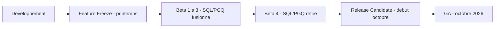
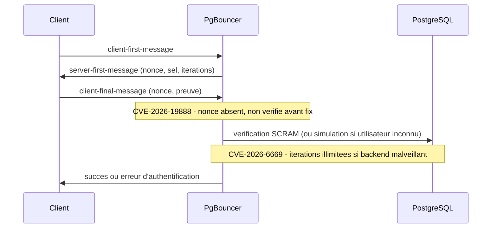

# Tech — Détail du dimanche 27 septembre 2026

## 1. PostgreSQL 19 Beta 4 — SQL/PGQ et quatre autres fonctionnalités repoussées pour tenir le calendrier

**Source :** PostgreSQL Global Development Group — https://www.postgresql.org/about/news/postgresql-19-beta-4-released-3386/
**Date :** 24 septembre 2026

### Contexte

PostgreSQL suit un cycle annuel strict : gel des fonctionnalités au printemps, puis une série de bêtas jusqu'à l'automne, une release candidate, et la GA. La bêta 4, sortie le 24 septembre, vise une GA en octobre 2026. Ce qui la rend notable, ce n'est pas ce qu'elle ajoute, mais ce qu'elle retire : SQL/PGQ (les requêtes de graphes du standard SQL:2023), l'activation en ligne des checksums de données, la clause `FOR PORTION OF` pour les mises à jour temporelles, `ALTER TABLE ... MERGE/SPLIT PARTITIONS`, et trois fonctions `pg_get_role_ddl()` / `pg_get_tablespace_ddl()` / `pg_get_database_ddl()`.

Ces fonctionnalités avaient pourtant déjà été fusionnées dans les bêtas précédentes. Leur retrait en bêta 4 n'est pas un simple report de roadmap : c'est le comité de développement qui juge, après revue communautaire plus poussée, qu'elles ne sont pas assez mûres pour être gelées définitivement dans une version majeure — et préfère les repousser plutôt que de livrer une API instable qu'il faudrait ensuite maintenir pendant des années.

### Comment ça marche

Le mécanisme à comprendre ici, c'est que chez PostgreSQL, le « feature freeze » du printemps ne veut pas dire feature *finale* : tant que la version n'a pas atteint la RC, une fonctionnalité déjà mergée peut être totalement retirée si la revue de code ou les tests communautaires remontent des soucis de conception. C'est arrivé à SQL/PGQ : la syntaxe `GRAPH_TABLE` permettait d'exprimer des parcours de graphe (ex. « amis d'amis ») de façon déclarative directement en SQL, sans dépendre d'une base de données graphe dédiée — mais des angles morts de conception ont été identifiés trop tard pour un gel propre cette année.



### En pratique — exemple de code

```sql
-- AVANT (prévu pour PostgreSQL 19, retiré en bêta 4) :
-- syntaxe déclarative SQL/PGQ pour un parcours de graphe à 2 sauts
SELECT * FROM GRAPH_TABLE (social_graph
    MATCH (a IS person WHERE a.name = 'Alice')
          -[IS follows]->(b IS person)
          -[IS follows]->(c IS person)
    COLUMNS (b.name AS friend, c.name AS friend_of_friend)
);

-- APRÈS (ce qu'il faut écrire tant que SQL/PGQ n'est pas disponible) :
-- même résultat via une CTE récursive classique, avec gestion manuelle
-- de la profondeur et des jointures explicites
WITH RECURSIVE friend_chain AS (
    SELECT u1.id, u2.id AS friend_id, u2.name AS friend_name, 1 AS depth
    FROM users u1
    JOIN follows f1 ON u1.id = f1.follower_id
    JOIN users u2 ON f1.followed_id = u2.id
    WHERE u1.name = 'Alice'
    UNION ALL
    SELECT fc.id, u3.id, u3.name, fc.depth + 1
    FROM friend_chain fc
    JOIN follows f2 ON fc.friend_id = f2.follower_id
    JOIN users u3 ON f2.followed_id = u3.id
    WHERE fc.depth < 2
)
SELECT DISTINCT friend_name FROM friend_chain WHERE depth = 2;
```

### Pourquoi ça compte pour toi

Ne mise pas de migration ou de code applicatif sur la syntaxe SQL/PGQ tant que tu n'as pas vu passer la GA de PostgreSQL 19 — la CTE récursive reste le chemin portable et stable aujourd'hui. Le glissement du calendrier (GA en octobre, pas fin septembre) impacte aussi ta planification si tu comptais migrer dès la sortie.

### Pour aller plus loin

La bêta 4 apporte aussi des correctifs plus discrets mais utiles en prod : de meilleures performances sur la vérification des contraintes de clé étrangère, des corrections sur la nouvelle commande `REPACK`, un score d'autovacuum affiné, et un correctif SIMD sur `COPY FROM`. Détails complets : https://www.postgresql.org/docs/19/release-19.html

---

## 2. PgBouncer 1.26.0 — un message SCRAM sans nonce suffit à planter le pooler sans authentification

**Source :** PostgreSQL Global Development Group (annonce PgBouncer) — https://www.postgresql.org/about/news/pgbouncer-1260-released-fixes-three-cves-3385/
**Date :** 23 septembre 2026

### Contexte

PgBouncer est le pooler de connexions le plus déployé devant PostgreSQL : que ton stack soit Symfony/Doctrine ou C#/EF Core via Npgsql, il évite d'épuiser les connexions natives de Postgres quand ton application en ouvre beaucoup (serverless, microservices, forte concurrence). Le 23 septembre, le projet a publié la version 1.26.0, qui corrige trois CVE découvertes dans le mécanisme d'authentification SCRAM-SHA-256 — le protocole standard utilisé entre client, pooler et serveur Postgres.

Point notable : PgBouncer simule une négociation SCRAM complète même pour des identifiants qui n'existent pas, afin d'éviter qu'un attaquant ne déduise la liste des utilisateurs valides par une différence de comportement (une protection classique contre le « user enumeration »). C'est justement ce chemin de simulation qui contenait le bug le plus sérieux des trois.

### Comment ça marche

Le handshake SCRAM se déroule en trois messages : le client envoie un `client-first-message`, le serveur répond avec un nonce, un sel et un nombre d'itérations, puis le client renvoie un `client-final-message` prouvant qu'il connaît le mot de passe. Les trois CVE de PgBouncer 1.26.0 touchent chacune une étape différente de cet échange.

CVE-2026-19888 : PgBouncer ne vérifiait pas que le `client-final-message` contenait bien un nonce — un attaquant non authentifié pouvait donc envoyer un message malformé et faire planter le processus, y compris via le chemin de simulation pour utilisateur inexistant. CVE-2026-6668 : un dépassement d'entier dans l'agrandissement du buffer de paquets pouvait, en envoyant un paquet volumineux avant la fin de l'authentification, déclencher une boucle infinie — critique car PgBouncer est mono-thread, donc ça bloque tous les clients d'un coup, pas seulement l'attaquant. CVE-2026-6669 : PgBouncer acceptait un nombre d'itérations SCRAM illimité renvoyé par le serveur Postgres ; un serveur backend compromis ou malveillant pouvait ainsi forcer un calcul de hachage interminable à chaque connexion.



### En pratique — exemple de code

```c
// AVANT (schema simplifie du bug CVE-2026-19888) :
// le champ nonce n'est jamais verifie avant utilisation
parse_client_final_message(msg);
verify_proof(msg.proof, stored_key);  // msg.nonce peut etre absent -> crash

// APRES (correctif 1.26.0) :
parse_client_final_message(msg);
if (msg.nonce == NULL || msg.nonce_len == 0) {
    reject_auth("nonce manquant dans client-final-message");
    return;
}
verify_proof(msg.proof, stored_key);
```

```ini
; pgbouncer.ini - aucun changement de config requis pour corriger les CVE,
; mais verifie que ce plafond reste raisonnable sur une instance exposee
max_packet_size = 2147483647   ; valeur par defaut avant le correctif de l'overflow
```

### Pourquoi ça compte pour toi

Si tu fais tourner PgBouncer devant un cluster Postgres, un attaquant non authentifié pouvait jusqu'ici planter le pooler pour tous tes clients avec un seul paquet forgé — aucun accès valide requis. Mets à jour vers 1.26.0 sans attendre ; aucun changement de configuration n'est nécessaire pour bénéficier du correctif.

### Pièges

CVE-2026-6669 ne te protège que si ton propre serveur Postgres est compromis ou malveillant (défense en profondeur) — ce n'est pas exploitable depuis un simple client. Le changement de gestion du `search_path` mentionné dans la même release est une fonctionnalité séparée, sans lien avec ces correctifs de sécurité.
