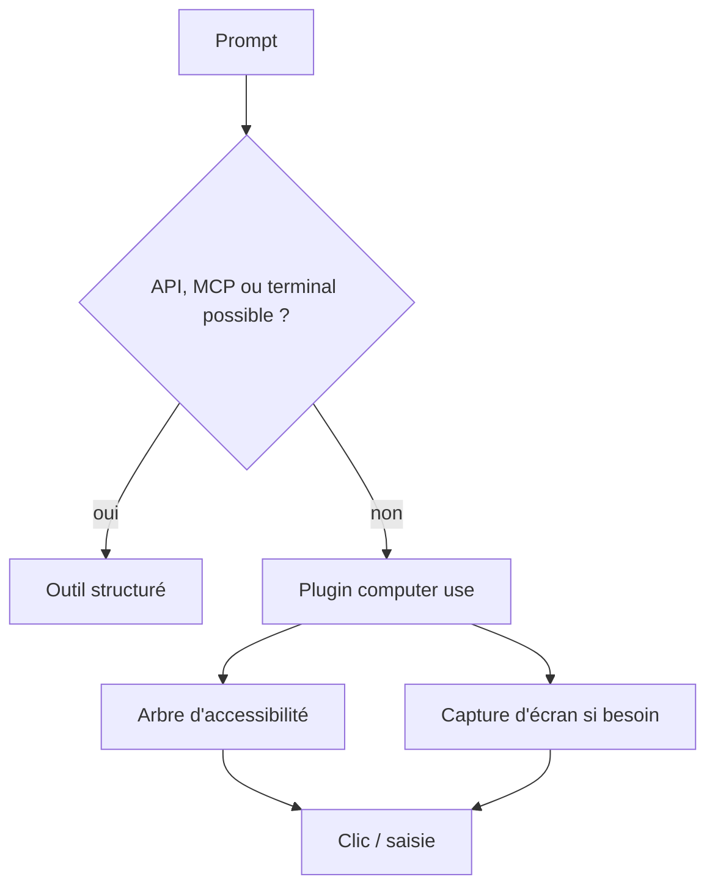
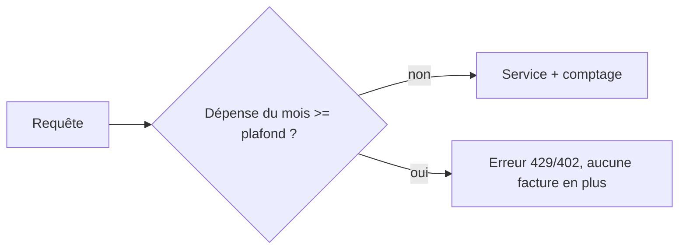

# Tech — Détail du dimanche 4 octobre 2026

## 1. GitHub Copilot « computer use » — piloter une application sans API, en dernier recours

**Source :** The New Stack — https://thenewstack.io/github-copilot-computer-use-desktop/
**Date :** 2 octobre 2026

### Contexte

Certains logiciels n'ont ni API ni serveur MCP : outils métier, applications de bureau anciennes. GitHub lance en préversion publique le computer use dans Copilot, sur macOS et Windows. L'agent peut lire du contenu, cliquer, taper, défiler et glisser dans ces applications.

### Comment ça marche

L'implémentation est un plugin livré avec son propre serveur MCP. Il s'appuie sur l'arbre d'accessibilité du système d'exploitation : chaque bouton, champ ou menu y est exposé comme un nœud avec un nom, un rôle et une valeur. L'agent lit cet arbre pour décider où agir, et déclenche des captures d'écran seulement quand le contexte visuel est nécessaire, pour les sessions locales.

La différence avec un modèle « vision pure » est nette. L'arbre d'accessibilité donne une structure fiable ; la capture d'écran sert de complément. C'est plus économe et plus précis que de deviner des pixels, sans éliminer les erreurs.

Le contrôle d'accès est explicite. Sur macOS, il faut accorder les autorisations Accessibilité et Enregistrement d'écran. La commande `/permissions show` affiche les accès de la session, et les approbations peuvent être temporaires ou permanentes. Les politiques d'entreprise prennent le dessus sur les réglages locaux via `managed-settings.json`.

Le plus notable est le conseil de GitHub : si une API, un serveur MCP, une commande de terminal, un outil de fichiers ou un outil de navigateur dédié suffit, il fournit des informations plus structurées et des résultats plus prévisibles. Le computer use est un repli.



### En pratique — exemple de code

Seule commande citée par la source : l'inspection des permissions. Le fichier de politique d'entreprise existe, mais son schéma n'est pas détaillé, donc rien n'est inventé ici.

```bash
  # Dans une session Copilot : voir ce que l'agent a le droit de faire
/permissions show
  # Les approbations peuvent être temporaires (session) ou permanentes.
  # Une politique d'entreprise dans managed-settings.json l'emporte
  # sur ces réglages locaux.
```

### Pourquoi ça compte pour toi

Réserve ce mode aux applications sans interface programmable, et préfère un serveur MCP ou un script quand c'est possible. Ce que l'écran affiche devient visible pour l'agent : ferme les données sensibles avant de lancer une session.

### Limites

GitHub reconnaît des difficultés avec les changements de timing, les interfaces dynamiques et les workflows longs. L'agent peut cliquer sur le mauvais contrôle ou remplir le mauvais champ.

---

## 2. Plafonds de dépense durs par défaut — la thèse de Simon Willison

**Source :** Simon Willison — https://simonwillison.net/2026/Oct/3/default-hard-budget-caps/
**Date :** 3 octobre 2026

### Contexte

Les services facturés à l'usage (API de modèles, cloud, bases managées) offrent des alertes de budget. Avec des agents de code qui bouclent sans surveillance, une alerte envoyée par e-mail arrive après la facture. Simon Willison demande des limites par défaut sur « pratiquement tout ».

### Comment ça marche

Sa règle tient en une phrase : après X par mois, couper le service et renvoyer des erreurs. Il insiste sur le mot « dur » : un plafond souple, qui envoie seulement un avertissement, ne suffit pas.

La différence est une question de boucle de contrôle. Un plafond souple est asynchrone : la facturation agrège avec retard, un e-mail part, un humain doit réagir. Un plafond dur est synchrone avec l'autorisation : le fournisseur refuse la requête suivante dès que le total atteint le seuil. Il faut donc que le fournisseur compte la dépense quasi en temps réel.

Pour l'utilisateur, le plafond devient une valeur par défaut raisonnable plutôt qu'une option cachée, que l'on relève consciemment. Le coût d'une boucle d'agent défaillante est alors borné par construction. La source citée ne détaille pas d'incident précis, seulement le risque des agents et des API non contrôlées.



### En pratique — exemple de code

Tu peux appliquer l'idée toi-même devant une API payante, avec un garde-fou côté .NET (code d'illustration, pas une fonctionnalité d'un fournisseur) :

```csharp
// Garde-fou : refuse l'appel quand le plafond mensuel est atteint
public sealed class HardBudgetHandler(IBudgetStore store, decimal capEur)
    : DelegatingHandler
{
    protected override async Task<HttpResponseMessage> SendAsync(
        HttpRequestMessage req, CancellationToken ct)
    {
        if (await store.SpentThisMonthAsync(ct) >= capEur)
            return new HttpResponseMessage(HttpStatusCode.PaymentRequired); // coupe net

        var res = await base.SendAsync(req, ct);
        await store.AddAsync(EstimateCost(res), ct); // comptage de la dépense
        return res;
    }
    static decimal EstimateCost(HttpResponseMessage r) => 0.01m; // à adapter
}
```

### Pourquoi ça compte pour toi

Avant de lancer un agent sur une clé d'API, fixe un plafond dur côté fournisseur s'il existe, sinon dans ton propre proxy. Une clé dédiée par agent limite aussi les dégâts.

### Limites

Un plafond dur peut couper un service légitime en pleine production : prévois une marge et une alerte en amont. Le billet est une prise de position, pas une spécification technique.
