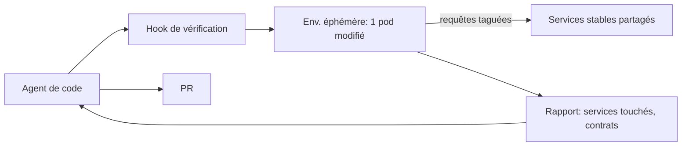
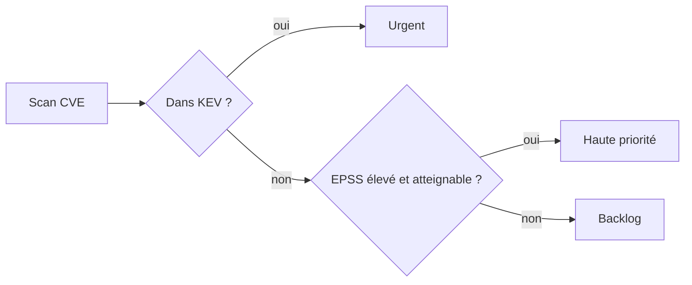

# Tech — Détail du lundi 5 octobre 2026

## 1. CI et agents de code — déplacer la vérification dans la boucle de l'agent

**Source :** The New Stack (Arjun Iyer, Signadot) — https://thenewstack.io/ci-bottleneck-agent-verification/
**Date :** 4 octobre 2026

### Contexte

Quand des agents de code produisent des PR en parallèle, la CI devient le goulot. L'auteur, CEO de Signadot (qui vend ce type d'outil, garde cela en tête), cite des chiffres : un volume de jobs CI multiplié par 25 chez Anthropic en six mois, environ 8 × plus de code livré par trimestre qu'en 2021-2025, la suite de tests de Linear presque quadruplée depuis janvier. DORA associerait davantage d'IA à plus de débit, mais aussi à plus d'instabilité.

### Comment ça marche

L'argument : accélérer les pipelines soigne le symptôme. Deux effets se cumulent. Un effet de volume, car plusieurs agents en parallèle font croître le nombre de PR de façon multiplicative. Et un découplage temporel, car une boucle de feedback CI de 20 minutes casse le contexte d'un agent qui itère.

Plus important, la CI vérifie un dépôt isolé alors que les vrais défauts vivent « dans les coutures » : un champ renommé dans une réponse, un consommateur en aval qui le lit encore. Test impact analysis, runners plus rapides et caches ne changent pas cela.

La proposition en trois temps : (1) des environnements de test multiplexés, avec une version stable partagée de tous les services dans un cluster Kubernetes et, par-dessus, des environnements éphémères légers où seul le service modifié est déployé ; les requêtes taguées lui sont routées, les autres appels vont vers les versions stables, pour un coût proche d'un pod et un démarrage en secondes ; (2) des hooks de vérification gouvernés, séquences de validation approuvées par l'équipe plateforme et appelées par l'agent comme des outils ; (3) une vérification avant PR, contre de vraies dépendances distribuées, dans la boucle de l'agent.



### En pratique — exemple de code

Illustration du routage par en-tête, non issue du billet (le mécanisme exact dépend de l'outil) :

```yaml
# Illustratif : pod modifié + règle de routage par en-tête
# Les requêtes portant x-sandbox: agent-42 vont vers le pod modifié.
# Toutes les autres vont vers le déploiement stable.
apiVersion: v1
kind: ConfigMap
metadata:
  name: sandbox-routes
data:
  routes.yaml: |
    - header: "x-sandbox: agent-42"
      service: orders
      target: orders-agent-42   # pod éphémère
    - default: orders-stable
```

```bash
# Hook appelé par l'agent avant d'ouvrir la PR
curl -H "x-sandbox: agent-42" https://staging.interne/orders/health
```

### Pourquoi ça compte pour toi

Si tes équipes .NET ou Symfony adoptent des agents, le test d'intégration pré-PR deviendra le vrai point de friction. Un environnement par pod, routé par en-tête, coûte moins qu'une copie complète du système. Mesure d'abord où ta CI attend vraiment.

### Limites

Les chiffres viennent d'un éditeur du domaine. Le billet liste d'autres approches (test impact analysis, sandboxes) sans les départager de façon chiffrée.

---

## 2. Gestion des vulnérabilités — sortir du « CVE theater » avec l'atteignabilité et KEV/EPSS

**Source :** The New Stack (Russ Andersson, RapidFort) — https://thenewstack.io/cve-vulnerability-risk-management/
**Date :** 3 octobre 2026

### Contexte

L'auteur, COO de RapidFort (autre éditeur concerné), affirme que le modèle classique « scanner, noter par CVSS, corriger par ordre de sévérité » ne suit plus l'exploitation accélérée par l'IA. Le billet ne chiffre pas le délai d'exploitation ; il affirme seulement que le temps nécessaire pour développer un exploit diminue.

### Comment ça marche

Le défaut central : CVSS mesure l'impact technique, pas le risque d'une organisation donnée. La même CVE ne pèse pas pareil selon qu'elle est exposée ou non, atteignable ou non, exécutée en production ou non. L'auteur appelle « CVE theater » le fait de mesurer l'activité (nombre de CVE fermées) plutôt que la réduction de risque.

Il propose six leviers : réduire l'entrée (images de base durcies, bibliothèques maîtrisées, SAST) ; évaluer la configuration (scan STIG) ; scanner la production en continu comme source de vérité ; déterminer l'atteignabilité réseau et chemin de code ; intégrer le renseignement de menace (catalogue CISA KEV, scores EPSS) ; prioriser selon l'exposition, l'impact métier et la durée de vie.



### En pratique — exemple de code

Exemple illustratif, utilisant les sources publiques CISA KEV et l'API EPSS de FIRST :

```python
import requests

KEV = requests.get(
    "https://www.cisa.gov/sites/default/files/feeds/known_exploited_vulnerabilities.json"
).json()
kev_ids = {v["cveID"] for v in KEV["vulnerabilities"]}

def priority(cve: str, reachable: bool) -> str:
    if cve in kev_ids:
        return "urgent"                     # exploitation connue
    r = requests.get("https://api.first.org/data/v1/epss", params={"cve": cve}).json()
    epss = float(r["data"][0]["epss"]) if r["data"] else 0.0
    return "haute" if (epss > 0.1 and reachable) else "backlog"
```

Le seuil EPSS 0,1 est arbitraire : ajuste-le à ton contexte.

### Pourquoi ça compte pour toi

Sur tes dépôts NuGet, npm et Composer, le bruit d'un audit brut est énorme. Croiser KEV, EPSS et l'atteignabilité réelle (le code appelle-t-il la fonction vulnérable ?) réduit la liste à ce qui compte, et le rapport de septembre sur les CVE .NET reste un bon exemple de cas où l'audit ne voit pas tout.

### Limites

Le billet reste conceptuel et ne donne aucune statistique. L'atteignabilité est difficile à établir sans outillage dédié, que l'auteur vend.
